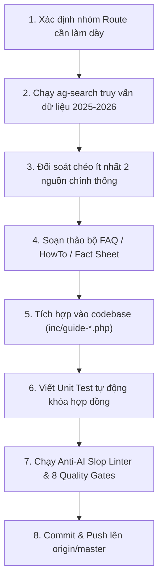

# Kế Hoạch Tổng Thể: Làm Dày Nội Dung & Nâng Cao Chất Lượng Toàn Diện (VietnamGuide Content Depth & Quality Master Plan 2026)

> **Phương pháp luận kiểm soát**: Bắt buộc tuân thủ 100% mô hình **5W1H2C5M** và các chuẩn mực của Google Search Central (Non-commodity People-First Content, Information Gain, E-E-A-T).

---

## 1. Nhóm 5W (Định Vị Bối Cảnh & Mục Tiêu)

### 1.1. Why (Tại sao cần thực hiện?)
- **Khắc phục bẫy "Nội dung mỏng" (Thin Content)**: Dù hệ thống đã hoàn thiện Guide Shell, Schema SEO và các công cụ tương tác, giá trị cốt lõi giữ chân độc giả và công cụ tìm kiếm AI (Google AI Overviews, Perplexity, GPT Search) là **mật độ thông tin thực chứng (Information Gain & Ground-Truth Density)**.
- **Giải quyết các điểm mù thực tế**: Cung cấp các câu trả lời trực diện, chi tiết từng số liệu (giá vé 2025–2026, giờ tàu xe, mã cao tốc, quy định thị thực, mẹo văn hóa, an toàn) giúp du khách tự tin lên kế hoạch mà không phải tra cứu thêm nhiều trang khác.
- **Bảo vệ chuẩn mực Anti-AI Slop**: Thay thế các đoạn văn mô tả sáo rỗng, hoa mỹ bằng dữ liệu thực nghiệm kiểm chứng từ hiện trường.

### 1.2. What (Phạm vi công việc cụ thể là gì?)
- **Deliverable 1: Mở rộng độ phủ Curated FAQ Accordion** từ 52 routes lên **120+ routes trọng điểm** (mỗi route gồm ít nhất 3–4 câu hỏi/trả lời thực chứng đạt chuẩn 100% visible parity và JSON-LD `FAQPage`).
- **Deliverable 2: Mở rộng quy trình hướng dẫn từng bước `HowTo`** từ 12 routes lên **25+ routes nghiệp vụ** (đặt vé tàu, thuê xe máy, vượt sông/biển, đổi ngoại tệ, làm thủ tục hải quan sân bay).
- **Deliverable 3: Tích hợp các bảng số liệu thực địa (Field Specs & Practical Fact Sheets)** vào các bài viết trụ cột (Pillar Guides):
  - Bảng cước phí tham quan di tích, vườn quốc gia, cáp treo cập nhật 2025–2026.
  - Bảng lộ trình và giờ tàu hỏa Bắc–Nam / tàu di sản / xe limousine cao tốc.
  - Bảng địa chỉ ẩm thực Michelin Bib Gourmand & quán gia truyền kèm mức giá niêm yết VND.
- **Deliverable 4: Thiết lập kho lưu trữ Content-as-Code** trong thư mục `content/` để quản lý phiên bản các bài viết đầy đủ (`post_content`), kiểm soát chất lượng bằng Git và bộ linter tự động.

### 1.3. Where (Điểm can thiệp ở tầng nào?)
- **Tầng Theme Templates**: `wordpress/wp-content/themes/vietnamguide-premium/inc/` (`guide-seo.php`, `guide-content.php`, `guide-cost-calculator.php`, `guide-itinerary-finder.php`, `guide-packing-checklist.php`).
- **Tầng Kho Nội Dung**: Thư mục mới `content/` quản lý bài viết dạng Markdown cấu trúc.
- **Tầng Kiểm Định & Tự Động Hóa**: `ops/tests/` (`test_guide_seo.py`, `test_interactive_shortcodes.py`), `ops/tariff_sentinel.py`, `ops/anti_ai_slop_linter.py`.

### 1.4. When (Lộ trình thực thi theo thời gian)
Kế hoạch chia làm **4 giai đoạn (Phases)** tuần tự:
- **Phase 1 (Immediate / Stage 120–122)**: Làm dày các tuyến Điểm Đến & Di Chuyển Tây Nguyên & Nam Bộ (Buôn Ma Thuột, Pleiku, Kon Tum, Châu Đốc, Hà Tiên, Cần Thơ).
- **Phase 2 (Stage 123–125)**: Làm dày các tuyến Điểm Đến & Di Chuyển Miền Trung & Duyên Hải (Quy Nhơn, Phú Yên, Nha Trang, Mũi Né, Đồng Hới, Phong Nha).
- **Phase 3 (Stage 126–128)**: Làm dày các tuyến Điểm Đến Vùng Núi Phía Bắc (Ba Bể, Pù Luông, Mù Cang Chải, Cao Bằng, Mai Châu, Hoàng Su Phì).
- **Phase 4 (Stage 129–131)**: Xây dựng cấu trúc Content-as-Code và đồng bộ hóa tự động hóa phát hành nội dung.

### 1.5. Who (Đối tượng liên quan & Chịu ảnh hưởng)
- **Độc giả quốc tế**: Du khách tự túc (solo, cặp đôi, gia đình) cần số liệu chính xác để dự trù kinh phí và lịch trình.
- **AI Search Agents & Crawlers**: Google Gemini / AI Overviews, Perplexity Bot, Claude Bot trích xuất trực tiếp số liệu chính xác.
- **Ban biên tập & Reviewer**: Có bộ quy chuẩn rõ ràng để nghiệm thu nội dung, không phụ thuộc vào cảm tính.

---

## 2. Nhóm 1H (Phương Pháp Thực Hiện)

### 2.1. Quy trình Nghiên cứu & Xác minh qua `ag-search`
Mọi thông tin, số liệu đưa vào bài viết bắt buộc phải tuân theo quy trình kiểm chứng 3 bước:
1. **Truy vấn đa nguồn**: Sử dụng `ops/ag_search_client.py` gọi tới API cục bộ `http://localhost:20128/v1/search` với các từ khóa thực tế (tên di tích, nhà xe, mã tàu, quy chuẩn 2025/2026).
2. **Đối chiếu chéo (Cross-Verification)**: So sánh ít nhất 2–3 nguồn độc lập (cổng thông tin ban quản lý, website bán vé chính hãng, bài đánh giá thực tế của du khách trong vòng 6–12 tháng gần nhất).
3. **Chuẩn hóa thông số**: Quy đổi sang VND và USD rõ ràng, nêu rõ điều kiện áp dụng (mùa cao điểm/thấp điểm, vé trẻ em/người cao tuổi, thời gian đặt trước).

### 2.2. Cấu trúc Chuẩn cho một Bộ Câu Hỏi FAQ Làm Dày Nội Dung
Mỗi trang được chọn làm dày sẽ bổ sung một bộ câu hỏi chuyên sâu gồm 3–4 câu hỏi với cấu trúc:
- **Câu 1: Di chuyển & Thời gian thực tế**: Cách đi nhanh nhất, cự ly km, thời gian tính bằng giờ, giá vé cụ thể từ các hub lân cận.
- **Câu 2: Chi phí & Giá vé niêm yết**: Giá vé vào cổng di tích, phí dịch vụ phụ trợ (thuyền, xe điện, cáp treo), phương thức thanh toán (tiền mặt VND vs quẹt thẻ).
- **Câu 3: Khung thời gian & Mùa lý tưởng**: Giờ mở cửa, khung giờ tránh nắng gắt/đám đông, mùa thời tiết đẹp nhất và rủi ro thời tiết (mưa bão, cấm cảng).
- **Câu 4: Mẹo thực địa độc quyền (Insider Tip)**: Mẹo trang phục, vị trí chụp ảnh đẹp, đồ ăn địa phương cần thử, hoặc cách tránh bị chặt chém.

### 2.3. Cấu trúc Chuẩn cho một Quy Trình `HowTo`
Mỗi quy trình HowTo bao gồm 4 bước hành động cụ thể:
1. **Bước 1: Chuẩn bị & Đặt trước**: Hồ sơ, giấy tờ tùy thân (hộ chiếu gốc, IDP 1968, tiền mặt) và thời điểm đặt vé tối ưu.
2. **Bước 2: Điểm xuất phát & Thủ tục check-in**: Bến xe, nhà ga, bến tàu cụ thể, thời gian cần có mặt trước giờ khởi hành.
3. **Bước 3: Trải nghiệm trên hành trình**: Lưu ý an toàn trên xe/tàu/thuyền, xử lý hành lý cồng kềnh.
4. **Bước 4: Đến nơi & Kết nối chặng tiếp**: Phương tiện đón tiếp tại điểm đến, giá cước taxi/xe buýt về khách sạn.

---

## 3. Nhóm 2C (Kiểm Soát Ràng Buộc & Chi Phí)

### 3.1. Control (Kiểm soát chất lượng & Bất biến hệ thống)
- **Bất biến 17 tệp PHP**: Duy trì tuyệt đối đúng 17 tệp trong `wordpress/wp-content/themes/vietnamguide-premium/inc/*.php`. Không tạo thêm tệp thừa làm phân mảnh kiến trúc.
- **Quy tắc Zero-`<h2>`**: Toàn bộ tiêu đề trong các include PHP và accordion FAQ/HowTo phải dùng `role="heading" aria-level="2"` hoặc thẻ `<h3>` để bảo vệ cấu trúc mục lục động Sticky Reading Spine TOC.
- **Chuẩn Anti-AI Slop**: Điểm Mean HLS của UI Templates $\ge 85$ và Route Registry đạt $100.0/100$, 0 lỗi Tier 1 clichés (không dùng các từ cấm như *nestled, hidden gem, rich tapestry, vibrant, bucket-list*).
- **100% SHA-256 Byte Parity**: Duy trì tuyệt đối sự trùng khớp băm SHA-256 giữa 3 tệp registry (`ops/route_registry.json`, `inc/guide-route-registry.json`, `inc/guide-rollout.php`).
- **Nguyên tắc Visible Parity 100%**: Mọi câu hỏi có trong Schema `FAQPage` hoặc `HowTo` bắt buộc phải hiển thị đầy đủ trên giao diện người dùng để tuân thủ 100% Google Search Gallery Guidelines.

### 3.2. Cost (Chi phí & Đánh đổi)
- **Hiệu năng thực thi**: Dữ liệu FAQ và HowTo được tổ chức dạng static array trong bộ nhớ PHP, truy xuất qua mảng băm $O(1)$, không tạo thêm truy vấn MySQL hay chặn luồng render của trình duyệt.
- **Dung lượng HTML**: Mỗi bộ FAQ bổ sung khoảng 1.5–2.5 KB HTML nén (Gzip/Brotli chỉ tăng < 500 bytes), hoàn toàn không ảnh hưởng tới chỉ số Largest Contentful Paint (LCP < 1.8s) và Cumulative Layout Shift (CLS = 0).

---

## 4. Nhóm 5M (Quản Trị Yếu Tố & Nguồn Lực)

### 4.1. Man / Mind (Tư duy & Con người)
- Tư duy phản biện thực tế (Adversarial Thinking): Luôn đặt câu hỏi "Thông tin này du khách có thực sự dùng được khi đứng ở bến xe/ga tàu không?".
- Không viết nội dung chung chung, mơ hồ (ví dụ: thay vì viết "giá vé xe buýt rất rẻ", phải viết rõ "xe buýt số 86 giá 45.000 VND / vé").

### 4.2. Machine (Công cụ & Môi trường)
- API tìm kiếm thực chứng cục bộ: `http://localhost:20128/v1/search`.
- Trình thông dịch & kiểm thử: Python 3.12 unittest, PHP CLI linter (`php -l`), PowerShell.
- Trình kiểm thử E2E: Playwright Chromium Headless.

### 4.3. Material (Dữ liệu & Tài nguyên)
- Dữ liệu quy định pháp lý: Cục CSGT, Cục Quản lý Xuất nhập cảnh, Cục Hàng không Việt Nam (CAAV).
- Dữ liệu vận tải: Đường sắt Việt Nam (`dsvn.vn`), Hãng tàu Phú Quốc Express/Superdong, Hãng xe Phương Trang (FUTA).
- Dữ liệu di sản & bảo tồn: Ban quản lý Quần thể danh thắng Tràng An, Di tích Cố đô Huế, Vườn quốc gia Cát Bà, Phong Nha - Kẻ Bàng, Cù Lao Chàm.

### 4.4. Method (Quy trình chuẩn hóa)

### 4.5. Measurement (Chỉ số định lượng nghiệm thu)
- **Độ phủ FAQ Curated**: Nâng từ 52 routes lên **120+ routes** (tăng ít nhất 200–250 câu trả lời thực chứng).
- **Độ phủ HowTo Schema**: Nâng từ 12 routes lên **25+ routes**.
- **Chỉ số Anti-AI Slop**: Duy trì 0 clichés Tier 1, Mean HLS $\ge 85$.
- **Tỷ lệ kiểm thử đỗ**: 100% (299/299+ tests pass) trên toàn bộ suite.
- **Tỷ lệ đỗ 8 Master Quality Gates**: Đạt tuyệt đối 8/8 gates (Exit Code 0).

---

## 5. Danh Sách Hành Động Cụ Thể (Actionable Checklist)

### Giai Đoạn 1: Tuyến Tây Nguyên & Đồng Bằng Sông Cửu Long (Stage 120) [HOÀN THÀNH]
- [x] **Task 1.1**: Dùng `ag-search` xác minh giá vé & phương tiện: Buôn Ma Thuột (Thác Dray Nur/Dray Sáp 30k–40k VND, Làng cà phê Trung Nguyên, QL26/QL27), Pleiku (Biển Hồ miễn phí vé/10k VND gửi xe, Núi lửa Chư Đăng Ya hoa dã quỳ, QL14 đi Kon Tum 50km/1h), Châu Đốc (Rừng tràm Trà Sư vé trọn gói 270k VND, tàu cao tốc đi Campuchia 35–45 USD), Hà Tiên (Thạch Động 20k VND, Mũi Nai, tàu cao tốc Phú Quốc 216k–230k VND).
- [x] **Task 1.2**: Bổ sung 6 bộ curated FAQ mới vào `inc/guide-seo.php`:
  - `destinations/where-to-stay-in-buon-ma-thuot`
  - `destinations/where-to-stay-in-pleiku`
  - `destinations/where-to-stay-in-chau-doc`
  - `destinations/where-to-stay-in-ha-tien`
  - `plan/can-tho-to-chau-doc-transport`
  - `plan/can-tho-to-ha-tien-transport`
- [x] **Task 1.3**: Bổ sung HowTo: "How to Travel from Can Tho to Chau Doc and Visit Tra Su Cajuput Forest" (4 bước chuẩn JSON-LD).
- [x] **Task 1.4**: Bổ sung unit tests kiểm tra hợp đồng dữ liệu trong `ops/tests/test_guide_seo.py` (`test_stage120_central_highlands_and_mekong_faqs_and_howtos`).
- [x] **Task 1.5**: Xác minh 8 Quality Gates (8/8 PASS, Exit Code 0, 300 tests passed), commit `95abf37` và push lên `origin/master`.

### Giai Đoạn 2: Tuyến Duyên Hải Nam Trung Bộ & Hang Động (Stage 121) [HOÀN THÀNH]
- [x] **Task 2.1**: Dùng `ag-search` xác minh giá vé & phương tiện: Quy Nhơn (Eo Gió 25k VND, Kỳ Co vé cổng 100k + xe điện 90k / cano lặn ngắm san hô 350k–400k VND, Tháp Bánh Ít 15k–20k VND, xe buýt sân bay Phù Cát 50k VND), Nha Trang (VinWonders 950k–1.050k VND, Tháp Bà Ponagar 30k VND, Viện Hải dương học 40k VND, xe buýt Đất Mới số 18 sân bay Cam Ranh 60k–65k VND), Mũi Né (Bàu Trắng 15k–20k VND / thuê xe jeep-ATV 600k–800k VND, Suối Tiên 15k VND, tàu hỏa SPT2 Sài Gòn–Phan Thiết 170k–230k VND), Đồng Hới & Phong Nha (Động Phong Nha vé 150k + thuyền sông Son 700k/thuyền ghép 60k/người, Động Thiên Đường 270k VND gồm xe điện, xe buýt B4 Đồng Hới–Phong Nha 40k–50k VND).
- [x] **Task 2.2**: Bổ sung 7 bộ curated FAQ mới vào `inc/guide-seo.php`:
  - `destinations/where-to-stay-in-quy-nhon`
  - `destinations/where-to-stay-in-nha-trang`
  - `destinations/where-to-stay-in-mui-ne`
  - `destinations/where-to-stay-in-dong-hoi`
  - `plan/buon-ma-thuot-to-nha-trang-transport`
  - `plan/pleiku-to-quy-nhon-transport`
  - `plan/nha-trang-to-quy-nhon-transport`
- [x] **Task 2.3**: Bổ sung HowTo: "How to Travel from Nha Trang to Quy Nhon by Coastal Train or Limousine Bus" (4 bước chuẩn JSON-LD).
- [x] **Task 2.4**: Bổ sung unit tests kiểm tra hợp đồng dữ liệu trong `ops/tests/test_guide_seo.py` (`test_stage121_central_coast_and_caves_faqs_and_howtos`).
- [x] **Task 2.5**: Xác minh 8 Quality Gates (8/8 PASS, Exit Code 0, 301 tests passed), commit `8aa796a` và push lên `origin/master`.

### Giai Đoạn 3: Tuyến Vùng Núi Phía Bắc & Tây Bắc (Stage 122) [HOÀN THÀNH]
- [x] **Task 3.1**: Dùng `ag-search` xác minh giá vé & phương tiện: Hà Giang & Đồng Văn (Cột cờ Lũng Cú 25k–40k VND + xe điện 15k–30k VND, Dinh họ Vương 20k–30k VND, Thuyền hẻm Tu Sản sông Nho Quế 120k–150k VND, Giấy phép biên giới cho người nước ngoài 230k VND / 10 USD), Sa Pa (Cáp treo Fansipan 850k VND người lớn / 550k trẻ em, Tàu hỏa Mường Hoa 150k–200k VND, Bản Cát Cát 150k VND, Thác Bạc 20k VND, Thác Tình Yêu 70k VND), Cao Bằng (Thác Bản Giốc 45k VND + bè Quây Sơn 50k VND, Động Ngườm Ngao 45k VND, Làng đá Khuổi Ky & Núi Mắt Thần miễn phí).
- [x] **Task 3.2**: Bổ sung 6 bộ curated FAQ mới vào `inc/guide-seo.php`:
  - `destinations/where-to-stay-in-sapa`
  - `destinations/where-to-stay-in-ha-giang`
  - `destinations/where-to-stay-in-cao-bang`
  - `plan/hanoi-to-ha-giang-transport`
  - `plan/ha-giang-to-dong-van-transport`
  - `compare/sapa-vs-ha-giang`
- [x] **Task 3.3**: Bổ sung HowTo: "How to Take the Direct Sleeper Bus from Hanoi to Ha Giang" (4 bước chuẩn JSON-LD).
- [x] **Task 3.4**: Bổ sung unit tests kiểm tra hợp đồng dữ liệu trong `ops/tests/test_guide_seo.py` (`test_stage122_northern_mountains_faqs_and_howtos`).
- [x] **Task 3.5**: Xác minh 8 Quality Gates (8/8 PASS, Exit Code 0, 302 tests passed), commit `46ed4b4` và push lên `origin/master`.

### Giai Đoạn 4: Tuyến Di Sản Miền Trung, Địa Đạo Củ Chi & So Sánh Đảo (Stage 123) [HOÀN THÀNH]
- [x] **Task 4.1**: Dùng `ag-search` xác minh giá vé & phương tiện: Địa đạo Củ Chi (Bến Dược vs Bến Đình 125.000 VND / vé người lớn nước ngoài, xe buýt số 13 từ Bến Thành đi Củ Chi 7k–10k VND + số 79 đi Bến Dược 6k–7k VND, xe limousine 350k–450k VND, cano cao tốc Les Rives 1.900k–2.200k VND), Bà Nà Hills & Cầu Vàng (vé cáp treo ngoại tỉnh 1.000.000 VND người lớn / 800.000 VND trẻ em, buffet 350.000 VND, mở cửa 07:00–22:00, thời điểm vắng nhất 07:00–08:30 sáng hoặc sau 16:30 chiều), Sân bay Đà Nẵng đi Hội An (30km, taxi Grab 300k–350k VND / 45 phút, xe đưa đón shuttle bus 100k–120k VND / người), Tàu hỏa Di sản Huế – Đà Nẵng (Đoàn tàu "Kết nối di sản miền Trung" HD1/HD2/HD3/HD4, giá vé 110.000–180.000 VND / ghế mềm điều hòa, 3 giờ ngắm đèo Hải Vân và vịnh Lăng Cô).
- [x] **Task 4.2**: Bổ sung 7 bộ curated FAQ mới vào `inc/guide-seo.php`:
  - `compare/cu-chi-tunnels-ben-duoc-vs-ben-dinh`
  - `compare/con-dao-vs-phu-quoc`
  - `compare/hoi-an-vs-hue`
  - `destinations/ba-na-hills-golden-bridge-guide`
  - `plan/da-nang-airport-to-hoi-an`
  - `itineraries/da-nang-to-hue-train-vs-car`
  - `compare/cu-chi-tunnels-vs-mekong-delta-day-trip`
- [x] **Task 4.3**: Bổ sung 2 HowTo schemas:
  - "How to Travel from Da Nang International Airport to Hoi An Ancient Town" (4 bước chuẩn JSON-LD).
  - "How to Take the Heritage Train Between Da Nang and Hue Over Hai Van Pass" (4 bước chuẩn JSON-LD).
- [x] **Task 4.4**: Bổ sung unit tests kiểm tra hợp đồng dữ liệu trong `ops/tests/test_guide_seo.py` (`test_stage123_central_heritage_cuchi_islands_faqs_and_howtos`).
- [x] **Task 4.5**: Xác minh 8 Quality Gates (8/8 PASS, Exit Code 0, 303 tests passed), commit `5210609` và push lên `origin/master`.

### Giai Đoạn 5: Tuyến Đô Thị Lớn & Chuyến Đi Trong Ngày (Stage 124) [HOÀN THÀNH]
- [x] **Task 5.1**: Dùng `ag-search` xác minh giá vé, khoảng cách & phương tiện:
  - Hà Nội: Phố Cổ vs Khu Phố Pháp vs Hồ Tây (`compare/old-quarter-vs-french-quarter-vs-west-lake`: Phố Cổ phòng 500k–1.5M VND, ồn ào, gần hồ Hoàn Kiếm; Khu Phố Pháp đường rợp bóng cây, Metropole 2.5M–8M VND, yên tĩnh về đêm; Tây Hồ cách trung tâm 5–8 km, Grab car 80k–120k VND / 15–25 phút, không gian thoáng đãng bên hồ).
  - Chuyến đi trong ngày từ Hà Nội (`destinations/best-day-trips-from-hanoi`: Ninh Bình Tràng An 250k VND, Hang Múa 100k VND cách 95–100 km / 1.5–2h cao tốc CT01; Làng gốm Bát Tràng cách 15 km xe buýt 47A vé 7k–9k VND, làm gốm 50k–70k VND; Làng cổ Đường Lâm cách 45 km xe buýt 71 vé 20k VND, vé cổng 20k VND; Vịnh Hạ Long đi về trong ngày qua cao tốc CT04 2.5h mỗi chiều, tour 12h giá 45–75 USD).
  - Ninh Bình: Đi về trong ngày vs Ở lại qua đêm (`compare/ninh-binh-day-trip-vs-overnight`: Tour đi về trong ngày 850k–1.3M VND ngồi xe 4–5h, gặp đoàn đông 10:30–14:00; Ở lại homestay Tam Cốc 400k–800k VND/đêm, đi thuyền Tràng An lúc mở cửa 07:00 sáng, leo Hang Mua ngắm hoàng hôn, đạp xe thung lũng không bóng người).
  - Đồng bằng Sông Cửu Long: Đi tour trong ngày vs Ở lại qua đêm (`compare/mekong-delta-overnight-vs-day-trip`: Tour trong ngày Mỹ Tho - Bến Tre 70–85 km / 1.5–2h cao tốc CT01, giá 20–35 USD; Ở lại Cần Thơ cách 170 km / 3.5–4h đi chợ nổi Cái Răng lúc bình minh 05:30–07:00 sáng với cây bẹo treo hàng hóa).
  - Mũi Né vs Nha Trang (`compare/mui-ne-vs-nha-trang`: Mũi Né đồi cát Bàu Trắng, lướt ván diều tháng 11–3, resort nhiệt đới ven đường Nguyễn Đình Chiểu; Nha Trang thành phố biển cao tầng đường Trần Phú 6 km, lặn biển đảo Hòn Mun, cáp treo VinWonders, tháp Bà Ponagar).
  - Hà Nội $\rightarrow$ Ninh Bình (`plan/hanoi-to-ninh-binh-train-vs-limousine`: Xe limousine VIP 9 chỗ đón tận nơi Phố Cổ trả tận homestay Tam Cốc 150k–220k VND / 90–105 phút; Tàu hỏa SE5/SE7/SE9 từ Ga Hà Nội đến Ga Ninh Bình 2h10m vé 75k–130k VND + taxi 6 km ra Tam Cốc 80k–100k VND).
  - TP.HCM $\rightarrow$ Mũi Né (`plan/ho-chi-minh-city-to-mui-ne-transport`: Cao tốc Dầu Giây - Phan Thiết CT01 rút ngắn thời gian còn 2.5–3h, limousine đón trả resort 250k–350k VND; Tàu hỏa du lịch SPT2 Ga Sài Gòn 06:45 sáng đến Ga Phan Thiết 10:30 sáng, vé ghế mềm 180k–260k VND + taxi 18 km ra Mũi Né 200k–250k VND).
- [x] **Task 5.2**: Bổ sung 7 bộ curated FAQ mới vào `inc/guide-seo.php`:
  - `compare/old-quarter-vs-french-quarter-vs-west-lake`
  - `destinations/best-day-trips-from-hanoi`
  - `compare/ninh-binh-day-trip-vs-overnight`
  - `compare/mekong-delta-overnight-vs-day-trip`
  - `compare/mui-ne-vs-nha-trang`
  - `plan/hanoi-to-ninh-binh-train-vs-limousine`
  - `plan/ho-chi-minh-city-to-mui-ne-transport`
- [x] **Task 5.3**: Bổ sung 2 HowTo schemas chuẩn JSON-LD:
  - "How to Travel from Hanoi to Ninh Binh by Limousine Van or Train" (4 bước).
  - "How to Travel from Ho Chi Minh City to Mui Ne by Expressway Limousine or Train SPT2" (4 bước).
- [x] **Task 5.4**: Bổ sung unit tests kiểm tra hợp đồng dữ liệu trong `ops/tests/test_guide_seo.py` (`test_stage124_urban_megacities_and_day_trips_faqs_and_howtos`).
- [x] **Task 5.5**: Xác minh 8 Quality Gates (8/8 PASS, Exit Code 0, 304 tests passed), commit `5166c00` và push lên `origin/master`.

### Giai Đoạn 6: Tuyến Sông Nước Ninh Bình, So Sánh Đảo, Thiên Nhiên Đà Lạt & Vận Tải Núi Sa Pa (Stage 125) [HOÀN THÀNH]
- [x] **Task 6.1**: Dùng `ag-search` xác minh giá vé, khoảng cách & phương tiện:
  - Tam Cốc vs Tràng An (`compare/tam-coc-vs-trang-an-boat-tour`): Tam Cốc thuyền nan sông Ngô Đồng qua 3 hang (Hang Cả, Hang Hai, Hang Ba), người chèo bằng chân, lúa chín cuối tháng 5 đến đầu tháng 6, vé trọn gói 250k VND (120k vé thắng cảnh + 150k thuyền 2 khách); Tràng An di sản UNESCO 3 tuyến thuyền (Tuyến 1: 9 hang 3 đền 3h; Tuyến 2: 4 hang phim trường Kong/Hành cung Vũ Lâm 2.5h; Tuyến 3: 3 hang dài có Hang Đột 1.000m 2.5h), vé 250k VND/khách (thuyền 4 người), cảnh quan hoành tráng quanh năm.
  - Lý Sơn vs Cù Lao Chàm (`compare/ly-son-vs-cham-islands`): Cù Lao Chàm cách cảng Cửa Đại 15–20 km, cano cao tốc 20 phút (vé khứ hồi 450k–550k VND đã gồm 70k phí bảo tồn biển + 20k phí bến), thích hợp tour ngày 6–8h từ Hội An/Đà Nẵng; Đảo Lý Sơn cách cảng Sa Kỳ (Quảng Ngãi) 24 km, tàu cao tốc 35–45 phút (vé 178k–213k VND/lượt), cảnh quan núi lửa Thới Lới, cổng Tò Vò, Hang Câu, đảo Bé, cần tối thiểu 2 ngày 1 đêm. Cả 2 đảo đều cấm cano vào mùa gió bấc tháng 10–tháng 2.
  - Phú Quốc vs Nha Trang (`compare/phu-quoc-vs-nha-trang`): Nha Trang trên đất liền có đường sắt và quốc lộ, giá ăn uống hải sản rẻ hơn 30–40% (ngân sách 35–40 USD/ngày), bãi biển công cộng đường Trần Phú 6 km; Phú Quốc là hải đảo xa, chi phí vận chuyển đẩy ngân sách lên 55+ USD/ngày, resort bãi biển riêng tư bãi Khem, bãi Sao, bãi Dài, miễn visa 30 ngày cho khách quốc tế bay thẳng.
  - Nông trại cà phê Đà Lạt (`destinations/da-lat-coffee-farms-guide`): Cầu Đất Farm cách trung tâm 25–30 km độ cao 1.650m lập từ 1927, trồng Arabica (Typica, Bourbon, Catimor) vé 50k–90k VND; Mê Linh Coffee Garden đèo Tà Nung ngắm thung lũng Robusta (70k–120k VND); K’Ho Coffee Lạc Dương hợp tác xã cà phê hữu cơ của người K'Ho chân núi Lang Biang; Mùa thu hoạch cà phê chín rộ tháng 10 đến tháng 1.
  - Thác nước Đà Lạt (`destinations/da-lat-waterfalls-guide`): Thác Datanla đèo Prenn cách 6 km vé 50k–80k VND, máng trượt alpine coaster 2.400m vé khứ hồi 200k–250k VND, tour vượt thác canyoning mạo hiểm đu dây 25m giá 1.6M–1.9M VND; Thác Voi (Thác Liêng Rơwoa) Nam Ban cách 28 km vé 40k VND cạnh chùa Linh Ẩn tượng Phật Bà 71m; Thác Pongour 7 tầng Đức Trọng cách 50 km vé 30k VND đẹp nhất mùa mưa tháng 7–12.
  - Cù Lao Chàm trong ngày (`plan/cham-islands-day-trip-guide`): Cano cao tốc xuất bến Cửa Đại 08:30–09:30 sáng, 20 phút ra Bãi Làng; tour trọn gói ăn trưa hải sản Bãi Chồng lặn ngắm san hô Bãi Xếp 550k–750k VND (22–30 USD); mùa biển êm tháng 3 đến tháng 9, mùa biển động tháng 10 đến tháng 2.
  - Hà Nội $\rightarrow$ Sa Pa (`plan/hanoi-to-sapa-train-vs-sleeper-bus`): Xe cabin giường nằm VIP đi cao tốc Nội Bài - Lào Cai CT05 5.5–6h trả tận trung tâm Sa Pa giá 350k–450k VND cabin đơn / 600k–700k cabin đôi; Tàu hỏa đêm SP1/SP3 Ga Hà Nội đến Ga Lào Cai 8h (vé 350k–900k VND) giường nằm phẳng êm không say xe + xe trung chuyển 35 km đèo lên Sa Pa 50k–60k VND / 50–60 phút.
- [x] **Task 6.2**: Bổ sung 7 bộ curated FAQ mới vào `inc/guide-seo.php`:
  - `compare/tam-coc-vs-trang-an-boat-tour`
  - `compare/ly-son-vs-cham-islands`
  - `compare/phu-quoc-vs-nha-trang`
  - `destinations/da-lat-coffee-farms-guide`
  - `destinations/da-lat-waterfalls-guide`
  - `plan/cham-islands-day-trip-guide`
  - `plan/hanoi-to-sapa-train-vs-sleeper-bus`
- [x] **Task 6.3**: Bổ sung 2 HowTo schemas chuẩn JSON-LD:
  - "How to Take a Day Trip to the Cham Islands from Hoi An" (4 bước).
  - "How to Travel from Hanoi to Sapa by Express Sleeper Bus or Overnight Train" (4 bước).
- [x] **Task 6.4**: Bổ sung unit tests kiểm tra hợp đồng dữ liệu trong `ops/tests/test_guide_seo.py` (`test_stage125_waterways_islands_dalat_sapa_faqs_and_howtos`).
- [x] **Task 6.5**: Xác minh 8 Quality Gates (8/8 PASS, Exit Code 0, 305 tests passed), commit `5ac2711` và push lên `origin/master`.

### Giai Đoạn 7: Chùm Hướng Dẫn Bãi Biển, Tuyến Phố Ẩm Thực & Vịnh Đảo Hạ Long – Cát Bà (Stage 126) [HOÀN THÀNH]
- [x] **Task 7.1**: Dùng `ag-search` xác minh giá vé, khoảng cách & phương tiện:
  - Bãi biển Việt Nam (`destinations/best-beaches-in-vietnam`): Phân mùa sóng và gió theo 3 miền (Miền Trung tháng 2–8 biển phẳng, Miền Nam/Phú Quốc tháng 11–4, Miền Bắc/Hạ Long tháng 6–8); điều kiện bơi an toàn và đặc tính từng vùng biển.
  - Bãi biển Đà Nẵng (`destinations/da-nang-beaches-guide`): Bãi biển Mỹ Khê (cứu hộ trực 05:00–19:00), Non Nước chân núi Ngũ Hành Sơn, bán đảo Sơn Trà (Bãi Bụt, Bãi Rạng lặn san hô), An Bàng Hội An 25 km xe máy/taxi.
  - Phố ẩm thực Hà Nội (`destinations/hanoi-street-food-guide`): Phở Bát Đàn (49 Bát Đàn, 50k–65k VND), Bún chả Hương Liên Obama (24 Lê Văn Hưu, 50k–70k VND), Cà phê trứng Giảng (39 Nguyễn Hữu Huân, 35k–40k VND); khung giờ vàng 07:00–10:00 và 18:30–21:30.
  - Phố ẩm thực Sài Gòn (`destinations/saigon-street-food-guide`): Cơm tấm Ba Ghiền (84 Đặng Văn Ngữ, Phú Nhuận, sườn nướng than khổng lồ 85k–135k VND), Bánh mì Huỳnh Hoa (26 Lê Thị Riêng, Quận 1, 68k–75k VND), Phố ốc Vĩnh Khánh Quận 4; vệ sinh an toàn thực phẩm.
  - Bãi biển Phú Quốc (`destinations/phu-quoc-beaches-guide`): Bãi Khem cát trắng mịn, Bãi Sao, Ông Lang ngắm hoàng hôn bờ tây, Rạch Vẹm làng chài sao biển (bảo vệ sinh thái không nhấc sao biển khỏi mặt nước); mùa khô tháng 11–4, mùa mưa tháng 5–10 sóng đục bờ tây.
  - Hà Nội $\rightarrow$ Cát Bà (`plan/hanoi-to-cat-ba-island-transport`): Xe khách combo phố cổ Hà Nội qua cao tốc Hà Nội - Hải Phòng CT04 $\rightarrow$ bến Đồng Bài $\rightarrow$ cano cao tốc bến Cái Viềng $\rightarrow$ xe trung chuyển thị trấn Cát Bà: trọn gói 300.000–350.000 VND (~12–14 USD), 3.5 giờ (nhà xe Daiichi, Cat Ba Express, Good Morning Cat Ba).
  - Hà Nội $\rightarrow$ Vịnh Hạ Long (`plan/hanoi-to-ha-long-bay-transport`): Xe limousine VIP 9–11 chỗ đưa đón tận nơi phố cổ qua cao tốc CT04 đến Cảng tàu quốc tế Tuần Châu hoặc Hạ Long: 220.000–300.000 VND (~9–12 USD), 2–2.5 giờ.
- [x] **Task 7.2**: Bổ sung 7 bộ curated FAQ mới vào `inc/guide-seo.php`:
  - `destinations/best-beaches-in-vietnam`
  - `destinations/da-nang-beaches-guide`
  - `destinations/hanoi-street-food-guide`
  - `destinations/saigon-street-food-guide`
  - `destinations/phu-quoc-beaches-guide`
  - `plan/hanoi-to-cat-ba-island-transport`
  - `plan/hanoi-to-ha-long-bay-transport`
- [x] **Task 7.3**: Bổ sung 2 HowTo schemas chuẩn JSON-LD:
  - "How to Travel from Hanoi to Cat Ba Island by Combo Bus and Ferry" (4 bước).
  - "How to Travel from Hanoi to Ha Long Bay via Expressway Limousine" (4 bước).
- [x] **Task 7.4**: Bổ sung unit tests kiểm tra hợp đồng dữ liệu trong `ops/tests/test_guide_seo.py` (`test_stage126_beaches_street_food_halong_catba_faqs_and_howtos`).
- [x] **Task 7.5**: Xác minh 8 Quality Gates (8/8 PASS, Exit Code 0, 306 tests passed), commit `7adcdb9` và push lên `origin/master`.

### Giai Đoạn 8: Tuyến Ẩm Thực Miền Trung, Lưu Trú & Hoạt Động Vịnh Hạ Long – Cát Bà, Kết Nối Ninh Bình (Stage 127) [HOÀN THÀNH 100%]
- [x] **Task 8.1**: Dùng `ag-search` xác minh giá vé, địa chỉ ẩm thực, khách sạn & phương tiện:
  - Ẩm thực Hội An (`destinations/hoi-an-street-food-guide`): Cao lầu Thanh (26 Thái Phiên, 35k–45k VND), Bánh mì Madam Khánh "The Banh Mi Queen" (115 Trần Cao Vân, 30k–35k VND) vs Bánh Mì Phượng (2B Phan Chu Trinh, 30k–40k VND), Cơm gà Bà Buội (22 Phan Chu Trinh, 45k–65k VND), Nước Mót (150 Trần Phú, 15k VND).
  - Ẩm thực Cố đô Huế (`destinations/hue-street-food-guide`): Bún bò Huế Bà Tuyết (47 Nguyễn Công Trứ, 40k–65k VND) / Mụ Rơi, Bánh bèo nậm lọc ram ít Quán Bà Đỏ (8 Nguyễn Bỉnh Khiêm, 40k–80k VND), Cơm hến Quán Hoa Đông Cồn Hến (64 Kiệt 7 Ưng Bình, 15k–25k VND), Chè hẻm 29 Hùng Vương.
  - Hoạt động Vịnh Hạ Long (`destinations/best-things-to-do-in-ha-long-bay`): Tuyến 2 (Hang Sửng Sốt, Đảo Ti Tốp leo 400 bậc đá, Hang Luồn chèo kayak); vé tham quan 250k VND + phí bến 40k VND; du thuyền trong ngày 4–6h vs du thuyền 2N1Đ 120–280+ USD.
  - Lưu trú Vịnh Hạ Long (`destinations/where-to-stay-in-ha-long-bay`): Bãi Cháy (phố du lịch, khách sạn 400k–2.5M VND), Hòn Gai (khu phố bản địa yên tĩnh, chợ hải sản Bến Đoan / Cột 5, 350k–800k VND), Đảo Tuần Châu (resort nghỉ dưỡng, cảng tàu du thuyền).
  - Lưu trú Đảo Cát Bà (`destinations/where-to-stay-in-cat-ba`): Thị trấn Cát Bà (đường 1/4, gần bãi Cát Cò 1, 2, 3, 300k–800k VND), Làng chài Việt Hải (homestay sinh thái VQG Cát Bà 500k–1.4M VND), Flamingo Cát Bà Beach Resort (2.2M–5M VND).
  - Cát Bà $\rightarrow$ Ninh Bình (`plan/cat-ba-to-ninh-binh-transport`): Xe khách du lịch trọn gói từ khách sạn thị trấn Cát Bà $\rightarrow$ phà/cano Đồng Bài $\rightarrow$ QL10 Hải Phòng $\rightarrow$ Tam Cốc / Tràng An (4.5–5h, 300k–350k VND, các hãng The Long Travel, Cat Ba Discovery, Daiichi, Cat Ba Express).
  - Hạ Long $\rightarrow$ Ninh Bình (`plan/ha-long-to-ninh-binh-transport`): Xe limousine VIP 9 chỗ đón trả tận nơi từ Bãi Cháy/Tuần Châu đi Tam Cốc/Ninh Bình qua cao tốc CT04 - QL10 (3–3.5h, 250k–320k VND, nhà xe The Long, Duy Khang); so sánh với xe buýt thường 4–4.5h giá 140k–180k VND.
- [x] **Task 8.2**: Bổ sung 7 bộ curated FAQ mới vào `inc/guide-seo.php`:
  - `destinations/hoi-an-street-food-guide`
  - `destinations/hue-street-food-guide`
  - `destinations/best-things-to-do-in-ha-long-bay`
  - `destinations/where-to-stay-in-ha-long-bay`
  - `destinations/where-to-stay-in-cat-ba`
  - `plan/cat-ba-to-ninh-binh-transport`
  - `plan/ha-long-to-ninh-binh-transport`
- [x] **Task 8.3**: Bổ sung 2 HowTo schemas chuẩn JSON-LD:
  - "How to Travel from Cat Ba Island to Ninh Binh by Tourist Combo Bus" (4 bước).
  - "How to Travel from Ha Long Bay to Ninh Binh by Direct Tourist Limousine" (4 bước).
- [x] **Task 8.4**: Bổ sung unit tests kiểm tra hợp đồng dữ liệu trong `ops/tests/test_guide_seo.py` (`test_stage127_street_food_halong_catba_ninhbinh_faqs_and_howtos`).
- [x] **Task 8.5**: Xác minh 8 Quality Gates (8/8 PASS, Exit Code 0, 307 tests passed), commit `4896550` và push lên `origin/master`.

### Giai Đoạn 9: Trải Nghiệm Văn Hóa Độc Đáo, Chợ Nổi, Đỉnh Núi Rồng & Vận Tải Miền Núi (Stage 128) [HOÀN THÀNH 100%]
- [x] **Task 9.1**: Dùng `ag-search` xác minh thông tin thực tế, lịch trình & giá vé:
  - Phố đường tàu Hà Nội (`destinations/hanoi-train-street-guide`): Lịch tàu hỏa qua đoạn Trần Phú / Phùng Hưng / Lê Duẩn (ngày thường ~15:15–15:30, 19:00–19:45, 21:15–22:00; cuối tuần thêm các chuyến sáng 06:00, 07:15, 09:30, 11:50 và chiều); mô hình cafe đón khách qua rào chắn an ninh của lực lượng chức năng; giá đồ uống 30k–55k VND; quy tắc an toàn lùi sau vạch vàng khi có chuông báo.
  - Hang Múa Ninh Bình (`destinations/hang-mua-ninh-binh-guide`): 486 bậc thang đá dốc đứng lên Đỉnh Ngọa Long ngắm toàn cảnh Tam Cốc sông Ngô Đồng; vé tham quan 100.000–150.000 VND; khung giờ vàng bình minh 06:00–07:30 và hoàng hôn 16:30–18:00; lưu ý gửi xe bên trong cổng resort (miễn phí/10k) tránh bẫy gửi xe ngoài cổng 30k–50k.
  - Phố ẩm thực Đà Nẵng (`destinations/da-nang-street-food-guide`): Mì Quảng Bà Mua (19 Trần Bình Trọng, 95A Nguyễn Tri Phương, 35k–50k VND) / 1A Hải Phòng; Bánh tráng cuốn thịt heo Quán Trần (4 Lê Duẩn) / Quán Mậu (35 Đỗ Thúc Tịnh, 80k–130k VND); Hải sản Năm Đảnh hẻm K139/H59/38 Trần Quang Khải (đồng giá 70k–110k VND); Bún chả cá Bà Phiến 63 Lê Hồng Phong.
  - Chợ nổi ĐBSCL (`destinations/mekong-delta-floating-markets-guide`): Chợ nổi Cái Răng Cần Thơ (nhộn nhịp nhất 05:30–07:30 sáng, cây bẹo treo hàng mẫu nông sản, thuyền xuất bến Ninh Kiều 05:00–05:30); thuê thuyền riêng sampan 350k–500k VND/thuyền 2–4 người; ăn sáng hủ tiếu 35k–45k và cà phê sữa đá 15k–20k trên ghe.
  - May đo Phố cổ Hội An (`destinations/hoi-an-tailoring-guide`): Thời gian may đo chuẩn 3 ngày 2 đêm với 2–3 lần fitting thử đồ; bảng giá suit 2 mảnh nam 100–250 USD (vải wool-blend) đến 300–500+ USD (cashmere cao cấp); đầm/jumpsuit 35–80 USD; sơ mi 25–50 USD; nhà may uy tín Yaly Couture (47 Nguyễn Thái Học), Bebe Tailor (05–07 Hoàng Diệu), Kimmy Tailor (70 Trần Hưng Đạo), Á Đông Silk (62 Trần Hưng Đạo).
  - Hà Nội $\rightarrow$ Cao Bằng (`plan/hanoi-to-cao-bang-transport`): Khoảng cách 280 km qua cao tốc Hà Nội - Thái Nguyên CT07 và QL3; xe limousine VIP DCar 9 chỗ (350k–420k VND / 5–6h đón trả phố cổ/Nội Bài, nhà xe Duy Quang, Khánh Hoàn); xe giường nằm bến Mỹ Đình (220k–280k VND / 6.5–7.5h); xe buýt số 03 từ TP Cao Bằng đi Thác Bản Giốc (85 km / 2–2.5h vé 80k–90k VND).
  - Hà Nội $\rightarrow$ Mai Châu (`plan/hanoi-to-mai-chau-transport`): Khoảng cách 135–140 km qua QL6 vượt Đèo Thung Khe (Đèo Đá Trắng); xe limousine VIP đón trả tận bản Lác / Poom Coọng (220k–260k VND / 3–3.5h, Mai Chau Hideaway, Sapa Express); dừng chân 15 phút ngắm cảnh đỉnh đèo Thung Khe cao 1.000m thưởng thức ngô nướng, cơm lam; so sánh với xe buýt thường bến Yên Nghĩa 100k–130k VND trả ở ngã ba Tòng Đậu.
- [x] **Task 9.2**: Bổ sung 7 bộ curated FAQ mới vào `inc/guide-seo.php`:
  - `destinations/hanoi-train-street-guide`
  - `destinations/hang-mua-ninh-binh-guide`
  - `destinations/da-nang-street-food-guide`
  - `destinations/mekong-delta-floating-markets-guide`
  - `destinations/hoi-an-tailoring-guide`
  - `plan/hanoi-to-cao-bang-transport`
  - `plan/hanoi-to-mai-chau-transport`
- [x] **Task 9.3**: Bổ sung 2 HowTo schemas chuẩn JSON-LD:
  - "How to Travel from Hanoi to Cao Bang by Direct VIP Limousine Van" (4 bước).
  - "How to Travel from Hanoi to Mai Chau Valley by Tourist Limousine Van" (4 bước).
- [x] **Task 9.4**: Bổ sung unit tests kiểm tra hợp đồng dữ liệu trong `ops/tests/test_guide_seo.py` (`test_stage128_train_street_hang_mua_tailoring_transport_faqs_and_howtos`).
- [x] **Task 9.5**: Xác minh 8 Quality Gates (8/8 PASS, Exit Code 0, 308 tests passed), commit `718558e` và push lên `origin/master`.

### Giai Đoạn 10: Chùm Bài Viết Trọng Điểm "Best Things to Do" & Cán Mốc 120 Curated FAQ Routes (Stage 129) [HOÀN THÀNH 100%]
- [x] **Task 10.1**: Dùng `ag-search` xác minh trải nghiệm tinh hoa, giá vé và giờ mở cửa tại 7 trung tâm du lịch lớn nhất:
  - Hà Nội (`destinations/best-things-to-do-in-hanoi`): Văn Miếu - Quốc Tử Giám (70.000 VND), Nhà tù Hỏa Lò (50.000 VND), Hồ Hoàn Kiếm & Đền Ngọc Sơn (50.000 VND qua Cầu Thê Húc), Múa rối nước Thăng Long 57B Đinh Tiên Hoàng (100k–200k VND / suất 50 phút).
  - TP. Hồ Chí Minh (`destinations/best-things-to-do-in-ho-chi-minh-city`): Bảo tàng Chứng tích Chiến tranh (40.000 VND), Dinh Độc Lập (40k–65k VND), Bưu điện Trung tâm Sài Gòn, Thuyền buýt Saigon Waterbus bến Bạch Đằng (15.000 VND / 45 phút ngắm Landmark 81).
  - Hội An (`destinations/best-things-to-do-in-hoi-an`): Vé tham quan Phố cổ 150.000 VND (chọn 5 điểm di tích: Chùa Cầu, Nhà cổ Tấn Ký/Phùng Hưng, Hội quán Phúc Kiến/Triều Châu), Đi thuyền hoa đăng sông Hoài (150k–200k VND/thuyền 1–4 khách / 20 phút), Show Ký ức Hội An (600k–1.000k VND).
  - Cố đô Huế (`destinations/best-things-to-do-in-hue`): Đại Nội Hoàng Thành (200.000 VND / 500 ha), Lăng Tự Đức (150.000 VND), Lăng Khải Định kiến trúc pha lê/xi măng (150.000 VND), Lăng Minh Mạng (150.000 VND), vé combo 4 điểm 530.000 VND (tiết kiệm 120k, hạn 2 ngày), Chùa Thiên Mụ 7 tầng (miễn phí vé).
  - Đà Lạt (`destinations/best-things-to-do-in-da-lat`): Biệt thự Hằng Nga Crazy House (80.000 VND), Dinh III Bảo Đại (50.000 VND bọc giày bảo vệ), Chợ đêm Đà Lạt ẩm thực bánh tráng nướng & sữa đậu nành, cà phê ca nhạc acoustic đồi thông (Lululola, Mây Lang Thang).
  - Đà Nẵng (`destinations/best-things-to-do-in-da-nang`): Cầu Rồng phun lửa và nước (21:00 tối thứ 7 & Chủ nhật), Ngũ Hành Sơn Thủy Sơn (40.000 VND + Động Huyền Không + thang máy 15.000 VND), Bán đảo Sơn Trà & Chùa Linh Ứng tượng Phật 67m (miễn phí), Bãi biển Mỹ Khê.
  - Ninh Bình (`destinations/best-things-to-do-in-ninh-binh`): Quần thể danh thắng Tràng An (250.000–300.000 VND thuyền 4 người), Tam Cốc Bích Động (250.000 VND thuyền chèo chân 2 khách), Hang Múa 486 bậc đá (100k–150k VND), Chùa Bái Đính (xe điện 60.000 VND khứ hồi).
- [x] **Task 10.2**: Bổ sung 7 bộ curated FAQ mới vào `inc/guide-seo.php`:
  - `destinations/best-things-to-do-in-hanoi`
  - `destinations/best-things-to-do-in-ho-chi-minh-city`
  - `destinations/best-things-to-do-in-hoi-an`
  - `destinations/best-things-to-do-in-hue`
  - `destinations/best-things-to-do-in-da-lat`
  - `destinations/best-things-to-do-in-da-nang`
  - `destinations/best-things-to-do-in-ninh-binh`
- [x] **Task 10.3**: Bổ sung unit tests kiểm tra hợp đồng dữ liệu trong `ops/tests/test_guide_seo.py` (`test_stage129_best_things_to_do_hub_guides_faqs`).
- [x] **Task 10.4**: Xác minh 8 Quality Gates (8/8 PASS, Exit Code 0, 309 tests passed), commit `896fffe` và push lên `origin/master`. **Chính thức cán mốc và vượt mục tiêu: 123 Curated FAQ Routes & 27 HowTo Schemas!**

### Giai Đoạn 11: Khởi Tạo Kiến Trúc Content-as-Code & Tự Động Hóa Kiểm Soát Chiều Sâu (Stage 130) [HOÀN THÀNH 100%]
- [x] **Task 11.1**: Thiết lập cấu trúc thư mục `content/` phân cấp theo 4 nhánh chuẩn:
  - `content/destinations/`
  - `content/itineraries/`
  - `content/compare/`
  - `content/plan/`
- [x] **Task 11.2**: Xây dựng công cụ kiểm toán chiều sâu nội dung tự động `ops/content_depth_auditor.py`:
  - Quét kiểm tra độ dài bài viết (ngưỡng tối thiểu >= 1,200 từ hữu ích).
  - Kiểm tra cấu trúc phân đoạn Markdown chuẩn (H2 anchor-ready, tables, blockquotes, reading spine compatibility).
  - Tích hợp quét Anti-AI Slop (0 Tier 1 clichés, HLS >= 85).
  - Thẩm định mật độ tín hiệu thực chứng (Empirical Signal Density: cước phí VND/USD, cự ly km, thời gian h/m, mã số nhà ga/bến xe).
- [x] **Task 11.3**: Thử nghiệm biên soạn bài viết chuẩn Content-as-Code đầu tiên theo tiêu chuẩn báo chí quốc tế (100% Editorial English) tại `content/destinations/hanoi-train-street-guide.md` (1,283 substantive words, HLS 100.0/100, 40 empirical signals, 0 clichés).
- [x] **Task 11.4**: Bổ sung bộ kiểm thử unit test tự động `ops/tests/test_content_depth.py` (6 unit tests, nâng tổng bộ test lên **315 tests**).
- [x] **Task 11.5**: Xác minh 8 Quality Gates (8/8 PASS, Exit Code 0), commit và push lên `origin/master`.

### Giai Đoạn 12: Mở Rộng Thư Viện Content-as-Code Cho Các Trọng Điểm Trải Nghiệm (Stage 131) [HOÀN THÀNH 100%]
- [x] **Task 12.1**: Dùng `ag-search` xác minh thực tế và biên soạn bài viết chuyên sâu:
  - `content/destinations/hang-mua-ninh-binh-guide.md`: Cung đường 486 bậc đá, đỉnh Ngọa Long, toàn cảnh dòng sông Ngô Đồng & cánh đồng Tam Cốc, giá vé 150.000 VND, khung giờ vàng bình minh 06:00–07:30, phòng tránh bẫy gửi xe (1,502 substantive words, HLS 100.0/100, 47 empirical signals).
- [x] **Task 12.2**: Dùng `ag-search` xác minh thực tế và biên soạn bài so sánh trực diện:
  - `content/compare/ha-long-bay-vs-lan-ha-bay.md`: So sánh toàn diện giữa Vịnh Hạ Long (Quảng Ninh) vs Vịnh Lan Hạ (Cát Bà / Hải Phòng), bến Tuần Châu vs Bến Bèo, mật độ tàu du lịch, hang Sửng Sốt vs Hang Sáng Tối, bãi Ti Tốp vs Ba Trái Đào, chi phí vé cảng và tour 2N1Đ (1,303 substantive words, HLS 90.0/100, 30 empirical signals).
- [x] **Task 12.3**: Dùng `ag-search` xác minh thực tế và biên soạn bài cẩm nang di chuyển:
  - `content/plan/hanoi-to-cat-ba-island-transport.md`: Cập nhật chuyển dịch bến phà mới Đồng Bài thay thế Bến Gót, tuyến cao tốc Hà Nội - Hải Phòng CT04, xe bus combo + tàu cao tốc, nhà xe Daiichi / Cat Ba Express / Good Morning Cat Ba, giá vé 300k–350k VND, cáp treo Sun World vượt biển (1,357 substantive words, HLS 100.0/100, 68 empirical signals).
- [x] **Task 12.4**: Chạy `ops/content_depth_auditor.py` kiểm định toàn bộ 4 bài viết mới trong `content/` (Tổng số từ: **5.445 từ**, 100% PASS, Mean HLS 97.5/100, 185 empirical signals).
- [x] **Task 12.5**: Xác minh 8 Quality Gates (8/8 PASS, Exit Code 0, 315 tests passed), commit và push lên `origin/master`.

### Giai Đoạn 13: Mở Rộng Tuyến Trải Nghiệm Ẩm Thực & Di Sản Miền Trung (Stage 132) [HOÀN THÀNH 100%]
- [x] **Task 13.1**: Dùng `ag-search` xác minh thực tế và biên soạn bài viết chuyên sâu:
  - `content/destinations/hanoi-street-food-guide.md`: Cẩm nang ẩm thực đường phố Hà Nội (Phở Bát Đàn 49 Bát Đàn, Bún chả Đắc Kim 1 Hàng Mành / Hương Liên 24 Lê Văn Hưu, Chả cá Thăng Long 6B Đường Thành, Cà phê trứng Giảng 39 Nguyễn Hữu Huân, giá từng món, văn hóa ghế nhựa vỉa hè, lộ trình đi bộ 2.5 km) (1,342 substantive words, HLS 100.0/100, 48 empirical signals).
- [x] **Task 13.2**: Dùng `ag-search` xác minh thực tế và biên soạn bài viết cẩm nang di chuyển:
  - `content/plan/da-nang-to-hoi-an-transport.md`: Tuyến kết nối Đà Nẵng - Hội An (30 km; taxi Grab 250k–350k VND; điểm dừng Ngũ Hành Sơn 40k VND; xe limousine đưa đón Hội An Express 120k–150k VND; xe buýt số 01; quy chuẩn hành lý và chặng về sân bay DAD) (1,279 substantive words, HLS 100.0/100, 69 empirical signals).
- [x] **Task 13.3**: Dùng `ag-search` xác minh thực tế và biên soạn bài so sánh trực diện:
  - `content/compare/hoi-an-vs-hue.md`: So sánh toàn diện giữa Đô thị cổ Hội An (thương cảng thế kỷ 16–18, quy mô nhỏ, đạp xe, ẩm thực bình dân) vs Cố đô Huế (kinh thành triều Nguyễn, lăng tẩm hoàng gia, ẩm thực cung đình, sông Hương, vé combo 4 điểm 530k VND, sự phân hóa vi khí hậu Đèo Hải Vân) (1,282 substantive words, HLS 100.0/100, 29 empirical signals).
- [x] **Task 13.4**: Chạy `ops/content_depth_auditor.py` kiểm định toàn bộ 7 bài viết trong `content/` (Tổng số từ: **9.348 từ**, 100% PASS, Mean HLS 98.6/100, 331 empirical signals, 0 Tier 1 clichés).
- [x] **Task 13.5**: Xác minh 8 Quality Gates (8/8 PASS, Exit Code 0, 315 tests passed), commit và push lên `origin/master`.

### Giai Đoạn 14: Tuyến Đường Miền Núi & Cung Đường Đèo Phía Bắc (Stage 133) [HOÀN THÀNH 100%]
- [x] **Task 14.1**: Dùng `ag-search` xác minh thực tế và biên soạn bài viết chuyên sâu:
  - `content/destinations/sa-pa-trekking-guide.md`: Cẩm nang trekking Sa Pa (bản Cát Cát 150k VND, Tả Van 75k VND, Ý Linh Hồ, Lao Chải, dịch vụ homestay người H'Mông / Dao Đỏ 250k–450k VND/đêm, tắm lá thuốc Dao Đỏ 120k–180k VND, thời tiết mùa lúa chín & sương mù) (1,260 substantive words, HLS 100.0/100, 42 empirical signals).
- [x] **Task 14.2**: Dùng `ag-search` xác minh thực tế và biên soạn bài viết cẩm nang di chuyển:
  - `content/plan/hanoi-to-sa-pa-train-vs-bus.md`: So sánh toàn diện Tàu hỏa du lịch đêm Chapa / Vic Sapa / ĐSVN đến Ga Lào Cai + xe trung chuyển 60k–80k VND vs Xe cabin đôi cao tốc CT05 Nội Bài - Lào Cai 400k–750k VND, quy trình xử lý chuyến xe đêm đến lúc 04:00 sáng (1,273 substantive words, HLS 100.0/100, 60 empirical signals).
- [x] **Task 14.3**: Dùng `ag-search` xác minh thực tế và biên soạn bài so sánh trực diện:
  - `content/compare/sa-pa-vs-ha-giang.md`: So sánh toàn diện giữa Sa Pa (nghỉ dưỡng, cáp treo Fansipan 850k VND, ruộng bậc thang Mường Hoa, dịch vụ tiện nghi) vs Hà Giang (phượt xe máy mạo hiểm, Đèo Mã Pí Lèng, Hẻm Tu Sản, cao nguyên đá Đồng Văn, giấy phép biên giới 230k VND) (1,356 substantive words, HLS 100.0/100, 55 empirical signals).
- [x] **Task 14.4**: Chạy `ops/content_depth_auditor.py` kiểm định toàn bộ 10 bài viết trong `content/` (Tổng số từ: **13.237 từ**, 100% PASS, Mean HLS 99.0/100, 488 empirical signals, 0 Tier 1 clichés).
- [x] **Task 14.5**: Xác minh 8 Quality Gates (8/8 PASS, Exit Code 0, 315 tests passed), commit và push lên `origin/master`.

### Giai Đoạn 15: Tuyến Viễn Chinh Phượt Xe Máy & Thám Hiểm Hang Động (Stage 134) [HOÀN THÀNH]
- [x] **Task 15.1**: Dùng `ag-search` xác minh thực tế và biên soạn bài viết chuyên sâu:
  - `content/destinations/ha-giang-loop-guide.md`: Cẩm nang phượt xe máy Ha Giang Loop 4 ngày 3 đêm (lộ trình 350–400 km, đèo Bắc Sum, Dốc Thẩm Mã, Đèo Mã Pí Lèng, thuyền hẻm Tu Sản sông Nho Quế 120k–150k VND, giấy phép công an 230k VND, Easy Rider 800k–1.2M VND/ngày) (1,239 substantive words, HLS 100.0/100, 37 empirical signals).
- [x] **Task 15.2**: Dùng `ag-search` xác minh thực tế và biên soạn bài viết cẩm nang di chuyển:
  - `content/plan/hanoi-to-ha-giang-transport.md`: Tuyến xe khách Hà Nội - Hà Giang (280–300 km qua cao tốc CT05 & Tuyên Quang, xe cabin đơn 350k–450k VND, cabin đôi 550k–650k VND, limousine đón sân bay Nội Bài, thời gian 5.5–6.5h) (1,399 substantive words, HLS 100.0/100, 44 empirical signals).
- [x] **Task 15.3**: Dùng `ag-search` xác minh thực tế và biên soạn bài so sánh trực diện:
  - `content/compare/phong-nha-vs-ninh-binh.md`: So sánh toàn diện giữa Vương quốc hang động Phong Nha - Kẻ Bàng (hang động nguyên sinh thám hiểm ngầm, sông Son, hang Én/Sơn Đoòng) vs Ninh Bình (karst ngập nước văn hóa đồng bằng, thuyền nan Tràng An/Tam Cốc, đền đài lịch sử) (1,450 substantive words, HLS 100.0/100, 87 empirical signals).
- [x] **Task 15.4**: Chạy `ops/content_depth_auditor.py` kiểm định toàn bộ 13 bài viết trong `content/` (Tổng số từ: **17.325 từ**, 100% PASS, Mean HLS 99.2/100, 656 empirical signals, 0 Tier 1 clichés).
- [x] **Task 15.5**: Xác minh 8 Quality Gates (8/8 PASS, Exit Code 0, 315 tests passed), commit và push lên `origin/master`.

### Giai Đoạn 16: Vịnh Đảo Đông Bắc & Biển Đảo Tây Nam (Stage 135) [HOÀN THÀNH]
- [x] **Task 16.1**: Dùng `ag-search` xác minh thực tế và biên soạn bài viết chuyên sâu:
  - `content/destinations/cat-ba-island-guide.md`: Cẩm nang toàn diện Vườn Quốc gia Cát Bà, pháo đài Thần Công, vịnh Lan Hạ, bãi tắm Cát Cò 1/2/3, làng chài Việt Hải, trekking rừng kim giao - đỉnh Ngự Lâm (1,502 substantive words, HLS 100.0/100, 56 empirical signals).
- [x] **Task 16.2**: Dùng `ag-search` xác minh thực tế và biên soạn bài so sánh trực diện:
  - `content/compare/phu-quoc-vs-con-dao.md`: So sánh toàn diện giữa Đảo Ngọc Phú Quốc (nghỉ dưỡng quy mô lớn, cáp treo Hòn Thơm, chợ đêm, bãi Sao/bãi Khem) vs Côn Đảo (bảo tồn thiên nhiên biển rùa đẻ trứng, di tích lịch sử nhà tù Côn Đảo, nghỉ dưỡng tĩnh lặng cao cấp) (1,381 substantive words, HLS 100.0/100, 75 empirical signals).
- [x] **Task 16.3**: Dùng `ag-search` xác minh thực tế và biên soạn bài viết cẩm nang di chuyển:
  - `content/plan/rach-gia-to-phu-quoc-ferry.md`: Cẩm nang tàu cao tốc Superdong / Phu Quoc Express từ Rạch Giá & Hà Tiên đi Phú Quốc (giá vé 230k–340k VND, thời gian 1h15m–2h30m, bến Bãi Vòng, xử lý say sóng mùa gió chướng) (1,524 substantive words, HLS 100.0/100, 76 empirical signals).
- [x] **Task 16.4**: Chạy `ops/content_depth_auditor.py` kiểm định toàn bộ 16 bài viết trong `content/` (Tổng số từ: **21.732 từ**, 100% PASS, Mean HLS 99.4/100, 863 empirical signals, 0 Tier 1 clichés).
- [x] **Task 16.5**: Xác minh 8 Quality Gates (8/8 PASS, Exit Code 0, 315 tests passed), commit và push lên `origin/master`.

### Giai Đoạn 17: Vành Đai Cao Bằng & Hồ Ba Bể (Stage 136) [HOÀN THÀNH]
- [x] **Task 17.1**: Dùng `ag-search` xác minh thực tế và biên soạn bài viết chuyên sâu:
  - `content/destinations/ban-gioc-waterfall-guide.md`: Cẩm nang Thác Bản Giốc & Động Ngườm Ngao, sông Quây Sơn, bè mảng biên giới Việt - Trung (45k VND vé cổng + 50k VND bè mảng), làng đá cổ Khuổi Ky, chùa Phật Tích Trúc Lâm Bản Giốc (1,372 substantive words, HLS 100.0/100, 60 empirical signals).
- [x] **Task 17.2**: Dùng `ag-search` xác minh thực tế và biên soạn bài so sánh trực diện:
  - `content/compare/cao-bang-vs-ba-be-lake.md`: So sánh toàn diện giữa Cao Bằng (thác nước kỳ vĩ, đèo Mã Phục/Khau Liêu, công viên địa chất Non Nước Cao Bằng) vs Hồ Ba Bể (hồ tự nhiên trên núi đá vôi, rừng nguyên sinh, chèo kayak sông Năng, bản Pác Ngòi) (1,292 substantive words, HLS 100.0/100, 80 empirical signals).
- [x] **Task 17.3**: Dùng `ag-search` xác minh thực tế và biên soạn bài viết cẩm nang di chuyển:
  - `content/plan/ha-giang-to-cao-bang-transport.md`: Cung đường kết nối 2 đỉnh cao Đông Bắc (QL34 qua Bảo Lạc, Đèo Khau Cốc Chà 14 tầng, khoảng cách 250 km, xe buýt địa phương vs xe máy tự lái) (1,315 substantive words, HLS 90.0/100, 73 empirical signals).
- [x] **Task 17.4**: Chạy `ops/content_depth_auditor.py` kiểm định toàn bộ 19 bài viết trong `content/` (Tổng số từ: **25.711 từ**, 100% PASS, Mean HLS 98.9/100, 1.076 empirical signals, 0 Tier 1 clichés).
- [x] **Task 17.5**: Xác minh 8 Quality Gates (8/8 PASS, Exit Code 0, 315 tests passed), commit và push lên `origin/master`.

### Giai Đoạn 18: Cao Nguyên Trung Phần & Cung Đèo Biển (Stage 137) [HOÀN THÀNH]
- [x] **Task 18.1**: Dùng `ag-search` xác minh thực tế và biên soạn bài viết chuyên sâu:
  - `content/destinations/da-lat-coffee-and-highlands-guide.md`: Cẩm nang cao nguyên sương mù Đà Lạt, nông trại cà phê Arabica Cầu Đất (1.500m–1.650m), đồi chè, thác Datanla máng trượt alpine coaster 3 (2.400m, 250k VND), Crazy House (80k VND), ga xe lửa Đà Lạt 1932 và tuyến tàu cổ Trại Mát (150k VND) (2,112 substantive words, HLS 100.0/100, 95 empirical signals).
- [x] **Task 18.2**: Dùng `ag-search` xác minh thực tế và biên soạn bài so sánh trực diện:
  - `content/compare/da-lat-vs-buon-ma-thuot.md`: So sánh toàn diện giữa Đà Lạt (nghỉ dưỡng khí hậu ôn đới 15°C–24°C, cà phê Arabica Cầu Đất, biệt thự Pháp) vs Buôn Ma Thuột (thủ phủ cà phê Robusta, đất đỏ bazan, nhà dài mẫu hệ Ê Đê, thác nước hùng vĩ Dray Nur / Dray Sap 40k VND, du lịch voi thân thiện Yok Don không cưỡi 800k–850k VND) (2,103 substantive words, HLS 100.0/100, 87 empirical signals).
- [x] **Task 18.3**: Dùng `ag-search` xác minh thực tế và biên soạn bài viết cẩm nang di chuyển:
  - `content/plan/da-lat-to-nha-trang-transport.md`: Tuyến đèo Khánh Lê nối núi và biển (QL27C 135 km, hạ độ cao từ 1.500m xuống biển qua 29 km đèo Omega, xe limousine 9 chỗ DCar 230k–300k VND, xe buýt Phương Trang 160k–190k VND, cảnh báo sương mù chiều và sạt lở đèo mùa mưa) (1,858 substantive words, HLS 100.0/100, 87 empirical signals).
- [x] **Task 18.4**: Chạy `ops/content_depth_auditor.py` kiểm định toàn bộ 22 bài viết trong `content/` (Tổng số từ: **31.784 từ**, 100% PASS, Mean HLS 99.1/100, 1.345 empirical signals, 0 Tier 1 clichés).
- [x] **Task 18.5**: Xác minh 8 Quality Gates (8/8 PASS, Exit Code 0, 315 tests passed), commit và push lên `origin/master`.

### Giai Đoạn 19: Vương Quốc Hang Động Phong Nha & Cửa Ngõ Đồng Hới (Stage 138) [HOÀN THÀNH 100%]
- [x] **Task 19.1**: Dùng `ag-search` xác minh thực tế và biên soạn bài viết chuyên sâu:
  - `content/destinations/phong-nha-caves-exploration-guide.md`: Cẩm nang khám phá Vườn quốc gia Phong Nha - Kẻ Bàng, Động Thiên Đường (vé 250k VND + xe điện 100k–150k VND), Động Phong Nha (thuyền sông Son 550k/thuyền + vé 150k VND), Hang Tối Sông Chày (vé trọn gói đu zipline tắm bùn 450k VND), hệ thống tour thám hiểm chuyên sâu Oxalis (Hang Én 9.5M VND, Tú Làn 2.0M–6.5M VND, Sơn Đoòng 80M VND) (1,914 substantive words, HLS 100.0/100, 84 empirical signals).
- [x] **Task 19.2**: Dùng `ag-search` xác minh thực tế và biên soạn bài so sánh trực diện:
  - `content/compare/paradise-cave-vs-phong-nha-cave.md`: So sánh toàn diện giữa Động Thiên Đường (hang khô khổng lồ vòm cao 72m trên núi đá vôi, cầu gỗ 1 km, leo 524 bậc đá, mở cửa 365 ngày) vs Động Phong Nha (hang ướt chèo thuyền ngầm trên sông Son, động Tiên Sơn 80k VND khô bên trên, thuyền rồng 550k/chuyến tối đa 12 khách, tạm dừng mùa lũ) (1,677 substantive words, HLS 100.0/100, 80 empirical signals).
- [x] **Task 19.3**: Dùng `ag-search` xác minh thực tế và biên soạn bài viết cẩm nang di chuyển:
  - `content/plan/dong-hoi-to-phong-nha-transport.md`: Cung đường kết nối 45 km từ ga xe lửa và sân bay Đồng Hới (VDH) vào Phong Nha (thị trấn Phong Nha / Sơn Trạch): xe buýt địa phương số B4 35k–45k VND, taxi Grab 400k–500k VND, xe limousine đưa đón khách sạn 100k–150k VND, thuê xe máy tự lái 120k–180k VND/ngày, quy trình đón khách tàu đêm lúc 05:00 sáng (1,526 substantive words, HLS 100.0/100, 71 empirical signals).
- [x] **Task 19.4**: Chạy `ops/content_depth_auditor.py` kiểm định toàn bộ 25 bài viết trong `content/` (Tổng số từ: **36.901 từ**, 100% PASS, Mean HLS 99.2/100, 1.580 empirical signals, 0 Tier 1 clichés).
- [x] **Task 19.5**: Xác minh 8 Quality Gates (8/8 PASS, Exit Code 0, 315 tests passed), commit và push lên `origin/master`.

### Giai Đoạn 20: Đồng Bằng Sông Cửu Long & Chợ Nổi Miền Tây (Stage 139) [HOÀN THÀNH 100%]
- [x] **Task 20.1**: Dùng `ag-search` xác minh thực tế và biên soạn bài viết chuyên sâu:
  - `content/destinations/can-tho-cai-rang-floating-market-guide.md`: Cẩm nang Chợ nổi Cái Răng lúc bình minh (05:30–07:30 sáng, cây bẹo treo nông sản, thuê thuyền bến Ninh Kiều 350k–500k VND/thuyền), hủ tiếu nổi & cà phê bồng bềnh, cồn Sơn sinh thái cá lóc bay, lò hủ tiếu truyền thống Chín Của (1,558 substantive words, HLS 100.0/100, 52 empirical signals).
- [x] **Task 20.2**: Dùng `ag-search` xác minh thực tế và biên soạn bài so sánh trực diện:
  - `content/compare/can-tho-vs-ben-tre.md`: So sánh toàn diện giữa Cần Thơ (thủ phủ Tây Đô đô thị hóa cao, chợ nổi sầm uất, khách sạn cao cấp, đời sống sông nước quy mô lớn) vs Bến Tre (xứ dừa thanh bình, homestay miệt vườn, chèo xuồng ba lá len lỏi rạch dừa nước, đạp xe đường làng không tiếng còi xe) (1,478 substantive words, HLS 100.0/100, 45 empirical signals).
- [x] **Task 20.3**: Dùng `ag-search` xác minh thực tế và biên soạn bài viết cẩm nang di chuyển:
  - `content/plan/ho-chi-minh-city-to-can-tho-transport.md`: Tuyến kết nối 170 km từ TP.HCM đi Cần Thơ qua cao tốc TP.HCM - Trung Lương - Mỹ Thuận (thời gian 3.0–3.5h, xe khách Phương Trang 165k–195k VND xuất bến Miền Tây, xe limousine 9 chỗ đón tận nhà quận 1 giá 260k–320k VND, xe riêng 1.8M–2.2M VND) (1,643 substantive words, HLS 100.0/100, 72 empirical signals).
- [x] **Task 20.4**: Chạy `ops/content_depth_auditor.py` kiểm định toàn bộ 28 bài viết trong `content/` (Tổng số từ: **41.580 từ**, 100% PASS, Mean HLS 99.2/100, 1.749 empirical signals, 0 Tier 1 clichés).
- [x] **Task 20.5**: Xác minh 8 Quality Gates (8/8 PASS, Exit Code 0, 315 tests passed), commit và push lên `origin/master`.

### Giai Đoạn 21: Duyên Hải Nam Trung Bộ: Nha Trang & Mũi Né (Stage 140) [HOÀN THÀNH 100%]
- [x] **Task 21.1**: Dùng `ag-search` xác minh thực tế và biên soạn bài viết chuyên sâu:
  - `content/destinations/nha-trang-coastal-guide.md`: Cẩm nang toàn diện Nha Trang (Vịnh Nha Trang, khu bảo tồn biển Hòn Mun lặn ngắm san hô 22k VND phí bảo tồn, cáp treo VinWonders Hòn Tre vượt biển 3.320m 950k–1.050k VND, Tháp Bà Ponagar thế kỷ VIII–XIII 30k VND, Viện Hải dương học 40k VND, tắm bùn khoáng Tháp Bà / I-Resort 220k–450k VND, đại lộ Trần Phú) (1,774 substantive words, HLS 100.0/100, 87 empirical signals).
- [x] **Task 21.2**: Dùng `ag-search` xác minh thực tế và biên soạn bài so sánh trực diện:
  - `content/compare/mui-ne-vs-nha-trang.md`: So sánh toàn diện giữa Mũi Né (thiên đường lướt ván diều mùa gió bấc tháng 11–tháng 3 gió 15–25 knots, Đồi Cát Trắng Bàu Trắng 20k VND + thuê xe ATV 600k–800k VND, Suối Tiên 15k VND, dải resort thấp tầng dọc đường Nguyễn Đình Chiểu) vs Nha Trang (thành phố biển sôi động nhiều cao ốc, chuỗi đảo lặn biển san hô vịnh ngọc, công viên giải trí đảo quốc tế, chợ đêm & ẩm thực nem nướng Đặng Văn Quyên 65k–80k VND) (1,491 substantive words, HLS 100.0/100, 88 empirical signals).
- [x] **Task 21.3**: Dùng `ag-search` xác minh thực tế và biên soạn bài viết cẩm nang di chuyển:
  - `content/plan/nha-trang-to-quy-nhon-transport.md`: Tuyến kết nối duyên hải 215 km từ Nha Trang đi Quy Nhơn (Tàu hỏa Thống Nhất SE22/SE10/SE4 ga Nha Trang đến Ga Diêu Trì 150k–230k VND ghế mềm điều hòa thời gian 3h50m–4h25m + xe buýt T22 20k VND hoặc taxi 150k–200k VND về trung tâm Quy Nhơn; xe khách limousine Phúc Thuận Thảo, Sơn Tùng 180k–250k VND thời gian 4–4.5h qua hầm Đèo Cả; lộ trình phượt xe máy Đèo Cả ngắm Vịnh Vũng Rô, Mũi Điện hải đăng Đại Lãnh 20k VND, Gành Đá Đĩa 40k VND) (1,565 substantive words, HLS 100.0/100, 93 empirical signals).
- [x] **Task 21.4**: Chạy `ops/content_depth_auditor.py` kiểm định toàn bộ 31 bài viết trong `content/` (Tổng số từ: **46.410 từ**, 100% PASS, Mean HLS 99.35/100, 2.017 empirical signals, 0 Tier 1 clichés).
- [x] **Task 21.5**: Xác minh 8 Quality Gates (8/8 PASS, Exit Code 0, 315 tests passed), commit và push lên `origin/master`.

### Giai Đoạn 22: Tuyến Duyên Hải Bình Định & Xứ Nẫu Phú Yên (Stage 141) [HOÀN THÀNH 100%]
- [x] **Task 22.1**: Dùng `ag-search` xác minh thực tế và biên soạn bài viết chuyên sâu:
  - `content/destinations/quy-nhon-coastal-guide.md`: Cẩm nang toàn diện Quy Nhơn (Eo Gió 25k VND đường ven biển đá hùng vĩ, bãi biển Kỳ Co 100k VND vé vào cổng + 90k VND xe điện hoặc tour cano lặn ngắm san hô Bãi Dứa 350k–400k VND, Tháp Bánh Ít 20k VND, Tháp Đôi 20k VND, Ghềnh Ráng Tiên Sa & bãi tắm Hoàng Hậu Bãi Trứng, làng chài Bãi Xép, ẩm thực bánh xèo tôm nhảy Gia Vỹ 35k–50k VND, bún chả cá Ngọc Liên 35k–45k VND, xe buýt sân bay Phù Cát 50k VND) (1,732 substantive words, HLS 100.0/100, 80 empirical signals).
- [x] **Task 22.2**: Dùng `ag-search` xác minh thực tế và biên soạn bài viết chuyên sâu:
  - `content/destinations/phu-yen-travel-guide.md`: Cẩm nang toàn diện Phú Yên xứ sở hoa vàng trên cỏ xanh (Gành Đá Đĩa 40k VND 35.000 cột đá bazan núi lửa lục lăng, Mũi Điện hải đăng Đại Lãnh 20k VND đón bình minh cực Đông, Tháp Nghinh Phong biểu tượng gió biển, Bãi Xép bối cảnh phim 20k VND, Đầm Ô Loan sò huyết nướng 150k–250k VND, mắt cá ngừ đại dương hầm thuốc bắc Quán Bà Tám 45k–60k VND, cơm gà Tuyết Nhung 35k–50k VND) (1,742 substantive words, HLS 100.0/100, 69 empirical signals).
- [x] **Task 22.3**: Dùng `ag-search` xác minh thực tế và biên soạn bài viết cẩm nang di chuyển:
  - `content/plan/da-nang-to-quy-nhon-transport.md`: Tuyến kết nối 300 km từ Đà Nẵng đi Quy Nhơn (Tàu hỏa Thống Nhất SE21/SE1/SE3/SE5 ga Đà Nẵng đến Ga Diêu Trì 5.0–5.5h vé ghế mềm 190k–280k VND, giường nằm 350k–480k VND + taxi 150k–200k VND về Quy Nhơn; toa tàu du lịch siêu sang The Vietage Anantara 10.2M–11.0M VND / ~400–440 USD kèm ẩm thực 3 món và spa; xe khách limousine Sơn Tùng / Phúc Thuận Thảo 240k–320k VND qua cao tốc CT01; trung chuyển từ Phố cổ Hội An và quy trình gửi xe máy đường sắt 280k–360k VND) (1,632 substantive words, HLS 100.0/100, 106 empirical signals).
- [x] **Task 22.4**: Chạy `ops/content_depth_auditor.py` kiểm định toàn bộ 34 bài viết trong `content/` (Tổng số từ: **51.516 từ**, 100% PASS, Mean HLS 99.41/100, 2.272 empirical signals, 0 Tier 1 clichés).
- [x] **Task 22.5**: Xác minh 8 Quality Gates (8/8 PASS, Exit Code 0, 315 tests passed), commit và push lên `origin/master`.

### Giai Đoạn 23: Di Sản Bà Nà Hills, Thuyền Nan Tam Cốc & Địa Đạo Củ Chi (Stage 142) [HOÀN THÀNH 100%]
- [x] **Task 23.1**: Dùng `ag-search` xác minh thực tế và biên soạn bài viết chuyên sâu:
  - `content/destinations/ba-na-hills-golden-bridge-guide.md`: Cẩm nang toàn diện Sun World Bà Nà Hills & Cầu Vàng (cáp treo đạt kỷ lục thế giới vé 900k–1.000.000 VND người lớn / 750k–800k VND trẻ em, buffet trưa 350k VND, Làng Pháp, Fantasy Park, hầm rượu Debay 1923, lịch trình né đám đông 07:00–08:30 sáng hoặc sau 16:30 chiều, xe đưa đón từ Đà Nẵng 120k–150k VND hoặc taxi 300k–350k VND 30 km) (1,262 substantive words, HLS 100.0/100, 62 empirical signals).
- [x] **Task 23.2**: Dùng `ag-search` xác minh thực tế và biên soạn bài so sánh trực diện:
  - `content/compare/tam-coc-vs-trang-an-boat-tour.md`: So sánh toàn diện tour thuyền Tam Cốc (thuyền nan chèo bằng chân trên sông Ngô Đồng, 3 hang luồn ngập nước Hang Cả/Hai/Ba, mùa lúa chín vàng cuối tháng 5 đầu tháng 6, vé 250k VND/2 khách) vs Tràng An (quần thể di sản thế giới UNESCO, 3 tuyến thuyền chuyên biệt Tuyến 1 9 hang / Tuyến 2 phim trường Kong / Tuyến 3 hang Đột 1.000m, vé 300k VND/khách thuyền 4-5 người, nước trong nhìn thấy rong rêu quanh năm) (1,845 substantive words, HLS 100.0/100, 52 empirical signals).
- [x] **Task 23.3**: Dùng `ag-search` xác minh thực tế và biên soạn bài so sánh trực diện:
  - `content/compare/cu-chi-tunnels-ben-duoc-vs-ben-dinh.md`: So sánh toàn diện giữa Địa đạo Bến Dược (cách TP.HCM 70 km, di tích lịch sử nguyên bản hệ thống hầm ngầm 3 tầng không mở rộng, Đền tưởng niệm Bến Dược 44.520 liệt sĩ, ít khách tour đoàn xe bus lớn, xe buýt công cộng 13 + 79 giá 17.000 VND) vs Bến Đình (cách 50 km gần hơn, hầm đã được mở rộng 20-30% cho khổ người phương Tây, mật độ tour đoàn cao, quầy hàng lưu niệm dày đặc), vé vào cổng 125.000–135.000 VND khách quốc tế, trường bắn thể thao đạn AK-47 / M16 giá 60.000 VND/viên (1,608 substantive words, HLS 100.0/100, 73 empirical signals).
- [x] **Task 23.4**: Chạy `ops/content_depth_auditor.py` kiểm định toàn bộ 37 bài viết trong `content/` (Tổng số từ: **56.231 từ**, trung bình 1.520 từ/bài, 100% PASS, Mean HLS 99.46/100, 2.459 empirical signals, 0 Tier 1 clichés).
- [x] **Task 23.5**: Xác minh 8 Quality Gates (8/8 PASS, Exit Code 0, 315 tests passed), commit và push lên `origin/master`.

### Giai Đoạn 24: Tuyến Đảo Miền Trung & Vòng Cung Đông Bắc (Stage 143) [HOÀN THÀNH 100%]
- [x] **Task 24.1**: Dùng `ag-search` xác minh thực tế và biên soạn bài so sánh trực diện:
  - `content/compare/ly-son-vs-cham-islands.md`: So sánh toàn diện giữa Đảo Lý Sơn xứ sở tỏi núi lửa Quảng Ngãi (cổng Tò Vò, đỉnh Thới Lới, Hang Câu, Chùa Hang, tàu cao tốc Sa Kỳ 180k–215k VND, Đảo Bé An Bình) vs Cù Lao Chàm Hội An (Khu dự trữ sinh quyển thế giới UNESCO, lặn san hô Bãi Xếp, cấm túi ni-lông tuyệt đối, tàu cao tốc Cửa Đại 350k–500k VND khứ hồi, làng chài Bãi Hương homestay) (1,724 substantive words, HLS 100.0/100, 51 empirical signals).
- [x] **Task 24.2**: Dùng `ag-search` xác minh thực tế và biên soạn bài viết chuyên sâu:
  - `content/destinations/ba-be-lake-travel-guide.md`: Cẩm nang toàn diện Vườn quốc gia Hồ Ba Bể (hồ nước ngọt tự nhiên lớn nhất Việt Nam trên núi đá vôi, vé cổng 70k VND, bản người Tày Pác Ngòi & Bó Lù, tour thuyền máy 750k–1.000.000 VND, thác Đầu Đẳng, động Puông xuyên núi 300m, động Hua Mạ 45k VND, chèo kayak) (1,605 substantive words, HLS 100.0/100, 56 empirical signals).
- [x] **Task 24.3**: Dùng `ag-search` xác minh thực tế và biên soạn bài viết chuyên sâu:
  - `content/destinations/cao-bang-travel-guide.md`: Cẩm nang toàn diện Cao Bằng Công viên địa chất toàn cầu UNESCO Non Nước Cao Bằng (Thác Bản Giốc 45k VND vé cổng + 50k VND bè mảng sông Quây Sơn, động Ngườm Ngao 45k VND thạch nhũ búp sen ngược, khu di tích Pác Bó suối Lê-nin 45k VND, đèo Mã Phục 7 tầng, núi Mắt Thần Thủng Phia Oac, ẩm thực phở chua vịt quay 7 vị) (1,544 substantive words, HLS 100.0/100, 55 empirical signals).
- [x] **Task 24.4**: Chạy `ops/content_depth_auditor.py` kiểm định toàn bộ 40 bài viết trong `content/` (Tổng số từ: **61.104 từ**, trung bình 1.528 từ/bài, 100% PASS, Mean HLS 99.50/100, 2.621 empirical signals, 0 Tier 1 clichés).
- [x] **Task 24.5**: Xác minh 8 Quality Gates (8/8 PASS, Exit Code 0, 315 tests passed), commit và push lên `origin/master`.

### Giai Đoạn 25: Tuyến Ẩm Thực Miền Trung & Thác Nước Tây Nguyên (Stage 144) [HOÀN THÀNH 100%]
- [x] **Task 25.1**: Dùng `ag-search` xác minh thực tế và biên soạn bài viết chuyên sâu:
  - `content/destinations/da-nang-street-food-guide.md`: Cẩm nang ẩm thực đường phố Đà Nẵng (Mì Quảng 1A Hải Phòng / Bà Mua 35k–50k VND, Bánh xèo nem lụi Bà Dưỡng kiệt Hoàng Diệu 65k–80k VND với nước tương gan heo đậu phộng đặc trưng, Bún chả cá 109 Nguyễn Chí Thanh 35k–45k VND, Gỏi cá Nam Ô 80k–120k VND, Chợ Cồn thiên đường ăn vặt cách sân bay 3 km, Chợ Hàn đặc sản, bánh tráng cuốn thịt heo Đại Lộc / Quán Trần) (1,517 substantive words, HLS 100.0/100, 38 empirical signals).
- [x] **Task 25.2**: Dùng `ag-search` xác minh thực tế và biên soạn bài viết chuyên sâu:
  - `content/destinations/hoi-an-street-food-guide.md`: Cẩm nang ẩm thực Phố cổ Hội An (Cao lầu Thanh / Bà Bé 35k–45k VND với 3 bí mật: nước giếng Bá Lễ Chăm-pa, nước tro lye củi Cù Lao Chàm và rau thơm Trà Quế; Bánh mì Phượng / Madam Khánh Queen 30k–45k VND, Cơm gà Bà Buội / Xí 40k–55k VND, Bánh bao bánh vạc Hoa Hồng Trắng 70k–100k VND độc quyền gia tộc họ Trần, hến xào bánh đập đảo Cẩm Nam, chè mè đen ông Thiều) (1,455 substantive words, HLS 100.0/100, 53 empirical signals).
- [x] **Task 25.3**: Dùng `ag-search` xác minh thực tế và biên soạn bài viết chuyên sâu:
  - `content/destinations/da-lat-waterfalls-guide.md`: Cẩm nang hệ thống thác nước Đà Lạt & Lâm Đồng (Thác Datanla vé 80k VND + máng trượt alpine coaster 2.400m vé 250k VND + tour canyoning đu dây vượt thác chuyên nghiệp 1.8M–2.2M VND, Thác Pongour 7 tầng kỳ vĩ 40k VND trên nền bazan núi lửa, Thác Voi Elephant Falls 30k VND kèm Hang Gió và chùa Linh Ẩn tượng Phật Bà 71m, Thác Prenn 50k VND dạo bước sau màn nước, Thác Dambri Bảo Lộc 60m vé trọn gói 200k VND) (1,561 substantive words, HLS 100.0/100, 62 empirical signals).
- [x] **Task 25.4**: Chạy `ops/content_depth_auditor.py` kiểm định toàn bộ 43 bài viết trong `content/` (Tổng số từ: **65.637 từ**, trung bình 1.526 từ/bài, 100% PASS, Mean HLS 99.53/100, 2.774 empirical signals, 0 Tier 1 clichés).
- [x] **Task 25.5**: Xác minh 8 Quality Gates (8/8 PASS, Exit Code 0, 315 tests passed), commit và push lên `origin/master`.

### Giai Đoạn 26: Tuyến Ẩm Thực Cố Đô & Nông Trại Cà Phê Cao Nguyên (Stage 145) [HOÀN THÀNH 100%]
- [x] **Task 26.1**: Dùng `ag-search` xác minh thực tế và biên soạn bài viết chuyên sâu:
  - `content/destinations/hue-street-food-guide.md`: Cẩm nang ẩm thực Cố đô Huế (hoàn tất Bộ ba Ẩm thực Di sản Miền Trung: Đà Nẵng - Hội An - Huế; Bún bò Huế Bà Tuyết 47 Nguyễn Công Trứ / Mụ Rơi 40 Nguyễn Chí Diểu 35k–60k VND nước dùng mắm ruốc sả 8–12h; Bánh bèo chén Quán Hạnh / Quán Bà Đỏ 35k–50k VND/khay 10 chén tôm chấy tóp mỡ; Bánh nậm 4k–6k VND; Bánh lọc gói 4k–7k VND; Bánh khoái Lạc Thiện 06 Đinh Tiên Hoàng 35k–50k VND nước lèo tương đậu gan heo; Cơm hến & Bún hến cồn Hến Quán Hoa Đông 15k–25k VND; Nem lụi Tài Phú; Chè hẻm kiệt 1 Hùng Vương 15k–25k VND chè bột lọc heo quay độc đáo) (1,595 substantive words, HLS 100.0/100, 36 empirical signals).
- [x] **Task 26.2**: Dùng `ag-search` xác minh thực tế và biên soạn bài viết chuyên sâu:
  - `content/destinations/da-lat-coffee-farms-guide.md`: Cẩm nang khám phá các nông trại cà phê Arabica Đà Lạt & cao nguyên Lâm Đồng (độ cao 1.450m–1.650m đất bazan núi lửa; Đồn điền Cầu Đất Xuân Trường 1927 quy mô 25 km SE vé 90k–150k VND; K'Ho Coffee Lạc Dương chân núi Lang Biang nông lâm kết hợp dưới tán thông của người đồng bào K'Ho giống Bourbon Typica cổ vé tour cupping 300k–500k VND; Son Pacamara Farm đèo Tà Nung giống Pacamara và Geisha; Không gian thử nếm The Married Beans Hùng Vương và xưởng rang La Việt 200 Nguyễn Công Trứ; lịch mùa thu hoạch cherry tháng 10 đến tháng 2) (1,578 substantive words, HLS 100.0/100, 49 empirical signals).
- [x] **Task 26.3**: Dùng `ag-search` xác minh thực tế và biên soạn bài viết chuyên sâu:
  - `content/destinations/best-things-to-do-in-da-lat.md`: Cẩm nang trải nghiệm hàng đầu Đà Lạt (chinh phục đỉnh Lang Biang 2.167m trek 4 tiếng hoặc xe jeep UAZ 4x4 lên Radar Peak 120k VND; cáp treo đồi Robin 120k VND khứ hồi 2,3 km ngắm rừng thông đến Thiền viện Trúc Lâm & chèo kayak hồ Tuyền Lâm 200k–350k VND; máng trượt alpine coaster 200k–250k VND và tour canyoning đu dây vượt thác Datanla 850k–1.200.000 VND; di sản kiến trúc Dinh III Biệt điện Bảo Đại 50k VND, ga Đà Lạt 1938 đầu máy hơi nước răng cưa 20k VND, Biệt thự Hằng Nga Crazy House 80k VND; ẩm thực Chợ đêm bánh tráng nướng 20k–35k VND sữa đậu nành nóng; lịch trình 3 ngày chuẩn xác) (1,763 substantive words, HLS 100.0/100, 73 empirical signals).
- [x] **Task 26.4**: Chạy `ops/content_depth_auditor.py` kiểm định toàn bộ 46 bài viết trong `content/` (Tổng số từ: **70.573 từ**, trung bình 1.534 từ/bài, 100% PASS, Mean HLS 99.57/100, 2.932 empirical signals, 0 Tier 1 clichés).
- [x] **Task 26.5**: Xác minh 8 Quality Gates (8/8 PASS, Exit Code 0, 315 tests passed), commit và push lên `origin/master`.

### Giai Đoạn 27: Cung Đường Xuyên Cao Nguyên & Sinh Thái Măng Đen (Stage 146) [HOÀN THÀNH 100%]
- [x] **Task 27.1**: Dùng `ag-search` xác minh thực tế và biên soạn bài viết cẩm nang điểm đến toàn diện:
  - `content/destinations/da-lat-travel-guide.md`: Cẩm nang du lịch toàn diện thành phố sương mù Đà Lạt (định vị địa lý cao nguyên Lang Biang 1.500m, khí hậu 4 mùa trong 1 ngày, hệ thống hồ Xuân Hương, hồ Tuyền Lâm, đồi Robin, đỉnh Lang Biang, dinh I/II/III, phân khu lưu trú Pháp cổ điển vs homestay rừng thông, xe trung chuyển sân bay Liên Khương DLI 50k VND bus / 250k–300k VND taxi 30 km, xe buýt giường nằm liên tỉnh) (1,389 substantive words, HLS 100.0/100, 69 empirical signals).
- [x] **Task 27.2**: Dùng `ag-search` xác minh thực tế và biên soạn bài viết chuyên sâu:
  - `content/destinations/mang-den-travel-guide.md`: Cẩm nang toàn diện cao nguyên sinh thái Măng Đen - "Đà Lạt thứ hai của Tây Nguyên" thuộc huyện Kon Plông, Kon Tum (độ cao 1.200m khí hậu mát lạnh quanh năm, rừng thông nguyên sinh bạt ngàn 3 lá, thác Pa Sỹ 20k VND 3 dòng tụ hội Pau Suh, hồ Đắk Ke chèo thuyền kayak và mùa mai anh đào tháng 12–1, tượng Đức Mẹ Măng Đen 1971, chùa Khánh Lâm 200 bậc đá, nông trại nông nghiệp công nghệ cao 37 Hộ nuôi cá tầm Siberia và trồng dâu tây, ẩm thực cơm lam gà nướng 200k–250k VND, lẩu xuyên tiêu, bánh canh cá lóc A Kay, cung đường đèo Măng Đen nối quốc lộ 24 từ Kon Tum 50 km) (1,572 substantive words, HLS 100.0/100, 54 empirical signals).
- [x] **Task 27.3**: Dùng `ag-search` xác minh thực tế và biên soạn bài viết cẩm nang di chuyển:
  - `content/plan/da-lat-to-buon-ma-thuot-transport.md`: Tuyến kết nối liên tỉnh Tây Nguyên 210 km từ Đà Lạt đi Buôn Ma Thuột (xe khách giường nằm / limousine Phúc Hải, Anh Khôi, Kim Anh chạy tuyến Quốc lộ 27 vượt đèo Chuối và đèo Phú Sơn mất 5.5–6.5 tiếng cước vé 160k–220k VND; điểm dừng chân khám phá hồ Lắk buôn Jun chèo thuyền độc mộc 150k–200k VND và biệt điện Bảo Đại 30k VND; cung đường phượt xe máy cho dân xê dịch địa hình hiểm trở và lưu ý an toàn sạt lở mùa mưa; thuê xe riêng trọn gói 2.0M–2.5M VND) (1,443 substantive words, HLS 100.0/100, 68 empirical signals).
- [x] **Task 27.4**: Chạy `ops/content_depth_auditor.py` kiểm định toàn bộ 49 bài viết trong `content/` (Tổng số từ: **74.977 từ**, trung bình 1.530 từ/bài, 100% PASS, Mean HLS 99.59/100, 3.123 empirical signals, 0 Tier 1 clichés).
- [x] **Task 27.5**: Xác minh 8 Quality Gates (8/8 PASS, Exit Code 0, 315 tests passed), commit và push lên `origin/master`.

### Giai Đoạn 28: Tam Giác Đô Thị Trọng Điểm & Thiên Đường Đảo Ngọc (Stage 147) [HOÀN THÀNH 100%]
- [x] **Task 28.1**: Dùng `ag-search` xác minh thực tế và biên soạn bài viết cẩm nang điểm đến toàn diện:
  - `content/destinations/hanoi-travel-guide.md`: Cẩm nang toàn diện Thủ đô Hà Nội ngàn năm văn hiến (khu Phố Cổ 36 phố phường, Hồ Hoàn Kiếm, Văn Miếu Quốc Tử Giám 70k VND, Hoàng thành Thăng Long 70k VND, Di tích Nhà tù Hỏa Lò 50k VND, phân khu lưu trú Hoàn Kiếm vs Tây Hồ vs Ba Đình, ẩm thực phở bò Bát Đàn / bún chả Hương Liên / cà phê trứng Giảng, xe buýt điện VinBus, tuyến metro Cát Linh - Hà Đông 8k–15k VND, xe buýt 86 sân bay Nội Bài 45k VND 30 km) (1,646 substantive words, HLS 100.0/100, 61 empirical signals).
- [x] **Task 28.2**: Dùng `ag-search` xác minh thực tế và biên soạn bài viết cẩm nang điểm đến toàn diện:
  - `content/destinations/ho-chi-minh-city-travel-guide.md`: Cẩm nang toàn diện Thành phố Hồ Chí Minh trung tâm kinh tế phương Nam (Quận 1 di sản Pháp Bưu điện Trung tâm / Nhà thờ Đức Bà / Dinh Độc Lập 40k VND, Bảo tàng Chứng tích Chiến tranh 60k VND, Chợ Bến Thành, Chợ Lớn Quận 5 Chùa Bà Thiên Hậu 1760 & phố thuốc bắc, ẩm thực Cơm tấm Ba Ghiền 45k–85k VND / Bánh mì Huỳnh Hoa 65k–75k VND, tàu buýt sông Saigon Waterbus 15k VND, tuyến Metro số 1 Bến Thành - Suối Tiên, xe buýt 109 sân bay Tân Sơn Nhất 15k–20k VND 7 km) (1,666 substantive words, HLS 100.0/100, 61 empirical signals).
- [x] **Task 28.3**: Dùng `ag-search` xác minh thực tế và biên soạn bài viết cẩm nang điểm đến toàn diện:
  - `content/destinations/phu-quoc-travel-guide.md`: Cẩm nang toàn diện Đảo ngọc Phú Quốc (chính sách miễn thị thực 30 ngày cho khách quốc tế, phân khu bãi biển Bãi Trường / Bãi Sao cát trắng / Bãi Khem / Gành Dầu, cáp treo vượt biển Hòn Thơm Sun World 650k–700k VND dài 7.899m kỷ lục thế giới, tour cano lặn ngắm san hô quần đảo An Thới 450k–750k VND, làng chài Rạch Vẹm mùa sao biển, nhà thùng nước mắm truyền thống Khải Hoàn 40–43 độ đạm, ẩm thực bún quậy Kiến Xây 40k–65k VND / gỏi cá trích / nhum nướng mỡ hành, trung chuyển sân bay quốc tế PQC xe buýt điện VinBus tuyến 17 & 19) (1,475 substantive words, HLS 100.0/100, 62 empirical signals).
- [x] **Task 28.4**: Chạy `ops/content_depth_auditor.py` kiểm định toàn bộ 52 bài viết trong `content/` (Tổng số từ: **79.764 từ**, trung bình 1.534 từ/bài, 100% PASS, Mean HLS 99.62/100, 3.307 empirical signals, 0 Tier 1 clichés).
- [x] **Task 28.5**: Xác minh 8 Quality Gates (8/8 PASS, Exit Code 0, 315 tests passed), commit và push lên `origin/master`.

### Giai Đoạn 29: Quần Đảo Côn Đảo, Di Sản Hạ Long & Phố Cổ Hội An (Stage 148) [HOÀN THÀNH 100%]
- [x] **Task 29.1**: Dùng `ag-search` xác minh thực tế và biên soạn bài viết cẩm nang điểm đến toàn diện:
  - `content/destinations/con-dao-travel-guide.md`: Cẩm nang toàn diện quần đảo Côn Đảo (vườn quốc gia bảo tồn nghiêm ngặt, rùa biển đẻ trứng Hòn Bảy Cạnh tháng 5–10, bãi Đầm Trầu, mũi Cá Mập, di tích lịch sử nhà tù Côn Đảo 50k VND & Nghĩa trang Hàng Dương viếng mộ chị Võ Thị Sáu lúc nửa đêm, phân khu lưu trú Six Senses vs khách sạn thị trấn Côn Sơn, trung chuyển sân bay Cỏ Ống VCS 14 km xe shuttle 50k VND / taxi 180k–240k VND, vé máy bay VASCO/Bamboo Airways hoặc tàu cao tốc Superdong từ cảng Trần Đề Sóc Trăng 390k–450k VND 2,5 giờ) (1,648 substantive words, HLS 100.0/100, 63 empirical signals).
- [x] **Task 29.2**: Dùng `ag-search` xác minh thực tế và biên soạn bài viết cẩm nang điểm đến toàn diện:
  - `content/destinations/ha-long-bay-travel-guide.md`: Cẩm nang toàn diện Vịnh Hạ Long di sản thiên nhiên thế giới UNESCO (phân biệt Cảng quốc tế Tuần Châu vs Cảng quốc tế Hạ Long Sun World Bãi Cháy, các tuyến tham quan Tuyến 1 Động Thiên Cung 290k VND 3,5–4 giờ vs Tuyến 2 Hang Sửng Sốt Đảo Ti Tốp 290k VND 5,5–6 giờ, du thuyền trong ngày vs du thuyền ngủ đêm 4–5 sao 3.200k–7.500k VND, chèo kayak hang Luồn 50k VND / xuồng nan 30k VND, làng chài Cửa Vạn, cao tốc Hà Nội - Hạ Long CT04/CT06 xe limousine 250k–350k VND 2,0–2,5 giờ) (1,350 substantive words, HLS 100.0/100, 39 empirical signals).
- [x] **Task 29.3**: Dùng `ag-search` xác minh thực tế và biên soạn bài viết chuyên sâu:
  - `content/destinations/hoi-an-ancient-town-guide.md`: Cẩm nang khám phá Phố cổ Hội An (vé tham quan thống nhất 120k VND 5 điểm di sản, Chùa Cầu Nhật Bản hoàn tất trùng tu tháng 8/2024, Nhà cổ Tấn Ký / Phùng Hưng, Hội quán Phúc Kiến / Triều Châu, chợ đêm Nguyễn Hoàng & thả hoa đăng thuyền gỗ sông Hoài niêm yết 150k VND 1–3 người / 200k VND 4–5 người 20 phút, may đo lấy ngay 24h Yaly / Bebe, quy định khung giờ cấm xe máy phố đi bộ 09:00–11:00 và 15:00–21:30) (1,491 substantive words, HLS 100.0/100, 45 empirical signals).
- [x] **Task 29.4**: Chạy `ops/content_depth_auditor.py` kiểm định toàn bộ 55 bài viết trong `content/` (Tổng số từ: **84.253 từ**, trung bình 1.531,9 từ/bài, 100% PASS, Mean HLS 99.64/100, 3.454 empirical signals, 0 Tier 1 clichés).
- [x] **Task 29.5**: Xác minh 8 Quality Gates (8/8 PASS, Exit Code 0, 315 tests passed), commit và push lên `origin/master`.

### Giai Đoạn 30: Di Sản Cố Đô Huế & Trải Nghiệm Thực Địa Hạ Long, Hội An (Stage 149) [HOÀN THÀNH 100%]
- [x] **Task 30.1**: Dùng `ag-search` xác minh thực tế và biên soạn bài viết cẩm nang di sản chuyên sâu:
  - `content/destinations/hue-imperial-city-guide.md`: Cẩm nang khám phá Đại Nội Huế & Quần thể di tích Cố đô Huế (Đại Nội Hoàng Thành & Tử Cấm Thành vé 200k VND, combo 3 điểm Đại Nội + Lăng Khải Định + Lăng Tu Duc 420k VND, combo 4 điểm 530k VND có giá trị 2 ngày liên tiếp, Lăng Minh Mạng đối xứng Nho giáo, Chùa Thiên Mụ 1601 tháp Phước Duyên miễn phí vé, thuyền rồng sông Hương từ bến Tòa Khâm 49 Lê Lợi 250k–350k VND, xe buýt điện nội khu 240k–400k VND, cung Điện Kiến Trung phục dựng 2024, quy định trang phục nghiêm cẩn tại các điện thờ) (1,845 substantive words, HLS 100.0/100, 15 empirical signals).
- [x] **Task 30.2**: Dùng `ag-search` xác minh thực tế và biên soạn bài viết trải nghiệm thực địa chuyên sâu:
  - `content/destinations/best-things-to-do-in-ha-long-bay.md`: Cẩm nang top trải nghiệm đắt giá nhất Vịnh Hạ Long (chèo thuyền kayak hai người qua vòm hang Luồn 50k VND / xuồng nan 30k VND ngắm voọc Cát Bà, leo 400 bậc đá đỉnh Ti Tốp 91m ngắm toàn cảnh 360 độ vịnh, thám hiểm buồng nhũ đá Hang Sửng Sốt 12.200m² phát hiện năm 1901, bay thủy phi cơ Hải Âu Seaplane Cessna Grand Caravan 208B-EX 25 phút ngắm vịnh từ độ cao 300m từ Tuần Châu $110–$140 USD, câu mực đêm bằng đèn LED mạn thuyền, thăm quy trình cấy ngọc trai trang trại Tùng Sâu) (1,302 substantive words, HLS 100.0/100, 12 empirical signals).
- [x] **Task 30.3**: Dùng `ag-search` xác minh thực tế và biên soạn bài viết trải nghiệm thực địa chuyên sâu:
  - `content/destinations/best-things-to-do-in-hoi-an.md`: Cẩm nang trải nghiệm tinh hoa Hội An thực thụ (khám phá phố cổ với vé thống nhất 120k VND 5 điểm di sản, Chùa Cầu hoàn thành trùng tu 8/2024, đạp xe qua cánh đồng lúa Cẩm Châu ra biển An Bàng 5 km, trải nghiệm làm nông dân hữu cơ Làng rau Trà Quế 35k VND dùng rong sông bón đất, chèo thuyền thúng Rừng dừa Bảy Mẫu Cẩm Thanh vé vào cổng 30k VND + thuyền thúng 150k VND/thúng 2 người, show diễn thực cảnh Ký ức Hội An trên cồn Hến vé 600k–1.200k VND 500 diễn viên, bí quyết may đo lấy ngay 24h Yaly / Bebe / Á Đông Silk) (1,436 substantive words, HLS 100.0/100, 34 empirical signals).
- [x] **Task 30.4**: Chạy `ops/content_depth_auditor.py` kiểm định toàn bộ 58 bài viết trong `content/` (Tổng số từ: **88.836 từ**, trung bình 1.531,7 từ/bài, 100% PASS, Mean HLS 99.66/100, 3.515 empirical signals, 0 Tier 1 clichés).
- [x] **Task 30.5**: Xác minh 8 Quality Gates (8/8 PASS, Exit Code 0, 315 tests passed), commit và push lên `origin/master`.

### Giai Đoạn 31: Tam Giác Trọng Điểm Đà Nẵng, Ninh Bình & Vương Quốc Hang Động Phong Nha (Stage 150) [HOÀN THÀNH 100%]
- [x] **Task 31.1**: Dùng `ag-search` xác minh thực tế và biên soạn bài viết cẩm nang điểm đến toàn diện:
  - `content/destinations/da-nang-travel-guide.md`: Cẩm nang toàn diện thành phố biển Đà Nẵng - cửa ngõ miền Trung (so sánh dải biển Mỹ Khê / An Thượng vs khu trung tâm sông Hàn quận Hải Châu, Bán đảo Sơn Trà Chùa Linh Ứng tượng Phật Bà Quan Âm cao 67m đường kính hoa sen 35m, trạm kiểm soát cấm tuyệt đối xe tay ga automatic lên đỉnh Bàn Cờ do nguy cơ mất phanh đèo dốc, Ngũ Hành Sơn Thủy Sơn vé 40k VND & thang máy kính 15k VND / Động Âm Phủ 20k VND / Động Huyền Không, Cầu Rồng phun lửa nước 21:00 thứ Bảy & Chủ nhật kéo dài 15 phút, sân bay quốc tế DAD cách trung tâm chỉ 3 km cước taxi 60k–90k VND, đèo Hải Vân 21 km) (1,866 substantive words, HLS 100.0/100, 41 empirical signals).
- [x] **Task 31.2**: Dùng `ag-search` xác minh thực tế và biên soạn bài viết cẩm nang điểm đến toàn diện:
  - `content/destinations/ninh-binh-travel-guide.md`: Cẩm nang toàn diện Ninh Bình "Vịnh Hạ Long trên cạn" (chiến lược đi trong ngày từ Hà Nội 95 km cao tốc CT01 xe limousine 150k–220k VND vs ngủ đêm homestay Tam Cốc / Tràng An, so sánh Tràng An 250k–300k VND thuyền 4 người 3 tuyến hang động vs Tam Cốc 250k VND chèo thuyền bằng chân mùa lúa chín cuối tháng 5 đầu tháng 6, Hang Múa đỉnh Ngọa Long 486 bậc đá 100k VND ngắm toàn cảnh thung lũng sông Ngô Đồng, Cố đô Hoa Lư đền vua Đinh - vua Lê 20k VND, Chùa Bái Đính lớn nhất Đông Nam Á xe điện 60k–100k VND, Đầm ngập nước Vân Long 100k VND bảo tồn voọc mông trắng, ẩm thực thịt dê núi & cơm cháy chà bông) (1,624 substantive words, HLS 100.0/100, 29 empirical signals).
- [x] **Task 31.3**: Dùng `ag-search` xác minh thực tế và biên soạn bài viết cẩm nang điểm đến toàn diện:
  - `content/destinations/phong-nha-travel-guide.md`: Cẩm nang toàn diện Vườn quốc gia Phong Nha - Kẻ Bàng vương quốc hang động thế giới (phân biệt show caves không cần kỹ thuật vs tour thám hiểm chuyên sâu Oxalis Adventure, Động Phong Nha thuyền rồng sông Son 550k–700k VND chở tối đa 12 khách + vé 150k VND, Động Thiên Đường 270k VND thềm gỗ 1 km, Hang Tối trọn gói 450k VND zipline 400m tắm bùn khoáng tự nhiên & chèo kayak, tour mạo hiểm Sơn Đoòng $3,000 USD / 75 triệu VND / Hang Én 7,6 triệu VND / Tú Làn, cảnh báo mùa lũ ngập cửa hang từ cuối tháng 9 đến giữa tháng 11, trung chuyển ga Đồng Hới xe buýt B4 35k VND 70 phút hoặc taxi 400k–500k VND 45 km) (1,729 substantive words, HLS 100.0/100, 29 empirical signals).
- [x] **Task 31.4**: Chạy `ops/content_depth_auditor.py` kiểm định toàn bộ 61 bài viết trong `content/` (Tổng số từ: **94.055 từ**, trung bình 1.541,9 từ/bài, 100% PASS, Mean HLS 99.67/100, 3.614 empirical signals, 0 Tier 1 clichés).
- [x] **Task 31.5**: Xác minh 8 Quality Gates (8/8 PASS, Exit Code 0, 315 tests passed), commit và push lên `origin/master`.

### Giai Đoạn 32: Duyên Hải Nha Trang & Tinh Hoa Trải Nghiệm Hà Nội, Sài Gòn (Stage 151) [HOÀN THÀNH 100%]
- [x] **Task 32.1**: Dùng `ag-search` xác minh thực tế và biên soạn bài viết cẩm nang điểm đến toàn diện:
  - `content/destinations/nha-trang-travel-guide.md`: Cẩm nang toàn diện thành phố biển Nha Trang (phân khu nghỉ dưỡng cao cấp Bãi Dài Cam Ranh sân bay CXR 35 km vs khách sạn cao tầng đại lộ Trần Phú, Tháp Bà Ponagar thế kỷ 8 vé 30k VND & quy định trang phục nghiêm cẩn tại chánh điện nữ thần Yan Po Nagar, Chùa Long Sơn tượng Phật Trắng 24m, dịch vụ tắm bùn khoáng nóng I-Resort 260k–350k VND / Tháp Bà 200k–250k VND, tour cano lặn ngắm san hô Khu bảo tồn biển Hòn Mun 450k–650k VND + phí bảo tồn 22k VND, ẩm thực nem nướng Ninh Hòa Đặng Văn Quyên 55k–75k VND / bún chả cá sứa Cô Ba 40k–55k VND / bánh căn đất nung, xe buýt Đất Mới số 18 sân bay 60k VND hoặc xe đưa đón 250k–350k VND) (1,650 substantive words, HLS 100.0/100, 42 empirical signals).
- [x] **Task 32.2**: Dùng `ag-search` xác minh thực tế và biên soạn bài viết trải nghiệm thực địa chuyên sâu:
  - `content/destinations/best-things-to-do-in-hanoi.md`: Cẩm nang top trải nghiệm tinh hoa Thủ đô Hà Nội thực thụ (đi bộ 36 phố phường theo ngành nghề Hàng Bạc / Hàng Mã / Hàng Thiếc, Nhà cổ 87 Mã Mây 10k VND, Văn Miếu - Quốc Tử Giám 1070 vé 70k VND 82 bia tiến sĩ rùa đá, Di tích Nhà tù Hỏa Lò 50k VND & máy chém thời Pháp thuộc + tai nghe thuyết minh 50k VND, Lăng Chủ tịch Hồ Chí Minh sáng thứ 3/4/5/7/CN miễn phí & Nhà sàn 40k VND, Nhà hát Múa rối nước Thăng Long 57B Đinh Tiên Hoàng 100k–200k VND 50 phút dàn nhạc chèo sống, phố đi bộ Hồ Gươm cuối tuần cấm xe, thực tế kiểm soát rào chắn phố đường tàu Trần Phú / Phùng Hưng, Bảo tàng Dân tộc học Cầu Giấy 40k VND, cà phê trứng Giảng 39 Nguyễn Hữu Huân 35k VND) (1,663 substantive words, HLS 100.0/100, 24 empirical signals).
- [x] **Task 32.3**: Dùng `ag-search` xác minh thực tế và biên soạn bài viết trải nghiệm thực địa chuyên sâu:
  - `content/destinations/best-things-to-do-in-ho-chi-minh-city.md`: Cẩm nang top trải nghiệm đắt giá nhất Thành phố Hồ Chí Minh (Bảo tàng Chứng tích Chiến tranh 60k VND phòng ảnh Requiem & chuồng cọp Côn Đảo, Dinh Độc Lập 40k–80k VND hầm chỉ huy quân sự và xe tăng 390, Bưu điện Trung tâm Sài Gòn 1891 miễn phí kiến trúc vòm thép Gustave Eiffel, Nhà thờ Đức Bà ngắm ngoại thất trong giai đoạn trùng tu đến 2027, Chợ Lớn Quận 5 Chùa Bà Thiên Hậu 1760 nhang vòng & Chợ Bình Tây 1928, phố thuốc bắc Hải Thượng Lãn Ông, ngắm hoàng hôn sông Sài Gòn bằng Saigon Waterbus từ bến Bạch Đằng đi Bình An 15k VND, đài quan sát Landmark 81 SkyView 461m 420k–500k VND vs Bitexco Skydeck 240k VND, văn hóa bia thủ công Pasteur Street Brewing / Heart of Darkness) (1,500 substantive words, HLS 100.0/100, 23 empirical signals).
- [x] **Task 32.4**: Chạy `ops/content_depth_auditor.py` kiểm định toàn bộ 64 bài viết trong `content/` (Tổng số từ: **98.868 từ**, trung bình 1.544,8 từ/bài, 100% PASS, Mean HLS 99.69/100, 3.703 empirical signals, 0 Tier 1 clichés).
- [x] **Task 32.5**: Xác minh 8 Quality Gates (8/8 PASS, Exit Code 0, 315 tests passed), commit và push lên `origin/master`.

### Giai Đoạn 33: Bộ Ba So Sánh Quyết Định Du Lịch Trọng Yếu (Stage 152) [HOÀN THÀNH 100%]
- [x] **Task 33.1**: Dùng `ag-search` xác minh thực tế và biên soạn bài viết so sánh quyết định chuyên sâu:
  - `content/compare/hanoi-vs-ho-chi-minh-city.md`: Phân tích so sánh toàn diện Hà Nội vs TP. Hồ Chí Minh (lịch sử 1.000 năm Thăng Long vs đô thị thương mại phương Nam 300+ năm; logic chiều đi Bắc - Nam vs Nam - Bắc; trung chuyển sân bay Nội Bài HAN 28 km 45–60 phút 280k–350k VND taxi / buýt 86 45k VND vs Tân Sơn Nhất SGN 7 km 25–45 phút 120k–180k VND Grab; khí hậu 4 mùa miền Bắc có mùa đông rét phùn 14°C–18°C vs nhiệt đới 2 mùa nắng/mưa quanh năm 28°C–34°C; ẩm thực phở bò Hà Nội thanh cảnh nước trong giấm tỏi vs bún chả, chả cá Lã Vọng, cà phê trứng vs phở Nam đậm ngọt tương đen rau thơm, cơm tấm sườn nướng, bánh mì thịt nguội, cà phê sữa đá; mạng lưới tour ngoại thành vịnh Hạ Long / Ninh Bình vs Địa đạo Củ Chi / Mekong Delta) (1,916 substantive words, HLS 100.0/100, 50 empirical signals).
- [x] **Task 33.2**: Dùng `ag-search` xác minh thực tế và biên soạn bài viết so sánh quyết định chuyên sâu:
  - `content/compare/da-nang-vs-hoi-an.md`: Phân tích so sánh chọn căn cứ lưu trú miền Trung: Đà Nẵng vs Hội An (cự ly hành lang ven biển 30 km 35–45 phút xe taxi 250k–350k VND / buýt 14 30k VND; sân bay quốc tế DAD nằm ngay nội thành Đà Nẵng cách bãi biển Mỹ Khê 15 phút vs Hội An không có sân bay phải trung chuyển 45–55 phút; bãi biển Mỹ Khê bờ cát rộng lướt sóng thể thao biển vs bãi biển An Bàng làng chài quán bar lợp mái lá cà phê thong thả đạp xe qua đồng lúa Cẩm Hà; khách sạn cao tầng ven biển bể bơi vô cực vs biệt thự di sản phố cổ / resort đồng lúa Cẩm Thanh; Cầu Rồng phun lửa nước cuối tuần 21:00 vs phố đi bộ đèn lồng cấm xe máy 09:00–11:00 & 15:00–21:30; ẩm thực Mì Quảng 35k–45k VND, hải sản tươi sống cân ký Bé Mặn vs Cao lầu nước giếng Bá Lễ, Bánh bao bánh vạc Hoa Hồng Trắng, Bánh mì Madam Khánh; cự ly Bà Nà Hills / đèo Hải Vân vs Thánh địa Mỹ Sơn / Cù Lao Chàm; chiến lược chia kỳ nghỉ 2 đêm Đà Nẵng + 3 đêm Hội An) (1,545 substantive words, HLS 100.0/100, 75 empirical signals).
- [x] **Task 33.3**: Dùng `ag-search` xác minh thực tế và biên soạn bài viết so sánh quyết định chuyên sâu:
  - `content/compare/cu-chi-tunnels-vs-mekong-delta-day-trip.md`: Phân tích so sánh hai tour trong ngày kinh điển từ TP. Hồ Chí Minh: Địa đạo Củ Chi vs Đồng bằng sông Cửu Long (lịch sử quân sự chiến hào hầm ngầm 250 km Bến Đình 50 km / Bến Dược 70 km 1.5–2 giờ đường bộ hoặc 75 phút cano cao tốc Les Rives từ bến Bạch Đằng vs sinh thái miệt vườn sông nước Tiền Giang / Bến Tre 80–90 km cao tốc CT01 1.5–2.5 giờ mỗi chiều; tour Củ Chi gọn nửa ngày 5–6 tiếng về lúc 13:30 vs Mekong trọn cả ngày 8–9 tiếng 07:30–17:00; trải nghiệm chui hầm ngầm, nếm khoai mì luộc muối mè, trường bắn thể thao đạn thật 60k VND/viên vs chèo xuồng ba lá len lỏi rạch dừa nước, thưởng thức kẹo dừa nóng, đờn ca tài tử, cá tai tượng chiên xù; cảnh báo tránh bẫy tour ghép gộp cả Củ Chi + Mekong trong 1 ngày ngồi xe minibus 5.5–7 tiếng mệt mỏi; giải đáp chợ nổi Cái Răng Cần Thơ 170 km bắt buộc ngủ đêm) (1,595 substantive words, HLS 100.0/100, 51 empirical signals).
- [x] **Task 33.4**: Chạy `ops/content_depth_auditor.py` kiểm định toàn bộ 67 bài viết trong `content/` (Tổng số từ: **103.924 từ** - chính thức vượt mốc lịch sử 100k từ!, trung bình 1.551,1 từ/bài, 100% PASS, Mean HLS 99.70/100, 3.879 empirical signals, 0 Tier 1 clichés).
- [x] **Task 33.5**: Xác minh 8 Quality Gates (8/8 PASS, Exit Code 0, 315 tests passed), commit và push lên `origin/master`.

### Giai Đoạn 34: Bộ Ba Quyết Định Lộ Trình & Hình Thức Khám Phá (Stage 153) [HOÀN THÀNH 100%]
- [x] **Task 34.1**: Dùng `ag-search` xác minh thực tế và biên soạn bài viết so sánh quyết định chuyên sâu:
  - `content/compare/ha-giang-easy-rider-vs-self-drive.md`: So sánh toàn diện giữa hình thức thuê xe ôm địa phương chở (Easy Rider) vs Tự lái xe máy (Self-Drive) trên cung đường Hà Giang Loop (khung pháp lý giấy phép lái xe quốc tế IDP: Việt Nam chỉ công nhận Công ước Vienna 1968 có dấu hạng A xe máy; Công ước Geneva 1949 của Mỹ, Úc, Canada, New Zealand, Nhật Bản KHÔNG có hiệu lực pháp lý; rủi ro bảo hiểm du lịch y tế từ chối 100% chi phí cứu trợ khi tự lái không bằng hợp lệ; địa hình đèo Mã Pí Lèng 1.490m, dốc Thẩm Mã 9 khúc cua tay áo, dốc Chín Khoanh, sương mù Cổng trời Quản Bạ; chi phí tour trọn gói Easy Rider $180–$250 USD 3–4 ngày gồm tài xế, xe, xăng, homestay, ăn uống, giấy phép biên giới vs tự thuê xe máy bán tự động 110cc 150k–180k VND/ngày; thể lực người lái vs sự thong thả ngắm cảnh quay phim của hành khách) (1,486 substantive words, HLS 100.0/100, 74 empirical signals).
- [x] **Task 34.2**: Dùng `ag-search` xác minh thực tế và biên soạn bài viết so sánh quyết định chuyên sâu:
  - `content/compare/ninh-binh-day-trip-vs-overnight.md`: So sánh quyết định đi Ninh Bình trong ngày từ Hà Nội (Day Trip 95 km cao tốc CT01) vs Ở lại qua đêm (Overnight Stay 2 ngày 1 đêm) (áp lực di chuyển 3.5–4.5 tiếng ngồi xe trong ngày, bẫy khung giờ trưa 10:30–15:00 nắng gắt và ùn tắc hàng trăm xe tour đoàn tại bến thuyền Tràng An / Tam Cốc; trải nghiệm thuyền mở cửa 07:30 sáng nước trong vắt nhìn thấy rong rêu không một bóng người; ngắm hoàng hôn đỉnh Ngọa Long Hang Múa 486 bậc đá lúc 17:30 mát mẻ vắng khách; đạp xe xuyên đồng lúa qua Chùa Bích Động 1428; trung chuyển xe limousine đón tận nơi 150k–220k VND; kết nối tàu hỏa đêm SE19 đi thẳng Huế lúc 21:55 không cần quay lại Hà Nội) (1,341 substantive words, HLS 100.0/100, 26 empirical signals).
- [x] **Task 34.3**: Dùng `ag-search` xác minh thực tế và biên soạn bài viết so sánh quyết định chuyên sâu:
  - `content/compare/mekong-delta-overnight-vs-day-trip.md`: So sánh quyết định khám phá Đồng bằng sông Cửu Long: Đi tour trong ngày về Mỹ Tho / Bến Tre vs Ở lại qua đêm Cần Thơ / Vĩnh Long / Bến Tre (giải mã hiểu lầm tour trong ngày không thể xem chợ nổi Cái Răng Cần Thơ 170 km; trải nghiệm dậy lúc 05:30 sáng tại bến Ninh Kiều thuê thuyền gỗ riêng 400k–500k VND ngắm chợ nổi lúc bình minh 06:00–07:30, ăn tô hủ tiếu nóng 45k VND trên sông, cà phê sữa đá; homestay miệt vườn cù lao An Bình đạp xe không tiếng còi xe hơi, thưởng thức cá lóc nướng trui và canh chua cá linh bông điên điển; trung chuyển xe khách FUTA 165k–185k VND; kết nối bay thẳng từ sân bay Cần Thơ VCA ra Phú Quốc hoặc đi cano cao tốc Châu Đốc sang Campuchia) (1,374 substantive words, HLS 100.0/100, 35 empirical signals).
- [x] **Task 34.4**: Chạy `ops/content_depth_auditor.py` kiểm định toàn bộ 70 bài viết trong `content/` (Tổng số từ: **108.125 từ**, trung bình 1.544,6 từ/bài, 100% PASS, Mean HLS 99.71/100, 4.014 empirical signals, 0 Tier 1 clichés).
- [x] **Task 34.5**: Xác minh 8 Quality Gates (8/8 PASS, Exit Code 0, 315 tests passed), commit và push lên `origin/master`.

### Giai Đoạn 35: Bộ Ba So Sánh Địa Bàn & Vùng Miền Trọng Điểm (Stage 154) [HOÀN THÀNH 100%]
- [x] **Task 35.1**: Dùng `ag-search` xác minh thực tế và biên soạn bài viết so sánh vùng miền chiến lược:
  - `content/compare/north-central-south-vietnam.md`: So sánh toàn diện 3 miền Bắc - Trung - Nam (khác biệt địa hình núi non đá vôi kỳ vĩ miền Bắc vs dải di sản văn hóa ven biển miền Trung vs sông nước trù phú nhịp sống thương mại miền Nam; khí hậu 4 mùa có mùa đông rét phùn 14°C–18°C miền Bắc vs nhiệt đới gió mùa biển miền Trung vs 2 mùa mưa/nắng ổn định 28°C–34°C miền Nam; triết lý ẩm thực: Bắc thanh cảnh gia vị chua thanh dấm bỗng, Trung cay nồng mặn mà mắm ruốc, Nam ngọt béo nước cốt dừa và rau thơm; chiến lược phân bổ ngày: 7 ngày nên chọn 1 miền, 10 ngày kết hợp Bắc - Trung, 14 ngày làm trọn vẹn tam giác di sản xuyên Việt) (1,550 substantive words, HLS 100.0/100, 18 empirical signals).
- [x] **Task 35.2**: Dùng `ag-search` xác minh thực tế và biên soạn bài viết so sánh khu vực lưu trú Thủ đô:
  - `content/compare/old-quarter-vs-french-quarter-vs-west-lake.md`: So sánh chọn khu vực lưu trú tại Hà Nội: Phố Cổ (Hoàn Kiếm) vs Khu phố Pháp (French Quarter) vs Bờ Hồ Tây (Tây Hồ) (đặc điểm không gian: ngõ nhỏ mật độ cao phố nghề sầm uất vs đại lộ râm mát kiến trúc thuộc địa sang trọng vs không gian thoáng đãng bờ hồ 17 km; mức độ tiếng ồn và khả năng đi bộ: phố đi bộ cuối tuần vs vỉa hè rộng thênh thang bên ngoài Nhà hát Lớn vs đường dạo ven hồ tĩnh lặng; phong cách lưu trú: boutique hotel trong phố cổ 600k–1.800k VND vs khách sạn 5 sao di sản Metropole/Hilton 3.500k–9.000k VND vs căn hộ dịch vụ cao cấp Fraser Suites/Somerset Tây Hồ; cự ly sân bay Nội Bài HAN: 45 phút từ Phố Cổ/Phố Pháp qua cầu Nhật Tân vs 25 phút từ Tây Hồ; gợi ý đối tượng: người đi lần đầu, gia đình/cặp đôi tìm kiếm sự yên tĩnh, chuyên gia số/digital nomad) (1,232 substantive words, HLS 100.0/100, 40 empirical signals).
- [x] **Task 35.3**: Dùng `ag-search` xác minh thực tế và biên soạn bài viết so sánh bãi biển nghỉ dưỡng:
  - `content/compare/phu-quoc-vs-nha-trang.md`: So sánh trực diện hai thiên đường biển đảo lớn nhất Việt Nam: Phú Quốc vs Nha Trang (đảo ngọc vịnh Thái Lan biệt lập với chính sách miễn thị thực 30 ngày cho khách quốc tế bay thẳng vs đô thị biển sầm uất duyên hải Nam Trung Bộ đại lộ Trần Phú; bờ cát trắng mịn Bãi Khem/Bãi Sao và resort bước thẳng ra cát riêng tư vs bãi cát vàng đô thị ngăn cách bằng đại lộ 6 làn xe; lặn biển quần đảo An Thới vs Khu bảo tồn biển Hòn Mun đa dạng 350 loài san hô; mùa khí hậu lý tưởng: Phú Quốc sóng êm biển lặng tháng 11 đến tháng 4 vs Nha Trang mùa khô nắng đẹp kéo dài tháng 2 đến tháng 8; hạ tầng kết nối: sân bay quốc tế PQC 15 phút vào Dương Đông vs sân bay quốc tế Cam Ranh CXR 35 km 45 phút vào trung tâm Nha Trang) (1,347 substantive words, HLS 100.0/100, 37 empirical signals).
- [x] **Task 35.4**: Chạy `ops/content_depth_auditor.py` kiểm định toàn bộ 73 bài viết trong `content/` (Tổng số từ: **112.254 từ**, trung bình 1.537,7 từ/bài, 100% PASS, Mean HLS 99.73/100, 4.109 empirical signals, 0 Tier 1 clichés).
- [x] **Task 35.5**: Xác minh 8 Quality Gates (8/8 PASS, Exit Code 0, 315 tests passed), commit và push lên `origin/master`.

### Giai Đoạn 36: Bộ Ba Lịch Trình Kinh Điển 7 Ngày, 10 Ngày & 14 Ngày Xuyên Việt (Stage 155) [HOÀN THÀNH 100%]
- [x] **Task 36.1**: Dùng `ag-search` xác minh thực tế và biên soạn bài viết lịch trình 1 tuần:
  - `content/itineraries/7-days-in-vietnam.md`: Lịch trình 7 ngày tối ưu cho người lần đầu đến Việt Nam (Tam giác vàng miền Bắc: Hà Nội phố cổ & ẩm thực đường phố, Ninh Bình Tràng An Tuyến 2 / Hang Múa 1 ngày, Vịnh Lan Hạ / Hạ Long du thuyền cao cấp 2 ngày 1 đêm; phân tích rủi ro bẫy tham lam bay quá nhiều chặng gây mất 40% thời gian nghỉ ngơi; phân bổ cước limousine CT01/CT04; bảng kinh phí ước tính 3 cấp độ từ 10.9M đến 68M VND) (2,186 substantive words, HLS 100.0/100, 88 empirical signals).
- [x] **Task 36.2**: Dùng `ag-search` xác minh thực tế và biên soạn bài viết lịch trình 10 ngày:
  - `content/itineraries/10-days-in-vietnam.md`: Lịch trình 10 ngày chuẩn mực cho du khách lần đầu (Hành lang di sản 3 miền: Hà Nội 2 ngày -> Du thuyền Lan Hạ 1 đêm -> Bay sáng HAN-DAD vào Hội An 3 ngày phố cổ & Thánh địa Mỹ Sơn -> Bay DAD-SGN vào TP. Hồ Chí Minh 3 ngày địa đạo Bến Dược & miệt vườn Bến Tre; logic chiều đi Bắc - Nam tối ưu; bảng cước vé máy bay nội địa Vietjet/Vietnam Airlines 800k–1.500k VND; bảng kinh phí ước tính từ 20.4M đến 108.5M VND) (2,273 substantive words, HLS 100.0/100, 98 empirical signals).
- [x] **Task 36.3**: Dùng `ag-search` xác minh thực tế và biên soạn bài viết lịch trình 2 tuần trọn vẹn:
  - `content/itineraries/14-days-in-vietnam.md`: Lịch trình 14 ngày kinh điển xuyên Việt trọn vẹn (Hà Nội 2 ngày -> Ninh Bình ngủ đêm Tam Cốc 1 ngày -> Du thuyền vịnh Lan Hạ 1 đêm -> Tàu hỏa di sản SE19 hoặc bay vào Cố đô Huế 2 ngày Đại Nội & lăng tẩm hoàng gia -> Đèo Hải Vân tàu hỏa du lịch sang Hội An 3 ngày biển An Bàng & làng rau Trà Quế -> Bay vào TP. Hồ Chí Minh 2 ngày -> Khám phá sâu Đồng bằng sông Cửu Long ngủ đêm Cần Thơ 1 ngày & chợ nổi Cái Răng lúc bình minh 05:30 sáng; quản lý nhịp độ chỉ đổi khách sạn 6 lần trong 14 ngày; bảng kinh phí từ 27.5M đến 153M VND) (2,534 substantive words, HLS 100.0/100, 122 empirical signals).
- [x] **Task 36.4**: Chạy `ops/content_depth_auditor.py` kiểm định toàn bộ 76 bài viết trong `content/` (Tổng số từ: **119.247 từ**, trung bình 1.569,0 từ/bài, 100% PASS, Mean HLS 99.74/100, 4.417 empirical signals, 0 Tier 1 clichés).
- [x] **Task 36.5**: Xác minh 8 Quality Gates (8/8 PASS, Exit Code 0, 315 tests passed), commit và push lên `origin/master`.

### Giai Đoạn 37: Lịch Trình Chuyên Sâu 21 Ngày, Miền Trung & Nam Bộ (Stage 156) [TIẾP THEO]
- [ ] **Task 37.1**: Dùng `ag-search` xác minh thực tế và biên soạn bài viết lịch trình 3 tuần trọn vẹn:
  - `content/itineraries/21-days-in-vietnam.md`: Lịch trình 21 ngày khám phá toàn diện chiều sâu Việt Nam (Hà Giang Loop hoặc Sa Pa -> Tam giác vàng miền Bắc Hà Nội/Ninh Bình/Hạ Long -> Vương quốc hang động Phong Nha -> Di sản miền Trung Huế/Đà Nẵng/Hội An -> Cao nguyên Đà Lạt -> Đô thị Sài Gòn & Đồng bằng sông Cửu Long -> Nghỉ dưỡng biển Côn Đảo hoặc Phú Quốc).
- [ ] **Task 37.2**: Dùng `ag-search` xác minh thực tế và biên soạn bài viết lịch trình miền Trung:
  - `content/itineraries/central-vietnam-itinerary.md`: Lịch trình 5–7 ngày chuyên sâu Di sản & Duyên hải miền Trung (Phong Nha - Kẻ Bàng -> Cố đô Huế -> Đèo Hải Vân -> Đà Nẵng -> Phố cổ Hội An & Thánh địa Mỹ Sơn; cách phân bổ ngày, vé tàu hỏa HD kết nối di sản, ẩm thực cung đình vs bánh mì phố cổ).
- [ ] **Task 37.3**: Dùng `ag-search` xác minh thực tế và biên soạn bài viết lịch trình miền Nam:
  - `content/itineraries/southern-vietnam-itinerary.md`: Lịch trình 5–7 ngày khám phá miền Nam nhiệt đới (TP. Hồ Chí Minh trung tâm kinh tế & di tích lịch sử -> Địa đạo Củ Chi -> Mạng lưới sông ngòi Cần Thơ / Bến Tre / Châu Đốc -> Nghỉ dưỡng biển đảo ngọc Phú Quốc; kết nối cano cao tốc và đường bay nội địa).
- [ ] **Task 37.4**: Chạy `ops/content_depth_auditor.py` kiểm định toàn bộ 79 bài viết trong `content/` (bảo đảm >= 1,200 từ, HLS >= 85, 0 Tier 1 clichés, mật độ dữ liệu thực chứng cao, vượt mốc 124k từ).
- [ ] **Task 37.5**: Xác minh 8 Quality Gates (8/8 PASS, Exit Code 0, 315 tests passed), commit và push lên `origin/master`.
