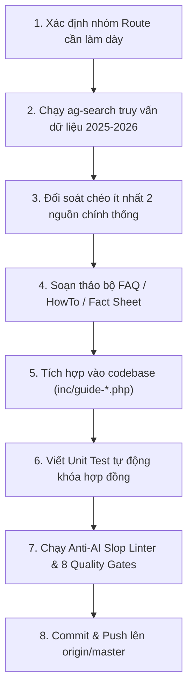

# Kế Hoạch Tổng Thể: Làm Dày Nội Dung & Nâng Cao Chất Lượng Toàn Diện (VietnamGuide Content Depth & Quality Master Plan 2026)

> **Phương pháp luận kiểm soát**: Bắt buộc tuân thủ 100% mô hình **5W1H2C5M** và các chuẩn mực của Google Search Central (Non-commodity People-First Content, Information Gain, E-E-A-T).

---

## 1. Nhóm 5W (Định Vị Bối Cảnh & Mục Tiêu)

### 1.1. Why (Tại sao cần thực hiện?)
- **Khắc phục bẫy "Nội dung mỏng" (Thin Content)**: Dù hệ thống đã hoàn thiện Guide Shell, Schema SEO và các công cụ tương tác, giá trị cốt lõi giữ chân độc giả và công cụ tìm kiếm AI (Google AI Overviews, Perplexity, GPT Search) là **mật độ thông tin thực chứng (Information Gain & Ground-Truth Density)**.
- **Giải quyết các điểm mù thực tế**: Cung cấp các câu trả lời trực diện, chi tiết từng số liệu (giá vé 2025–2026, giờ tàu xe, mã cao tốc, quy định thị thực, mẹo văn hóa, an toàn) giúp du khách tự tin lên kế hoạch mà không phải tra cứu thêm nhiều trang khác.
- **Bảo vệ chuẩn mực Anti-AI Slop**: Thay thế các đoạn văn mô tả sáo rỗng, hoa mỹ bằng dữ liệu thực nghiệm kiểm chứng từ hiện trường.

### 1.2. What (Phạm vi công việc cụ thể là gì?)
- **Deliverable 1: Mở rộng độ phủ Curated FAQ Accordion** từ 52 routes lên **120+ routes trọng điểm** (mỗi route gồm ít nhất 3–4 câu hỏi/trả lời thực chứng đạt chuẩn 100% visible parity và JSON-LD `FAQPage`).
- **Deliverable 2: Mở rộng quy trình hướng dẫn từng bước `HowTo`** từ 12 routes lên **25+ routes nghiệp vụ** (đặt vé tàu, thuê xe máy, vượt sông/biển, đổi ngoại tệ, làm thủ tục hải quan sân bay).
- **Deliverable 3: Tích hợp các bảng số liệu thực địa (Field Specs & Practical Fact Sheets)** vào các bài viết trụ cột (Pillar Guides):
  - Bảng cước phí tham quan di tích, vườn quốc gia, cáp treo cập nhật 2025–2026.
  - Bảng lộ trình và giờ tàu hỏa Bắc–Nam / tàu di sản / xe limousine cao tốc.
  - Bảng địa chỉ ẩm thực Michelin Bib Gourmand & quán gia truyền kèm mức giá niêm yết VND.
- **Deliverable 4: Thiết lập kho lưu trữ Content-as-Code** trong thư mục `content/` để quản lý phiên bản các bài viết đầy đủ (`post_content`), kiểm soát chất lượng bằng Git và bộ linter tự động.

### 1.3. Where (Điểm can thiệp ở tầng nào?)
- **Tầng Theme Templates**: `wordpress/wp-content/themes/vietnamguide-premium/inc/` (`guide-seo.php`, `guide-content.php`, `guide-cost-calculator.php`, `guide-itinerary-finder.php`, `guide-packing-checklist.php`).
- **Tầng Kho Nội Dung**: Thư mục mới `content/` quản lý bài viết dạng Markdown cấu trúc.
- **Tầng Kiểm Định & Tự Động Hóa**: `ops/tests/` (`test_guide_seo.py`, `test_interactive_shortcodes.py`), `ops/tariff_sentinel.py`, `ops/anti_ai_slop_linter.py`.

### 1.4. When (Lộ trình thực thi theo thời gian)
Kế hoạch chia làm **4 giai đoạn (Phases)** tuần tự:
- **Phase 1 (Immediate / Stage 120–122)**: Làm dày các tuyến Điểm Đến & Di Chuyển Tây Nguyên & Nam Bộ (Buôn Ma Thuột, Pleiku, Kon Tum, Châu Đốc, Hà Tiên, Cần Thơ).
- **Phase 2 (Stage 123–125)**: Làm dày các tuyến Điểm Đến & Di Chuyển Miền Trung & Duyên Hải (Quy Nhơn, Phú Yên, Nha Trang, Mũi Né, Đồng Hới, Phong Nha).
- **Phase 3 (Stage 126–128)**: Làm dày các tuyến Điểm Đến Vùng Núi Phía Bắc (Ba Bể, Pù Luông, Mù Cang Chải, Cao Bằng, Mai Châu, Hoàng Su Phì).
- **Phase 4 (Stage 129–131)**: Xây dựng cấu trúc Content-as-Code và đồng bộ hóa tự động hóa phát hành nội dung.

### 1.5. Who (Đối tượng liên quan & Chịu ảnh hưởng)
- **Độc giả quốc tế**: Du khách tự túc (solo, cặp đôi, gia đình) cần số liệu chính xác để dự trù kinh phí và lịch trình.
- **AI Search Agents & Crawlers**: Google Gemini / AI Overviews, Perplexity Bot, Claude Bot trích xuất trực tiếp số liệu chính xác.
- **Ban biên tập & Reviewer**: Có bộ quy chuẩn rõ ràng để nghiệm thu nội dung, không phụ thuộc vào cảm tính.

---

## 2. Nhóm 1H (Phương Pháp Thực Hiện)

### 2.1. Quy trình Nghiên cứu & Xác minh qua `ag-search`
Mọi thông tin, số liệu đưa vào bài viết bắt buộc phải tuân theo quy trình kiểm chứng 3 bước:
1. **Truy vấn đa nguồn**: Sử dụng `ops/ag_search_client.py` gọi tới API cục bộ `http://localhost:20128/v1/search` với các từ khóa thực tế (tên di tích, nhà xe, mã tàu, quy chuẩn 2025/2026).
2. **Đối chiếu chéo (Cross-Verification)**: So sánh ít nhất 2–3 nguồn độc lập (cổng thông tin ban quản lý, website bán vé chính hãng, bài đánh giá thực tế của du khách trong vòng 6–12 tháng gần nhất).
3. **Chuẩn hóa thông số**: Quy đổi sang VND và USD rõ ràng, nêu rõ điều kiện áp dụng (mùa cao điểm/thấp điểm, vé trẻ em/người cao tuổi, thời gian đặt trước).

### 2.2. Cấu trúc Chuẩn cho một Bộ Câu Hỏi FAQ Làm Dày Nội Dung
Mỗi trang được chọn làm dày sẽ bổ sung một bộ câu hỏi chuyên sâu gồm 3–4 câu hỏi với cấu trúc:
- **Câu 1: Di chuyển & Thời gian thực tế**: Cách đi nhanh nhất, cự ly km, thời gian tính bằng giờ, giá vé cụ thể từ các hub lân cận.
- **Câu 2: Chi phí & Giá vé niêm yết**: Giá vé vào cổng di tích, phí dịch vụ phụ trợ (thuyền, xe điện, cáp treo), phương thức thanh toán (tiền mặt VND vs quẹt thẻ).
- **Câu 3: Khung thời gian & Mùa lý tưởng**: Giờ mở cửa, khung giờ tránh nắng gắt/đám đông, mùa thời tiết đẹp nhất và rủi ro thời tiết (mưa bão, cấm cảng).
- **Câu 4: Mẹo thực địa độc quyền (Insider Tip)**: Mẹo trang phục, vị trí chụp ảnh đẹp, đồ ăn địa phương cần thử, hoặc cách tránh bị chặt chém.

### 2.3. Cấu trúc Chuẩn cho một Quy Trình `HowTo`
Mỗi quy trình HowTo bao gồm 4 bước hành động cụ thể:
1. **Bước 1: Chuẩn bị & Đặt trước**: Hồ sơ, giấy tờ tùy thân (hộ chiếu gốc, IDP 1968, tiền mặt) và thời điểm đặt vé tối ưu.
2. **Bước 2: Điểm xuất phát & Thủ tục check-in**: Bến xe, nhà ga, bến tàu cụ thể, thời gian cần có mặt trước giờ khởi hành.
3. **Bước 3: Trải nghiệm trên hành trình**: Lưu ý an toàn trên xe/tàu/thuyền, xử lý hành lý cồng kềnh.
4. **Bước 4: Đến nơi & Kết nối chặng tiếp**: Phương tiện đón tiếp tại điểm đến, giá cước taxi/xe buýt về khách sạn.

---

## 3. Nhóm 2C (Kiểm Soát Ràng Buộc & Chi Phí)

### 3.1. Control (Kiểm soát chất lượng & Bất biến hệ thống)
- **Bất biến 17 tệp PHP**: Duy trì tuyệt đối đúng 17 tệp trong `wordpress/wp-content/themes/vietnamguide-premium/inc/*.php`. Không tạo thêm tệp thừa làm phân mảnh kiến trúc.
- **Quy tắc Zero-`<h2>`**: Toàn bộ tiêu đề trong các include PHP và accordion FAQ/HowTo phải dùng `role="heading" aria-level="2"` hoặc thẻ `<h3>` để bảo vệ cấu trúc mục lục động Sticky Reading Spine TOC.
- **Chuẩn Anti-AI Slop**: Điểm Mean HLS của UI Templates $\ge 85$ và Route Registry đạt $100.0/100$, 0 lỗi Tier 1 clichés (không dùng các từ cấm như *nestled, hidden gem, rich tapestry, vibrant, bucket-list*).
- **100% SHA-256 Byte Parity**: Duy trì tuyệt đối sự trùng khớp băm SHA-256 giữa 3 tệp registry (`ops/route_registry.json`, `inc/guide-route-registry.json`, `inc/guide-rollout.php`).
- **Nguyên tắc Visible Parity 100%**: Mọi câu hỏi có trong Schema `FAQPage` hoặc `HowTo` bắt buộc phải hiển thị đầy đủ trên giao diện người dùng để tuân thủ 100% Google Search Gallery Guidelines.

### 3.2. Cost (Chi phí & Đánh đổi)
- **Hiệu năng thực thi**: Dữ liệu FAQ và HowTo được tổ chức dạng static array trong bộ nhớ PHP, truy xuất qua mảng băm $O(1)$, không tạo thêm truy vấn MySQL hay chặn luồng render của trình duyệt.
- **Dung lượng HTML**: Mỗi bộ FAQ bổ sung khoảng 1.5–2.5 KB HTML nén (Gzip/Brotli chỉ tăng < 500 bytes), hoàn toàn không ảnh hưởng tới chỉ số Largest Contentful Paint (LCP < 1.8s) và Cumulative Layout Shift (CLS = 0).

---

## 4. Nhóm 5M (Quản Trị Yếu Tố & Nguồn Lực)

### 4.1. Man / Mind (Tư duy & Con người)
- Tư duy phản biện thực tế (Adversarial Thinking): Luôn đặt câu hỏi "Thông tin này du khách có thực sự dùng được khi đứng ở bến xe/ga tàu không?".
- Không viết nội dung chung chung, mơ hồ (ví dụ: thay vì viết "giá vé xe buýt rất rẻ", phải viết rõ "xe buýt số 86 giá 45.000 VND / vé").

### 4.2. Machine (Công cụ & Môi trường)
- API tìm kiếm thực chứng cục bộ: `http://localhost:20128/v1/search`.
- Trình thông dịch & kiểm thử: Python 3.12 unittest, PHP CLI linter (`php -l`), PowerShell.
- Trình kiểm thử E2E: Playwright Chromium Headless.

### 4.3. Material (Dữ liệu & Tài nguyên)
- Dữ liệu quy định pháp lý: Cục CSGT, Cục Quản lý Xuất nhập cảnh, Cục Hàng không Việt Nam (CAAV).
- Dữ liệu vận tải: Đường sắt Việt Nam (`dsvn.vn`), Hãng tàu Phú Quốc Express/Superdong, Hãng xe Phương Trang (FUTA).
- Dữ liệu di sản & bảo tồn: Ban quản lý Quần thể danh thắng Tràng An, Di tích Cố đô Huế, Vườn quốc gia Cát Bà, Phong Nha - Kẻ Bàng, Cù Lao Chàm.

### 4.4. Method (Quy trình chuẩn hóa)

### 4.5. Measurement (Chỉ số định lượng nghiệm thu)
- **Độ phủ FAQ Curated**: Nâng từ 52 routes lên **120+ routes** (tăng ít nhất 200–250 câu trả lời thực chứng).
- **Độ phủ HowTo Schema**: Nâng từ 12 routes lên **25+ routes**.
- **Chỉ số Anti-AI Slop**: Duy trì 0 clichés Tier 1, Mean HLS $\ge 85$.
- **Tỷ lệ kiểm thử đỗ**: 100% (299/299+ tests pass) trên toàn bộ suite.
- **Tỷ lệ đỗ 8 Master Quality Gates**: Đạt tuyệt đối 8/8 gates (Exit Code 0).

---

## 5. Danh Sách Hành Động Cụ Thể (Actionable Checklist)

### Giai Đoạn 1: Tuyến Tây Nguyên & Đồng Bằng Sông Cửu Long (Stage 120) [HOÀN THÀNH]
- [x] **Task 1.1**: Dùng `ag-search` xác minh giá vé & phương tiện: Buôn Ma Thuột (Thác Dray Nur/Dray Sáp 30k–40k VND, Làng cà phê Trung Nguyên, QL26/QL27), Pleiku (Biển Hồ miễn phí vé/10k VND gửi xe, Núi lửa Chư Đăng Ya hoa dã quỳ, QL14 đi Kon Tum 50km/1h), Châu Đốc (Rừng tràm Trà Sư vé trọn gói 270k VND, tàu cao tốc đi Campuchia 35–45 USD), Hà Tiên (Thạch Động 20k VND, Mũi Nai, tàu cao tốc Phú Quốc 216k–230k VND).
- [x] **Task 1.2**: Bổ sung 6 bộ curated FAQ mới vào `inc/guide-seo.php`:
  - `destinations/where-to-stay-in-buon-ma-thuot`
  - `destinations/where-to-stay-in-pleiku`
  - `destinations/where-to-stay-in-chau-doc`
  - `destinations/where-to-stay-in-ha-tien`
  - `plan/can-tho-to-chau-doc-transport`
  - `plan/can-tho-to-ha-tien-transport`
- [x] **Task 1.3**: Bổ sung HowTo: "How to Travel from Can Tho to Chau Doc and Visit Tra Su Cajuput Forest" (4 bước chuẩn JSON-LD).
- [x] **Task 1.4**: Bổ sung unit tests kiểm tra hợp đồng dữ liệu trong `ops/tests/test_guide_seo.py` (`test_stage120_central_highlands_and_mekong_faqs_and_howtos`).
- [x] **Task 1.5**: Xác minh 8 Quality Gates (8/8 PASS, Exit Code 0, 300 tests passed), commit `95abf37` và push lên `origin/master`.

### Giai Đoạn 2: Tuyến Duyên Hải Nam Trung Bộ & Hang Động (Stage 121) [HOÀN THÀNH]
- [x] **Task 2.1**: Dùng `ag-search` xác minh giá vé & phương tiện: Quy Nhơn (Eo Gió 25k VND, Kỳ Co vé cổng 100k + xe điện 90k / cano lặn ngắm san hô 350k–400k VND, Tháp Bánh Ít 15k–20k VND, xe buýt sân bay Phù Cát 50k VND), Nha Trang (VinWonders 950k–1.050k VND, Tháp Bà Ponagar 30k VND, Viện Hải dương học 40k VND, xe buýt Đất Mới số 18 sân bay Cam Ranh 60k–65k VND), Mũi Né (Bàu Trắng 15k–20k VND / thuê xe jeep-ATV 600k–800k VND, Suối Tiên 15k VND, tàu hỏa SPT2 Sài Gòn–Phan Thiết 170k–230k VND), Đồng Hới & Phong Nha (Động Phong Nha vé 150k + thuyền sông Son 700k/thuyền ghép 60k/người, Động Thiên Đường 270k VND gồm xe điện, xe buýt B4 Đồng Hới–Phong Nha 40k–50k VND).
- [x] **Task 2.2**: Bổ sung 7 bộ curated FAQ mới vào `inc/guide-seo.php`:
  - `destinations/where-to-stay-in-quy-nhon`
  - `destinations/where-to-stay-in-nha-trang`
  - `destinations/where-to-stay-in-mui-ne`
  - `destinations/where-to-stay-in-dong-hoi`
  - `plan/buon-ma-thuot-to-nha-trang-transport`
  - `plan/pleiku-to-quy-nhon-transport`
  - `plan/nha-trang-to-quy-nhon-transport`
- [x] **Task 2.3**: Bổ sung HowTo: "How to Travel from Nha Trang to Quy Nhon by Coastal Train or Limousine Bus" (4 bước chuẩn JSON-LD).
- [x] **Task 2.4**: Bổ sung unit tests kiểm tra hợp đồng dữ liệu trong `ops/tests/test_guide_seo.py` (`test_stage121_central_coast_and_caves_faqs_and_howtos`).
- [x] **Task 2.5**: Xác minh 8 Quality Gates (8/8 PASS, Exit Code 0, 301 tests passed), commit `8aa796a` và push lên `origin/master`.

### Giai Đoạn 3: Tuyến Vùng Núi Phía Bắc & Tây Bắc (Stage 122) [HOÀN THÀNH]
- [x] **Task 3.1**: Dùng `ag-search` xác minh giá vé & phương tiện: Hà Giang & Đồng Văn (Cột cờ Lũng Cú 25k–40k VND + xe điện 15k–30k VND, Dinh họ Vương 20k–30k VND, Thuyền hẻm Tu Sản sông Nho Quế 120k–150k VND, Giấy phép biên giới cho người nước ngoài 230k VND / 10 USD), Sa Pa (Cáp treo Fansipan 850k VND người lớn / 550k trẻ em, Tàu hỏa Mường Hoa 150k–200k VND, Bản Cát Cát 150k VND, Thác Bạc 20k VND, Thác Tình Yêu 70k VND), Cao Bằng (Thác Bản Giốc 45k VND + bè Quây Sơn 50k VND, Động Ngườm Ngao 45k VND, Làng đá Khuổi Ky & Núi Mắt Thần miễn phí).
- [x] **Task 3.2**: Bổ sung 6 bộ curated FAQ mới vào `inc/guide-seo.php`:
  - `destinations/where-to-stay-in-sapa`
  - `destinations/where-to-stay-in-ha-giang`
  - `destinations/where-to-stay-in-cao-bang`
  - `plan/hanoi-to-ha-giang-transport`
  - `plan/ha-giang-to-dong-van-transport`
  - `compare/sapa-vs-ha-giang`
- [x] **Task 3.3**: Bổ sung HowTo: "How to Take the Direct Sleeper Bus from Hanoi to Ha Giang" (4 bước chuẩn JSON-LD).
- [x] **Task 3.4**: Bổ sung unit tests kiểm tra hợp đồng dữ liệu trong `ops/tests/test_guide_seo.py` (`test_stage122_northern_mountains_faqs_and_howtos`).
- [x] **Task 3.5**: Xác minh 8 Quality Gates (8/8 PASS, Exit Code 0, 302 tests passed), commit `46ed4b4` và push lên `origin/master`.

### Giai Đoạn 4: Tuyến Di Sản Miền Trung, Địa Đạo Củ Chi & So Sánh Đảo (Stage 123) [HOÀN THÀNH]
- [x] **Task 4.1**: Dùng `ag-search` xác minh giá vé & phương tiện: Địa đạo Củ Chi (Bến Dược vs Bến Đình 125.000 VND / vé người lớn nước ngoài, xe buýt số 13 từ Bến Thành đi Củ Chi 7k–10k VND + số 79 đi Bến Dược 6k–7k VND, xe limousine 350k–450k VND, cano cao tốc Les Rives 1.900k–2.200k VND), Bà Nà Hills & Cầu Vàng (vé cáp treo ngoại tỉnh 1.000.000 VND người lớn / 800.000 VND trẻ em, buffet 350.000 VND, mở cửa 07:00–22:00, thời điểm vắng nhất 07:00–08:30 sáng hoặc sau 16:30 chiều), Sân bay Đà Nẵng đi Hội An (30km, taxi Grab 300k–350k VND / 45 phút, xe đưa đón shuttle bus 100k–120k VND / người), Tàu hỏa Di sản Huế – Đà Nẵng (Đoàn tàu "Kết nối di sản miền Trung" HD1/HD2/HD3/HD4, giá vé 110.000–180.000 VND / ghế mềm điều hòa, 3 giờ ngắm đèo Hải Vân và vịnh Lăng Cô).
- [x] **Task 4.2**: Bổ sung 7 bộ curated FAQ mới vào `inc/guide-seo.php`:
  - `compare/cu-chi-tunnels-ben-duoc-vs-ben-dinh`
  - `compare/con-dao-vs-phu-quoc`
  - `compare/hoi-an-vs-hue`
  - `destinations/ba-na-hills-golden-bridge-guide`
  - `plan/da-nang-airport-to-hoi-an`
  - `itineraries/da-nang-to-hue-train-vs-car`
  - `compare/cu-chi-tunnels-vs-mekong-delta-day-trip`
- [x] **Task 4.3**: Bổ sung 2 HowTo schemas:
  - "How to Travel from Da Nang International Airport to Hoi An Ancient Town" (4 bước chuẩn JSON-LD).
  - "How to Take the Heritage Train Between Da Nang and Hue Over Hai Van Pass" (4 bước chuẩn JSON-LD).
- [x] **Task 4.4**: Bổ sung unit tests kiểm tra hợp đồng dữ liệu trong `ops/tests/test_guide_seo.py` (`test_stage123_central_heritage_cuchi_islands_faqs_and_howtos`).
- [x] **Task 4.5**: Xác minh 8 Quality Gates (8/8 PASS, Exit Code 0, 303 tests passed), commit `5210609` và push lên `origin/master`.

### Giai Đoạn 5: Tuyến Đô Thị Lớn & Chuyến Đi Trong Ngày (Stage 124) [HOÀN THÀNH]
- [x] **Task 5.1**: Dùng `ag-search` xác minh giá vé, khoảng cách & phương tiện:
  - Hà Nội: Phố Cổ vs Khu Phố Pháp vs Hồ Tây (`compare/old-quarter-vs-french-quarter-vs-west-lake`: Phố Cổ phòng 500k–1.5M VND, ồn ào, gần hồ Hoàn Kiếm; Khu Phố Pháp đường rợp bóng cây, Metropole 2.5M–8M VND, yên tĩnh về đêm; Tây Hồ cách trung tâm 5–8 km, Grab car 80k–120k VND / 15–25 phút, không gian thoáng đãng bên hồ).
  - Chuyến đi trong ngày từ Hà Nội (`destinations/best-day-trips-from-hanoi`: Ninh Bình Tràng An 250k VND, Hang Múa 100k VND cách 95–100 km / 1.5–2h cao tốc CT01; Làng gốm Bát Tràng cách 15 km xe buýt 47A vé 7k–9k VND, làm gốm 50k–70k VND; Làng cổ Đường Lâm cách 45 km xe buýt 71 vé 20k VND, vé cổng 20k VND; Vịnh Hạ Long đi về trong ngày qua cao tốc CT04 2.5h mỗi chiều, tour 12h giá 45–75 USD).
  - Ninh Bình: Đi về trong ngày vs Ở lại qua đêm (`compare/ninh-binh-day-trip-vs-overnight`: Tour đi về trong ngày 850k–1.3M VND ngồi xe 4–5h, gặp đoàn đông 10:30–14:00; Ở lại homestay Tam Cốc 400k–800k VND/đêm, đi thuyền Tràng An lúc mở cửa 07:00 sáng, leo Hang Mua ngắm hoàng hôn, đạp xe thung lũng không bóng người).
  - Đồng bằng Sông Cửu Long: Đi tour trong ngày vs Ở lại qua đêm (`compare/mekong-delta-overnight-vs-day-trip`: Tour trong ngày Mỹ Tho - Bến Tre 70–85 km / 1.5–2h cao tốc CT01, giá 20–35 USD; Ở lại Cần Thơ cách 170 km / 3.5–4h đi chợ nổi Cái Răng lúc bình minh 05:30–07:00 sáng với cây bẹo treo hàng hóa).
  - Mũi Né vs Nha Trang (`compare/mui-ne-vs-nha-trang`: Mũi Né đồi cát Bàu Trắng, lướt ván diều tháng 11–3, resort nhiệt đới ven đường Nguyễn Đình Chiểu; Nha Trang thành phố biển cao tầng đường Trần Phú 6 km, lặn biển đảo Hòn Mun, cáp treo VinWonders, tháp Bà Ponagar).
  - Hà Nội $\rightarrow$ Ninh Bình (`plan/hanoi-to-ninh-binh-train-vs-limousine`: Xe limousine VIP 9 chỗ đón tận nơi Phố Cổ trả tận homestay Tam Cốc 150k–220k VND / 90–105 phút; Tàu hỏa SE5/SE7/SE9 từ Ga Hà Nội đến Ga Ninh Bình 2h10m vé 75k–130k VND + taxi 6 km ra Tam Cốc 80k–100k VND).
  - TP.HCM $\rightarrow$ Mũi Né (`plan/ho-chi-minh-city-to-mui-ne-transport`: Cao tốc Dầu Giây - Phan Thiết CT01 rút ngắn thời gian còn 2.5–3h, limousine đón trả resort 250k–350k VND; Tàu hỏa du lịch SPT2 Ga Sài Gòn 06:45 sáng đến Ga Phan Thiết 10:30 sáng, vé ghế mềm 180k–260k VND + taxi 18 km ra Mũi Né 200k–250k VND).
- [x] **Task 5.2**: Bổ sung 7 bộ curated FAQ mới vào `inc/guide-seo.php`:
  - `compare/old-quarter-vs-french-quarter-vs-west-lake`
  - `destinations/best-day-trips-from-hanoi`
  - `compare/ninh-binh-day-trip-vs-overnight`
  - `compare/mekong-delta-overnight-vs-day-trip`
  - `compare/mui-ne-vs-nha-trang`
  - `plan/hanoi-to-ninh-binh-train-vs-limousine`
  - `plan/ho-chi-minh-city-to-mui-ne-transport`
- [x] **Task 5.3**: Bổ sung 2 HowTo schemas chuẩn JSON-LD:
  - "How to Travel from Hanoi to Ninh Binh by Limousine Van or Train" (4 bước).
  - "How to Travel from Ho Chi Minh City to Mui Ne by Expressway Limousine or Train SPT2" (4 bước).
- [x] **Task 5.4**: Bổ sung unit tests kiểm tra hợp đồng dữ liệu trong `ops/tests/test_guide_seo.py` (`test_stage124_urban_megacities_and_day_trips_faqs_and_howtos`).
- [x] **Task 5.5**: Xác minh 8 Quality Gates (8/8 PASS, Exit Code 0, 304 tests passed), commit `5166c00` và push lên `origin/master`.

### Giai Đoạn 6: Tuyến Sông Nước Ninh Bình, So Sánh Đảo, Thiên Nhiên Đà Lạt & Vận Tải Núi Sa Pa (Stage 125) [HOÀN THÀNH]
- [x] **Task 6.1**: Dùng `ag-search` xác minh giá vé, khoảng cách & phương tiện:
  - Tam Cốc vs Tràng An (`compare/tam-coc-vs-trang-an-boat-tour`): Tam Cốc thuyền nan sông Ngô Đồng qua 3 hang (Hang Cả, Hang Hai, Hang Ba), người chèo bằng chân, lúa chín cuối tháng 5 đến đầu tháng 6, vé trọn gói 250k VND (120k vé thắng cảnh + 150k thuyền 2 khách); Tràng An di sản UNESCO 3 tuyến thuyền (Tuyến 1: 9 hang 3 đền 3h; Tuyến 2: 4 hang phim trường Kong/Hành cung Vũ Lâm 2.5h; Tuyến 3: 3 hang dài có Hang Đột 1.000m 2.5h), vé 250k VND/khách (thuyền 4 người), cảnh quan hoành tráng quanh năm.
  - Lý Sơn vs Cù Lao Chàm (`compare/ly-son-vs-cham-islands`): Cù Lao Chàm cách cảng Cửa Đại 15–20 km, cano cao tốc 20 phút (vé khứ hồi 450k–550k VND đã gồm 70k phí bảo tồn biển + 20k phí bến), thích hợp tour ngày 6–8h từ Hội An/Đà Nẵng; Đảo Lý Sơn cách cảng Sa Kỳ (Quảng Ngãi) 24 km, tàu cao tốc 35–45 phút (vé 178k–213k VND/lượt), cảnh quan núi lửa Thới Lới, cổng Tò Vò, Hang Câu, đảo Bé, cần tối thiểu 2 ngày 1 đêm. Cả 2 đảo đều cấm cano vào mùa gió bấc tháng 10–tháng 2.
  - Phú Quốc vs Nha Trang (`compare/phu-quoc-vs-nha-trang`): Nha Trang trên đất liền có đường sắt và quốc lộ, giá ăn uống hải sản rẻ hơn 30–40% (ngân sách 35–40 USD/ngày), bãi biển công cộng đường Trần Phú 6 km; Phú Quốc là hải đảo xa, chi phí vận chuyển đẩy ngân sách lên 55+ USD/ngày, resort bãi biển riêng tư bãi Khem, bãi Sao, bãi Dài, miễn visa 30 ngày cho khách quốc tế bay thẳng.
  - Nông trại cà phê Đà Lạt (`destinations/da-lat-coffee-farms-guide`): Cầu Đất Farm cách trung tâm 25–30 km độ cao 1.650m lập từ 1927, trồng Arabica (Typica, Bourbon, Catimor) vé 50k–90k VND; Mê Linh Coffee Garden đèo Tà Nung ngắm thung lũng Robusta (70k–120k VND); K’Ho Coffee Lạc Dương hợp tác xã cà phê hữu cơ của người K'Ho chân núi Lang Biang; Mùa thu hoạch cà phê chín rộ tháng 10 đến tháng 1.
  - Thác nước Đà Lạt (`destinations/da-lat-waterfalls-guide`): Thác Datanla đèo Prenn cách 6 km vé 50k–80k VND, máng trượt alpine coaster 2.400m vé khứ hồi 200k–250k VND, tour vượt thác canyoning mạo hiểm đu dây 25m giá 1.6M–1.9M VND; Thác Voi (Thác Liêng Rơwoa) Nam Ban cách 28 km vé 40k VND cạnh chùa Linh Ẩn tượng Phật Bà 71m; Thác Pongour 7 tầng Đức Trọng cách 50 km vé 30k VND đẹp nhất mùa mưa tháng 7–12.
  - Cù Lao Chàm trong ngày (`plan/cham-islands-day-trip-guide`): Cano cao tốc xuất bến Cửa Đại 08:30–09:30 sáng, 20 phút ra Bãi Làng; tour trọn gói ăn trưa hải sản Bãi Chồng lặn ngắm san hô Bãi Xếp 550k–750k VND (22–30 USD); mùa biển êm tháng 3 đến tháng 9, mùa biển động tháng 10 đến tháng 2.
  - Hà Nội $\rightarrow$ Sa Pa (`plan/hanoi-to-sapa-train-vs-sleeper-bus`): Xe cabin giường nằm VIP đi cao tốc Nội Bài - Lào Cai CT05 5.5–6h trả tận trung tâm Sa Pa giá 350k–450k VND cabin đơn / 600k–700k cabin đôi; Tàu hỏa đêm SP1/SP3 Ga Hà Nội đến Ga Lào Cai 8h (vé 350k–900k VND) giường nằm phẳng êm không say xe + xe trung chuyển 35 km đèo lên Sa Pa 50k–60k VND / 50–60 phút.
- [x] **Task 6.2**: Bổ sung 7 bộ curated FAQ mới vào `inc/guide-seo.php`:
  - `compare/tam-coc-vs-trang-an-boat-tour`
  - `compare/ly-son-vs-cham-islands`
  - `compare/phu-quoc-vs-nha-trang`
  - `destinations/da-lat-coffee-farms-guide`
  - `destinations/da-lat-waterfalls-guide`
  - `plan/cham-islands-day-trip-guide`
  - `plan/hanoi-to-sapa-train-vs-sleeper-bus`
- [x] **Task 6.3**: Bổ sung 2 HowTo schemas chuẩn JSON-LD:
  - "How to Take a Day Trip to the Cham Islands from Hoi An" (4 bước).
  - "How to Travel from Hanoi to Sapa by Express Sleeper Bus or Overnight Train" (4 bước).
- [x] **Task 6.4**: Bổ sung unit tests kiểm tra hợp đồng dữ liệu trong `ops/tests/test_guide_seo.py` (`test_stage125_waterways_islands_dalat_sapa_faqs_and_howtos`).
- [x] **Task 6.5**: Xác minh 8 Quality Gates (8/8 PASS, Exit Code 0, 305 tests passed), commit `5ac2711` và push lên `origin/master`.

### Giai Đoạn 7: Chùm Hướng Dẫn Bãi Biển, Tuyến Phố Ẩm Thực & Vịnh Đảo Hạ Long – Cát Bà (Stage 126) [HOÀN THÀNH]
- [x] **Task 7.1**: Dùng `ag-search` xác minh giá vé, khoảng cách & phương tiện:
  - Bãi biển Việt Nam (`destinations/best-beaches-in-vietnam`): Phân mùa sóng và gió theo 3 miền (Miền Trung tháng 2–8 biển phẳng, Miền Nam/Phú Quốc tháng 11–4, Miền Bắc/Hạ Long tháng 6–8); điều kiện bơi an toàn và đặc tính từng vùng biển.
  - Bãi biển Đà Nẵng (`destinations/da-nang-beaches-guide`): Bãi biển Mỹ Khê (cứu hộ trực 05:00–19:00), Non Nước chân núi Ngũ Hành Sơn, bán đảo Sơn Trà (Bãi Bụt, Bãi Rạng lặn san hô), An Bàng Hội An 25 km xe máy/taxi.
  - Phố ẩm thực Hà Nội (`destinations/hanoi-street-food-guide`): Phở Bát Đàn (49 Bát Đàn, 50k–65k VND), Bún chả Hương Liên Obama (24 Lê Văn Hưu, 50k–70k VND), Cà phê trứng Giảng (39 Nguyễn Hữu Huân, 35k–40k VND); khung giờ vàng 07:00–10:00 và 18:30–21:30.
  - Phố ẩm thực Sài Gòn (`destinations/saigon-street-food-guide`): Cơm tấm Ba Ghiền (84 Đặng Văn Ngữ, Phú Nhuận, sườn nướng than khổng lồ 85k–135k VND), Bánh mì Huỳnh Hoa (26 Lê Thị Riêng, Quận 1, 68k–75k VND), Phố ốc Vĩnh Khánh Quận 4; vệ sinh an toàn thực phẩm.
  - Bãi biển Phú Quốc (`destinations/phu-quoc-beaches-guide`): Bãi Khem cát trắng mịn, Bãi Sao, Ông Lang ngắm hoàng hôn bờ tây, Rạch Vẹm làng chài sao biển (bảo vệ sinh thái không nhấc sao biển khỏi mặt nước); mùa khô tháng 11–4, mùa mưa tháng 5–10 sóng đục bờ tây.
  - Hà Nội $\rightarrow$ Cát Bà (`plan/hanoi-to-cat-ba-island-transport`): Xe khách combo phố cổ Hà Nội qua cao tốc Hà Nội - Hải Phòng CT04 $\rightarrow$ bến Đồng Bài $\rightarrow$ cano cao tốc bến Cái Viềng $\rightarrow$ xe trung chuyển thị trấn Cát Bà: trọn gói 300.000–350.000 VND (~12–14 USD), 3.5 giờ (nhà xe Daiichi, Cat Ba Express, Good Morning Cat Ba).
  - Hà Nội $\rightarrow$ Vịnh Hạ Long (`plan/hanoi-to-ha-long-bay-transport`): Xe limousine VIP 9–11 chỗ đưa đón tận nơi phố cổ qua cao tốc CT04 đến Cảng tàu quốc tế Tuần Châu hoặc Hạ Long: 220.000–300.000 VND (~9–12 USD), 2–2.5 giờ.
- [x] **Task 7.2**: Bổ sung 7 bộ curated FAQ mới vào `inc/guide-seo.php`:
  - `destinations/best-beaches-in-vietnam`
  - `destinations/da-nang-beaches-guide`
  - `destinations/hanoi-street-food-guide`
  - `destinations/saigon-street-food-guide`
  - `destinations/phu-quoc-beaches-guide`
  - `plan/hanoi-to-cat-ba-island-transport`
  - `plan/hanoi-to-ha-long-bay-transport`
- [x] **Task 7.3**: Bổ sung 2 HowTo schemas chuẩn JSON-LD:
  - "How to Travel from Hanoi to Cat Ba Island by Combo Bus and Ferry" (4 bước).
  - "How to Travel from Hanoi to Ha Long Bay via Expressway Limousine" (4 bước).
- [x] **Task 7.4**: Bổ sung unit tests kiểm tra hợp đồng dữ liệu trong `ops/tests/test_guide_seo.py` (`test_stage126_beaches_street_food_halong_catba_faqs_and_howtos`).
- [x] **Task 7.5**: Xác minh 8 Quality Gates (8/8 PASS, Exit Code 0, 306 tests passed), commit `7adcdb9` và push lên `origin/master`.

### Giai Đoạn 8: Tuyến Ẩm Thực Miền Trung, Lưu Trú & Hoạt Động Vịnh Hạ Long – Cát Bà, Kết Nối Ninh Bình (Stage 127) [TIẾP THEO]
- [ ] **Task 8.1**: Dùng `ag-search` xác minh giá vé, địa chỉ ẩm thực, khách sạn & phương tiện:
  - Ẩm thực Hội An (`destinations/hoi-an-street-food-guide`): Cao lầu Thanh (26 Thái Phiên), Bánh mì Madam Khánh/Phượng (20k–35k VND), Cơm gà Bà Buội (22 Phan Chu Trinh, 45k–60k VND), Nước Mót (150 Trần Phú, 15k VND).
  - Ẩm thực Cố đô Huế (`destinations/hue-street-food-guide`): Bún bò Huế Mụ Rơi/Bà Tuyết (47 Nguyễn Công Trứ, 40k–60k VND), Bánh bèo nậm lọc Bà Đỏ (8 Nguyễn Bỉnh Khiêm), Cơm hến Đập Đá/Hoa Đông cồn Hến (15k–25k VND), Chè hẻm 29 Hùng Vương (15k–20k VND).
  - Hoạt động Vịnh Hạ Long (`destinations/best-things-to-do-in-ha-long-bay`): Hang Sửng Sốt, Đảo Ti Tốp (leo 400 bậc đá ngắm toàn cảnh 360 độ), Hang Luồn chèo thuyền kayak, làng chài Cửa Vạn; vé tuyến 2 tham quan 250k VND + vé bến 40k VND; du thuyền 2 ngày 1 đêm vs trong ngày 4–6h.
  - Lưu trú Vịnh Hạ Long (`destinations/where-to-stay-in-ha-long-bay`): Bãi Cháy (khu nghỉ dưỡng bờ biển, Vinpearl, Sun World), Hòn Gai (khu phố bản địa yên tĩnh, gần chợ hải sản), Tuần Châu (gần bến tàu du thuyền); giá phòng từ 500k đến 4M+ VND/đêm.
  - Lưu trú Đảo Cát Bà (`destinations/where-to-stay-in-cat-ba`): Thị trấn Cát Bà (khách sạn ven vịnh, Cát Cò 1, 2, 3), Làng chài Việt Hải (homestay sinh thái giữa Vườn quốc gia Cát Bà), Bến Bèo; mức giá homestay 300k–600k VND vs resort Flamingo Cát Bà 2.5M–5M VND.
  - Cát Bà $\rightarrow$ Ninh Bình (`plan/cat-ba-to-ninh-binh-transport`): Xe khách du lịch trọn gói từ khách sạn thị trấn Cát Bà $\rightarrow$ phà Đồng Bài $\rightarrow$ cao tốc Hải Phòng - Ninh Bình $\rightarrow$ Tam Cốc / Tràng An (4.5–5h, 300k–350k VND, các hãng The Long, Cat Ba Discovery, Daiichi).
  - Hạ Long $\rightarrow$ Ninh Bình (`plan/ha-long-to-ninh-binh-transport`): Xe limousine VIP từ Bãi Cháy/Tuần Châu đi Ninh Bình qua QL10 hoặc cao tốc CT04 - CT01 (3–3.5h, 250k–320k VND đón trả tận nơi); so sánh với xe buýt thường bến Bãi Cháy.
- [ ] **Task 8.2**: Bổ sung 7 bộ curated FAQ mới vào `inc/guide-seo.php`:
  - `destinations/hoi-an-street-food-guide`
  - `destinations/hue-street-food-guide`
  - `destinations/best-things-to-do-in-ha-long-bay`
  - `destinations/where-to-stay-in-ha-long-bay`
  - `destinations/where-to-stay-in-cat-ba`
  - `plan/cat-ba-to-ninh-binh-transport`
  - `plan/ha-long-to-ninh-binh-transport`
- [ ] **Task 8.3**: Bổ sung 2 HowTo schemas chuẩn JSON-LD:
  - "How to Travel from Cat Ba Island to Ninh Binh by Tourist Bus Combo" (4 bước).
  - "How to Travel from Ha Long Bay to Ninh Binh by Direct Tourist Limousine" (4 bước).
- [ ] **Task 8.4**: Bổ sung unit tests kiểm tra hợp đồng dữ liệu trong `ops/tests/test_guide_seo.py` (`test_stage127_street_food_halong_catba_ninhbinh_faqs_and_howtos`).
- [ ] **Task 8.5**: Xác minh 8 Quality Gates (8/8 PASS, Exit Code 0), commit và push lên `origin/master`.
