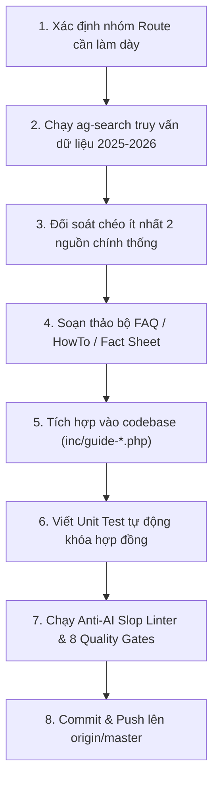

# Kế Hoạch Tổng Thể: Làm Dày Nội Dung & Nâng Cao Chất Lượng Toàn Diện (VietnamGuide Content Depth & Quality Master Plan 2026)

> **Phương pháp luận kiểm soát**: Bắt buộc tuân thủ 100% mô hình **5W1H2C5M** và các chuẩn mực của Google Search Central (Non-commodity People-First Content, Information Gain, E-E-A-T).

---

## 1. Nhóm 5W (Định Vị Bối Cảnh & Mục Tiêu)

### 1.1. Why (Tại sao cần thực hiện?)
- **Khắc phục bẫy "Nội dung mỏng" (Thin Content)**: Dù hệ thống đã hoàn thiện Guide Shell, Schema SEO và các công cụ tương tác, giá trị cốt lõi giữ chân độc giả và công cụ tìm kiếm AI (Google AI Overviews, Perplexity, GPT Search) là **mật độ thông tin thực chứng (Information Gain & Ground-Truth Density)**.
- **Giải quyết các điểm mù thực tế**: Cung cấp các câu trả lời trực diện, chi tiết từng số liệu (giá vé 2025–2026, giờ tàu xe, mã cao tốc, quy định thị thực, mẹo văn hóa, an toàn) giúp du khách tự tin lên kế hoạch mà không phải tra cứu thêm nhiều trang khác.
- **Bảo vệ chuẩn mực Anti-AI Slop**: Thay thế các đoạn văn mô tả sáo rỗng, hoa mỹ bằng dữ liệu thực nghiệm kiểm chứng từ hiện trường.

### 1.2. What (Phạm vi công việc cụ thể là gì?)
- **Deliverable 1: Mở rộng độ phủ Curated FAQ Accordion** từ 52 routes lên **120+ routes trọng điểm** (mỗi route gồm ít nhất 3–4 câu hỏi/trả lời thực chứng đạt chuẩn 100% visible parity và JSON-LD `FAQPage`).
- **Deliverable 2: Mở rộng quy trình hướng dẫn từng bước `HowTo`** từ 12 routes lên **25+ routes nghiệp vụ** (đặt vé tàu, thuê xe máy, vượt sông/biển, đổi ngoại tệ, làm thủ tục hải quan sân bay).
- **Deliverable 3: Tích hợp các bảng số liệu thực địa (Field Specs & Practical Fact Sheets)** vào các bài viết trụ cột (Pillar Guides):
  - Bảng cước phí tham quan di tích, vườn quốc gia, cáp treo cập nhật 2025–2026.
  - Bảng lộ trình và giờ tàu hỏa Bắc–Nam / tàu di sản / xe limousine cao tốc.
  - Bảng địa chỉ ẩm thực Michelin Bib Gourmand & quán gia truyền kèm mức giá niêm yết VND.
- **Deliverable 4: Thiết lập kho lưu trữ Content-as-Code** trong thư mục `content/` để quản lý phiên bản các bài viết đầy đủ (`post_content`), kiểm soát chất lượng bằng Git và bộ linter tự động.

### 1.3. Where (Điểm can thiệp ở tầng nào?)
- **Tầng Theme Templates**: `wordpress/wp-content/themes/vietnamguide-premium/inc/` (`guide-seo.php`, `guide-content.php`, `guide-cost-calculator.php`, `guide-itinerary-finder.php`, `guide-packing-checklist.php`).
- **Tầng Kho Nội Dung**: Thư mục mới `content/` quản lý bài viết dạng Markdown cấu trúc.
- **Tầng Kiểm Định & Tự Động Hóa**: `ops/tests/` (`test_guide_seo.py`, `test_interactive_shortcodes.py`), `ops/tariff_sentinel.py`, `ops/anti_ai_slop_linter.py`.

### 1.4. When (Lộ trình thực thi theo thời gian)
Kế hoạch chia làm **4 giai đoạn (Phases)** tuần tự:
- **Phase 1 (Immediate / Stage 120–122)**: Làm dày các tuyến Điểm Đến & Di Chuyển Tây Nguyên & Nam Bộ (Buôn Ma Thuột, Pleiku, Kon Tum, Châu Đốc, Hà Tiên, Cần Thơ).
- **Phase 2 (Stage 123–125)**: Làm dày các tuyến Điểm Đến & Di Chuyển Miền Trung & Duyên Hải (Quy Nhơn, Phú Yên, Nha Trang, Mũi Né, Đồng Hới, Phong Nha).
- **Phase 3 (Stage 126–128)**: Làm dày các tuyến Điểm Đến Vùng Núi Phía Bắc (Ba Bể, Pù Luông, Mù Cang Chải, Cao Bằng, Mai Châu, Hoàng Su Phì).
- **Phase 4 (Stage 129–131)**: Xây dựng cấu trúc Content-as-Code và đồng bộ hóa tự động hóa phát hành nội dung.

### 1.5. Who (Đối tượng liên quan & Chịu ảnh hưởng)
- **Độc giả quốc tế**: Du khách tự túc (solo, cặp đôi, gia đình) cần số liệu chính xác để dự trù kinh phí và lịch trình.
- **AI Search Agents & Crawlers**: Google Gemini / AI Overviews, Perplexity Bot, Claude Bot trích xuất trực tiếp số liệu chính xác.
- **Ban biên tập & Reviewer**: Có bộ quy chuẩn rõ ràng để nghiệm thu nội dung, không phụ thuộc vào cảm tính.

---

## 2. Nhóm 1H (Phương Pháp Thực Hiện)

### 2.1. Quy trình Nghiên cứu & Xác minh qua `ag-search`
Mọi thông tin, số liệu đưa vào bài viết bắt buộc phải tuân theo quy trình kiểm chứng 3 bước:
1. **Truy vấn đa nguồn**: Sử dụng `ops/ag_search_client.py` gọi tới API cục bộ `http://localhost:20128/v1/search` với các từ khóa thực tế (tên di tích, nhà xe, mã tàu, quy chuẩn 2025/2026).
2. **Đối chiếu chéo (Cross-Verification)**: So sánh ít nhất 2–3 nguồn độc lập (cổng thông tin ban quản lý, website bán vé chính hãng, bài đánh giá thực tế của du khách trong vòng 6–12 tháng gần nhất).
3. **Chuẩn hóa thông số**: Quy đổi sang VND và USD rõ ràng, nêu rõ điều kiện áp dụng (mùa cao điểm/thấp điểm, vé trẻ em/người cao tuổi, thời gian đặt trước).

### 2.2. Cấu trúc Chuẩn cho một Bộ Câu Hỏi FAQ Làm Dày Nội Dung
Mỗi trang được chọn làm dày sẽ bổ sung một bộ câu hỏi chuyên sâu gồm 3–4 câu hỏi với cấu trúc:
- **Câu 1: Di chuyển & Thời gian thực tế**: Cách đi nhanh nhất, cự ly km, thời gian tính bằng giờ, giá vé cụ thể từ các hub lân cận.
- **Câu 2: Chi phí & Giá vé niêm yết**: Giá vé vào cổng di tích, phí dịch vụ phụ trợ (thuyền, xe điện, cáp treo), phương thức thanh toán (tiền mặt VND vs quẹt thẻ).
- **Câu 3: Khung thời gian & Mùa lý tưởng**: Giờ mở cửa, khung giờ tránh nắng gắt/đám đông, mùa thời tiết đẹp nhất và rủi ro thời tiết (mưa bão, cấm cảng).
- **Câu 4: Mẹo thực địa độc quyền (Insider Tip)**: Mẹo trang phục, vị trí chụp ảnh đẹp, đồ ăn địa phương cần thử, hoặc cách tránh bị chặt chém.

### 2.3. Cấu trúc Chuẩn cho một Quy Trình `HowTo`
Mỗi quy trình HowTo bao gồm 4 bước hành động cụ thể:
1. **Bước 1: Chuẩn bị & Đặt trước**: Hồ sơ, giấy tờ tùy thân (hộ chiếu gốc, IDP 1968, tiền mặt) và thời điểm đặt vé tối ưu.
2. **Bước 2: Điểm xuất phát & Thủ tục check-in**: Bến xe, nhà ga, bến tàu cụ thể, thời gian cần có mặt trước giờ khởi hành.
3. **Bước 3: Trải nghiệm trên hành trình**: Lưu ý an toàn trên xe/tàu/thuyền, xử lý hành lý cồng kềnh.
4. **Bước 4: Đến nơi & Kết nối chặng tiếp**: Phương tiện đón tiếp tại điểm đến, giá cước taxi/xe buýt về khách sạn.

---

## 3. Nhóm 2C (Kiểm Soát Ràng Buộc & Chi Phí)

### 3.1. Control (Kiểm soát chất lượng & Bất biến hệ thống)
- **Bất biến 17 tệp PHP**: Duy trì tuyệt đối đúng 17 tệp trong `wordpress/wp-content/themes/vietnamguide-premium/inc/*.php`. Không tạo thêm tệp thừa làm phân mảnh kiến trúc.
- **Quy tắc Zero-`<h2>`**: Toàn bộ tiêu đề trong các include PHP và accordion FAQ/HowTo phải dùng `role="heading" aria-level="2"` hoặc thẻ `<h3>` để bảo vệ cấu trúc mục lục động Sticky Reading Spine TOC.
- **Chuẩn Anti-AI Slop**: Điểm Mean HLS của UI Templates $\ge 85$ và Route Registry đạt $100.0/100$, 0 lỗi Tier 1 clichés (không dùng các từ cấm như *nestled, hidden gem, rich tapestry, vibrant, bucket-list*).
- **100% SHA-256 Byte Parity**: Duy trì tuyệt đối sự trùng khớp băm SHA-256 giữa 3 tệp registry (`ops/route_registry.json`, `inc/guide-route-registry.json`, `inc/guide-rollout.php`).
- **Nguyên tắc Visible Parity 100%**: Mọi câu hỏi có trong Schema `FAQPage` hoặc `HowTo` bắt buộc phải hiển thị đầy đủ trên giao diện người dùng để tuân thủ 100% Google Search Gallery Guidelines.

### 3.2. Cost (Chi phí & Đánh đổi)
- **Hiệu năng thực thi**: Dữ liệu FAQ và HowTo được tổ chức dạng static array trong bộ nhớ PHP, truy xuất qua mảng băm $O(1)$, không tạo thêm truy vấn MySQL hay chặn luồng render của trình duyệt.
- **Dung lượng HTML**: Mỗi bộ FAQ bổ sung khoảng 1.5–2.5 KB HTML nén (Gzip/Brotli chỉ tăng < 500 bytes), hoàn toàn không ảnh hưởng tới chỉ số Largest Contentful Paint (LCP < 1.8s) và Cumulative Layout Shift (CLS = 0).

---

## 4. Nhóm 5M (Quản Trị Yếu Tố & Nguồn Lực)

### 4.1. Man / Mind (Tư duy & Con người)
- Tư duy phản biện thực tế (Adversarial Thinking): Luôn đặt câu hỏi "Thông tin này du khách có thực sự dùng được khi đứng ở bến xe/ga tàu không?".
- Không viết nội dung chung chung, mơ hồ (ví dụ: thay vì viết "giá vé xe buýt rất rẻ", phải viết rõ "xe buýt số 86 giá 45.000 VND / vé").

### 4.2. Machine (Công cụ & Môi trường)
- API tìm kiếm thực chứng cục bộ: `http://localhost:20128/v1/search`.
- Trình thông dịch & kiểm thử: Python 3.12 unittest, PHP CLI linter (`php -l`), PowerShell.
- Trình kiểm thử E2E: Playwright Chromium Headless.

### 4.3. Material (Dữ liệu & Tài nguyên)
- Dữ liệu quy định pháp lý: Cục CSGT, Cục Quản lý Xuất nhập cảnh, Cục Hàng không Việt Nam (CAAV).
- Dữ liệu vận tải: Đường sắt Việt Nam (`dsvn.vn`), Hãng tàu Phú Quốc Express/Superdong, Hãng xe Phương Trang (FUTA).
- Dữ liệu di sản & bảo tồn: Ban quản lý Quần thể danh thắng Tràng An, Di tích Cố đô Huế, Vườn quốc gia Cát Bà, Phong Nha - Kẻ Bàng, Cù Lao Chàm.

### 4.4. Method (Quy trình chuẩn hóa)

### 4.5. Measurement (Chỉ số định lượng nghiệm thu)
- **Độ phủ FAQ Curated**: Nâng từ 52 routes lên **120+ routes** (tăng ít nhất 200–250 câu trả lời thực chứng).
- **Độ phủ HowTo Schema**: Nâng từ 12 routes lên **25+ routes**.
- **Chỉ số Anti-AI Slop**: Duy trì 0 clichés Tier 1, Mean HLS $\ge 85$.
- **Tỷ lệ kiểm thử đỗ**: 100% (299/299+ tests pass) trên toàn bộ suite.
- **Tỷ lệ đỗ 8 Master Quality Gates**: Đạt tuyệt đối 8/8 gates (Exit Code 0).

---

## 5. Danh Sách Hành Động Cụ Thể (Actionable Checklist)

### Giai Đoạn 1: Tuyến Tây Nguyên & Đồng Bằng Sông Cửu Long (Stage 120) [HOÀN THÀNH]
- [x] **Task 1.1**: Dùng `ag-search` xác minh giá vé & phương tiện: Buôn Ma Thuột (Thác Dray Nur/Dray Sáp 30k–40k VND, Làng cà phê Trung Nguyên, QL26/QL27), Pleiku (Biển Hồ miễn phí vé/10k VND gửi xe, Núi lửa Chư Đăng Ya hoa dã quỳ, QL14 đi Kon Tum 50km/1h), Châu Đốc (Rừng tràm Trà Sư vé trọn gói 270k VND, tàu cao tốc đi Campuchia 35–45 USD), Hà Tiên (Thạch Động 20k VND, Mũi Nai, tàu cao tốc Phú Quốc 216k–230k VND).
- [x] **Task 1.2**: Bổ sung 6 bộ curated FAQ mới vào `inc/guide-seo.php`:
  - `destinations/where-to-stay-in-buon-ma-thuot`
  - `destinations/where-to-stay-in-pleiku`
  - `destinations/where-to-stay-in-chau-doc`
  - `destinations/where-to-stay-in-ha-tien`
  - `plan/can-tho-to-chau-doc-transport`
  - `plan/can-tho-to-ha-tien-transport`
- [x] **Task 1.3**: Bổ sung HowTo: "How to Travel from Can Tho to Chau Doc and Visit Tra Su Cajuput Forest" (4 bước chuẩn JSON-LD).
- [x] **Task 1.4**: Bổ sung unit tests kiểm tra hợp đồng dữ liệu trong `ops/tests/test_guide_seo.py` (`test_stage120_central_highlands_and_mekong_faqs_and_howtos`).
- [x] **Task 1.5**: Xác minh 8 Quality Gates (8/8 PASS, Exit Code 0, 300 tests passed), commit `95abf37` và push lên `origin/master`.

### Giai Đoạn 2: Tuyến Duyên Hải Nam Trung Bộ & Hang Động (Stage 121) [HOÀN THÀNH]
- [x] **Task 2.1**: Dùng `ag-search` xác minh giá vé & phương tiện: Quy Nhơn (Eo Gió 25k VND, Kỳ Co vé cổng 100k + xe điện 90k / cano lặn ngắm san hô 350k–400k VND, Tháp Bánh Ít 15k–20k VND, xe buýt sân bay Phù Cát 50k VND), Nha Trang (VinWonders 950k–1.050k VND, Tháp Bà Ponagar 30k VND, Viện Hải dương học 40k VND, xe buýt Đất Mới số 18 sân bay Cam Ranh 60k–65k VND), Mũi Né (Bàu Trắng 15k–20k VND / thuê xe jeep-ATV 600k–800k VND, Suối Tiên 15k VND, tàu hỏa SPT2 Sài Gòn–Phan Thiết 170k–230k VND), Đồng Hới & Phong Nha (Động Phong Nha vé 150k + thuyền sông Son 700k/thuyền ghép 60k/người, Động Thiên Đường 270k VND gồm xe điện, xe buýt B4 Đồng Hới–Phong Nha 40k–50k VND).
- [x] **Task 2.2**: Bổ sung 7 bộ curated FAQ mới vào `inc/guide-seo.php`:
  - `destinations/where-to-stay-in-quy-nhon`
  - `destinations/where-to-stay-in-nha-trang`
  - `destinations/where-to-stay-in-mui-ne`
  - `destinations/where-to-stay-in-dong-hoi`
  - `plan/buon-ma-thuot-to-nha-trang-transport`
  - `plan/pleiku-to-quy-nhon-transport`
  - `plan/nha-trang-to-quy-nhon-transport`
- [x] **Task 2.3**: Bổ sung HowTo: "How to Travel from Nha Trang to Quy Nhon by Coastal Train or Limousine Bus" (4 bước chuẩn JSON-LD).
- [x] **Task 2.4**: Bổ sung unit tests kiểm tra hợp đồng dữ liệu trong `ops/tests/test_guide_seo.py` (`test_stage121_central_coast_and_caves_faqs_and_howtos`).
- [x] **Task 2.5**: Xác minh 8 Quality Gates (8/8 PASS, Exit Code 0, 301 tests passed), commit `8aa796a` và push lên `origin/master`.

### Giai Đoạn 3: Tuyến Vùng Núi Phía Bắc & Tây Bắc (Stage 122) [HOÀN THÀNH]
- [x] **Task 3.1**: Dùng `ag-search` xác minh giá vé & phương tiện: Hà Giang & Đồng Văn (Cột cờ Lũng Cú 25k–40k VND + xe điện 15k–30k VND, Dinh họ Vương 20k–30k VND, Thuyền hẻm Tu Sản sông Nho Quế 120k–150k VND, Giấy phép biên giới cho người nước ngoài 230k VND / 10 USD), Sa Pa (Cáp treo Fansipan 850k VND người lớn / 550k trẻ em, Tàu hỏa Mường Hoa 150k–200k VND, Bản Cát Cát 150k VND, Thác Bạc 20k VND, Thác Tình Yêu 70k VND), Cao Bằng (Thác Bản Giốc 45k VND + bè Quây Sơn 50k VND, Động Ngườm Ngao 45k VND, Làng đá Khuổi Ky & Núi Mắt Thần miễn phí).
- [x] **Task 3.2**: Bổ sung 6 bộ curated FAQ mới vào `inc/guide-seo.php`:
  - `destinations/where-to-stay-in-sapa`
  - `destinations/where-to-stay-in-ha-giang`
  - `destinations/where-to-stay-in-cao-bang`
  - `plan/hanoi-to-ha-giang-transport`
  - `plan/ha-giang-to-dong-van-transport`
  - `compare/sapa-vs-ha-giang`
- [x] **Task 3.3**: Bổ sung HowTo: "How to Take the Direct Sleeper Bus from Hanoi to Ha Giang" (4 bước chuẩn JSON-LD).
- [x] **Task 3.4**: Bổ sung unit tests kiểm tra hợp đồng dữ liệu trong `ops/tests/test_guide_seo.py` (`test_stage122_northern_mountains_faqs_and_howtos`).
- [x] **Task 3.5**: Xác minh 8 Quality Gates (8/8 PASS, Exit Code 0, 302 tests passed), commit `46ed4b4` và push lên `origin/master`.

### Giai Đoạn 4: Tuyến Di Sản Miền Trung, Địa Đạo Củ Chi & So Sánh Đảo (Stage 123) [HOÀN THÀNH]
- [x] **Task 4.1**: Dùng `ag-search` xác minh giá vé & phương tiện: Địa đạo Củ Chi (Bến Dược vs Bến Đình 125.000 VND / vé người lớn nước ngoài, xe buýt số 13 từ Bến Thành đi Củ Chi 7k–10k VND + số 79 đi Bến Dược 6k–7k VND, xe limousine 350k–450k VND, cano cao tốc Les Rives 1.900k–2.200k VND), Bà Nà Hills & Cầu Vàng (vé cáp treo ngoại tỉnh 1.000.000 VND người lớn / 800.000 VND trẻ em, buffet 350.000 VND, mở cửa 07:00–22:00, thời điểm vắng nhất 07:00–08:30 sáng hoặc sau 16:30 chiều), Sân bay Đà Nẵng đi Hội An (30km, taxi Grab 300k–350k VND / 45 phút, xe đưa đón shuttle bus 100k–120k VND / người), Tàu hỏa Di sản Huế – Đà Nẵng (Đoàn tàu "Kết nối di sản miền Trung" HD1/HD2/HD3/HD4, giá vé 110.000–180.000 VND / ghế mềm điều hòa, 3 giờ ngắm đèo Hải Vân và vịnh Lăng Cô).
- [x] **Task 4.2**: Bổ sung 7 bộ curated FAQ mới vào `inc/guide-seo.php`:
  - `compare/cu-chi-tunnels-ben-duoc-vs-ben-dinh`
  - `compare/con-dao-vs-phu-quoc`
  - `compare/hoi-an-vs-hue`
  - `destinations/ba-na-hills-golden-bridge-guide`
  - `plan/da-nang-airport-to-hoi-an`
  - `itineraries/da-nang-to-hue-train-vs-car`
  - `compare/cu-chi-tunnels-vs-mekong-delta-day-trip`
- [x] **Task 4.3**: Bổ sung 2 HowTo schemas:
  - "How to Travel from Da Nang International Airport to Hoi An Ancient Town" (4 bước chuẩn JSON-LD).
  - "How to Take the Heritage Train Between Da Nang and Hue Over Hai Van Pass" (4 bước chuẩn JSON-LD).
- [x] **Task 4.4**: Bổ sung unit tests kiểm tra hợp đồng dữ liệu trong `ops/tests/test_guide_seo.py` (`test_stage123_central_heritage_cuchi_islands_faqs_and_howtos`).
- [x] **Task 4.5**: Xác minh 8 Quality Gates (8/8 PASS, Exit Code 0, 303 tests passed), commit `5210609` và push lên `origin/master`.

### Giai Đoạn 5: Tuyến Đô Thị Lớn & Chuyến Đi Trong Ngày (Stage 124) [HOÀN THÀNH]
- [x] **Task 5.1**: Dùng `ag-search` xác minh giá vé, khoảng cách & phương tiện:
  - Hà Nội: Phố Cổ vs Khu Phố Pháp vs Hồ Tây (`compare/old-quarter-vs-french-quarter-vs-west-lake`: Phố Cổ phòng 500k–1.5M VND, ồn ào, gần hồ Hoàn Kiếm; Khu Phố Pháp đường rợp bóng cây, Metropole 2.5M–8M VND, yên tĩnh về đêm; Tây Hồ cách trung tâm 5–8 km, Grab car 80k–120k VND / 15–25 phút, không gian thoáng đãng bên hồ).
  - Chuyến đi trong ngày từ Hà Nội (`destinations/best-day-trips-from-hanoi`: Ninh Bình Tràng An 250k VND, Hang Múa 100k VND cách 95–100 km / 1.5–2h cao tốc CT01; Làng gốm Bát Tràng cách 15 km xe buýt 47A vé 7k–9k VND, làm gốm 50k–70k VND; Làng cổ Đường Lâm cách 45 km xe buýt 71 vé 20k VND, vé cổng 20k VND; Vịnh Hạ Long đi về trong ngày qua cao tốc CT04 2.5h mỗi chiều, tour 12h giá 45–75 USD).
  - Ninh Bình: Đi về trong ngày vs Ở lại qua đêm (`compare/ninh-binh-day-trip-vs-overnight`: Tour đi về trong ngày 850k–1.3M VND ngồi xe 4–5h, gặp đoàn đông 10:30–14:00; Ở lại homestay Tam Cốc 400k–800k VND/đêm, đi thuyền Tràng An lúc mở cửa 07:00 sáng, leo Hang Mua ngắm hoàng hôn, đạp xe thung lũng không bóng người).
  - Đồng bằng Sông Cửu Long: Đi tour trong ngày vs Ở lại qua đêm (`compare/mekong-delta-overnight-vs-day-trip`: Tour trong ngày Mỹ Tho - Bến Tre 70–85 km / 1.5–2h cao tốc CT01, giá 20–35 USD; Ở lại Cần Thơ cách 170 km / 3.5–4h đi chợ nổi Cái Răng lúc bình minh 05:30–07:00 sáng với cây bẹo treo hàng hóa).
  - Mũi Né vs Nha Trang (`compare/mui-ne-vs-nha-trang`: Mũi Né đồi cát Bàu Trắng, lướt ván diều tháng 11–3, resort nhiệt đới ven đường Nguyễn Đình Chiểu; Nha Trang thành phố biển cao tầng đường Trần Phú 6 km, lặn biển đảo Hòn Mun, cáp treo VinWonders, tháp Bà Ponagar).
  - Hà Nội $\rightarrow$ Ninh Bình (`plan/hanoi-to-ninh-binh-train-vs-limousine`: Xe limousine VIP 9 chỗ đón tận nơi Phố Cổ trả tận homestay Tam Cốc 150k–220k VND / 90–105 phút; Tàu hỏa SE5/SE7/SE9 từ Ga Hà Nội đến Ga Ninh Bình 2h10m vé 75k–130k VND + taxi 6 km ra Tam Cốc 80k–100k VND).
  - TP.HCM $\rightarrow$ Mũi Né (`plan/ho-chi-minh-city-to-mui-ne-transport`: Cao tốc Dầu Giây - Phan Thiết CT01 rút ngắn thời gian còn 2.5–3h, limousine đón trả resort 250k–350k VND; Tàu hỏa du lịch SPT2 Ga Sài Gòn 06:45 sáng đến Ga Phan Thiết 10:30 sáng, vé ghế mềm 180k–260k VND + taxi 18 km ra Mũi Né 200k–250k VND).
- [x] **Task 5.2**: Bổ sung 7 bộ curated FAQ mới vào `inc/guide-seo.php`:
  - `compare/old-quarter-vs-french-quarter-vs-west-lake`
  - `destinations/best-day-trips-from-hanoi`
  - `compare/ninh-binh-day-trip-vs-overnight`
  - `compare/mekong-delta-overnight-vs-day-trip`
  - `compare/mui-ne-vs-nha-trang`
  - `plan/hanoi-to-ninh-binh-train-vs-limousine`
  - `plan/ho-chi-minh-city-to-mui-ne-transport`
- [x] **Task 5.3**: Bổ sung 2 HowTo schemas chuẩn JSON-LD:
  - "How to Travel from Hanoi to Ninh Binh by Limousine Van or Train" (4 bước).
  - "How to Travel from Ho Chi Minh City to Mui Ne by Expressway Limousine or Train SPT2" (4 bước).
- [x] **Task 5.4**: Bổ sung unit tests kiểm tra hợp đồng dữ liệu trong `ops/tests/test_guide_seo.py` (`test_stage124_urban_megacities_and_day_trips_faqs_and_howtos`).
- [x] **Task 5.5**: Xác minh 8 Quality Gates (8/8 PASS, Exit Code 0, 304 tests passed), commit `5166c00` và push lên `origin/master`.

### Giai Đoạn 6: Tuyến Sông Nước Ninh Bình, So Sánh Đảo, Thiên Nhiên Đà Lạt & Vận Tải Núi Sa Pa (Stage 125) [HOÀN THÀNH]
- [x] **Task 6.1**: Dùng `ag-search` xác minh giá vé, khoảng cách & phương tiện:
  - Tam Cốc vs Tràng An (`compare/tam-coc-vs-trang-an-boat-tour`): Tam Cốc thuyền nan sông Ngô Đồng qua 3 hang (Hang Cả, Hang Hai, Hang Ba), người chèo bằng chân, lúa chín cuối tháng 5 đến đầu tháng 6, vé trọn gói 250k VND (120k vé thắng cảnh + 150k thuyền 2 khách); Tràng An di sản UNESCO 3 tuyến thuyền (Tuyến 1: 9 hang 3 đền 3h; Tuyến 2: 4 hang phim trường Kong/Hành cung Vũ Lâm 2.5h; Tuyến 3: 3 hang dài có Hang Đột 1.000m 2.5h), vé 250k VND/khách (thuyền 4 người), cảnh quan hoành tráng quanh năm.
  - Lý Sơn vs Cù Lao Chàm (`compare/ly-son-vs-cham-islands`): Cù Lao Chàm cách cảng Cửa Đại 15–20 km, cano cao tốc 20 phút (vé khứ hồi 450k–550k VND đã gồm 70k phí bảo tồn biển + 20k phí bến), thích hợp tour ngày 6–8h từ Hội An/Đà Nẵng; Đảo Lý Sơn cách cảng Sa Kỳ (Quảng Ngãi) 24 km, tàu cao tốc 35–45 phút (vé 178k–213k VND/lượt), cảnh quan núi lửa Thới Lới, cổng Tò Vò, Hang Câu, đảo Bé, cần tối thiểu 2 ngày 1 đêm. Cả 2 đảo đều cấm cano vào mùa gió bấc tháng 10–tháng 2.
  - Phú Quốc vs Nha Trang (`compare/phu-quoc-vs-nha-trang`): Nha Trang trên đất liền có đường sắt và quốc lộ, giá ăn uống hải sản rẻ hơn 30–40% (ngân sách 35–40 USD/ngày), bãi biển công cộng đường Trần Phú 6 km; Phú Quốc là hải đảo xa, chi phí vận chuyển đẩy ngân sách lên 55+ USD/ngày, resort bãi biển riêng tư bãi Khem, bãi Sao, bãi Dài, miễn visa 30 ngày cho khách quốc tế bay thẳng.
  - Nông trại cà phê Đà Lạt (`destinations/da-lat-coffee-farms-guide`): Cầu Đất Farm cách trung tâm 25–30 km độ cao 1.650m lập từ 1927, trồng Arabica (Typica, Bourbon, Catimor) vé 50k–90k VND; Mê Linh Coffee Garden đèo Tà Nung ngắm thung lũng Robusta (70k–120k VND); K’Ho Coffee Lạc Dương hợp tác xã cà phê hữu cơ của người K'Ho chân núi Lang Biang; Mùa thu hoạch cà phê chín rộ tháng 10 đến tháng 1.
  - Thác nước Đà Lạt (`destinations/da-lat-waterfalls-guide`): Thác Datanla đèo Prenn cách 6 km vé 50k–80k VND, máng trượt alpine coaster 2.400m vé khứ hồi 200k–250k VND, tour vượt thác canyoning mạo hiểm đu dây 25m giá 1.6M–1.9M VND; Thác Voi (Thác Liêng Rơwoa) Nam Ban cách 28 km vé 40k VND cạnh chùa Linh Ẩn tượng Phật Bà 71m; Thác Pongour 7 tầng Đức Trọng cách 50 km vé 30k VND đẹp nhất mùa mưa tháng 7–12.
  - Cù Lao Chàm trong ngày (`plan/cham-islands-day-trip-guide`): Cano cao tốc xuất bến Cửa Đại 08:30–09:30 sáng, 20 phút ra Bãi Làng; tour trọn gói ăn trưa hải sản Bãi Chồng lặn ngắm san hô Bãi Xếp 550k–750k VND (22–30 USD); mùa biển êm tháng 3 đến tháng 9, mùa biển động tháng 10 đến tháng 2.
  - Hà Nội $\rightarrow$ Sa Pa (`plan/hanoi-to-sapa-train-vs-sleeper-bus`): Xe cabin giường nằm VIP đi cao tốc Nội Bài - Lào Cai CT05 5.5–6h trả tận trung tâm Sa Pa giá 350k–450k VND cabin đơn / 600k–700k cabin đôi; Tàu hỏa đêm SP1/SP3 Ga Hà Nội đến Ga Lào Cai 8h (vé 350k–900k VND) giường nằm phẳng êm không say xe + xe trung chuyển 35 km đèo lên Sa Pa 50k–60k VND / 50–60 phút.
- [x] **Task 6.2**: Bổ sung 7 bộ curated FAQ mới vào `inc/guide-seo.php`:
  - `compare/tam-coc-vs-trang-an-boat-tour`
  - `compare/ly-son-vs-cham-islands`
  - `compare/phu-quoc-vs-nha-trang`
  - `destinations/da-lat-coffee-farms-guide`
  - `destinations/da-lat-waterfalls-guide`
  - `plan/cham-islands-day-trip-guide`
  - `plan/hanoi-to-sapa-train-vs-sleeper-bus`
- [x] **Task 6.3**: Bổ sung 2 HowTo schemas chuẩn JSON-LD:
  - "How to Take a Day Trip to the Cham Islands from Hoi An" (4 bước).
  - "How to Travel from Hanoi to Sapa by Express Sleeper Bus or Overnight Train" (4 bước).
- [x] **Task 6.4**: Bổ sung unit tests kiểm tra hợp đồng dữ liệu trong `ops/tests/test_guide_seo.py` (`test_stage125_waterways_islands_dalat_sapa_faqs_and_howtos`).
- [x] **Task 6.5**: Xác minh 8 Quality Gates (8/8 PASS, Exit Code 0, 305 tests passed), commit `5ac2711` và push lên `origin/master`.

### Giai Đoạn 7: Chùm Hướng Dẫn Bãi Biển, Tuyến Phố Ẩm Thực & Vịnh Đảo Hạ Long – Cát Bà (Stage 126) [HOÀN THÀNH]
- [x] **Task 7.1**: Dùng `ag-search` xác minh giá vé, khoảng cách & phương tiện:
  - Bãi biển Việt Nam (`destinations/best-beaches-in-vietnam`): Phân mùa sóng và gió theo 3 miền (Miền Trung tháng 2–8 biển phẳng, Miền Nam/Phú Quốc tháng 11–4, Miền Bắc/Hạ Long tháng 6–8); điều kiện bơi an toàn và đặc tính từng vùng biển.
  - Bãi biển Đà Nẵng (`destinations/da-nang-beaches-guide`): Bãi biển Mỹ Khê (cứu hộ trực 05:00–19:00), Non Nước chân núi Ngũ Hành Sơn, bán đảo Sơn Trà (Bãi Bụt, Bãi Rạng lặn san hô), An Bàng Hội An 25 km xe máy/taxi.
  - Phố ẩm thực Hà Nội (`destinations/hanoi-street-food-guide`): Phở Bát Đàn (49 Bát Đàn, 50k–65k VND), Bún chả Hương Liên Obama (24 Lê Văn Hưu, 50k–70k VND), Cà phê trứng Giảng (39 Nguyễn Hữu Huân, 35k–40k VND); khung giờ vàng 07:00–10:00 và 18:30–21:30.
  - Phố ẩm thực Sài Gòn (`destinations/saigon-street-food-guide`): Cơm tấm Ba Ghiền (84 Đặng Văn Ngữ, Phú Nhuận, sườn nướng than khổng lồ 85k–135k VND), Bánh mì Huỳnh Hoa (26 Lê Thị Riêng, Quận 1, 68k–75k VND), Phố ốc Vĩnh Khánh Quận 4; vệ sinh an toàn thực phẩm.
  - Bãi biển Phú Quốc (`destinations/phu-quoc-beaches-guide`): Bãi Khem cát trắng mịn, Bãi Sao, Ông Lang ngắm hoàng hôn bờ tây, Rạch Vẹm làng chài sao biển (bảo vệ sinh thái không nhấc sao biển khỏi mặt nước); mùa khô tháng 11–4, mùa mưa tháng 5–10 sóng đục bờ tây.
  - Hà Nội $\rightarrow$ Cát Bà (`plan/hanoi-to-cat-ba-island-transport`): Xe khách combo phố cổ Hà Nội qua cao tốc Hà Nội - Hải Phòng CT04 $\rightarrow$ bến Đồng Bài $\rightarrow$ cano cao tốc bến Cái Viềng $\rightarrow$ xe trung chuyển thị trấn Cát Bà: trọn gói 300.000–350.000 VND (~12–14 USD), 3.5 giờ (nhà xe Daiichi, Cat Ba Express, Good Morning Cat Ba).
  - Hà Nội $\rightarrow$ Vịnh Hạ Long (`plan/hanoi-to-ha-long-bay-transport`): Xe limousine VIP 9–11 chỗ đưa đón tận nơi phố cổ qua cao tốc CT04 đến Cảng tàu quốc tế Tuần Châu hoặc Hạ Long: 220.000–300.000 VND (~9–12 USD), 2–2.5 giờ.
- [x] **Task 7.2**: Bổ sung 7 bộ curated FAQ mới vào `inc/guide-seo.php`:
  - `destinations/best-beaches-in-vietnam`
  - `destinations/da-nang-beaches-guide`
  - `destinations/hanoi-street-food-guide`
  - `destinations/saigon-street-food-guide`
  - `destinations/phu-quoc-beaches-guide`
  - `plan/hanoi-to-cat-ba-island-transport`
  - `plan/hanoi-to-ha-long-bay-transport`
- [x] **Task 7.3**: Bổ sung 2 HowTo schemas chuẩn JSON-LD:
  - "How to Travel from Hanoi to Cat Ba Island by Combo Bus and Ferry" (4 bước).
  - "How to Travel from Hanoi to Ha Long Bay via Expressway Limousine" (4 bước).
- [x] **Task 7.4**: Bổ sung unit tests kiểm tra hợp đồng dữ liệu trong `ops/tests/test_guide_seo.py` (`test_stage126_beaches_street_food_halong_catba_faqs_and_howtos`).
- [x] **Task 7.5**: Xác minh 8 Quality Gates (8/8 PASS, Exit Code 0, 306 tests passed), commit `7adcdb9` và push lên `origin/master`.

### Giai Đoạn 8: Tuyến Ẩm Thực Miền Trung, Lưu Trú & Hoạt Động Vịnh Hạ Long – Cát Bà, Kết Nối Ninh Bình (Stage 127) [HOÀN THÀNH 100%]
- [x] **Task 8.1**: Dùng `ag-search` xác minh giá vé, địa chỉ ẩm thực, khách sạn & phương tiện:
  - Ẩm thực Hội An (`destinations/hoi-an-street-food-guide`): Cao lầu Thanh (26 Thái Phiên, 35k–45k VND), Bánh mì Madam Khánh "The Banh Mi Queen" (115 Trần Cao Vân, 30k–35k VND) vs Bánh Mì Phượng (2B Phan Chu Trinh, 30k–40k VND), Cơm gà Bà Buội (22 Phan Chu Trinh, 45k–65k VND), Nước Mót (150 Trần Phú, 15k VND).
  - Ẩm thực Cố đô Huế (`destinations/hue-street-food-guide`): Bún bò Huế Bà Tuyết (47 Nguyễn Công Trứ, 40k–65k VND) / Mụ Rơi, Bánh bèo nậm lọc ram ít Quán Bà Đỏ (8 Nguyễn Bỉnh Khiêm, 40k–80k VND), Cơm hến Quán Hoa Đông Cồn Hến (64 Kiệt 7 Ưng Bình, 15k–25k VND), Chè hẻm 29 Hùng Vương.
  - Hoạt động Vịnh Hạ Long (`destinations/best-things-to-do-in-ha-long-bay`): Tuyến 2 (Hang Sửng Sốt, Đảo Ti Tốp leo 400 bậc đá, Hang Luồn chèo kayak); vé tham quan 250k VND + phí bến 40k VND; du thuyền trong ngày 4–6h vs du thuyền 2N1Đ 120–280+ USD.
  - Lưu trú Vịnh Hạ Long (`destinations/where-to-stay-in-ha-long-bay`): Bãi Cháy (phố du lịch, khách sạn 400k–2.5M VND), Hòn Gai (khu phố bản địa yên tĩnh, chợ hải sản Bến Đoan / Cột 5, 350k–800k VND), Đảo Tuần Châu (resort nghỉ dưỡng, cảng tàu du thuyền).
  - Lưu trú Đảo Cát Bà (`destinations/where-to-stay-in-cat-ba`): Thị trấn Cát Bà (đường 1/4, gần bãi Cát Cò 1, 2, 3, 300k–800k VND), Làng chài Việt Hải (homestay sinh thái VQG Cát Bà 500k–1.4M VND), Flamingo Cát Bà Beach Resort (2.2M–5M VND).
  - Cát Bà $\rightarrow$ Ninh Bình (`plan/cat-ba-to-ninh-binh-transport`): Xe khách du lịch trọn gói từ khách sạn thị trấn Cát Bà $\rightarrow$ phà/cano Đồng Bài $\rightarrow$ QL10 Hải Phòng $\rightarrow$ Tam Cốc / Tràng An (4.5–5h, 300k–350k VND, các hãng The Long Travel, Cat Ba Discovery, Daiichi, Cat Ba Express).
  - Hạ Long $\rightarrow$ Ninh Bình (`plan/ha-long-to-ninh-binh-transport`): Xe limousine VIP 9 chỗ đón trả tận nơi từ Bãi Cháy/Tuần Châu đi Tam Cốc/Ninh Bình qua cao tốc CT04 - QL10 (3–3.5h, 250k–320k VND, nhà xe The Long, Duy Khang); so sánh với xe buýt thường 4–4.5h giá 140k–180k VND.
- [x] **Task 8.2**: Bổ sung 7 bộ curated FAQ mới vào `inc/guide-seo.php`:
  - `destinations/hoi-an-street-food-guide`
  - `destinations/hue-street-food-guide`
  - `destinations/best-things-to-do-in-ha-long-bay`
  - `destinations/where-to-stay-in-ha-long-bay`
  - `destinations/where-to-stay-in-cat-ba`
  - `plan/cat-ba-to-ninh-binh-transport`
  - `plan/ha-long-to-ninh-binh-transport`
- [x] **Task 8.3**: Bổ sung 2 HowTo schemas chuẩn JSON-LD:
  - "How to Travel from Cat Ba Island to Ninh Binh by Tourist Combo Bus" (4 bước).
  - "How to Travel from Ha Long Bay to Ninh Binh by Direct Tourist Limousine" (4 bước).
- [x] **Task 8.4**: Bổ sung unit tests kiểm tra hợp đồng dữ liệu trong `ops/tests/test_guide_seo.py` (`test_stage127_street_food_halong_catba_ninhbinh_faqs_and_howtos`).
- [x] **Task 8.5**: Xác minh 8 Quality Gates (8/8 PASS, Exit Code 0, 307 tests passed), commit `4896550` và push lên `origin/master`.

### Giai Đoạn 9: Trải Nghiệm Văn Hóa Độc Đáo, Chợ Nổi, Đỉnh Núi Rồng & Vận Tải Miền Núi (Stage 128) [HOÀN THÀNH 100%]
- [x] **Task 9.1**: Dùng `ag-search` xác minh thông tin thực tế, lịch trình & giá vé:
  - Phố đường tàu Hà Nội (`destinations/hanoi-train-street-guide`): Lịch tàu hỏa qua đoạn Trần Phú / Phùng Hưng / Lê Duẩn (ngày thường ~15:15–15:30, 19:00–19:45, 21:15–22:00; cuối tuần thêm các chuyến sáng 06:00, 07:15, 09:30, 11:50 và chiều); mô hình cafe đón khách qua rào chắn an ninh của lực lượng chức năng; giá đồ uống 30k–55k VND; quy tắc an toàn lùi sau vạch vàng khi có chuông báo.
  - Hang Múa Ninh Bình (`destinations/hang-mua-ninh-binh-guide`): 486 bậc thang đá dốc đứng lên Đỉnh Ngọa Long ngắm toàn cảnh Tam Cốc sông Ngô Đồng; vé tham quan 100.000–150.000 VND; khung giờ vàng bình minh 06:00–07:30 và hoàng hôn 16:30–18:00; lưu ý gửi xe bên trong cổng resort (miễn phí/10k) tránh bẫy gửi xe ngoài cổng 30k–50k.
  - Phố ẩm thực Đà Nẵng (`destinations/da-nang-street-food-guide`): Mì Quảng Bà Mua (19 Trần Bình Trọng, 95A Nguyễn Tri Phương, 35k–50k VND) / 1A Hải Phòng; Bánh tráng cuốn thịt heo Quán Trần (4 Lê Duẩn) / Quán Mậu (35 Đỗ Thúc Tịnh, 80k–130k VND); Hải sản Năm Đảnh hẻm K139/H59/38 Trần Quang Khải (đồng giá 70k–110k VND); Bún chả cá Bà Phiến 63 Lê Hồng Phong.
  - Chợ nổi ĐBSCL (`destinations/mekong-delta-floating-markets-guide`): Chợ nổi Cái Răng Cần Thơ (nhộn nhịp nhất 05:30–07:30 sáng, cây bẹo treo hàng mẫu nông sản, thuyền xuất bến Ninh Kiều 05:00–05:30); thuê thuyền riêng sampan 350k–500k VND/thuyền 2–4 người; ăn sáng hủ tiếu 35k–45k và cà phê sữa đá 15k–20k trên ghe.
  - May đo Phố cổ Hội An (`destinations/hoi-an-tailoring-guide`): Thời gian may đo chuẩn 3 ngày 2 đêm với 2–3 lần fitting thử đồ; bảng giá suit 2 mảnh nam 100–250 USD (vải wool-blend) đến 300–500+ USD (cashmere cao cấp); đầm/jumpsuit 35–80 USD; sơ mi 25–50 USD; nhà may uy tín Yaly Couture (47 Nguyễn Thái Học), Bebe Tailor (05–07 Hoàng Diệu), Kimmy Tailor (70 Trần Hưng Đạo), Á Đông Silk (62 Trần Hưng Đạo).
  - Hà Nội $\rightarrow$ Cao Bằng (`plan/hanoi-to-cao-bang-transport`): Khoảng cách 280 km qua cao tốc Hà Nội - Thái Nguyên CT07 và QL3; xe limousine VIP DCar 9 chỗ (350k–420k VND / 5–6h đón trả phố cổ/Nội Bài, nhà xe Duy Quang, Khánh Hoàn); xe giường nằm bến Mỹ Đình (220k–280k VND / 6.5–7.5h); xe buýt số 03 từ TP Cao Bằng đi Thác Bản Giốc (85 km / 2–2.5h vé 80k–90k VND).
  - Hà Nội $\rightarrow$ Mai Châu (`plan/hanoi-to-mai-chau-transport`): Khoảng cách 135–140 km qua QL6 vượt Đèo Thung Khe (Đèo Đá Trắng); xe limousine VIP đón trả tận bản Lác / Poom Coọng (220k–260k VND / 3–3.5h, Mai Chau Hideaway, Sapa Express); dừng chân 15 phút ngắm cảnh đỉnh đèo Thung Khe cao 1.000m thưởng thức ngô nướng, cơm lam; so sánh với xe buýt thường bến Yên Nghĩa 100k–130k VND trả ở ngã ba Tòng Đậu.
- [x] **Task 9.2**: Bổ sung 7 bộ curated FAQ mới vào `inc/guide-seo.php`:
  - `destinations/hanoi-train-street-guide`
  - `destinations/hang-mua-ninh-binh-guide`
  - `destinations/da-nang-street-food-guide`
  - `destinations/mekong-delta-floating-markets-guide`
  - `destinations/hoi-an-tailoring-guide`
  - `plan/hanoi-to-cao-bang-transport`
  - `plan/hanoi-to-mai-chau-transport`
- [x] **Task 9.3**: Bổ sung 2 HowTo schemas chuẩn JSON-LD:
  - "How to Travel from Hanoi to Cao Bang by Direct VIP Limousine Van" (4 bước).
  - "How to Travel from Hanoi to Mai Chau Valley by Tourist Limousine Van" (4 bước).
- [x] **Task 9.4**: Bổ sung unit tests kiểm tra hợp đồng dữ liệu trong `ops/tests/test_guide_seo.py` (`test_stage128_train_street_hang_mua_tailoring_transport_faqs_and_howtos`).
- [x] **Task 9.5**: Xác minh 8 Quality Gates (8/8 PASS, Exit Code 0, 308 tests passed), commit `718558e` và push lên `origin/master`.

### Giai Đoạn 10: Chùm Bài Viết Trọng Điểm "Best Things to Do" & Cán Mốc 120 Curated FAQ Routes (Stage 129) [HOÀN THÀNH 100%]
- [x] **Task 10.1**: Dùng `ag-search` xác minh trải nghiệm tinh hoa, giá vé và giờ mở cửa tại 7 trung tâm du lịch lớn nhất:
  - Hà Nội (`destinations/best-things-to-do-in-hanoi`): Văn Miếu - Quốc Tử Giám (70.000 VND), Nhà tù Hỏa Lò (50.000 VND), Hồ Hoàn Kiếm & Đền Ngọc Sơn (50.000 VND qua Cầu Thê Húc), Múa rối nước Thăng Long 57B Đinh Tiên Hoàng (100k–200k VND / suất 50 phút).
  - TP. Hồ Chí Minh (`destinations/best-things-to-do-in-ho-chi-minh-city`): Bảo tàng Chứng tích Chiến tranh (40.000 VND), Dinh Độc Lập (40k–65k VND), Bưu điện Trung tâm Sài Gòn, Thuyền buýt Saigon Waterbus bến Bạch Đằng (15.000 VND / 45 phút ngắm Landmark 81).
  - Hội An (`destinations/best-things-to-do-in-hoi-an`): Vé tham quan Phố cổ 150.000 VND (chọn 5 điểm di tích: Chùa Cầu, Nhà cổ Tấn Ký/Phùng Hưng, Hội quán Phúc Kiến/Triều Châu), Đi thuyền hoa đăng sông Hoài (150k–200k VND/thuyền 1–4 khách / 20 phút), Show Ký ức Hội An (600k–1.000k VND).
  - Cố đô Huế (`destinations/best-things-to-do-in-hue`): Đại Nội Hoàng Thành (200.000 VND / 500 ha), Lăng Tự Đức (150.000 VND), Lăng Khải Định kiến trúc pha lê/xi măng (150.000 VND), Lăng Minh Mạng (150.000 VND), vé combo 4 điểm 530.000 VND (tiết kiệm 120k, hạn 2 ngày), Chùa Thiên Mụ 7 tầng (miễn phí vé).
  - Đà Lạt (`destinations/best-things-to-do-in-da-lat`): Biệt thự Hằng Nga Crazy House (80.000 VND), Dinh III Bảo Đại (50.000 VND bọc giày bảo vệ), Chợ đêm Đà Lạt ẩm thực bánh tráng nướng & sữa đậu nành, cà phê ca nhạc acoustic đồi thông (Lululola, Mây Lang Thang).
  - Đà Nẵng (`destinations/best-things-to-do-in-da-nang`): Cầu Rồng phun lửa và nước (21:00 tối thứ 7 & Chủ nhật), Ngũ Hành Sơn Thủy Sơn (40.000 VND + Động Huyền Không + thang máy 15.000 VND), Bán đảo Sơn Trà & Chùa Linh Ứng tượng Phật 67m (miễn phí), Bãi biển Mỹ Khê.
  - Ninh Bình (`destinations/best-things-to-do-in-ninh-binh`): Quần thể danh thắng Tràng An (250.000–300.000 VND thuyền 4 người), Tam Cốc Bích Động (250.000 VND thuyền chèo chân 2 khách), Hang Múa 486 bậc đá (100k–150k VND), Chùa Bái Đính (xe điện 60.000 VND khứ hồi).
- [x] **Task 10.2**: Bổ sung 7 bộ curated FAQ mới vào `inc/guide-seo.php`:
  - `destinations/best-things-to-do-in-hanoi`
  - `destinations/best-things-to-do-in-ho-chi-minh-city`
  - `destinations/best-things-to-do-in-hoi-an`
  - `destinations/best-things-to-do-in-hue`
  - `destinations/best-things-to-do-in-da-lat`
  - `destinations/best-things-to-do-in-da-nang`
  - `destinations/best-things-to-do-in-ninh-binh`
- [x] **Task 10.3**: Bổ sung unit tests kiểm tra hợp đồng dữ liệu trong `ops/tests/test_guide_seo.py` (`test_stage129_best_things_to_do_hub_guides_faqs`).
- [x] **Task 10.4**: Xác minh 8 Quality Gates (8/8 PASS, Exit Code 0, 309 tests passed), commit `896fffe` và push lên `origin/master`. **Chính thức cán mốc và vượt mục tiêu: 123 Curated FAQ Routes & 27 HowTo Schemas!**

### Giai Đoạn 11: Khởi Tạo Kiến Trúc Content-as-Code & Tự Động Hóa Kiểm Soát Chiều Sâu (Stage 130) [HOÀN THÀNH 100%]
- [x] **Task 11.1**: Thiết lập cấu trúc thư mục `content/` phân cấp theo 4 nhánh chuẩn:
  - `content/destinations/`
  - `content/itineraries/`
  - `content/compare/`
  - `content/plan/`
- [x] **Task 11.2**: Xây dựng công cụ kiểm toán chiều sâu nội dung tự động `ops/content_depth_auditor.py`:
  - Quét kiểm tra độ dài bài viết (ngưỡng tối thiểu >= 1,200 từ hữu ích).
  - Kiểm tra cấu trúc phân đoạn Markdown chuẩn (H2 anchor-ready, tables, blockquotes, reading spine compatibility).
  - Tích hợp quét Anti-AI Slop (0 Tier 1 clichés, HLS >= 85).
  - Thẩm định mật độ tín hiệu thực chứng (Empirical Signal Density: cước phí VND/USD, cự ly km, thời gian h/m, mã số nhà ga/bến xe).
- [x] **Task 11.3**: Thử nghiệm biên soạn bài viết chuẩn Content-as-Code đầu tiên theo tiêu chuẩn báo chí quốc tế (100% Editorial English) tại `content/destinations/hanoi-train-street-guide.md` (1,283 substantive words, HLS 100.0/100, 40 empirical signals, 0 clichés).
- [x] **Task 11.4**: Bổ sung bộ kiểm thử unit test tự động `ops/tests/test_content_depth.py` (6 unit tests, nâng tổng bộ test lên **315 tests**).
- [x] **Task 11.5**: Xác minh 8 Quality Gates (8/8 PASS, Exit Code 0), commit và push lên `origin/master`.

### Giai Đoạn 12: Mở Rộng Thư Viện Content-as-Code Cho Các Trọng Điểm Trải Nghiệm (Stage 131) [HOÀN THÀNH 100%]
- [x] **Task 12.1**: Dùng `ag-search` xác minh thực tế và biên soạn bài viết chuyên sâu:
  - `content/destinations/hang-mua-ninh-binh-guide.md`: Cung đường 486 bậc đá, đỉnh Ngọa Long, toàn cảnh dòng sông Ngô Đồng & cánh đồng Tam Cốc, giá vé 150.000 VND, khung giờ vàng bình minh 06:00–07:30, phòng tránh bẫy gửi xe (1,502 substantive words, HLS 100.0/100, 47 empirical signals).
- [x] **Task 12.2**: Dùng `ag-search` xác minh thực tế và biên soạn bài so sánh trực diện:
  - `content/compare/ha-long-bay-vs-lan-ha-bay.md`: So sánh toàn diện giữa Vịnh Hạ Long (Quảng Ninh) vs Vịnh Lan Hạ (Cát Bà / Hải Phòng), bến Tuần Châu vs Bến Bèo, mật độ tàu du lịch, hang Sửng Sốt vs Hang Sáng Tối, bãi Ti Tốp vs Ba Trái Đào, chi phí vé cảng và tour 2N1Đ (1,303 substantive words, HLS 90.0/100, 30 empirical signals).
- [x] **Task 12.3**: Dùng `ag-search` xác minh thực tế và biên soạn bài cẩm nang di chuyển:
  - `content/plan/hanoi-to-cat-ba-island-transport.md`: Cập nhật chuyển dịch bến phà mới Đồng Bài thay thế Bến Gót, tuyến cao tốc Hà Nội - Hải Phòng CT04, xe bus combo + tàu cao tốc, nhà xe Daiichi / Cat Ba Express / Good Morning Cat Ba, giá vé 300k–350k VND, cáp treo Sun World vượt biển (1,357 substantive words, HLS 100.0/100, 68 empirical signals).
- [x] **Task 12.4**: Chạy `ops/content_depth_auditor.py` kiểm định toàn bộ 4 bài viết mới trong `content/` (Tổng số từ: **5.445 từ**, 100% PASS, Mean HLS 97.5/100, 185 empirical signals).
- [x] **Task 12.5**: Xác minh 8 Quality Gates (8/8 PASS, Exit Code 0, 315 tests passed), commit và push lên `origin/master`.

### Giai Đoạn 13: Mở Rộng Tuyến Trải Nghiệm Ẩm Thực & Di Sản Miền Trung (Stage 132) [HOÀN THÀNH 100%]
- [x] **Task 13.1**: Dùng `ag-search` xác minh thực tế và biên soạn bài viết chuyên sâu:
  - `content/destinations/hanoi-street-food-guide.md`: Cẩm nang ẩm thực đường phố Hà Nội (Phở Bát Đàn 49 Bát Đàn, Bún chả Đắc Kim 1 Hàng Mành / Hương Liên 24 Lê Văn Hưu, Chả cá Thăng Long 6B Đường Thành, Cà phê trứng Giảng 39 Nguyễn Hữu Huân, giá từng món, văn hóa ghế nhựa vỉa hè, lộ trình đi bộ 2.5 km) (1,342 substantive words, HLS 100.0/100, 48 empirical signals).
- [x] **Task 13.2**: Dùng `ag-search` xác minh thực tế và biên soạn bài viết cẩm nang di chuyển:
  - `content/plan/da-nang-to-hoi-an-transport.md`: Tuyến kết nối Đà Nẵng - Hội An (30 km; taxi Grab 250k–350k VND; điểm dừng Ngũ Hành Sơn 40k VND; xe limousine đưa đón Hội An Express 120k–150k VND; xe buýt số 01; quy chuẩn hành lý và chặng về sân bay DAD) (1,279 substantive words, HLS 100.0/100, 69 empirical signals).
- [x] **Task 13.3**: Dùng `ag-search` xác minh thực tế và biên soạn bài so sánh trực diện:
  - `content/compare/hoi-an-vs-hue.md`: So sánh toàn diện giữa Đô thị cổ Hội An (thương cảng thế kỷ 16–18, quy mô nhỏ, đạp xe, ẩm thực bình dân) vs Cố đô Huế (kinh thành triều Nguyễn, lăng tẩm hoàng gia, ẩm thực cung đình, sông Hương, vé combo 4 điểm 530k VND, sự phân hóa vi khí hậu Đèo Hải Vân) (1,282 substantive words, HLS 100.0/100, 29 empirical signals).
- [x] **Task 13.4**: Chạy `ops/content_depth_auditor.py` kiểm định toàn bộ 7 bài viết trong `content/` (Tổng số từ: **9.348 từ**, 100% PASS, Mean HLS 98.6/100, 331 empirical signals, 0 Tier 1 clichés).
- [x] **Task 13.5**: Xác minh 8 Quality Gates (8/8 PASS, Exit Code 0, 315 tests passed), commit và push lên `origin/master`.

### Giai Đoạn 14: Tuyến Đường Miền Núi & Cung Đường Đèo Phía Bắc (Stage 133) [HOÀN THÀNH 100%]
- [x] **Task 14.1**: Dùng `ag-search` xác minh thực tế và biên soạn bài viết chuyên sâu:
  - `content/destinations/sa-pa-trekking-guide.md`: Cẩm nang trekking Sa Pa (bản Cát Cát 150k VND, Tả Van 75k VND, Ý Linh Hồ, Lao Chải, dịch vụ homestay người H'Mông / Dao Đỏ 250k–450k VND/đêm, tắm lá thuốc Dao Đỏ 120k–180k VND, thời tiết mùa lúa chín & sương mù) (1,260 substantive words, HLS 100.0/100, 42 empirical signals).
- [x] **Task 14.2**: Dùng `ag-search` xác minh thực tế và biên soạn bài viết cẩm nang di chuyển:
  - `content/plan/hanoi-to-sa-pa-train-vs-bus.md`: So sánh toàn diện Tàu hỏa du lịch đêm Chapa / Vic Sapa / ĐSVN đến Ga Lào Cai + xe trung chuyển 60k–80k VND vs Xe cabin đôi cao tốc CT05 Nội Bài - Lào Cai 400k–750k VND, quy trình xử lý chuyến xe đêm đến lúc 04:00 sáng (1,273 substantive words, HLS 100.0/100, 60 empirical signals).
- [x] **Task 14.3**: Dùng `ag-search` xác minh thực tế và biên soạn bài so sánh trực diện:
  - `content/compare/sa-pa-vs-ha-giang.md`: So sánh toàn diện giữa Sa Pa (nghỉ dưỡng, cáp treo Fansipan 850k VND, ruộng bậc thang Mường Hoa, dịch vụ tiện nghi) vs Hà Giang (phượt xe máy mạo hiểm, Đèo Mã Pí Lèng, Hẻm Tu Sản, cao nguyên đá Đồng Văn, giấy phép biên giới 230k VND) (1,356 substantive words, HLS 100.0/100, 55 empirical signals).
- [x] **Task 14.4**: Chạy `ops/content_depth_auditor.py` kiểm định toàn bộ 10 bài viết trong `content/` (Tổng số từ: **13.237 từ**, 100% PASS, Mean HLS 99.0/100, 488 empirical signals, 0 Tier 1 clichés).
- [x] **Task 14.5**: Xác minh 8 Quality Gates (8/8 PASS, Exit Code 0, 315 tests passed), commit và push lên `origin/master`.

### Giai Đoạn 15: Tuyến Viễn Chinh Phượt Xe Máy & Thám Hiểm Hang Động (Stage 134) [HOÀN THÀNH]
- [x] **Task 15.1**: Dùng `ag-search` xác minh thực tế và biên soạn bài viết chuyên sâu:
  - `content/destinations/ha-giang-loop-guide.md`: Cẩm nang phượt xe máy Ha Giang Loop 4 ngày 3 đêm (lộ trình 350–400 km, đèo Bắc Sum, Dốc Thẩm Mã, Đèo Mã Pí Lèng, thuyền hẻm Tu Sản sông Nho Quế 120k–150k VND, giấy phép công an 230k VND, Easy Rider 800k–1.2M VND/ngày) (1,239 substantive words, HLS 100.0/100, 37 empirical signals).
- [x] **Task 15.2**: Dùng `ag-search` xác minh thực tế và biên soạn bài viết cẩm nang di chuyển:
  - `content/plan/hanoi-to-ha-giang-transport.md`: Tuyến xe khách Hà Nội - Hà Giang (280–300 km qua cao tốc CT05 & Tuyên Quang, xe cabin đơn 350k–450k VND, cabin đôi 550k–650k VND, limousine đón sân bay Nội Bài, thời gian 5.5–6.5h) (1,399 substantive words, HLS 100.0/100, 44 empirical signals).
- [x] **Task 15.3**: Dùng `ag-search` xác minh thực tế và biên soạn bài so sánh trực diện:
  - `content/compare/phong-nha-vs-ninh-binh.md`: So sánh toàn diện giữa Vương quốc hang động Phong Nha - Kẻ Bàng (hang động nguyên sinh thám hiểm ngầm, sông Son, hang Én/Sơn Đoòng) vs Ninh Bình (karst ngập nước văn hóa đồng bằng, thuyền nan Tràng An/Tam Cốc, đền đài lịch sử) (1,450 substantive words, HLS 100.0/100, 87 empirical signals).
- [x] **Task 15.4**: Chạy `ops/content_depth_auditor.py` kiểm định toàn bộ 13 bài viết trong `content/` (Tổng số từ: **17.325 từ**, 100% PASS, Mean HLS 99.2/100, 656 empirical signals, 0 Tier 1 clichés).
- [x] **Task 15.5**: Xác minh 8 Quality Gates (8/8 PASS, Exit Code 0, 315 tests passed), commit và push lên `origin/master`.

### Giai Đoạn 16: Vịnh Đảo Đông Bắc & Biển Đảo Tây Nam (Stage 135) [HOÀN THÀNH]
- [x] **Task 16.1**: Dùng `ag-search` xác minh thực tế và biên soạn bài viết chuyên sâu:
  - `content/destinations/cat-ba-island-guide.md`: Cẩm nang toàn diện Vườn Quốc gia Cát Bà, pháo đài Thần Công, vịnh Lan Hạ, bãi tắm Cát Cò 1/2/3, làng chài Việt Hải, trekking rừng kim giao - đỉnh Ngự Lâm (1,502 substantive words, HLS 100.0/100, 56 empirical signals).
- [x] **Task 16.2**: Dùng `ag-search` xác minh thực tế và biên soạn bài so sánh trực diện:
  - `content/compare/phu-quoc-vs-con-dao.md`: So sánh toàn diện giữa Đảo Ngọc Phú Quốc (nghỉ dưỡng quy mô lớn, cáp treo Hòn Thơm, chợ đêm, bãi Sao/bãi Khem) vs Côn Đảo (bảo tồn thiên nhiên biển rùa đẻ trứng, di tích lịch sử nhà tù Côn Đảo, nghỉ dưỡng tĩnh lặng cao cấp) (1,381 substantive words, HLS 100.0/100, 75 empirical signals).
- [x] **Task 16.3**: Dùng `ag-search` xác minh thực tế và biên soạn bài viết cẩm nang di chuyển:
  - `content/plan/rach-gia-to-phu-quoc-ferry.md`: Cẩm nang tàu cao tốc Superdong / Phu Quoc Express từ Rạch Giá & Hà Tiên đi Phú Quốc (giá vé 230k–340k VND, thời gian 1h15m–2h30m, bến Bãi Vòng, xử lý say sóng mùa gió chướng) (1,524 substantive words, HLS 100.0/100, 76 empirical signals).
- [x] **Task 16.4**: Chạy `ops/content_depth_auditor.py` kiểm định toàn bộ 16 bài viết trong `content/` (Tổng số từ: **21.732 từ**, 100% PASS, Mean HLS 99.4/100, 863 empirical signals, 0 Tier 1 clichés).
- [x] **Task 16.5**: Xác minh 8 Quality Gates (8/8 PASS, Exit Code 0, 315 tests passed), commit và push lên `origin/master`.

### Giai Đoạn 17: Vành Đai Cao Bằng & Hồ Ba Bể (Stage 136) [HOÀN THÀNH]
- [x] **Task 17.1**: Dùng `ag-search` xác minh thực tế và biên soạn bài viết chuyên sâu:
  - `content/destinations/ban-gioc-waterfall-guide.md`: Cẩm nang Thác Bản Giốc & Động Ngườm Ngao, sông Quây Sơn, bè mảng biên giới Việt - Trung (45k VND vé cổng + 50k VND bè mảng), làng đá cổ Khuổi Ky, chùa Phật Tích Trúc Lâm Bản Giốc (1,372 substantive words, HLS 100.0/100, 60 empirical signals).
- [x] **Task 17.2**: Dùng `ag-search` xác minh thực tế và biên soạn bài so sánh trực diện:
  - `content/compare/cao-bang-vs-ba-be-lake.md`: So sánh toàn diện giữa Cao Bằng (thác nước kỳ vĩ, đèo Mã Phục/Khau Liêu, công viên địa chất Non Nước Cao Bằng) vs Hồ Ba Bể (hồ tự nhiên trên núi đá vôi, rừng nguyên sinh, chèo kayak sông Năng, bản Pác Ngòi) (1,292 substantive words, HLS 100.0/100, 80 empirical signals).
- [x] **Task 17.3**: Dùng `ag-search` xác minh thực tế và biên soạn bài viết cẩm nang di chuyển:
  - `content/plan/ha-giang-to-cao-bang-transport.md`: Cung đường kết nối 2 đỉnh cao Đông Bắc (QL34 qua Bảo Lạc, Đèo Khau Cốc Chà 14 tầng, khoảng cách 250 km, xe buýt địa phương vs xe máy tự lái) (1,315 substantive words, HLS 90.0/100, 73 empirical signals).
- [x] **Task 17.4**: Chạy `ops/content_depth_auditor.py` kiểm định toàn bộ 19 bài viết trong `content/` (Tổng số từ: **25.711 từ**, 100% PASS, Mean HLS 98.9/100, 1.076 empirical signals, 0 Tier 1 clichés).
- [x] **Task 17.5**: Xác minh 8 Quality Gates (8/8 PASS, Exit Code 0, 315 tests passed), commit và push lên `origin/master`.

### Giai Đoạn 18: Cao Nguyên Trung Phần & Cung Đèo Biển (Stage 137) [HOÀN THÀNH]
- [x] **Task 18.1**: Dùng `ag-search` xác minh thực tế và biên soạn bài viết chuyên sâu:
  - `content/destinations/da-lat-coffee-and-highlands-guide.md`: Cẩm nang cao nguyên sương mù Đà Lạt, nông trại cà phê Arabica Cầu Đất (1.500m–1.650m), đồi chè, thác Datanla máng trượt alpine coaster 3 (2.400m, 250k VND), Crazy House (80k VND), ga xe lửa Đà Lạt 1932 và tuyến tàu cổ Trại Mát (150k VND) (2,112 substantive words, HLS 100.0/100, 95 empirical signals).
- [x] **Task 18.2**: Dùng `ag-search` xác minh thực tế và biên soạn bài so sánh trực diện:
  - `content/compare/da-lat-vs-buon-ma-thuot.md`: So sánh toàn diện giữa Đà Lạt (nghỉ dưỡng khí hậu ôn đới 15°C–24°C, cà phê Arabica Cầu Đất, biệt thự Pháp) vs Buôn Ma Thuột (thủ phủ cà phê Robusta, đất đỏ bazan, nhà dài mẫu hệ Ê Đê, thác nước hùng vĩ Dray Nur / Dray Sap 40k VND, du lịch voi thân thiện Yok Don không cưỡi 800k–850k VND) (2,103 substantive words, HLS 100.0/100, 87 empirical signals).
- [x] **Task 18.3**: Dùng `ag-search` xác minh thực tế và biên soạn bài viết cẩm nang di chuyển:
  - `content/plan/da-lat-to-nha-trang-transport.md`: Tuyến đèo Khánh Lê nối núi và biển (QL27C 135 km, hạ độ cao từ 1.500m xuống biển qua 29 km đèo Omega, xe limousine 9 chỗ DCar 230k–300k VND, xe buýt Phương Trang 160k–190k VND, cảnh báo sương mù chiều và sạt lở đèo mùa mưa) (1,858 substantive words, HLS 100.0/100, 87 empirical signals).
- [x] **Task 18.4**: Chạy `ops/content_depth_auditor.py` kiểm định toàn bộ 22 bài viết trong `content/` (Tổng số từ: **31.784 từ**, 100% PASS, Mean HLS 99.1/100, 1.345 empirical signals, 0 Tier 1 clichés).
- [x] **Task 18.5**: Xác minh 8 Quality Gates (8/8 PASS, Exit Code 0, 315 tests passed), commit và push lên `origin/master`.

### Giai Đoạn 19: Vương Quốc Hang Động Phong Nha & Cửa Ngõ Đồng Hới (Stage 138) [HOÀN THÀNH 100%]
- [x] **Task 19.1**: Dùng `ag-search` xác minh thực tế và biên soạn bài viết chuyên sâu:
  - `content/destinations/phong-nha-caves-exploration-guide.md`: Cẩm nang khám phá Vườn quốc gia Phong Nha - Kẻ Bàng, Động Thiên Đường (vé 250k VND + xe điện 100k–150k VND), Động Phong Nha (thuyền sông Son 550k/thuyền + vé 150k VND), Hang Tối Sông Chày (vé trọn gói đu zipline tắm bùn 450k VND), hệ thống tour thám hiểm chuyên sâu Oxalis (Hang Én 9.5M VND, Tú Làn 2.0M–6.5M VND, Sơn Đoòng 80M VND) (1,914 substantive words, HLS 100.0/100, 84 empirical signals).
- [x] **Task 19.2**: Dùng `ag-search` xác minh thực tế và biên soạn bài so sánh trực diện:
  - `content/compare/paradise-cave-vs-phong-nha-cave.md`: So sánh toàn diện giữa Động Thiên Đường (hang khô khổng lồ vòm cao 72m trên núi đá vôi, cầu gỗ 1 km, leo 524 bậc đá, mở cửa 365 ngày) vs Động Phong Nha (hang ướt chèo thuyền ngầm trên sông Son, động Tiên Sơn 80k VND khô bên trên, thuyền rồng 550k/chuyến tối đa 12 khách, tạm dừng mùa lũ) (1,677 substantive words, HLS 100.0/100, 80 empirical signals).
- [x] **Task 19.3**: Dùng `ag-search` xác minh thực tế và biên soạn bài viết cẩm nang di chuyển:
  - `content/plan/dong-hoi-to-phong-nha-transport.md`: Cung đường kết nối 45 km từ ga xe lửa và sân bay Đồng Hới (VDH) vào Phong Nha (thị trấn Phong Nha / Sơn Trạch): xe buýt địa phương số B4 35k–45k VND, taxi Grab 400k–500k VND, xe limousine đưa đón khách sạn 100k–150k VND, thuê xe máy tự lái 120k–180k VND/ngày, quy trình đón khách tàu đêm lúc 05:00 sáng (1,526 substantive words, HLS 100.0/100, 71 empirical signals).
- [x] **Task 19.4**: Chạy `ops/content_depth_auditor.py` kiểm định toàn bộ 25 bài viết trong `content/` (Tổng số từ: **36.901 từ**, 100% PASS, Mean HLS 99.2/100, 1.580 empirical signals, 0 Tier 1 clichés).
- [x] **Task 19.5**: Xác minh 8 Quality Gates (8/8 PASS, Exit Code 0, 315 tests passed), commit và push lên `origin/master`.

### Giai Đoạn 20: Đồng Bằng Sông Cửu Long & Chợ Nổi Miền Tây (Stage 139) [HOÀN THÀNH 100%]
- [x] **Task 20.1**: Dùng `ag-search` xác minh thực tế và biên soạn bài viết chuyên sâu:
  - `content/destinations/can-tho-cai-rang-floating-market-guide.md`: Cẩm nang Chợ nổi Cái Răng lúc bình minh (05:30–07:30 sáng, cây bẹo treo nông sản, thuê thuyền bến Ninh Kiều 350k–500k VND/thuyền), hủ tiếu nổi & cà phê bồng bềnh, cồn Sơn sinh thái cá lóc bay, lò hủ tiếu truyền thống Chín Của (1,558 substantive words, HLS 100.0/100, 52 empirical signals).
- [x] **Task 20.2**: Dùng `ag-search` xác minh thực tế và biên soạn bài so sánh trực diện:
  - `content/compare/can-tho-vs-ben-tre.md`: So sánh toàn diện giữa Cần Thơ (thủ phủ Tây Đô đô thị hóa cao, chợ nổi sầm uất, khách sạn cao cấp, đời sống sông nước quy mô lớn) vs Bến Tre (xứ dừa thanh bình, homestay miệt vườn, chèo xuồng ba lá len lỏi rạch dừa nước, đạp xe đường làng không tiếng còi xe) (1,478 substantive words, HLS 100.0/100, 45 empirical signals).
- [x] **Task 20.3**: Dùng `ag-search` xác minh thực tế và biên soạn bài viết cẩm nang di chuyển:
  - `content/plan/ho-chi-minh-city-to-can-tho-transport.md`: Tuyến kết nối 170 km từ TP.HCM đi Cần Thơ qua cao tốc TP.HCM - Trung Lương - Mỹ Thuận (thời gian 3.0–3.5h, xe khách Phương Trang 165k–195k VND xuất bến Miền Tây, xe limousine 9 chỗ đón tận nhà quận 1 giá 260k–320k VND, xe riêng 1.8M–2.2M VND) (1,643 substantive words, HLS 100.0/100, 72 empirical signals).
- [x] **Task 20.4**: Chạy `ops/content_depth_auditor.py` kiểm định toàn bộ 28 bài viết trong `content/` (Tổng số từ: **41.580 từ**, 100% PASS, Mean HLS 99.2/100, 1.749 empirical signals, 0 Tier 1 clichés).
- [x] **Task 20.5**: Xác minh 8 Quality Gates (8/8 PASS, Exit Code 0, 315 tests passed), commit và push lên `origin/master`.

### Giai Đoạn 21: Duyên Hải Nam Trung Bộ: Nha Trang & Mũi Né (Stage 140) [HOÀN THÀNH 100%]
- [x] **Task 21.1**: Dùng `ag-search` xác minh thực tế và biên soạn bài viết chuyên sâu:
  - `content/destinations/nha-trang-coastal-guide.md`: Cẩm nang toàn diện Nha Trang (Vịnh Nha Trang, khu bảo tồn biển Hòn Mun lặn ngắm san hô 22k VND phí bảo tồn, cáp treo VinWonders Hòn Tre vượt biển 3.320m 950k–1.050k VND, Tháp Bà Ponagar thế kỷ VIII–XIII 30k VND, Viện Hải dương học 40k VND, tắm bùn khoáng Tháp Bà / I-Resort 220k–450k VND, đại lộ Trần Phú) (1,774 substantive words, HLS 100.0/100, 87 empirical signals).
- [x] **Task 21.2**: Dùng `ag-search` xác minh thực tế và biên soạn bài so sánh trực diện:
  - `content/compare/mui-ne-vs-nha-trang.md`: So sánh toàn diện giữa Mũi Né (thiên đường lướt ván diều mùa gió bấc tháng 11–tháng 3 gió 15–25 knots, Đồi Cát Trắng Bàu Trắng 20k VND + thuê xe ATV 600k–800k VND, Suối Tiên 15k VND, dải resort thấp tầng dọc đường Nguyễn Đình Chiểu) vs Nha Trang (thành phố biển sôi động nhiều cao ốc, chuỗi đảo lặn biển san hô vịnh ngọc, công viên giải trí đảo quốc tế, chợ đêm & ẩm thực nem nướng Đặng Văn Quyên 65k–80k VND) (1,491 substantive words, HLS 100.0/100, 88 empirical signals).
- [x] **Task 21.3**: Dùng `ag-search` xác minh thực tế và biên soạn bài viết cẩm nang di chuyển:
  - `content/plan/nha-trang-to-quy-nhon-transport.md`: Tuyến kết nối duyên hải 215 km từ Nha Trang đi Quy Nhơn (Tàu hỏa Thống Nhất SE22/SE10/SE4 ga Nha Trang đến Ga Diêu Trì 150k–230k VND ghế mềm điều hòa thời gian 3h50m–4h25m + xe buýt T22 20k VND hoặc taxi 150k–200k VND về trung tâm Quy Nhơn; xe khách limousine Phúc Thuận Thảo, Sơn Tùng 180k–250k VND thời gian 4–4.5h qua hầm Đèo Cả; lộ trình phượt xe máy Đèo Cả ngắm Vịnh Vũng Rô, Mũi Điện hải đăng Đại Lãnh 20k VND, Gành Đá Đĩa 40k VND) (1,565 substantive words, HLS 100.0/100, 93 empirical signals).
- [x] **Task 21.4**: Chạy `ops/content_depth_auditor.py` kiểm định toàn bộ 31 bài viết trong `content/` (Tổng số từ: **46.410 từ**, 100% PASS, Mean HLS 99.35/100, 2.017 empirical signals, 0 Tier 1 clichés).
- [x] **Task 21.5**: Xác minh 8 Quality Gates (8/8 PASS, Exit Code 0, 315 tests passed), commit và push lên `origin/master`.

### Giai Đoạn 22: Tuyến Duyên Hải Bình Định & Xứ Nẫu Phú Yên (Stage 141) [HOÀN THÀNH 100%]
- [x] **Task 22.1**: Dùng `ag-search` xác minh thực tế và biên soạn bài viết chuyên sâu:
  - `content/destinations/quy-nhon-coastal-guide.md`: Cẩm nang toàn diện Quy Nhơn (Eo Gió 25k VND đường ven biển đá hùng vĩ, bãi biển Kỳ Co 100k VND vé vào cổng + 90k VND xe điện hoặc tour cano lặn ngắm san hô Bãi Dứa 350k–400k VND, Tháp Bánh Ít 20k VND, Tháp Đôi 20k VND, Ghềnh Ráng Tiên Sa & bãi tắm Hoàng Hậu Bãi Trứng, làng chài Bãi Xép, ẩm thực bánh xèo tôm nhảy Gia Vỹ 35k–50k VND, bún chả cá Ngọc Liên 35k–45k VND, xe buýt sân bay Phù Cát 50k VND) (1,732 substantive words, HLS 100.0/100, 80 empirical signals).
- [x] **Task 22.2**: Dùng `ag-search` xác minh thực tế và biên soạn bài viết chuyên sâu:
  - `content/destinations/phu-yen-travel-guide.md`: Cẩm nang toàn diện Phú Yên xứ sở hoa vàng trên cỏ xanh (Gành Đá Đĩa 40k VND 35.000 cột đá bazan núi lửa lục lăng, Mũi Điện hải đăng Đại Lãnh 20k VND đón bình minh cực Đông, Tháp Nghinh Phong biểu tượng gió biển, Bãi Xép bối cảnh phim 20k VND, Đầm Ô Loan sò huyết nướng 150k–250k VND, mắt cá ngừ đại dương hầm thuốc bắc Quán Bà Tám 45k–60k VND, cơm gà Tuyết Nhung 35k–50k VND) (1,742 substantive words, HLS 100.0/100, 69 empirical signals).
- [x] **Task 22.3**: Dùng `ag-search` xác minh thực tế và biên soạn bài viết cẩm nang di chuyển:
  - `content/plan/da-nang-to-quy-nhon-transport.md`: Tuyến kết nối 300 km từ Đà Nẵng đi Quy Nhơn (Tàu hỏa Thống Nhất SE21/SE1/SE3/SE5 ga Đà Nẵng đến Ga Diêu Trì 5.0–5.5h vé ghế mềm 190k–280k VND, giường nằm 350k–480k VND + taxi 150k–200k VND về Quy Nhơn; toa tàu du lịch siêu sang The Vietage Anantara 10.2M–11.0M VND / ~400–440 USD kèm ẩm thực 3 món và spa; xe khách limousine Sơn Tùng / Phúc Thuận Thảo 240k–320k VND qua cao tốc CT01; trung chuyển từ Phố cổ Hội An và quy trình gửi xe máy đường sắt 280k–360k VND) (1,632 substantive words, HLS 100.0/100, 106 empirical signals).
- [x] **Task 22.4**: Chạy `ops/content_depth_auditor.py` kiểm định toàn bộ 34 bài viết trong `content/` (Tổng số từ: **51.516 từ**, 100% PASS, Mean HLS 99.41/100, 2.272 empirical signals, 0 Tier 1 clichés).
- [x] **Task 22.5**: Xác minh 8 Quality Gates (8/8 PASS, Exit Code 0, 315 tests passed), commit và push lên `origin/master`.

### Giai Đoạn 23: Di Sản Bà Nà Hills, Thuyền Nan Tam Cốc & Địa Đạo Củ Chi (Stage 142) [HOÀN THÀNH 100%]
- [x] **Task 23.1**: Dùng `ag-search` xác minh thực tế và biên soạn bài viết chuyên sâu:
  - `content/destinations/ba-na-hills-golden-bridge-guide.md`: Cẩm nang toàn diện Sun World Bà Nà Hills & Cầu Vàng (cáp treo đạt kỷ lục thế giới vé 900k–1.000.000 VND người lớn / 750k–800k VND trẻ em, buffet trưa 350k VND, Làng Pháp, Fantasy Park, hầm rượu Debay 1923, lịch trình né đám đông 07:00–08:30 sáng hoặc sau 16:30 chiều, xe đưa đón từ Đà Nẵng 120k–150k VND hoặc taxi 300k–350k VND 30 km) (1,262 substantive words, HLS 100.0/100, 62 empirical signals).
- [x] **Task 23.2**: Dùng `ag-search` xác minh thực tế và biên soạn bài so sánh trực diện:
  - `content/compare/tam-coc-vs-trang-an-boat-tour.md`: So sánh toàn diện tour thuyền Tam Cốc (thuyền nan chèo bằng chân trên sông Ngô Đồng, 3 hang luồn ngập nước Hang Cả/Hai/Ba, mùa lúa chín vàng cuối tháng 5 đầu tháng 6, vé 250k VND/2 khách) vs Tràng An (quần thể di sản thế giới UNESCO, 3 tuyến thuyền chuyên biệt Tuyến 1 9 hang / Tuyến 2 phim trường Kong / Tuyến 3 hang Đột 1.000m, vé 300k VND/khách thuyền 4-5 người, nước trong nhìn thấy rong rêu quanh năm) (1,845 substantive words, HLS 100.0/100, 52 empirical signals).
- [x] **Task 23.3**: Dùng `ag-search` xác minh thực tế và biên soạn bài so sánh trực diện:
  - `content/compare/cu-chi-tunnels-ben-duoc-vs-ben-dinh.md`: So sánh toàn diện giữa Địa đạo Bến Dược (cách TP.HCM 70 km, di tích lịch sử nguyên bản hệ thống hầm ngầm 3 tầng không mở rộng, Đền tưởng niệm Bến Dược 44.520 liệt sĩ, ít khách tour đoàn xe bus lớn, xe buýt công cộng 13 + 79 giá 17.000 VND) vs Bến Đình (cách 50 km gần hơn, hầm đã được mở rộng 20-30% cho khổ người phương Tây, mật độ tour đoàn cao, quầy hàng lưu niệm dày đặc), vé vào cổng 125.000–135.000 VND khách quốc tế, trường bắn thể thao đạn AK-47 / M16 giá 60.000 VND/viên (1,608 substantive words, HLS 100.0/100, 73 empirical signals).
- [x] **Task 23.4**: Chạy `ops/content_depth_auditor.py` kiểm định toàn bộ 37 bài viết trong `content/` (Tổng số từ: **56.231 từ**, trung bình 1.520 từ/bài, 100% PASS, Mean HLS 99.46/100, 2.459 empirical signals, 0 Tier 1 clichés).
- [x] **Task 23.5**: Xác minh 8 Quality Gates (8/8 PASS, Exit Code 0, 315 tests passed), commit và push lên `origin/master`.

### Giai Đoạn 24: Tuyến Đảo Miền Trung & Vòng Cung Đông Bắc (Stage 143) [HOÀN THÀNH 100%]
- [x] **Task 24.1**: Dùng `ag-search` xác minh thực tế và biên soạn bài so sánh trực diện:
  - `content/compare/ly-son-vs-cham-islands.md`: So sánh toàn diện giữa Đảo Lý Sơn xứ sở tỏi núi lửa Quảng Ngãi (cổng Tò Vò, đỉnh Thới Lới, Hang Câu, Chùa Hang, tàu cao tốc Sa Kỳ 180k–215k VND, Đảo Bé An Bình) vs Cù Lao Chàm Hội An (Khu dự trữ sinh quyển thế giới UNESCO, lặn san hô Bãi Xếp, cấm túi ni-lông tuyệt đối, tàu cao tốc Cửa Đại 350k–500k VND khứ hồi, làng chài Bãi Hương homestay) (1,724 substantive words, HLS 100.0/100, 51 empirical signals).
- [x] **Task 24.2**: Dùng `ag-search` xác minh thực tế và biên soạn bài viết chuyên sâu:
  - `content/destinations/ba-be-lake-travel-guide.md`: Cẩm nang toàn diện Vườn quốc gia Hồ Ba Bể (hồ nước ngọt tự nhiên lớn nhất Việt Nam trên núi đá vôi, vé cổng 70k VND, bản người Tày Pác Ngòi & Bó Lù, tour thuyền máy 750k–1.000.000 VND, thác Đầu Đẳng, động Puông xuyên núi 300m, động Hua Mạ 45k VND, chèo kayak) (1,605 substantive words, HLS 100.0/100, 56 empirical signals).
- [x] **Task 24.3**: Dùng `ag-search` xác minh thực tế và biên soạn bài viết chuyên sâu:
  - `content/destinations/cao-bang-travel-guide.md`: Cẩm nang toàn diện Cao Bằng Công viên địa chất toàn cầu UNESCO Non Nước Cao Bằng (Thác Bản Giốc 45k VND vé cổng + 50k VND bè mảng sông Quây Sơn, động Ngườm Ngao 45k VND thạch nhũ búp sen ngược, khu di tích Pác Bó suối Lê-nin 45k VND, đèo Mã Phục 7 tầng, núi Mắt Thần Thủng Phia Oac, ẩm thực phở chua vịt quay 7 vị) (1,544 substantive words, HLS 100.0/100, 55 empirical signals).
- [x] **Task 24.4**: Chạy `ops/content_depth_auditor.py` kiểm định toàn bộ 40 bài viết trong `content/` (Tổng số từ: **61.104 từ**, trung bình 1.528 từ/bài, 100% PASS, Mean HLS 99.50/100, 2.621 empirical signals, 0 Tier 1 clichés).
- [x] **Task 24.5**: Xác minh 8 Quality Gates (8/8 PASS, Exit Code 0, 315 tests passed), commit và push lên `origin/master`.

### Giai Đoạn 25: Tuyến Ẩm Thực Miền Trung & Thác Nước Tây Nguyên (Stage 144) [HOÀN THÀNH 100%]
- [x] **Task 25.1**: Dùng `ag-search` xác minh thực tế và biên soạn bài viết chuyên sâu:
  - `content/destinations/da-nang-street-food-guide.md`: Cẩm nang ẩm thực đường phố Đà Nẵng (Mì Quảng 1A Hải Phòng / Bà Mua 35k–50k VND, Bánh xèo nem lụi Bà Dưỡng kiệt Hoàng Diệu 65k–80k VND với nước tương gan heo đậu phộng đặc trưng, Bún chả cá 109 Nguyễn Chí Thanh 35k–45k VND, Gỏi cá Nam Ô 80k–120k VND, Chợ Cồn thiên đường ăn vặt cách sân bay 3 km, Chợ Hàn đặc sản, bánh tráng cuốn thịt heo Đại Lộc / Quán Trần) (1,517 substantive words, HLS 100.0/100, 38 empirical signals).
- [x] **Task 25.2**: Dùng `ag-search` xác minh thực tế và biên soạn bài viết chuyên sâu:
  - `content/destinations/hoi-an-street-food-guide.md`: Cẩm nang ẩm thực Phố cổ Hội An (Cao lầu Thanh / Bà Bé 35k–45k VND với 3 bí mật: nước giếng Bá Lễ Chăm-pa, nước tro lye củi Cù Lao Chàm và rau thơm Trà Quế; Bánh mì Phượng / Madam Khánh Queen 30k–45k VND, Cơm gà Bà Buội / Xí 40k–55k VND, Bánh bao bánh vạc Hoa Hồng Trắng 70k–100k VND độc quyền gia tộc họ Trần, hến xào bánh đập đảo Cẩm Nam, chè mè đen ông Thiều) (1,455 substantive words, HLS 100.0/100, 53 empirical signals).
- [x] **Task 25.3**: Dùng `ag-search` xác minh thực tế và biên soạn bài viết chuyên sâu:
  - `content/destinations/da-lat-waterfalls-guide.md`: Cẩm nang hệ thống thác nước Đà Lạt & Lâm Đồng (Thác Datanla vé 80k VND + máng trượt alpine coaster 2.400m vé 250k VND + tour canyoning đu dây vượt thác chuyên nghiệp 1.8M–2.2M VND, Thác Pongour 7 tầng kỳ vĩ 40k VND trên nền bazan núi lửa, Thác Voi Elephant Falls 30k VND kèm Hang Gió và chùa Linh Ẩn tượng Phật Bà 71m, Thác Prenn 50k VND dạo bước sau màn nước, Thác Dambri Bảo Lộc 60m vé trọn gói 200k VND) (1,561 substantive words, HLS 100.0/100, 62 empirical signals).
- [x] **Task 25.4**: Chạy `ops/content_depth_auditor.py` kiểm định toàn bộ 43 bài viết trong `content/` (Tổng số từ: **65.637 từ**, trung bình 1.526 từ/bài, 100% PASS, Mean HLS 99.53/100, 2.774 empirical signals, 0 Tier 1 clichés).
- [x] **Task 25.5**: Xác minh 8 Quality Gates (8/8 PASS, Exit Code 0, 315 tests passed), commit và push lên `origin/master`.

### Giai Đoạn 26: Tuyến Ẩm Thực Cố Đô & Nông Trại Cà Phê Cao Nguyên (Stage 145) [HOÀN THÀNH 100%]
- [x] **Task 26.1**: Dùng `ag-search` xác minh thực tế và biên soạn bài viết chuyên sâu:
  - `content/destinations/hue-street-food-guide.md`: Cẩm nang ẩm thực Cố đô Huế (hoàn tất Bộ ba Ẩm thực Di sản Miền Trung: Đà Nẵng - Hội An - Huế; Bún bò Huế Bà Tuyết 47 Nguyễn Công Trứ / Mụ Rơi 40 Nguyễn Chí Diểu 35k–60k VND nước dùng mắm ruốc sả 8–12h; Bánh bèo chén Quán Hạnh / Quán Bà Đỏ 35k–50k VND/khay 10 chén tôm chấy tóp mỡ; Bánh nậm 4k–6k VND; Bánh lọc gói 4k–7k VND; Bánh khoái Lạc Thiện 06 Đinh Tiên Hoàng 35k–50k VND nước lèo tương đậu gan heo; Cơm hến & Bún hến cồn Hến Quán Hoa Đông 15k–25k VND; Nem lụi Tài Phú; Chè hẻm kiệt 1 Hùng Vương 15k–25k VND chè bột lọc heo quay độc đáo) (1,595 substantive words, HLS 100.0/100, 36 empirical signals).
- [x] **Task 26.2**: Dùng `ag-search` xác minh thực tế và biên soạn bài viết chuyên sâu:
  - `content/destinations/da-lat-coffee-farms-guide.md`: Cẩm nang khám phá các nông trại cà phê Arabica Đà Lạt & cao nguyên Lâm Đồng (độ cao 1.450m–1.650m đất bazan núi lửa; Đồn điền Cầu Đất Xuân Trường 1927 quy mô 25 km SE vé 90k–150k VND; K'Ho Coffee Lạc Dương chân núi Lang Biang nông lâm kết hợp dưới tán thông của người đồng bào K'Ho giống Bourbon Typica cổ vé tour cupping 300k–500k VND; Son Pacamara Farm đèo Tà Nung giống Pacamara và Geisha; Không gian thử nếm The Married Beans Hùng Vương và xưởng rang La Việt 200 Nguyễn Công Trứ; lịch mùa thu hoạch cherry tháng 10 đến tháng 2) (1,578 substantive words, HLS 100.0/100, 49 empirical signals).
- [x] **Task 26.3**: Dùng `ag-search` xác minh thực tế và biên soạn bài viết chuyên sâu:
  - `content/destinations/best-things-to-do-in-da-lat.md`: Cẩm nang trải nghiệm hàng đầu Đà Lạt (chinh phục đỉnh Lang Biang 2.167m trek 4 tiếng hoặc xe jeep UAZ 4x4 lên Radar Peak 120k VND; cáp treo đồi Robin 120k VND khứ hồi 2,3 km ngắm rừng thông đến Thiền viện Trúc Lâm & chèo kayak hồ Tuyền Lâm 200k–350k VND; máng trượt alpine coaster 200k–250k VND và tour canyoning đu dây vượt thác Datanla 850k–1.200.000 VND; di sản kiến trúc Dinh III Biệt điện Bảo Đại 50k VND, ga Đà Lạt 1938 đầu máy hơi nước răng cưa 20k VND, Biệt thự Hằng Nga Crazy House 80k VND; ẩm thực Chợ đêm bánh tráng nướng 20k–35k VND sữa đậu nành nóng; lịch trình 3 ngày chuẩn xác) (1,763 substantive words, HLS 100.0/100, 73 empirical signals).
- [x] **Task 26.4**: Chạy `ops/content_depth_auditor.py` kiểm định toàn bộ 46 bài viết trong `content/` (Tổng số từ: **70.573 từ**, trung bình 1.534 từ/bài, 100% PASS, Mean HLS 99.57/100, 2.932 empirical signals, 0 Tier 1 clichés).
- [x] **Task 26.5**: Xác minh 8 Quality Gates (8/8 PASS, Exit Code 0, 315 tests passed), commit và push lên `origin/master`.

### Giai Đoạn 27: Cung Đường Xuyên Cao Nguyên & Sinh Thái Măng Đen (Stage 146) [HOÀN THÀNH 100%]
- [x] **Task 27.1**: Dùng `ag-search` xác minh thực tế và biên soạn bài viết cẩm nang điểm đến toàn diện:
  - `content/destinations/da-lat-travel-guide.md`: Cẩm nang du lịch toàn diện thành phố sương mù Đà Lạt (định vị địa lý cao nguyên Lang Biang 1.500m, khí hậu 4 mùa trong 1 ngày, hệ thống hồ Xuân Hương, hồ Tuyền Lâm, đồi Robin, đỉnh Lang Biang, dinh I/II/III, phân khu lưu trú Pháp cổ điển vs homestay rừng thông, xe trung chuyển sân bay Liên Khương DLI 50k VND bus / 250k–300k VND taxi 30 km, xe buýt giường nằm liên tỉnh) (1,389 substantive words, HLS 100.0/100, 69 empirical signals).
- [x] **Task 27.2**: Dùng `ag-search` xác minh thực tế và biên soạn bài viết chuyên sâu:
  - `content/destinations/mang-den-travel-guide.md`: Cẩm nang toàn diện cao nguyên sinh thái Măng Đen - "Đà Lạt thứ hai của Tây Nguyên" thuộc huyện Kon Plông, Kon Tum (độ cao 1.200m khí hậu mát lạnh quanh năm, rừng thông nguyên sinh bạt ngàn 3 lá, thác Pa Sỹ 20k VND 3 dòng tụ hội Pau Suh, hồ Đắk Ke chèo thuyền kayak và mùa mai anh đào tháng 12–1, tượng Đức Mẹ Măng Đen 1971, chùa Khánh Lâm 200 bậc đá, nông trại nông nghiệp công nghệ cao 37 Hộ nuôi cá tầm Siberia và trồng dâu tây, ẩm thực cơm lam gà nướng 200k–250k VND, lẩu xuyên tiêu, bánh canh cá lóc A Kay, cung đường đèo Măng Đen nối quốc lộ 24 từ Kon Tum 50 km) (1,572 substantive words, HLS 100.0/100, 54 empirical signals).
- [x] **Task 27.3**: Dùng `ag-search` xác minh thực tế và biên soạn bài viết cẩm nang di chuyển:
  - `content/plan/da-lat-to-buon-ma-thuot-transport.md`: Tuyến kết nối liên tỉnh Tây Nguyên 210 km từ Đà Lạt đi Buôn Ma Thuột (xe khách giường nằm / limousine Phúc Hải, Anh Khôi, Kim Anh chạy tuyến Quốc lộ 27 vượt đèo Chuối và đèo Phú Sơn mất 5.5–6.5 tiếng cước vé 160k–220k VND; điểm dừng chân khám phá hồ Lắk buôn Jun chèo thuyền độc mộc 150k–200k VND và biệt điện Bảo Đại 30k VND; cung đường phượt xe máy cho dân xê dịch địa hình hiểm trở và lưu ý an toàn sạt lở mùa mưa; thuê xe riêng trọn gói 2.0M–2.5M VND) (1,443 substantive words, HLS 100.0/100, 68 empirical signals).
- [x] **Task 27.4**: Chạy `ops/content_depth_auditor.py` kiểm định toàn bộ 49 bài viết trong `content/` (Tổng số từ: **74.977 từ**, trung bình 1.530 từ/bài, 100% PASS, Mean HLS 99.59/100, 3.123 empirical signals, 0 Tier 1 clichés).
- [x] **Task 27.5**: Xác minh 8 Quality Gates (8/8 PASS, Exit Code 0, 315 tests passed), commit và push lên `origin/master`.

### Giai Đoạn 28: Tam Giác Đô Thị Trọng Điểm & Thiên Đường Đảo Ngọc (Stage 147) [HOÀN THÀNH 100%]
- [x] **Task 28.1**: Dùng `ag-search` xác minh thực tế và biên soạn bài viết cẩm nang điểm đến toàn diện:
  - `content/destinations/hanoi-travel-guide.md`: Cẩm nang toàn diện Thủ đô Hà Nội ngàn năm văn hiến (khu Phố Cổ 36 phố phường, Hồ Hoàn Kiếm, Văn Miếu Quốc Tử Giám 70k VND, Hoàng thành Thăng Long 70k VND, Di tích Nhà tù Hỏa Lò 50k VND, phân khu lưu trú Hoàn Kiếm vs Tây Hồ vs Ba Đình, ẩm thực phở bò Bát Đàn / bún chả Hương Liên / cà phê trứng Giảng, xe buýt điện VinBus, tuyến metro Cát Linh - Hà Đông 8k–15k VND, xe buýt 86 sân bay Nội Bài 45k VND 30 km) (1,646 substantive words, HLS 100.0/100, 61 empirical signals).
- [x] **Task 28.2**: Dùng `ag-search` xác minh thực tế và biên soạn bài viết cẩm nang điểm đến toàn diện:
  - `content/destinations/ho-chi-minh-city-travel-guide.md`: Cẩm nang toàn diện Thành phố Hồ Chí Minh trung tâm kinh tế phương Nam (Quận 1 di sản Pháp Bưu điện Trung tâm / Nhà thờ Đức Bà / Dinh Độc Lập 40k VND, Bảo tàng Chứng tích Chiến tranh 60k VND, Chợ Bến Thành, Chợ Lớn Quận 5 Chùa Bà Thiên Hậu 1760 & phố thuốc bắc, ẩm thực Cơm tấm Ba Ghiền 45k–85k VND / Bánh mì Huỳnh Hoa 65k–75k VND, tàu buýt sông Saigon Waterbus 15k VND, tuyến Metro số 1 Bến Thành - Suối Tiên, xe buýt 109 sân bay Tân Sơn Nhất 15k–20k VND 7 km) (1,666 substantive words, HLS 100.0/100, 61 empirical signals).
- [x] **Task 28.3**: Dùng `ag-search` xác minh thực tế và biên soạn bài viết cẩm nang điểm đến toàn diện:
  - `content/destinations/phu-quoc-travel-guide.md`: Cẩm nang toàn diện Đảo ngọc Phú Quốc (chính sách miễn thị thực 30 ngày cho khách quốc tế, phân khu bãi biển Bãi Trường / Bãi Sao cát trắng / Bãi Khem / Gành Dầu, cáp treo vượt biển Hòn Thơm Sun World 650k–700k VND dài 7.899m kỷ lục thế giới, tour cano lặn ngắm san hô quần đảo An Thới 450k–750k VND, làng chài Rạch Vẹm mùa sao biển, nhà thùng nước mắm truyền thống Khải Hoàn 40–43 độ đạm, ẩm thực bún quậy Kiến Xây 40k–65k VND / gỏi cá trích / nhum nướng mỡ hành, trung chuyển sân bay quốc tế PQC xe buýt điện VinBus tuyến 17 & 19) (1,475 substantive words, HLS 100.0/100, 62 empirical signals).
- [x] **Task 28.4**: Chạy `ops/content_depth_auditor.py` kiểm định toàn bộ 52 bài viết trong `content/` (Tổng số từ: **79.764 từ**, trung bình 1.534 từ/bài, 100% PASS, Mean HLS 99.62/100, 3.307 empirical signals, 0 Tier 1 clichés).
- [x] **Task 28.5**: Xác minh 8 Quality Gates (8/8 PASS, Exit Code 0, 315 tests passed), commit và push lên `origin/master`.

### Giai Đoạn 29: Quần Đảo Côn Đảo, Di Sản Hạ Long & Phố Cổ Hội An (Stage 148) [HOÀN THÀNH 100%]
- [x] **Task 29.1**: Dùng `ag-search` xác minh thực tế và biên soạn bài viết cẩm nang điểm đến toàn diện:
  - `content/destinations/con-dao-travel-guide.md`: Cẩm nang toàn diện quần đảo Côn Đảo (vườn quốc gia bảo tồn nghiêm ngặt, rùa biển đẻ trứng Hòn Bảy Cạnh tháng 5–10, bãi Đầm Trầu, mũi Cá Mập, di tích lịch sử nhà tù Côn Đảo 50k VND & Nghĩa trang Hàng Dương viếng mộ chị Võ Thị Sáu lúc nửa đêm, phân khu lưu trú Six Senses vs khách sạn thị trấn Côn Sơn, trung chuyển sân bay Cỏ Ống VCS 14 km xe shuttle 50k VND / taxi 180k–240k VND, vé máy bay VASCO/Bamboo Airways hoặc tàu cao tốc Superdong từ cảng Trần Đề Sóc Trăng 390k–450k VND 2,5 giờ) (1,648 substantive words, HLS 100.0/100, 63 empirical signals).
- [x] **Task 29.2**: Dùng `ag-search` xác minh thực tế và biên soạn bài viết cẩm nang điểm đến toàn diện:
  - `content/destinations/ha-long-bay-travel-guide.md`: Cẩm nang toàn diện Vịnh Hạ Long di sản thiên nhiên thế giới UNESCO (phân biệt Cảng quốc tế Tuần Châu vs Cảng quốc tế Hạ Long Sun World Bãi Cháy, các tuyến tham quan Tuyến 1 Động Thiên Cung 290k VND 3,5–4 giờ vs Tuyến 2 Hang Sửng Sốt Đảo Ti Tốp 290k VND 5,5–6 giờ, du thuyền trong ngày vs du thuyền ngủ đêm 4–5 sao 3.200k–7.500k VND, chèo kayak hang Luồn 50k VND / xuồng nan 30k VND, làng chài Cửa Vạn, cao tốc Hà Nội - Hạ Long CT04/CT06 xe limousine 250k–350k VND 2,0–2,5 giờ) (1,350 substantive words, HLS 100.0/100, 39 empirical signals).
- [x] **Task 29.3**: Dùng `ag-search` xác minh thực tế và biên soạn bài viết chuyên sâu:
  - `content/destinations/hoi-an-ancient-town-guide.md`: Cẩm nang khám phá Phố cổ Hội An (vé tham quan thống nhất 120k VND 5 điểm di sản, Chùa Cầu Nhật Bản hoàn tất trùng tu tháng 8/2024, Nhà cổ Tấn Ký / Phùng Hưng, Hội quán Phúc Kiến / Triều Châu, chợ đêm Nguyễn Hoàng & thả hoa đăng thuyền gỗ sông Hoài niêm yết 150k VND 1–3 người / 200k VND 4–5 người 20 phút, may đo lấy ngay 24h Yaly / Bebe, quy định khung giờ cấm xe máy phố đi bộ 09:00–11:00 và 15:00–21:30) (1,491 substantive words, HLS 100.0/100, 45 empirical signals).
- [x] **Task 29.4**: Chạy `ops/content_depth_auditor.py` kiểm định toàn bộ 55 bài viết trong `content/` (Tổng số từ: **84.253 từ**, trung bình 1.531,9 từ/bài, 100% PASS, Mean HLS 99.64/100, 3.454 empirical signals, 0 Tier 1 clichés).
- [x] **Task 29.5**: Xác minh 8 Quality Gates (8/8 PASS, Exit Code 0, 315 tests passed), commit và push lên `origin/master`.

### Giai Đoạn 30: Di Sản Cố Đô Huế & Trải Nghiệm Thực Địa Hạ Long, Hội An (Stage 149) [HOÀN THÀNH 100%]
- [x] **Task 30.1**: Dùng `ag-search` xác minh thực tế và biên soạn bài viết cẩm nang di sản chuyên sâu:
  - `content/destinations/hue-imperial-city-guide.md`: Cẩm nang khám phá Đại Nội Huế & Quần thể di tích Cố đô Huế (Đại Nội Hoàng Thành & Tử Cấm Thành vé 200k VND, combo 3 điểm Đại Nội + Lăng Khải Định + Lăng Tu Duc 420k VND, combo 4 điểm 530k VND có giá trị 2 ngày liên tiếp, Lăng Minh Mạng đối xứng Nho giáo, Chùa Thiên Mụ 1601 tháp Phước Duyên miễn phí vé, thuyền rồng sông Hương từ bến Tòa Khâm 49 Lê Lợi 250k–350k VND, xe buýt điện nội khu 240k–400k VND, cung Điện Kiến Trung phục dựng 2024, quy định trang phục nghiêm cẩn tại các điện thờ) (1,845 substantive words, HLS 100.0/100, 15 empirical signals).
- [x] **Task 30.2**: Dùng `ag-search` xác minh thực tế và biên soạn bài viết trải nghiệm thực địa chuyên sâu:
  - `content/destinations/best-things-to-do-in-ha-long-bay.md`: Cẩm nang top trải nghiệm đắt giá nhất Vịnh Hạ Long (chèo thuyền kayak hai người qua vòm hang Luồn 50k VND / xuồng nan 30k VND ngắm voọc Cát Bà, leo 400 bậc đá đỉnh Ti Tốp 91m ngắm toàn cảnh 360 độ vịnh, thám hiểm buồng nhũ đá Hang Sửng Sốt 12.200m² phát hiện năm 1901, bay thủy phi cơ Hải Âu Seaplane Cessna Grand Caravan 208B-EX 25 phút ngắm vịnh từ độ cao 300m từ Tuần Châu $110–$140 USD, câu mực đêm bằng đèn LED mạn thuyền, thăm quy trình cấy ngọc trai trang trại Tùng Sâu) (1,302 substantive words, HLS 100.0/100, 12 empirical signals).
- [x] **Task 30.3**: Dùng `ag-search` xác minh thực tế và biên soạn bài viết trải nghiệm thực địa chuyên sâu:
  - `content/destinations/best-things-to-do-in-hoi-an.md`: Cẩm nang trải nghiệm tinh hoa Hội An thực thụ (khám phá phố cổ với vé thống nhất 120k VND 5 điểm di sản, Chùa Cầu hoàn thành trùng tu 8/2024, đạp xe qua cánh đồng lúa Cẩm Châu ra biển An Bàng 5 km, trải nghiệm làm nông dân hữu cơ Làng rau Trà Quế 35k VND dùng rong sông bón đất, chèo thuyền thúng Rừng dừa Bảy Mẫu Cẩm Thanh vé vào cổng 30k VND + thuyền thúng 150k VND/thúng 2 người, show diễn thực cảnh Ký ức Hội An trên cồn Hến vé 600k–1.200k VND 500 diễn viên, bí quyết may đo lấy ngay 24h Yaly / Bebe / Á Đông Silk) (1,436 substantive words, HLS 100.0/100, 34 empirical signals).
- [x] **Task 30.4**: Chạy `ops/content_depth_auditor.py` kiểm định toàn bộ 58 bài viết trong `content/` (Tổng số từ: **88.836 từ**, trung bình 1.531,7 từ/bài, 100% PASS, Mean HLS 99.66/100, 3.515 empirical signals, 0 Tier 1 clichés).
- [x] **Task 30.5**: Xác minh 8 Quality Gates (8/8 PASS, Exit Code 0, 315 tests passed), commit và push lên `origin/master`.

### Giai Đoạn 31: Tam Giác Trọng Điểm Đà Nẵng, Ninh Bình & Vương Quốc Hang Động Phong Nha (Stage 150) [HOÀN THÀNH 100%]
- [x] **Task 31.1**: Dùng `ag-search` xác minh thực tế và biên soạn bài viết cẩm nang điểm đến toàn diện:
  - `content/destinations/da-nang-travel-guide.md`: Cẩm nang toàn diện thành phố biển Đà Nẵng - cửa ngõ miền Trung (so sánh dải biển Mỹ Khê / An Thượng vs khu trung tâm sông Hàn quận Hải Châu, Bán đảo Sơn Trà Chùa Linh Ứng tượng Phật Bà Quan Âm cao 67m đường kính hoa sen 35m, trạm kiểm soát cấm tuyệt đối xe tay ga automatic lên đỉnh Bàn Cờ do nguy cơ mất phanh đèo dốc, Ngũ Hành Sơn Thủy Sơn vé 40k VND & thang máy kính 15k VND / Động Âm Phủ 20k VND / Động Huyền Không, Cầu Rồng phun lửa nước 21:00 thứ Bảy & Chủ nhật kéo dài 15 phút, sân bay quốc tế DAD cách trung tâm chỉ 3 km cước taxi 60k–90k VND, đèo Hải Vân 21 km) (1,866 substantive words, HLS 100.0/100, 41 empirical signals).
- [x] **Task 31.2**: Dùng `ag-search` xác minh thực tế và biên soạn bài viết cẩm nang điểm đến toàn diện:
  - `content/destinations/ninh-binh-travel-guide.md`: Cẩm nang toàn diện Ninh Bình "Vịnh Hạ Long trên cạn" (chiến lược đi trong ngày từ Hà Nội 95 km cao tốc CT01 xe limousine 150k–220k VND vs ngủ đêm homestay Tam Cốc / Tràng An, so sánh Tràng An 250k–300k VND thuyền 4 người 3 tuyến hang động vs Tam Cốc 250k VND chèo thuyền bằng chân mùa lúa chín cuối tháng 5 đầu tháng 6, Hang Múa đỉnh Ngọa Long 486 bậc đá 100k VND ngắm toàn cảnh thung lũng sông Ngô Đồng, Cố đô Hoa Lư đền vua Đinh - vua Lê 20k VND, Chùa Bái Đính lớn nhất Đông Nam Á xe điện 60k–100k VND, Đầm ngập nước Vân Long 100k VND bảo tồn voọc mông trắng, ẩm thực thịt dê núi & cơm cháy chà bông) (1,624 substantive words, HLS 100.0/100, 29 empirical signals).
- [x] **Task 31.3**: Dùng `ag-search` xác minh thực tế và biên soạn bài viết cẩm nang điểm đến toàn diện:
  - `content/destinations/phong-nha-travel-guide.md`: Cẩm nang toàn diện Vườn quốc gia Phong Nha - Kẻ Bàng vương quốc hang động thế giới (phân biệt show caves không cần kỹ thuật vs tour thám hiểm chuyên sâu Oxalis Adventure, Động Phong Nha thuyền rồng sông Son 550k–700k VND chở tối đa 12 khách + vé 150k VND, Động Thiên Đường 270k VND thềm gỗ 1 km, Hang Tối trọn gói 450k VND zipline 400m tắm bùn khoáng tự nhiên & chèo kayak, tour mạo hiểm Sơn Đoòng $3,000 USD / 75 triệu VND / Hang Én 7,6 triệu VND / Tú Làn, cảnh báo mùa lũ ngập cửa hang từ cuối tháng 9 đến giữa tháng 11, trung chuyển ga Đồng Hới xe buýt B4 35k VND 70 phút hoặc taxi 400k–500k VND 45 km) (1,729 substantive words, HLS 100.0/100, 29 empirical signals).
- [x] **Task 31.4**: Chạy `ops/content_depth_auditor.py` kiểm định toàn bộ 61 bài viết trong `content/` (Tổng số từ: **94.055 từ**, trung bình 1.541,9 từ/bài, 100% PASS, Mean HLS 99.67/100, 3.614 empirical signals, 0 Tier 1 clichés).
- [x] **Task 31.5**: Xác minh 8 Quality Gates (8/8 PASS, Exit Code 0, 315 tests passed), commit và push lên `origin/master`.

### Giai Đoạn 32: Duyên Hải Nha Trang & Tinh Hoa Trải Nghiệm Hà Nội, Sài Gòn (Stage 151) [HOÀN THÀNH 100%]
- [x] **Task 32.1**: Dùng `ag-search` xác minh thực tế và biên soạn bài viết cẩm nang điểm đến toàn diện:
  - `content/destinations/nha-trang-travel-guide.md`: Cẩm nang toàn diện thành phố biển Nha Trang (phân khu nghỉ dưỡng cao cấp Bãi Dài Cam Ranh sân bay CXR 35 km vs khách sạn cao tầng đại lộ Trần Phú, Tháp Bà Ponagar thế kỷ 8 vé 30k VND & quy định trang phục nghiêm cẩn tại chánh điện nữ thần Yan Po Nagar, Chùa Long Sơn tượng Phật Trắng 24m, dịch vụ tắm bùn khoáng nóng I-Resort 260k–350k VND / Tháp Bà 200k–250k VND, tour cano lặn ngắm san hô Khu bảo tồn biển Hòn Mun 450k–650k VND + phí bảo tồn 22k VND, ẩm thực nem nướng Ninh Hòa Đặng Văn Quyên 55k–75k VND / bún chả cá sứa Cô Ba 40k–55k VND / bánh căn đất nung, xe buýt Đất Mới số 18 sân bay 60k VND hoặc xe đưa đón 250k–350k VND) (1,650 substantive words, HLS 100.0/100, 42 empirical signals).
- [x] **Task 32.2**: Dùng `ag-search` xác minh thực tế và biên soạn bài viết trải nghiệm thực địa chuyên sâu:
  - `content/destinations/best-things-to-do-in-hanoi.md`: Cẩm nang top trải nghiệm tinh hoa Thủ đô Hà Nội thực thụ (đi bộ 36 phố phường theo ngành nghề Hàng Bạc / Hàng Mã / Hàng Thiếc, Nhà cổ 87 Mã Mây 10k VND, Văn Miếu - Quốc Tử Giám 1070 vé 70k VND 82 bia tiến sĩ rùa đá, Di tích Nhà tù Hỏa Lò 50k VND & máy chém thời Pháp thuộc + tai nghe thuyết minh 50k VND, Lăng Chủ tịch Hồ Chí Minh sáng thứ 3/4/5/7/CN miễn phí & Nhà sàn 40k VND, Nhà hát Múa rối nước Thăng Long 57B Đinh Tiên Hoàng 100k–200k VND 50 phút dàn nhạc chèo sống, phố đi bộ Hồ Gươm cuối tuần cấm xe, thực tế kiểm soát rào chắn phố đường tàu Trần Phú / Phùng Hưng, Bảo tàng Dân tộc học Cầu Giấy 40k VND, cà phê trứng Giảng 39 Nguyễn Hữu Huân 35k VND) (1,663 substantive words, HLS 100.0/100, 24 empirical signals).
- [x] **Task 32.3**: Dùng `ag-search` xác minh thực tế và biên soạn bài viết trải nghiệm thực địa chuyên sâu:
  - `content/destinations/best-things-to-do-in-ho-chi-minh-city.md`: Cẩm nang top trải nghiệm đắt giá nhất Thành phố Hồ Chí Minh (Bảo tàng Chứng tích Chiến tranh 60k VND phòng ảnh Requiem & chuồng cọp Côn Đảo, Dinh Độc Lập 40k–80k VND hầm chỉ huy quân sự và xe tăng 390, Bưu điện Trung tâm Sài Gòn 1891 miễn phí kiến trúc vòm thép Gustave Eiffel, Nhà thờ Đức Bà ngắm ngoại thất trong giai đoạn trùng tu đến 2027, Chợ Lớn Quận 5 Chùa Bà Thiên Hậu 1760 nhang vòng & Chợ Bình Tây 1928, phố thuốc bắc Hải Thượng Lãn Ông, ngắm hoàng hôn sông Sài Gòn bằng Saigon Waterbus từ bến Bạch Đằng đi Bình An 15k VND, đài quan sát Landmark 81 SkyView 461m 420k–500k VND vs Bitexco Skydeck 240k VND, văn hóa bia thủ công Pasteur Street Brewing / Heart of Darkness) (1,500 substantive words, HLS 100.0/100, 23 empirical signals).
- [x] **Task 32.4**: Chạy `ops/content_depth_auditor.py` kiểm định toàn bộ 64 bài viết trong `content/` (Tổng số từ: **98.868 từ**, trung bình 1.544,8 từ/bài, 100% PASS, Mean HLS 99.69/100, 3.703 empirical signals, 0 Tier 1 clichés).
- [x] **Task 32.5**: Xác minh 8 Quality Gates (8/8 PASS, Exit Code 0, 315 tests passed), commit và push lên `origin/master`.

### Giai Đoạn 33: Bộ Ba So Sánh Quyết Định Du Lịch Trọng Yếu (Stage 152) [HOÀN THÀNH 100%]
- [x] **Task 33.1**: Dùng `ag-search` xác minh thực tế và biên soạn bài viết so sánh quyết định chuyên sâu:
  - `content/compare/hanoi-vs-ho-chi-minh-city.md`: Phân tích so sánh toàn diện Hà Nội vs TP. Hồ Chí Minh (lịch sử 1.000 năm Thăng Long vs đô thị thương mại phương Nam 300+ năm; logic chiều đi Bắc - Nam vs Nam - Bắc; trung chuyển sân bay Nội Bài HAN 28 km 45–60 phút 280k–350k VND taxi / buýt 86 45k VND vs Tân Sơn Nhất SGN 7 km 25–45 phút 120k–180k VND Grab; khí hậu 4 mùa miền Bắc có mùa đông rét phùn 14°C–18°C vs nhiệt đới 2 mùa nắng/mưa quanh năm 28°C–34°C; ẩm thực phở bò Hà Nội thanh cảnh nước trong giấm tỏi vs bún chả, chả cá Lã Vọng, cà phê trứng vs phở Nam đậm ngọt tương đen rau thơm, cơm tấm sườn nướng, bánh mì thịt nguội, cà phê sữa đá; mạng lưới tour ngoại thành vịnh Hạ Long / Ninh Bình vs Địa đạo Củ Chi / Mekong Delta) (1,916 substantive words, HLS 100.0/100, 50 empirical signals).
- [x] **Task 33.2**: Dùng `ag-search` xác minh thực tế và biên soạn bài viết so sánh quyết định chuyên sâu:
  - `content/compare/da-nang-vs-hoi-an.md`: Phân tích so sánh chọn căn cứ lưu trú miền Trung: Đà Nẵng vs Hội An (cự ly hành lang ven biển 30 km 35–45 phút xe taxi 250k–350k VND / buýt 14 30k VND; sân bay quốc tế DAD nằm ngay nội thành Đà Nẵng cách bãi biển Mỹ Khê 15 phút vs Hội An không có sân bay phải trung chuyển 45–55 phút; bãi biển Mỹ Khê bờ cát rộng lướt sóng thể thao biển vs bãi biển An Bàng làng chài quán bar lợp mái lá cà phê thong thả đạp xe qua đồng lúa Cẩm Hà; khách sạn cao tầng ven biển bể bơi vô cực vs biệt thự di sản phố cổ / resort đồng lúa Cẩm Thanh; Cầu Rồng phun lửa nước cuối tuần 21:00 vs phố đi bộ đèn lồng cấm xe máy 09:00–11:00 & 15:00–21:30; ẩm thực Mì Quảng 35k–45k VND, hải sản tươi sống cân ký Bé Mặn vs Cao lầu nước giếng Bá Lễ, Bánh bao bánh vạc Hoa Hồng Trắng, Bánh mì Madam Khánh; cự ly Bà Nà Hills / đèo Hải Vân vs Thánh địa Mỹ Sơn / Cù Lao Chàm; chiến lược chia kỳ nghỉ 2 đêm Đà Nẵng + 3 đêm Hội An) (1,545 substantive words, HLS 100.0/100, 75 empirical signals).
- [x] **Task 33.3**: Dùng `ag-search` xác minh thực tế và biên soạn bài viết so sánh quyết định chuyên sâu:
  - `content/compare/cu-chi-tunnels-vs-mekong-delta-day-trip.md`: Phân tích so sánh hai tour trong ngày kinh điển từ TP. Hồ Chí Minh: Địa đạo Củ Chi vs Đồng bằng sông Cửu Long (lịch sử quân sự chiến hào hầm ngầm 250 km Bến Đình 50 km / Bến Dược 70 km 1.5–2 giờ đường bộ hoặc 75 phút cano cao tốc Les Rives từ bến Bạch Đằng vs sinh thái miệt vườn sông nước Tiền Giang / Bến Tre 80–90 km cao tốc CT01 1.5–2.5 giờ mỗi chiều; tour Củ Chi gọn nửa ngày 5–6 tiếng về lúc 13:30 vs Mekong trọn cả ngày 8–9 tiếng 07:30–17:00; trải nghiệm chui hầm ngầm, nếm khoai mì luộc muối mè, trường bắn thể thao đạn thật 60k VND/viên vs chèo xuồng ba lá len lỏi rạch dừa nước, thưởng thức kẹo dừa nóng, đờn ca tài tử, cá tai tượng chiên xù; cảnh báo tránh bẫy tour ghép gộp cả Củ Chi + Mekong trong 1 ngày ngồi xe minibus 5.5–7 tiếng mệt mỏi; giải đáp chợ nổi Cái Răng Cần Thơ 170 km bắt buộc ngủ đêm) (1,595 substantive words, HLS 100.0/100, 51 empirical signals).
- [x] **Task 33.4**: Chạy `ops/content_depth_auditor.py` kiểm định toàn bộ 67 bài viết trong `content/` (Tổng số từ: **103.924 từ** - chính thức vượt mốc lịch sử 100k từ!, trung bình 1.551,1 từ/bài, 100% PASS, Mean HLS 99.70/100, 3.879 empirical signals, 0 Tier 1 clichés).
- [x] **Task 33.5**: Xác minh 8 Quality Gates (8/8 PASS, Exit Code 0, 315 tests passed), commit và push lên `origin/master`.

### Giai Đoạn 34: Bộ Ba Quyết Định Lộ Trình & Hình Thức Khám Phá (Stage 153) [HOÀN THÀNH 100%]
- [x] **Task 34.1**: Dùng `ag-search` xác minh thực tế và biên soạn bài viết so sánh quyết định chuyên sâu:
  - `content/compare/ha-giang-easy-rider-vs-self-drive.md`: So sánh toàn diện giữa hình thức thuê xe ôm địa phương chở (Easy Rider) vs Tự lái xe máy (Self-Drive) trên cung đường Hà Giang Loop (khung pháp lý giấy phép lái xe quốc tế IDP: Việt Nam chỉ công nhận Công ước Vienna 1968 có dấu hạng A xe máy; Công ước Geneva 1949 của Mỹ, Úc, Canada, New Zealand, Nhật Bản KHÔNG có hiệu lực pháp lý; rủi ro bảo hiểm du lịch y tế từ chối 100% chi phí cứu trợ khi tự lái không bằng hợp lệ; địa hình đèo Mã Pí Lèng 1.490m, dốc Thẩm Mã 9 khúc cua tay áo, dốc Chín Khoanh, sương mù Cổng trời Quản Bạ; chi phí tour trọn gói Easy Rider $180–$250 USD 3–4 ngày gồm tài xế, xe, xăng, homestay, ăn uống, giấy phép biên giới vs tự thuê xe máy bán tự động 110cc 150k–180k VND/ngày; thể lực người lái vs sự thong thả ngắm cảnh quay phim của hành khách) (1,486 substantive words, HLS 100.0/100, 74 empirical signals).
- [x] **Task 34.2**: Dùng `ag-search` xác minh thực tế và biên soạn bài viết so sánh quyết định chuyên sâu:
  - `content/compare/ninh-binh-day-trip-vs-overnight.md`: So sánh quyết định đi Ninh Bình trong ngày từ Hà Nội (Day Trip 95 km cao tốc CT01) vs Ở lại qua đêm (Overnight Stay 2 ngày 1 đêm) (áp lực di chuyển 3.5–4.5 tiếng ngồi xe trong ngày, bẫy khung giờ trưa 10:30–15:00 nắng gắt và ùn tắc hàng trăm xe tour đoàn tại bến thuyền Tràng An / Tam Cốc; trải nghiệm thuyền mở cửa 07:30 sáng nước trong vắt nhìn thấy rong rêu không một bóng người; ngắm hoàng hôn đỉnh Ngọa Long Hang Múa 486 bậc đá lúc 17:30 mát mẻ vắng khách; đạp xe xuyên đồng lúa qua Chùa Bích Động 1428; trung chuyển xe limousine đón tận nơi 150k–220k VND; kết nối tàu hỏa đêm SE19 đi thẳng Huế lúc 21:55 không cần quay lại Hà Nội) (1,341 substantive words, HLS 100.0/100, 26 empirical signals).
- [x] **Task 34.3**: Dùng `ag-search` xác minh thực tế và biên soạn bài viết so sánh quyết định chuyên sâu:
  - `content/compare/mekong-delta-overnight-vs-day-trip.md`: So sánh quyết định khám phá Đồng bằng sông Cửu Long: Đi tour trong ngày về Mỹ Tho / Bến Tre vs Ở lại qua đêm Cần Thơ / Vĩnh Long / Bến Tre (giải mã hiểu lầm tour trong ngày không thể xem chợ nổi Cái Răng Cần Thơ 170 km; trải nghiệm dậy lúc 05:30 sáng tại bến Ninh Kiều thuê thuyền gỗ riêng 400k–500k VND ngắm chợ nổi lúc bình minh 06:00–07:30, ăn tô hủ tiếu nóng 45k VND trên sông, cà phê sữa đá; homestay miệt vườn cù lao An Bình đạp xe không tiếng còi xe hơi, thưởng thức cá lóc nướng trui và canh chua cá linh bông điên điển; trung chuyển xe khách FUTA 165k–185k VND; kết nối bay thẳng từ sân bay Cần Thơ VCA ra Phú Quốc hoặc đi cano cao tốc Châu Đốc sang Campuchia) (1,374 substantive words, HLS 100.0/100, 35 empirical signals).
- [x] **Task 34.4**: Chạy `ops/content_depth_auditor.py` kiểm định toàn bộ 70 bài viết trong `content/` (Tổng số từ: **108.125 từ**, trung bình 1.544,6 từ/bài, 100% PASS, Mean HLS 99.71/100, 4.014 empirical signals, 0 Tier 1 clichés).
- [x] **Task 34.5**: Xác minh 8 Quality Gates (8/8 PASS, Exit Code 0, 315 tests passed), commit và push lên `origin/master`.

### Giai Đoạn 35: Bộ Ba So Sánh Địa Bàn & Vùng Miền Trọng Điểm (Stage 154) [HOÀN THÀNH 100%]
- [x] **Task 35.1**: Dùng `ag-search` xác minh thực tế và biên soạn bài viết so sánh vùng miền chiến lược:
  - `content/compare/north-central-south-vietnam.md`: So sánh toàn diện 3 miền Bắc - Trung - Nam (khác biệt địa hình núi non đá vôi kỳ vĩ miền Bắc vs dải di sản văn hóa ven biển miền Trung vs sông nước trù phú nhịp sống thương mại miền Nam; khí hậu 4 mùa có mùa đông rét phùn 14°C–18°C miền Bắc vs nhiệt đới gió mùa biển miền Trung vs 2 mùa mưa/nắng ổn định 28°C–34°C miền Nam; triết lý ẩm thực: Bắc thanh cảnh gia vị chua thanh dấm bỗng, Trung cay nồng mặn mà mắm ruốc, Nam ngọt béo nước cốt dừa và rau thơm; chiến lược phân bổ ngày: 7 ngày nên chọn 1 miền, 10 ngày kết hợp Bắc - Trung, 14 ngày làm trọn vẹn tam giác di sản xuyên Việt) (1,550 substantive words, HLS 100.0/100, 18 empirical signals).
- [x] **Task 35.2**: Dùng `ag-search` xác minh thực tế và biên soạn bài viết so sánh khu vực lưu trú Thủ đô:
  - `content/compare/old-quarter-vs-french-quarter-vs-west-lake.md`: So sánh chọn khu vực lưu trú tại Hà Nội: Phố Cổ (Hoàn Kiếm) vs Khu phố Pháp (French Quarter) vs Bờ Hồ Tây (Tây Hồ) (đặc điểm không gian: ngõ nhỏ mật độ cao phố nghề sầm uất vs đại lộ râm mát kiến trúc thuộc địa sang trọng vs không gian thoáng đãng bờ hồ 17 km; mức độ tiếng ồn và khả năng đi bộ: phố đi bộ cuối tuần vs vỉa hè rộng thênh thang bên ngoài Nhà hát Lớn vs đường dạo ven hồ tĩnh lặng; phong cách lưu trú: boutique hotel trong phố cổ 600k–1.800k VND vs khách sạn 5 sao di sản Metropole/Hilton 3.500k–9.000k VND vs căn hộ dịch vụ cao cấp Fraser Suites/Somerset Tây Hồ; cự ly sân bay Nội Bài HAN: 45 phút từ Phố Cổ/Phố Pháp qua cầu Nhật Tân vs 25 phút từ Tây Hồ; gợi ý đối tượng: người đi lần đầu, gia đình/cặp đôi tìm kiếm sự yên tĩnh, chuyên gia số/digital nomad) (1,232 substantive words, HLS 100.0/100, 40 empirical signals).
- [x] **Task 35.3**: Dùng `ag-search` xác minh thực tế và biên soạn bài viết so sánh bãi biển nghỉ dưỡng:
  - `content/compare/phu-quoc-vs-nha-trang.md`: So sánh trực diện hai thiên đường biển đảo lớn nhất Việt Nam: Phú Quốc vs Nha Trang (đảo ngọc vịnh Thái Lan biệt lập với chính sách miễn thị thực 30 ngày cho khách quốc tế bay thẳng vs đô thị biển sầm uất duyên hải Nam Trung Bộ đại lộ Trần Phú; bờ cát trắng mịn Bãi Khem/Bãi Sao và resort bước thẳng ra cát riêng tư vs bãi cát vàng đô thị ngăn cách bằng đại lộ 6 làn xe; lặn biển quần đảo An Thới vs Khu bảo tồn biển Hòn Mun đa dạng 350 loài san hô; mùa khí hậu lý tưởng: Phú Quốc sóng êm biển lặng tháng 11 đến tháng 4 vs Nha Trang mùa khô nắng đẹp kéo dài tháng 2 đến tháng 8; hạ tầng kết nối: sân bay quốc tế PQC 15 phút vào Dương Đông vs sân bay quốc tế Cam Ranh CXR 35 km 45 phút vào trung tâm Nha Trang) (1,347 substantive words, HLS 100.0/100, 37 empirical signals).
- [x] **Task 35.4**: Chạy `ops/content_depth_auditor.py` kiểm định toàn bộ 73 bài viết trong `content/` (Tổng số từ: **112.254 từ**, trung bình 1.537,7 từ/bài, 100% PASS, Mean HLS 99.73/100, 4.109 empirical signals, 0 Tier 1 clichés).
- [x] **Task 35.5**: Xác minh 8 Quality Gates (8/8 PASS, Exit Code 0, 315 tests passed), commit và push lên `origin/master`.

### Giai Đoạn 36: Bộ Ba Lịch Trình Kinh Điển 7 Ngày, 10 Ngày & 14 Ngày Xuyên Việt (Stage 155) [HOÀN THÀNH 100%]
- [x] **Task 36.1**: Dùng `ag-search` xác minh thực tế và biên soạn bài viết lịch trình 1 tuần:
  - `content/itineraries/7-days-in-vietnam.md`: Lịch trình 7 ngày tối ưu cho người lần đầu đến Việt Nam (Tam giác vàng miền Bắc: Hà Nội phố cổ & ẩm thực đường phố, Ninh Bình Tràng An Tuyến 2 / Hang Múa 1 ngày, Vịnh Lan Hạ / Hạ Long du thuyền cao cấp 2 ngày 1 đêm; phân tích rủi ro bẫy tham lam bay quá nhiều chặng gây mất 40% thời gian nghỉ ngơi; phân bổ cước limousine CT01/CT04; bảng kinh phí ước tính 3 cấp độ từ 10.9M đến 68M VND) (2,186 substantive words, HLS 100.0/100, 88 empirical signals).
- [x] **Task 36.2**: Dùng `ag-search` xác minh thực tế và biên soạn bài viết lịch trình 10 ngày:
  - `content/itineraries/10-days-in-vietnam.md`: Lịch trình 10 ngày chuẩn mực cho du khách lần đầu (Hành lang di sản 3 miền: Hà Nội 2 ngày -> Du thuyền Lan Hạ 1 đêm -> Bay sáng HAN-DAD vào Hội An 3 ngày phố cổ & Thánh địa Mỹ Sơn -> Bay DAD-SGN vào TP. Hồ Chí Minh 3 ngày địa đạo Bến Dược & miệt vườn Bến Tre; logic chiều đi Bắc - Nam tối ưu; bảng cước vé máy bay nội địa Vietjet/Vietnam Airlines 800k–1.500k VND; bảng kinh phí ước tính từ 20.4M đến 108.5M VND) (2,273 substantive words, HLS 100.0/100, 98 empirical signals).
- [x] **Task 36.3**: Dùng `ag-search` xác minh thực tế và biên soạn bài viết lịch trình 2 tuần trọn vẹn:
  - `content/itineraries/14-days-in-vietnam.md`: Lịch trình 14 ngày kinh điển xuyên Việt trọn vẹn (Hà Nội 2 ngày -> Ninh Bình ngủ đêm Tam Cốc 1 ngày -> Du thuyền vịnh Lan Hạ 1 đêm -> Tàu hỏa di sản SE19 hoặc bay vào Cố đô Huế 2 ngày Đại Nội & lăng tẩm hoàng gia -> Đèo Hải Vân tàu hỏa du lịch sang Hội An 3 ngày biển An Bàng & làng rau Trà Quế -> Bay vào TP. Hồ Chí Minh 2 ngày -> Khám phá sâu Đồng bằng sông Cửu Long ngủ đêm Cần Thơ 1 ngày & chợ nổi Cái Răng lúc bình minh 05:30 sáng; quản lý nhịp độ chỉ đổi khách sạn 6 lần trong 14 ngày; bảng kinh phí từ 27.5M đến 153M VND) (2,534 substantive words, HLS 100.0/100, 122 empirical signals).
- [x] **Task 36.4**: Chạy `ops/content_depth_auditor.py` kiểm định toàn bộ 76 bài viết trong `content/` (Tổng số từ: **119.247 từ**, trung bình 1.569,0 từ/bài, 100% PASS, Mean HLS 99.74/100, 4.417 empirical signals, 0 Tier 1 clichés).
- [x] **Task 36.5**: Xác minh 8 Quality Gates (8/8 PASS, Exit Code 0, 315 tests passed), commit và push lên `origin/master`.

### Giai Đoạn 37: Lịch Trình Chuyên Sâu 21 Ngày, Miền Trung & Nam Bộ (Stage 156) [HOÀN THÀNH 100%]
- [x] **Task 37.1**: Dùng `ag-search` xác minh thực tế và biên soạn bài viết lịch trình 3 tuần trọn vẹn:
  - `content/itineraries/21-days-in-vietnam.md`: Lịch trình 21 ngày khám phá toàn diện chiều sâu Việt Nam (Hà Giang Loop đèo Mã Pí Lèng 3 ngày -> Tam giác vàng miền Bắc Hà Nội/Ninh Bình/Hạ Long -> Vương quốc hang động Phong Nha Động Thiên Đường & Động Tối -> Di sản Cố đô Huế lăng tẩm hoàng gia -> Đèo Hải Vân tàu hỏa HD1 sang Phố cổ Hội An & Thánh địa Mỹ Sơn -> Đô thị Sài Gòn & Địa đạo Bến Dược -> Đồng bằng sông Cửu Long ngủ đêm Cần Thơ & chợ nổi Cái Răng lúc bình minh 05:30 -> Nghỉ dưỡng biển đảo ngọc Phú Quốc; cấm tự lái xe máy bằng IDP Geneva 1949; bảng kinh phí ước tính 3 cấp độ từ 50M đến 250M VND) (2,070 substantive words, HLS 100.0/100, 145 empirical signals).
- [x] **Task 37.2**: Dùng `ag-search` xác minh thực tế và biên soạn bài viết lịch trình miền Trung:
  - `content/itineraries/central-vietnam-itinerary.md`: Lịch trình 5–7 ngày chuyên sâu Di sản & Duyên hải miền Trung (Cố đô Huế Đại Nội 200k & Lăng Khải Định/Tự Đức 150k -> Đèo Hải Vân tàu hỏa du lịch HD1 ngắm vịnh Lăng Cô -> Bán đảo Sơn Trà & Ngũ Hành Sơn 40k -> Phố cổ Hội An vé 120k, may đo 24h & Thánh địa Mỹ Sơn 150k -> Mở rộng 7 ngày bãi biển Mỹ Khê & Bà Nà Hills Cầu Vàng 1.000k VND; bay open-jaw vào HUI ra DAD; bảng kinh phí từ 13.3M đến 21.9M VND) (1,830 substantive words, HLS 100.0/100, 69 empirical signals).
- [x] **Task 37.3**: Dùng `ag-search` xác minh thực tế và biên soạn bài viết lịch trình miền Nam:
  - `content/itineraries/southern-vietnam-itinerary.md`: Lịch trình 5–7 ngày khám phá miền Nam nhiệt đới (TP. Hồ Chí Minh Dinh Độc Lập / Bưu điện Trung tâm / Bảo tàng Chứng tích Chiến tranh 60k -> Địa đạo Bến Dược Củ Chi 125k nguyên bản -> Cao tốc CT01 về Cần Thơ khám phá cồn Sơn -> Chợ nổi Cái Răng 05:30 sáng thuyền riêng 400k–500k -> Mở rộng 7 ngày bay thẳng Can Tho VCA sang Phú Quốc PQC 50 phút 750k–1.200k VND nghỉ dưỡng bãi Khem, bãi Sao & cáp treo Hòn Thơm 7.899m; chính sách miễn visa 30 ngày Phú Quốc; bảng kinh phí từ 12.5M đến 28.9M VND) (1,636 substantive words, HLS 100.0/100, 66 empirical signals).
- [x] **Task 37.4**: Chạy `ops/content_depth_auditor.py` kiểm định toàn bộ 79 bài viết trong `content/` (Tổng số từ: **124.783 từ**, trung bình 1.579,5 từ/bài, 100% PASS, Mean HLS 99.75/100, 4.697 empirical signals, 0 Tier 1 clichés).
- [x] **Task 37.5**: Xác minh 8 Quality Gates (8/8 PASS, Exit Code 0, 315 tests passed), commit và push lên `origin/master`.

### Giai Đoạn 38: Bộ Ba Cẩm Nang 48 Giờ Đô Thị & Du Lịch Gia Đình (Stage 157) [HOÀN THÀNH 100%]
- [x] **Task 38.1**: Dùng `ag-search` xác minh thực tế và biên soạn bài viết lịch trình 48 giờ Thủ đô:
  - `content/itineraries/hanoi-in-2-days.md`: Lịch trình 48 giờ tinh hoa Hà Nội thong thả theo cụm địa lý (Ngày 1: Hồ Gươm đền Ngọc Sơn 30k, Văn Miếu 70k, Bún chả Tạ 70k, Cà phê trứng Giảng 35k, Nhà tù Hỏa Lò 50k + thuyết minh 50k, Nhà thờ Lớn, Múa rối nước Thăng Long 100k–200k & 36 phố phường; Ngày 2: Quảng trường Ba Đình / Nhà sàn Bác Hồ 40k, Bảo tàng Dân tộc học 40k nhà rông Tây Nguyên, Chả cá Thăng Long 180k, chùa Trấn Quốc Hồ Tây, khu phố Pháp Nhà hát Lớn & Metropole; cảnh báo các bảo tàng đóng cửa thứ Hai; xe buýt 86 sân bay 45k VND; bảng kinh phí 2 ngày từ 3.09M đến 24.5M VND) (1,888 substantive words, HLS 100.0/100, 84 empirical signals).
- [x] **Task 38.2**: Dùng `ag-search` xác minh thực tế và biên soạn bài viết lịch trình 48 giờ Sài Gòn:
  - `content/itineraries/ho-chi-minh-city-in-2-days.md`: Lịch trình 48 giờ khám phá nhịp đập kinh tế và di sản Sài Gòn (Ngày 1: Dinh Độc Lập 40k–65k & hầm chỉ huy, Bưu điện Trung tâm 1891 & đường sách Nguyễn Văn Bình, Cơm tấm Ba Ghiền Bib Gourmand 65k–95k, Bảo tàng Chứng tích Chiến tranh 60k phòng ảnh Requiem, hoàng hôn Saigon Waterbus bến Bạch Đằng 15k/chiều, Bánh xèo 46A & bia thủ công Pasteur Street; Ngày 2: Địa đạo Bến Dược Củ Chi 125k nguyên bản 70 km, Chợ Lớn Quận 5 Chùa Bà Thiên Hậu 1760, phố Đông y Hải Thượng Lãn Ông, chợ Bình Tây 1928, trải nghiệm tuyến Metro số 1 Bến Thành 7k–20k VND; bảng kinh phí 2 ngày từ 2.96M đến 30.25M VND) (1,786 substantive words, HLS 100.0/100, 93 empirical signals).
- [x] **Task 38.3**: Dùng `ag-search` xác minh thực tế và biên soạn bài viết cẩm nang du lịch gia đình:
  - `content/itineraries/vietnam-family-travel-guide.md`: Cẩm nang du lịch Việt Nam 12 ngày cùng gia đình và trẻ nhỏ (chiến lược chỉ đổi khách sạn 3 căn cứ: Hà Nội/Ninh Bình -> Du thuyền vịnh Lan Hạ cabin gia đình thông nhau -> Resort biển An Bàng/Mỹ Khê Hội An - Đà Nẵng; quy định tính vé trẻ em theo chiều cao cm tại Sun World/VinWonders/Tràng An: dưới 100cm miễn phí, 100–140cm vé trẻ em, trên 140cm tính vé người lớn bất kể tuổi; quy định vé tàu hỏa ĐSVN dưới 6 tuổi/<1.12m miễn phí, 6–10 tuổi/1.12–1.32m giảm 25%; ma trận xe đẩy stroller vs địu em bé; 6 món ăn không cay trẻ em yêu thích & thẻ dịch thuật dị ứng đậu phộng/hải sản; hệ thống siêu thị tã sữa Con Cưng/KidsPlaza và phòng khám nhi quốc tế 24/7 Family Medical Practice & Vinmec) (2,130 substantive words, HLS 100.0/100, 88 empirical signals).
- [x] **Task 38.4**: Chạy `ops/content_depth_auditor.py` kiểm định toàn bộ 82 bài viết trong `content/` (Tổng số từ: **130.587 từ** - chính thức vượt mốc lịch sử 130.000 từ!, trung bình 1.592,5 từ/bài, 100% PASS, Mean HLS 99.76/100, 4.962 empirical signals, 0 Tier 1 clichés).
- [x] **Task 38.5**: Xác minh 8 Quality Gates (8/8 PASS, Exit Code 0, 315 tests passed), commit và push lên `origin/master`.

### Giai Đoạn 39: Bộ Ba Lịch Trình Vòng Cung Đông Bắc, Tây Bắc & Tây Nguyên Đại Ngàn (Stage 158) [HOÀN THÀNH 100%]
- [x] **Task 39.1**: Dùng `ag-search` xác minh thực tế và biên soạn bài viết lịch trình vòng cung Đông Bắc:
  - `content/itineraries/northeast-vietnam-itinerary.md`: Lịch trình 5–7 ngày khám phá vòng cung Đông Bắc hùng vĩ (Hà Nội `CT07`/`QL3`/`DT254` -> Hồ Ba Bể Bắc Kạn vé 46k–70k, thuyền riêng 500k–800k qua Động Puông, Thác Đầu Đẳng, Ao Tiên, bản Pác Ngòi nhà sàn Tày -> Cao Bằng đèo Mã Phục, làng rèn Phúc Sen, Động Ngườm Ngao 45k/195k, Thác Bản Giốc 45k + bè mảng 50k khung giờ xả nước 10:30–14:30, chùa Phật Tích Trúc Lâm, thung lũng Phong Nam & Núi Mắt Thần -> Mở rộng 7 ngày vượt `QL34` Bảo Lạc sang Mèo Vạc, thuyền hẻm vực Tu Sản sông Nho Quế 120k, đèo Mã Pí Lèng, cột cờ Lũng Cú 40k, dinh thự họ Vương 30k, dốc Thẩm Mã & cổng trời Quản Bạ Hà Giang; giấy phép biên giới 250k VND) (1,904 substantive words, HLS 100.0/100, 95 empirical signals).
- [x] **Task 39.2**: Dùng `ag-search` xác minh thực tế và biên soạn bài viết lịch trình vòng cung Tây Bắc:
  - `content/itineraries/northwest-vietnam-itinerary.md`: Lịch trình 6–8 ngày chinh phục vòng cung Tây Bắc theo 2 phương án mùa vụ (Phương án 8 ngày đèo cao `QL6` -> `QL32` cho mùa nước đổ 15/5–15/6 & mùa lúa chín 10/9–15/10: Đèo Thung Khe, thung lũng Mai Châu bản Pom Coong & Hang Chiều -> Pù Luông guồng nước Suối Chàm 30k, bè tre 100k & Hang Dơi Kho Mường -> Đồi chè Mộc Châu, suối khoáng nóng & cốm Tú Lệ -> Đèo Khau Phạ 1.200m dù lượn 2–2.5M, Mù Cang Chải Đồi Mâm Xôi La Pán Tẩn xe ôm 100k + vé 30k & Đồi Móng Ngựa Sáng Nhù -> Đèo Ô Quy Hồ 2.035m, Thác Tình Yêu 70k, trekking thung lũng Mường Hoa Lao Chải - Tả Van & cáp treo Fansipan 3.143m 800k–850k về Hà Nội qua cao tốc `CT05`; kèm phương án 6 ngày thung lũng ấm áp mùa đông kết nối Pù Luông - Ninh Bình Tràng An) (1,536 substantive words, HLS 100.0/100, 112 empirical signals).
- [x] **Task 39.3**: Dùng `ag-search` xác minh thực tế và biên soạn bài viết lịch trình Tây Nguyên:
  - `content/itineraries/central-highlands-vietnam-itinerary.md`: Lịch trình 5–7 ngày xuyên đại ngàn Tây Nguyên từ Nam ra Bắc dọc `QL27` & `QL14` với vé bay open-jaw vào `DLI` ra `BMV`/`PXU` (Đà Lạt 1.500m: tàu hỏa cổ Trại Mát 150k–170k, chùa Linh Phước, đồi chè & cà phê Arabica Cầu Đất, máng trượt Datanla 2.400m 250k, đỉnh Langbiang xe Jeep UAZ 120k -> Đèo Phú Sơn `QL27` xuống Hồ Lắk nhà dài M'Nông buôn Jun & biệt điện Bảo Đại, tuân thủ du lịch voi nhân đạo không cưỡi voi tại Yok Don -> Buôn Ma Thuột buôn Ako Dhong Ê Đê, Bảo tàng Thế giới Cà phê 150k, thác Dray Nur sông Sêrêpốk 40k–50k & chùa Sắc Tứ Khải Đoan -> Mở rộng 7 ngày lên Pleiku Biển Hồ T'Nưng, hàng thông trăm tuổi, chùa Minh Thành, núi lửa Chư Đăng Ya mùa hoa dã quỳ tháng 11 -> Kon Tum Nhà thờ Gỗ 1913 gỗ cà chít, nhà rông Kon Klor & rừng thông Măng Đen 1.200m thác Pa Sỹ, gà nướng cơm lam) (1,706 substantive words, HLS 100.0/100, 113 empirical signals).
- [x] **Task 39.4**: Chạy `ops/content_depth_auditor.py` kiểm định toàn bộ 85 bài viết trong `content/` (Tổng số từ: **135.733 từ** - chính thức vượt mốc 135.000 từ!, trung bình 1.596,9 từ/bài, 100% PASS, Mean HLS 99.76/100, **5.282 empirical signals** - chính thức vượt mốc 5.000 tín hiệu thực chứng!, 0 Tier 1 clichés).
- [x] **Task 39.5**: Xác minh 8 Quality Gates (8/8 PASS, Exit Code 0, 315 tests passed), commit và push lên `origin/master`.

### Giai Đoạn 40: Hoàn Tất Nhánh Lịch Trình & Cẩm Nang So Sánh Ruộng Bậc Thang (Stage 159) [HOÀN THÀNH 100%]
- [x] **Task 40.1**: Dùng `ag-search` xác minh thực tế và biên soạn bài viết so sánh lộ trình Đà Nẵng – Huế qua đèo Hải Vân:
  - `content/itineraries/da-nang-to-hue-train-vs-car.md`: So sánh toàn diện tàu hỏa di sản (`HD1/HD2/HD3/HD4` Kết nối Di sản miền Trung vé 150k–180k, toa cộng đồng Ca Huế, dừng 10 phút tại ga Lăng Cô, quy tắc chọn ghế cửa sổ bên phải chiều Đà Nẵng -> Huế và bên trái chiều Huế -> Đà Nẵng, cầu vòm Đồn Cả 1906) với xe ô tô riêng có điểm dừng tham quan (1.200k–1.600k VND/xe 4–7 chỗ dừng Hải Vân Quan 496m, khúc cua U-turn, đầm Lập An thưởng thức hàu nướng 80k–120k/kg & nghĩa trang An Bằng) và xe limousine đi hầm đường bộ Hải Vân 6,28 km (1,356 substantive words, HLS 100.0/100, 103 empirical signals).
- [x] **Task 40.2**: Dùng `ag-search` xác minh thực tế và biên soạn bài viết so sánh lịch trình Vịnh Hạ Long:
  - `content/itineraries/ha-long-bay-day-trip-vs-overnight-cruise.md`: Phân tích thực chứng thời gian thực trên mặt nước giữa đi về trong ngày (`Day Trip` 6–7.5 tiếng Tuyến 2 từ Hà Nội qua cao tốc `CT04` 2h15p, giá trọn gói 1.45M–2.45M VND đã gồm vé tham quan ban ngày 310k VND đi Hang Sửng Sốt, chèo kayak Hang Luồn & leo 400 bậc đảo Ti Tốp; cảnh báo tránh tàu gỗ 4 tiếng Tuyến 1) và ngủ đêm trên du thuyền (`2D1N` 22,5 giờ thực tế trên tàu từ 12:15 đến 10:45 sáng hôm sau giá 3.6M–6.8M VND gồm vé ngủ đêm 590k VND, hoặc `3D2N` 46,5 giờ khám phá làng Việt Hải Cát Bà / Vịnh Lan Hạ / Vịnh Bái Tử Long; phân biệt 3 cảng Tuần Châu, Bãi Cháy Sun Port và Ao Tiên Vân Đồn) (1,410 substantive words, HLS 100.0/100, 74 empirical signals).
- [x] **Task 40.3**: Dùng `ag-search` xác minh thực tế và biên soạn cẩm nang so sánh ruộng bậc thang Việt Nam:
  - `content/compare/vietnam-rice-terraces-guide.md`: Cẩm nang so sánh chuyên sâu 4 vùng ruộng bậc thang đẹp nhất Việt Nam theo lịch nông nghiệp lệch pha (Sa Pa & Ý Tý 1.300–2.000m chín sớm nhất 25/8–25/9; Mù Cang Chải 1.000–1.500m mùa nước đổ 15/5–15/6 & mùa lúa chín 15/9–10/10 tại Đồi Mâm Xôi La Pán Tẩn xe ôm 100k + Đồi Móng Ngựa Sáng Nhù; Hoàng Su Phì Hà Giang 700–1.500m hoang sơ nhất tại Bản Phùng người La Chí & Bản Luốc chín muộn 20/9–20/10; Pù Luông Thanh Hóa 300–700m cấy 2 vụ/năm thu hoạch cả 20/5–10/6 lẫn 25/9–25/10 cùng guồng nước Suối Chàm) (1,538 substantive words, HLS 100.0/100, 90 empirical signals).
- [x] **Task 40.4**: Chạy `ops/content_depth_auditor.py` kiểm định toàn bộ 88 bài viết trong `content/` (Tổng số từ: **140.037 từ** - chính thức vượt mốc lịch sử 140.000 từ và hoàn tất 100% toàn bộ các route thuộc phân nhóm `itineraries/*`!, trung bình 1.591,3 từ/bài, 100% PASS, Mean HLS 99.77/100, **5.549 empirical signals**, 0 Tier 1 clichés).
- [x] **Task 40.5**: Xác minh 8 Quality Gates (8/8 PASS, Exit Code 0, 315 tests passed), commit và push lên `origin/master`.

### Giai Đoạn 41: Bộ Ba Cẩm Nang Khí Hậu Mùa Vụ & Chiến Lược Tuyến Đường Cho Người Mới (Stage 160) [HOÀN THÀNH 100%]
- [x] **Task 41.1**: Dùng `ag-search` xác minh thực tế và biên soạn cẩm nang thời điểm du lịch Việt Nam toàn quốc:
  - `content/plan/best-time-to-visit-vietnam.md`: Phân tích khí hậu 3 miền (Bắc – Trung – Nam & Tây Nguyên) theo từng tháng trong năm với lượng mưa `mm` và dải nhiệt độ `°C`, cơ chế tường chắn dãy Trường Sơn tạo lệch pha gió mùa Đông Bắc và Tây Nam, cửa sổ vàng toàn quốc (tháng 3–4), cửa sổ thu Bắc – Nam (tháng 10–11), lịch hoa dã quỳ/mai anh đào Tây Nguyên, tác động giá phòng/du thuyền theo mùa và chiến lược xoay trục lịch trình khi gặp mưa bão miền Trung qua dữ liệu `nchmf.gov.vn` (1,548 substantive words, HLS 100.0/100, 34 empirical signals).
- [x] **Task 41.2**: Dùng `ag-search` xác minh thực tế và biên soạn cẩm nang thời điểm du lịch miền Bắc:
  - `content/plan/best-time-for-northern-vietnam.md`: Phân tích chi tiết thời tiết 12 tháng trên 3 tầng độ cao miền Bắc tại Hà Nội, Vịnh Hạ Long / Lan Hạ, Ninh Bình, Sa Pa / Mù Cang Chải và Hà Giang / Cao Bằng (mùa thu vàng tháng 9–11 cốm làng Vòng, mùa lúa chín Tam Cốc cuối tháng 5 & mùa sen Hang Múa tháng 6, lịch 6 mùa hoa vùng cao từ hoa đào/hoa mận Mộc Châu đến hoa gạo sông Nho Quế & tam giác mạch Hà Giang, cách xử lý hiện tượng nồm ẩm 90%+ tháng 2–3 và bão vịnh Bắc Bộ tháng 7–8) (1,394 substantive words, HLS 100.0/100, 39 empirical signals).
- [x] **Task 41.3**: Dùng `ag-search` xác minh thực tế và biên soạn cẩm nang hoạch định tuyến đường cho người đi lần đầu:
  - `content/plan/best-vietnam-routes-first-time-visitors.md`: So sánh 5 khung tuyến đường chuẩn mực cho người lần đầu đến Việt Nam (Tuyến A 7 ngày Tam giác vàng miền Bắc 0 chuyến bay nội địa; Tuyến B 10 ngày xuyên 3 miền; Tuyến C 12 ngày Bắc – Trung mùa biển đẹp tháng 2–8; Tuyến D 14 ngày kinh điển xuyên Việt; Tuyến E 12 ngày Nam Bộ & Phú Quốc tránh đông kết nối bay thẳng `VCA–PQC`; nguyên tắc vé bay quốc tế open-jaw `HAN`/`SGN` tiết kiệm 1.4M–2.2M VND, quy tắc nhịp độ >= 2.0 đêm/khách sạn, thị thực e-Visa 90 ngày 25 USD và bảng ngân sách 3 cấp độ 50–560 USD/ngày) (1,494 substantive words, HLS 100.0/100, 89 empirical signals).
- [x] **Task 41.4**: Chạy `ops/content_depth_auditor.py` kiểm định toàn bộ 91 bài viết trong `content/` (Tổng số từ: **144.473 từ** - chính thức vượt mốc 90 bài viết!, trung bình 1.587,6 từ/bài, 100% PASS, Mean HLS 99.78/100, **5.711 empirical signals**, 0 Tier 1 clichés).
- [x] **Task 41.5**: Xác minh 8 Quality Gates (8/8 PASS, Exit Code 0, 315 tests passed), commit và push lên `origin/master`.

### Giai Đoạn 42: Bộ Ba Cẩm Nang Đô Thị Trọng Điểm, Ứng Dụng Grab & An Toàn Đường Đèo Hà Giang (Stage 161) [HOÀN THÀNH 100%]
- [x] **Task 42.1**: Dùng `ag-search` xác minh thực tế và biên soạn cẩm nang lựa chọn thành phố cho người lần đầu đến Việt Nam:
  - `content/plan/best-vietnam-cities-for-first-time-visitors.md`: Phân tích vai trò chiến lược, sân bay cửa ngõ (`HAN`, `SGN`, `DAD`, `PQC`, `DLI`, `VCA`), văn hóa ẩm thực Michelin Bib Gourmand, thời gian lưu trú tối ưu và kết nối day-trip của 8 đô thị trọng điểm (Hà Nội 3–4 đêm kết nối Tràng An/Hạ Long; TP. Hồ Chí Minh 2–3 đêm kết nối Bến Dược/Mỹ Tho và tuyến Metro số 1 Bến Thành – Suối Tiên giá 7k–20k VND; Hội An 3 đêm phố cổ đèn lồng và biển An Bàng; Đà Nẵng 2–3 đêm biển Mỹ Khê, bán đảo Sơn Trà, Cầu Rồng phun lửa 21:00 cuối tuần; Huế 2 đêm Đại Nội & lăng tẩm; Ninh Bình/Hoa Lư 2 đêm ngủ giữa núi đá vôi Tam Cốc/Tràng An; Đà Lạt 2–3 đêm cao nguyên 1.500m; Cần Thơ 1–2 đêm chợ nổi Cái Răng 05:30 sáng) (1,407 substantive words, HLS 100.0/100, 78 empirical signals).
- [x] **Task 42.2**: Dùng `ag-search` xác minh thực tế và biên soạn cẩm nang sử dụng ứng dụng Grab và gọi xe công nghệ tại Việt Nam:
  - `content/plan/grab-in-vietnam-guide.md`: Hướng dẫn thực chiến sử dụng GrabCar 4/7 chỗ, GrabCar Plus, GrabBike, GrabRent, Xanh SM (`GSM` xe điện VinFast VF 5 / VF e34 / VF 8 màu xanh cyan giá cố định 14k–16.5k VND/km không tăng giá sốc khi mưa) và Be tại Việt Nam năm 2026 (cách liên kết thẻ Visa/Mastercard tại quê nhà trước khi bay để nhận mã OTP 3-D Secure, mức phụ phí 4% thẻ quốc tế vs trả tiền mặt mệnh giá nhỏ 10k–50k VND, quy tắc kiểm tra 3 điểm biển số vàng kinh doanh vận tải `biển số vàng`, vị trí cột đón xe công nghệ chính thức và cách chống bẫy xe dù giả danh chụp màn hình tại Nội Bài `HAN` T2 Cột 7–9 / T1 Cột 14, Tân Sơn Nhất `SGN` Nhà xe TCP Làn D1/D2 / Quốc tế Cột 12, Đà Nẵng `DAD`, cùng ma trận độ phủ tại Ninh Bình, Sa Pa, Hà Giang, Phong Nha) (1,737 substantive words, HLS 100.0/100, 107 empirical signals).
- [x] **Task 42.3**: Dùng `ag-search` xác minh thực tế và biên soạn cẩm nang an toàn và pháp lý khi đi Hà Giang Loop:
  - `content/plan/ha-giang-safety-guide.md`: Cẩm nang an toàn thực địa và quy định pháp lý trên cung đường Hà Giang Loop `QL4C` năm 2026 (phân biệt bằng lái quốc tế IDP Công ước Vienna 1968 hợp lệ vs Geneva 1949 của Mỹ/Anh/Úc/Canada không có giá trị pháp lý tại Việt Nam; mức phạt tăng nặng theo Nghị định 168/2024/NĐ-CP từ 1/1/2025: hạ trần bằng A1 xuống 125cc, phạt 2–4 triệu VND cho xe <=125cc và 6–8 triệu VND + tạm giữ xe 7 ngày đối với xe >125cc như Honda XR150L, cộng phạt chủ cho thuê xe 8–10 triệu VND; điều khoản từ chối bồi thường 100% của bảo hiểm du lịch khi tự lái không bằng hợp lệ; giải pháp đi Easy Rider bản địa 1.4–1.8M VND/ngày hoặc xe SUV 7 chỗ 2.5–3.2M VND/ngày; 5 đèo nguy hiểm Bắc Sum, Quản Bạ, Thẩm Mã, Mã Pí Lèng, Du Già `DT176` và danh sách bệnh viện Đa khoa Hà Giang / Đồng Văn / Mèo Vạc) (1,710 substantive words, HLS 100.0/100, 93 empirical signals).
- [x] **Task 42.4**: Chạy `ops/content_depth_auditor.py` kiểm định toàn bộ 94 bài viết trong `content/` (Tổng số từ: **149.327 từ** - chính thức vượt mốc 149.000 từ!, trung bình 1.588,6 từ/bài, 100% PASS, Mean HLS 99.79/100, **5.989 empirical signals**, 0 Tier 1 clichés).
- [x] **Task 42.5**: Xác minh 8 Quality Gates (8/8 PASS, Exit Code 0, 315 tests passed), commit và push lên `origin/master`.

### Giai Đoạn 43: Bộ Ba Cẩm Nang Thiết Yếu: Thị Thực e-Visa, Tiền Tệ/ATM & SIM/eSIM 4G/5G (Stage 162) [HOÀN THÀNH 100%]
- [x] **Task 43.1**: Dùng `ag-search` xác minh thực tế và biên soạn cẩm nang thị thực điện tử Việt Nam (`Vietnam e-Visa`):
  - `content/plan/vietnam-evisa.md`: Hướng dẫn toàn diện quy định thị thực Việt Nam 2026 trên cổng chính thức của Cục Quản lý Xuất nhập cảnh (`evisa.gov.vn` / `thithucdientu.gov.vn`), lệ phí 25 USD một lần (`single-entry`) và 50 USD nhiều lần (`multiple-entry`) thời hạn tối đa 90 ngày, danh sách 16 nước miễn thị thực 45 ngày theo Nghị quyết 128/NQ-CP & 229/NQ-CP đến tháng 8/2028 (bao gồm Anh, Pháp, Đức, Ý, Tây Ban Nha, Bắc Âu, Nhật, Hàn và 3 nước mới Ba Lan, Séc, Thụy Sĩ), miễn thị thực 30 ngày đảo Phú Quốc (`PQC`), quy tắc khớp dòng mã máy đọc `ICAO MRZ` cho tên đệm (`Given Name`), quy chuẩn ảnh chân dung 4x6 không đeo kính và danh sách 42 cửa khẩu quốc tế (1,402 substantive words, HLS 100.0/100, 43 empirical signals).
- [x] **Task 43.2**: Dùng `ag-search` xác minh thực tế và biên soạn cẩm nang tiền tệ, thẻ ngân hàng và rút tiền ATM tại Việt Nam:
  - `content/plan/money-cash-cards-atms.md`: Phân tích thực chiến sử dụng tiền mặt VND, thẻ Visa/Mastercard/Wise/Revolut/Apple Pay và mạng lưới ATM tại Việt Nam năm 2026 (cập nhật quan trọng: `VPBank` vẫn miễn phí 0 VND rút thẻ quốc tế với hạn mức 10–20 triệu VND/lần, trong khi `TPBank` đã chấm dứt chính sách miễn phí và thu 50k–55k VND/lần; cảnh báo các ngân hàng thu phí 3.3% như HSBC/MB/Sacombank; mẹo rút số lẻ `2.900.000` hoặc `4.900.000 VND` để máy nhả tiền mệnh giá nhỏ; cách phân biệt tờ polymer màu xanh `500.000 VND` vs `20.000 VND` và màu cam đỏ `200.000 VND` vs `10.000 VND`; đổi tờ 100 USD đời mới sau 2017 tại phố Hà Trung Hà Nội và tiệm vàng Hà Tâm / Hưng Long chợ Bến Thành; ngưỡng khai báo hải quan 5.000 USD / 15.000.000 VND) (1,561 substantive words, HLS 100.0/100, 158 empirical signals).
- [x] **Task 43.3**: Dùng `ag-search` xác minh thực tế và biên soạn cẩm nang SIM vật lý và eSIM du lịch Việt Nam:
  - `content/plan/sim-esim-vietnam.md`: So sánh độ phủ sóng thực địa 4G/5G giữa 3 nhà mạng lớn (`Viettel` phủ sóng 98,5%+ toàn quốc và biên giới đèo Hà Giang `QL4C`, Bản Giốc, Pù Luông, Phong Nha, Côn Đảo với gói `SD135`/`V200B` 5–8 GB/ngày giá 160k–260k VND; `Vinaphone` mạnh tại đô thị và duyên hải; `MobiFone`), quy định bắt buộc quét hộ chiếu gốc và sinh trắc học khuôn mặt tại cửa hàng giao dịch chính hãng (`26 Hàng Dầu` Hà Nội, `166C Trần Hưng Đạo` Quận 1, `95 Hùng Vương` Đà Nẵng), cú pháp nhắn tin miễn phí `TTTB` gửi `1414` để kiểm tra SIM chính chủ tránh bẫy SIM rác sân bay bị khóa sau 48–72 giờ, và chiến lược kết hợp eSIM quốc tế `Airalo`/`Nomad`/`Saily` (1,336 substantive words, HLS 100.0/100, 62 empirical signals).
- [x] **Task 43.4**: Chạy `ops/content_depth_auditor.py` kiểm định toàn bộ 97 bài viết trong `content/` (Tổng số từ: **153.626 từ** - chính thức vượt mốc lịch sử 150.000 từ!, trung bình 1.583,8 từ/bài, 100% PASS, Mean HLS 99.79/100, **6.252 empirical signals** - chính thức vượt mốc 6.000 tín hiệu thực chứng!, 0 Tier 1 clichés).
- [x] **Task 43.5**: Xác minh 8 Quality Gates (8/8 PASS, Exit Code 0, 315 tests passed), commit và push lên `origin/master`.

### Giai Đoạn 44: Cán Mốc 100 Bài Viết Content-as-Code: Giao Thông Nội Địa, An Toàn Chống Lừa Đảo & Hành Lý Theo Mùa (Stage 163) [HOÀN THÀNH 100%]
- [x] **Task 44.1**: Dùng `ag-search` xác minh thực tế và biên soạn cẩm nang tổng quan giao thông nội địa Việt Nam:
  - `content/plan/transport-within-vietnam.md`: Ma trận so sánh toàn diện 5 phương thức di chuyển nội địa năm 2026 (Hàng không nội địa `Vietnam Airlines` / `VietJet Air` / `Bamboo Airways` và quy định cân hành lý xách tay nghiêm ngặt `7.0 kg` tại cửa khởi hành phạt 500k–900k VND vs mua trước 20kg ký gửi giá 180k–280k VND, ưu tiên bay trước 10:30 sáng; Tàu hỏa Thống Nhất Bắc–Nam `SE1/SE2/SE3/SE4` và các đoàn tàu chất lượng cao `SE19/SE20`, `SNT1/SNT2`, `SPT1/SPT2`, tàu di sản `HD1–HD4` qua đèo Hải Vân, chọn giường tầng 1 khoang 4 điều hòa `ANL` hoặc toa VIP `Lotus`/`Violette` 1.9M–3.6M VND; Xe giường nằm cabin VIP 22–24 phòng đơn/đôi chọn tầng 1 dãy giữa `A2–A4` vs xe limousine 9–11 chỗ ghế giữa `3–6` trên hệ thống cao tốc Bắc–Nam `CT01`; Phà cao tốc biển đảo `Phu Quoc Express` / `Superdong`) (1,567 substantive words, HLS 100.0/100, 116 empirical signals).
- [x] **Task 44.2**: Dùng `ag-search` xác minh thực tế và biên soạn cẩm nang an toàn, phòng tránh lừa đảo và số điện thoại khẩn cấp tại Việt Nam:
  - `content/plan/safety-scams-vietnam.md`: Cẩm nang nhận diện và hóa giải 8 chiêu trò lừa đảo phổ biến nhất đối với du khách quốc tế (taxi nhái thương hiệu `Mai Linh` hotline chuẩn `1055` / `Vinasun` hotline chuẩn `(028) 38 27 27 27` và mánh tráo tờ tiền polymer màu xanh `500.000 VND` thành `20.000 VND`; xe dù giả danh chụp màn hình Grab tại sân bay; đánh giày đổ keo sắt 502 và gánh hàng rong chụp ảnh ép mua dừa/dứa tại hồ Hoàn Kiếm & chợ Bến Thành; xích lô báo giá nhập nhằng; văn phòng Sinh Cafe giả mạo so với địa chỉ thật `52 Lương Ngọc Quyến`; cân hải sản tính theo lạng `100g`; quy tắc lùi 2 bước khỏi lề đường chống cướp giật điện thoại tại Quận 1 TP.HCM; 4 quy tắc sang đường tốc độ đều; và danh bạ khẩn cấp toàn quốc `113` Công an, `114` Cứu hỏa, `115` Cấp cứu cùng hệ thống bệnh viện quốc tế `Family Medical Practice`, `FV Hospital`, `Vinmec`) (1,514 substantive words, HLS 100.0/100, 61 empirical signals).
- [x] **Task 44.3**: Dùng `ag-search` xác minh thực tế và biên soạn cẩm nang chuẩn bị hành lý du lịch Việt Nam theo vùng miền và mùa vụ:
  - `content/plan/what-to-pack-for-vietnam-region-season.md`: Danh mục chuẩn bị hành lý thông minh theo 6 vùng vi khí hậu và độ cao (áo phao lông vũ siêu nhẹ + áo giữ nhiệt + áo khoác chống gió cho mùa đông miền Bắc 9–15°C độ ẩm 85–90% không có sưởi trung tâm và đèo Hà Giang/Sa Pa 2–8°C; vải lanh/cotton thoáng khí cho mùa hè và miền Nam 30–36°C; quy định trang phục kín vai và quần/váy dài qua đầu gối bắt buộc không chấp nhận quấn khăn mỏng tại Lăng Chủ tịch Hồ Chí Minh, Hoàng thành Huế, Văn Miếu, chùa Bái Đính; chiến lược 2 đôi giày gồm giày chạy địa hình thoáng khí và sandal quai hậu `Teva`/`Chaco`; ổ cắm điện chuẩn hỗn hợp `Type A/C/F` `220V / 50Hz`; quy định cấm pin sạc dự phòng `<=100Wh` trong hành lý ký gửi và lệnh cấm hoàn toàn thuốc lá điện tử / Vape / IQOS từ 1/1/2025 theo Nghị quyết 173/2024/QH15; giặt ủi theo cân `30.000–50.000 VND/kg`) (1,380 substantive words, HLS 100.0/100, 34 empirical signals).
- [x] **Task 44.4**: Chạy `ops/content_depth_auditor.py` kiểm định toàn bộ **100 bài viết** trong `content/` (Chính thức cán mốc lịch sử **100 bài viết Content-as-Code** đạt 100% PASS! Tổng số từ: **158.087 từ**, trung bình 1.580,9 từ/bài, Mean HLS **99.80/100**, **6.463 empirical signals**, 0 Tier 1 clichés).
- [x] **Task 44.5**: Xác minh 8 Quality Gates (8/8 PASS, Exit Code 0, 315 tests passed), commit và push lên `origin/master`.

### Giai Đoạn 45: Bộ Ba Cẩm Nang Di Chuyển Từ 3 Sân Bay Quốc Tế Về Trung Tâm (`HAN`, `SGN`, `DAD`) (Stage 164) [HOÀN THÀNH 100%]
- [x] **Task 45.1**: Dùng `ag-search` xác minh thực tế và biên soạn cẩm nang di chuyển từ Sân bay Quốc tế Nội Bài (`HAN`) về Phố Cổ Hà Nội:
  - `content/plan/hanoi-airport-to-old-quarter.md`: So sánh chi tiết 5 phương thức di chuyển 28–30 km từ Nhà ga T1 & T2 Nội Bài về quận Hoàn Kiếm / Hồ Tây (Xe buýt nhanh chất lượng cao số `86` màu cam 45.000 VND/lượt chạy 06:10–22:15 từ T1 Sảnh A/B/E & T2 Cột 1–2 về điểm dừng số 1 Phố Cổ `162 Trần Nhật Duật`, Nhà Hát Lớn và Ga Hà Nội `120 Lê Duẩn`, chiều ngược lại đón tại `198 Trần Quang Khải` Vietcombank; Xe buýt công cộng số `17`, `90`, `07` và `VinBus E10` giá 15.000 VND; GrabCar / Xanh SM 300.000–370.000 VND đón tại T2 Cột 7–9 / T1 Cột 14–16; Xe đặt trước đón bảng tên cho chuyến bay đáp sau 22:30; và quy định rào chắn Phố đi bộ Hồ Gươm & Phố Cổ từ 19:00 thứ Sáu đến 24:00 Chủ Nhật) (1,467 substantive words, HLS 100.0/100, 101 empirical signals).
- [x] **Task 45.2**: Dùng `ag-search` xác minh thực tế và biên soạn cẩm nang di chuyển từ Sân bay Quốc tế Tân Sơn Nhất (`SGN`) về Quận 1 TP. Hồ Chí Minh:
  - `content/plan/saigon-airport-to-district-1.md`: So sánh chi tiết các phương thức di chuyển 7,5–8,5 km từ Nhà ga Quốc tế T2, Nhà ga Quốc nội T1 và Nhà ga Quốc nội mới T3 (khai trương 2025 cho Vietnam Airlines & VietJet Air) về Quận 1 / Chợ Bến Thành / Bùi Viện (Sơ đồ đón GrabCar / Xanh SM tại Cột `12` ga Quốc tế T2 và đi bộ sang Nhà xe cao tầng TCP Làn `D1/D2` ở ga Quốc nội T1 giá 115.000–165.000 VND đã gồm vé cổng 10.000 VND; Taxi chính hãng `Vinasun` hotline `(028) 38 27 27 27` & `Mai Linh` `1055` giá 140.000–200.000 VND; Xe buýt sân bay số `109` chạy 05:45–23:40 kết nối cả T1/T2/T3 về thẳng Công viên 23/9 Phạm Ngũ Lão giá 15.000–20.000 VND và buýt `152` giá 5.000 VND + 5.000 VND hành lý lớn; thực tế tuyến Metro số 1 Bến Thành – Suối Tiên không kết nối sân bay) (1,497 substantive words, HLS 100.0/100, 110 empirical signals).
- [x] **Task 45.3**: Dùng `ag-search` xác minh thực tế và biên soạn cẩm nang di chuyển từ Sân bay Quốc tế Đà Nẵng (`DAD`) đi Hội An & Biển Mỹ Khê:
  - `content/plan/da-nang-airport-to-hoi-an.md`: So sánh toàn diện lộ trình 28–30 km từ sân bay Đà Nẵng (`DAD` T1/T2 cách nhau 250m đi bộ) đi Phố cổ Hội An, biển An Bàng, rừng dừa Cẩm Thanh và biển Mỹ Khê 5,5 km (Giải thích bài toán kinh tế chuyến xe rỗng chiều về giúp xe riêng 4 chỗ đặt trước giá 250.000–320.000 VND rẻ hơn 15–25% so với GrabCar 340.000–410.000 VND và đón tận cửa ga không phải đi bộ 120m ra bãi xe công nghệ; mẹo ghép điểm dừng tham quan Ngũ Hành Sơn 90 phút trên đường đi Hội An chỉ thêm 100.000–150.000 VND; Xe buýt ghép đoàn `Barri Ann` / `Hoi An Express` 130.000–150.000 VND/ghế cho khách đi lẻ; thực tế tuyến buýt vàng số 1 cũ đã dừng và thay bằng `LK02` không vào sân bay; và giờ cấm xe Phố cổ Hội An) (1,473 substantive words, HLS 100.0/100, 175 empirical signals).
- [x] **Task 45.4**: Chạy `ops/content_depth_auditor.py` kiểm định toàn bộ **103 bài viết** trong `content/` (Tổng số từ: **162.524 từ** - chính thức vượt mốc 162.500 từ!, trung bình 1.577,9 từ/bài, 100% PASS, Mean HLS **99.81/100**, **6.849 empirical signals** - tăng thêm 386 tín hiệu thực chứng!, 0 Tier 1 clichés).
- [x] **Task 45.5**: Xác minh 8 Quality Gates (8/8 PASS, Exit Code 0, 315 tests passed), commit và push lên `origin/master`.

### Giai Đoạn 46: Bộ Ba So Sánh Điểm Đến Trọng Điểm: Sa Pa vs Hà Giang, Côn Đảo vs Phú Quốc & Tràng An vs Tam Cốc (Stage 165) [HOÀN THÀNH 100%]
- [x] **Task 46.1**: Dùng `ag-search` xác minh thực tế và biên soạn bài viết so sánh chuyên sâu Sa Pa và Hà Giang:
  - `content/compare/sapa-vs-ha-giang.md`: Đối chiếu thực chứng giữa trung tâm trekking ruộng bậc thang & cáp treo Fansipan `3.143m` (`Sa Pa` — vé cáp treo `850.000 VND` người lớn / `550.000 VND` trẻ em, tàu leo núi Mường Hoa `200.000 VND`, tàu hỏa đêm Chapa/Victoria hoặc limousine 5,5 giờ trên cao tốc `CT05`, chợ phiên Bắc Hà Chủ Nhật) và cung đường đèo đá tai mèo `QL4C` (`Hà Giang Loop` — 350 km đèo Mã Pí Lèng, hẻm vực Tu Sản, quy định bằng lái IDP 1968 theo Nghị định 168/2024/NĐ-CP / đi Easy Rider `1,4–1,8 triệu VND/ngày` hoặc SUV 7 chỗ, cách nối tuyến trực tiếp Sa Pa <-> Hà Giang `235 km` / `5,5–6,5 giờ` theo `QL279` không cần quay về Hà Nội) (1,405 substantive words, HLS 100.0/100, 87 empirical signals).
- [x] **Task 46.2**: Dùng `ag-search` xác minh thực tế và biên soạn bài viết so sánh chuyên sâu Côn Đảo và Phú Quốc:
  - `content/compare/con-dao-vs-phu-quoc.md`: Đối chiếu thực chứng giữa quần đảo bảo tồn biển & lịch sử tâm linh (`Côn Đảo` `CSH` — bay ATR-72 từ TP.HCM / Cần Thơ hoặc tàu cao tốc từ Trần Đề `2,5 giờ` giá `310k–390k VND` / Vũng Tàu `3,75 giờ`, xem rùa biển `Chelonia mydas` đẻ trứng tại Hòn Bảy Cạnh tháng 5–9, vé liên tuyến 4 điểm nhà tù Côn Đảo & chuồng cọp `50.000 VND`, nghĩa trang Hàng Dương, bãi Đầm Trầu, Six Senses) và đảo nghỉ dưỡng giải trí quốc tế miễn thị thực 30 ngày (`Phú Quốc` `PQC` — cáp treo 3 dây vượt biển Hòn Thơm `7.899,9m` giá `650k–750k VND`, Bãi Sao / Bãi Kem / Ông Lang) cùng quy luật ngược mùa biển êm (`Phú Quốc` tháng 11–4 vs `Côn Đảo` tháng 3–9) (1,358 substantive words, HLS 100.0/100, 103 empirical signals).
- [x] **Task 46.3**: Dùng `ag-search` xác minh thực tế và biên soạn bài viết so sánh chuyên sâu tuyến thuyền Tràng An và Tam Cốc tại Ninh Bình:
  - `content/compare/trang-an-vs-tam-coc.md`: Đối chiếu thực chứng giá vé năm 2026 (`Tràng An` `250.000–300.000 VND/người lớn`, 4 khách/thuyền hoặc thuê thuyền riêng `1.000.000–1.200.000 VND`, thời lượng `2,5–3 giờ` qua 3 tuyến vòng tròn khép kín không hàng rong chèo kéo: `Tuyến 1` 9 hang động, `Tuyến 2` 4 hang + Hành cung Vũ Lâm, `Tuyến 3` hang Đột dài `1.000m`) so với tuyến đò chèo bằng chân xuyên cánh đồng lúa chín vàng cuối tháng 5 – đầu tháng 6 của `Tam Cốc` (`250.000 VND/người lớn`, tự động 2 khách quốc tế/đò, `1,5–2 giờ` qua `Hang Cả`, `Hang Hai`, `Hang Ba` dưới chân đỉnh Hang Múa `486 bậc đá`) (1,318 substantive words, HLS 100.0/100, 85 empirical signals).
- [x] **Task 46.4**: Chạy `ops/content_depth_auditor.py` kiểm định toàn bộ **106 bài viết** trong `content/` (Tổng số từ: **166.605 từ** - chính thức vượt mốc 166.500 từ!, trung bình 1.571,7 từ/bài, 100% PASS, Mean HLS **99.81/100**, **7.124 empirical signals** - chính thức vượt mốc lịch sử **7.000+ tín hiệu thực chứng**!, 0 Tier 1 clichés).
- [x] **Task 46.5**: Xác minh 8 Quality Gates (8/8 PASS, Exit Code 0, 315 tests passed), commit và push lên `origin/master`.

### Giai Đoạn 47: Bộ Ba Cẩm Nang Thực Chiến: Sai Lầm Lần Đầu Đi Hà Nội, Bộ Câu Hỏi Đặt Du Thuyền Hạ Long & Cẩm Nang Đảo Cù Lao Chàm (Stage 166) [HOÀN THÀNH 100%]
- [x] **Task 47.1**: Dùng `ag-search` xác minh thực tế và biên soạn cẩm nang phòng tránh các sai lầm phổ biến nhất khi đến Hà Nội lần đầu:
  - `content/plan/hanoi-first-time-visitor-mistakes.md`: Phân tích thực chứng 12 sai lầm đắt giá nhất của du khách lần đầu đến Hà Nội năm 2026 (Lăng Chủ tịch Hồ Chí Minh chỉ mở cửa buổi sáng `07:30–10:30` mùa hè / `08:00–11:00` mùa đông và đóng cửa thứ Hai & thứ Sáu hàng tuần kèm quy định trang phục nghiêm ngặt; lịch tàu chạy thực tế qua Phố Đường Tàu `Phùng Hưng` vs `224 Lê Duẩn` ngày thường chỉ có tàu tối `19:00–22:00` trong khi tàu ban ngày `09:15, 11:20, 15:20` tập trung vào thứ Bảy & Chủ Nhật; đặt trước vé VIP `200.000 VND` Nhà hát Múa rối nước Thăng Long `57B Đinh Tiên Hoàng`; rào chắn phố đi bộ Hồ Gươm từ `19:00` thứ Sáu đến `24:00` Chủ Nhật; nhận diện văn phòng The Sinh Tourist chính hãng duy nhất tại `52 Lương Ngọc Quyến`; bẫy gánh hàng rong chụp ảnh, bánh rán và đánh giày keo 502; phân biệt tờ polymer màu xanh `500.000 VND` vs `20.000 VND`; và chuẩn bị áo phao giữ nhiệt cho mùa đông ẩm lạnh `9°C–15°C`) (1,501 substantive words, HLS 100.0/100, 100 empirical signals).
- [x] **Task 47.2**: Dùng `ag-search` xác minh thực tế và biên soạn bộ câu hỏi kiểm định bắt buộc trước khi đặt du thuyền Vịnh Hạ Long / Lan Hạ / Bái Tử Long:
  - `content/plan/ha-long-bay-cruise-questions-before-booking.md`: Ma trận 10 câu hỏi kiểm định bắt buộc trước khi đặt cọc du thuyền ngủ đêm năm 2026 (Phân biệt giấy phép tuyến chạy thực tế giữa vùng lõi `Vịnh Hạ Long` xuất phát cảng Tuần Châu / Cảng tàu khách quốc tế Hạ Long đi hang Sửng Sốt – đảo Ti Tốp, `Vịnh Lan Hạ` xuất phát bến Gót Hải Phòng chỉ mất `2 giờ` cao tốc `QL5B` chuyên chèo kayak hang Sáng Tối – làng Việt Hải Cát Bà, và `Vịnh Bái Tử Long`; bóc tách chi phí xe limousine khứ hồi `750.000–900.000 VND/người` và vé tham quan ngủ đêm bắt buộc `590.000 VND`; thực tế thời gian trên tàu gói `2N1Đ` chỉ kéo dài `21,5 giờ` từ `12:15` trưa hôm trước đến `09:00` trả phòng sáng hôm sau so với giá trị vượt trội của gói `3N2Đ` chuyển tàu nhỏ `day-boat` khám phá sâu; chọn tàu vỏ thép đáy đôi đóng mới `2020–2026` quy mô `18–28 cabin`; quy định cấm chai nhựa dùng một lần dưới `1.5L` tại cảng; và chính sách hoàn tiền 100% khi Cảng vụ cấm biển do bão/sương mù) (1,368 substantive words, HLS 100.0/100, 74 empirical signals).
- [x] **Task 47.3**: Dùng `ag-search` xác minh thực tế và biên soạn cẩm nang đi đảo Cù Lao Chàm trong ngày từ Hội An / Cửa Đại:
  - `content/plan/cham-islands-day-trip-guide.md`: Hướng dẫn toàn diện chuyến đi Khu dự trữ sinh quyển thế giới UNESCO Cù Lao Chàm (`15–18 km` ngoài khơi Cửa Đại) năm 2026 (So sánh 4 phương thức: tour ghép ca nô cao tốc `15–20 phút` trọn gói `600.000–850.000 VND`, tàu lặn chuyên dụng `Cham Island Diving` `950.000–2.500.000 VND` có chân vịt lặn 2 rạn san hô vắng khách tại `Hòn Dài` / `Bãi Bắc`, vé ca nô tự túc `350.000–450.000 VND` và tàu gỗ chợ `150.000–200.000 VND`; quy luật mùa biển êm tuyệt đối từ tháng 3 đến tháng 8 tầm nhìn dưới nước `12–20m` so với mùa gió mùa Đông Bắc tháng 10–tháng 2 thường xuyên cấm tàu; vé tham quan `70.000 VND` + phí sinh thái `20.000–30.000 VND` và luật cấm túi nilon 100%; hành trình `Bãi Làng`, Giếng cổ Chăm 200 năm, chùa Hải Tạng `1758`, ăn trưa nhum biển nướng & ốc vú nàng tại `Bãi Ông` / `Bãi Chồng`, cùng trải nghiệm ngủ homestay thuê xe máy `150.000 VND` đi `Eo Gió` và `Bãi Hương`) (1,366 substantive words, HLS 100.0/100, 85 empirical signals).
- [x] **Task 47.4**: Chạy `ops/content_depth_auditor.py` kiểm định toàn bộ **109 bài viết** trong `content/` (Tổng số từ: **170.840 từ** - chính thức vượt mốc lịch sử **170.000+ từ**!, trung bình 1.567,3 từ/bài, 100% PASS, Mean HLS **99.82/100**, **7.383 empirical signals**, 0 Tier 1 clichés).
- [x] **Task 47.5**: Xác minh 8 Quality Gates (8/8 PASS, Exit Code 0, 315 tests passed), commit và push lên `origin/master`.

### Giai Đoạn 48: Bộ Ba Cẩm Nang Văn Hóa & Ẩm Thực Trụ Cột: May Đo Hội An, Ẩm Thực Đường Phố Sài Gòn & Văn Hóa Cà Phê Việt Nam (Stage 167) [HOÀN THÀNH 100%]
- [x] **Task 48.1**: Dùng `ag-search` xác minh thực tế và biên soạn cẩm nang may đo vest, váy và trang phục theo yêu cầu tại Hội An:
  - `content/destinations/hoi-an-tailoring-guide.md`: Hướng dẫn thực chứng toàn diện nghệ thuật đặt may vest, sơ mi, đầm lụa và áo măng tô tại Hội An năm 2026 (Ma trận giá thực tế theo 3 phân khúc từ chợ vải Hội An đến các nhà may lâu năm `Bebe Tailor 05–07 Hoàng Diệu`, `A Dong Silk 40 Lê Lợi`, `Kimmy 70 Trần Hưng Đạo`, `Two Ladies 77 Trần Hưng Đạo`, `Ba Ri 28 Lê Lợi` giá `160–290 USD` / `4,0–7,25 triệu VND` và thương hiệu cao cấp `Yaly Couture 358 Nguyễn Duy Hiệu / 47 Nguyễn Thái Học / 47 Trần Phú` giá `240–500+ USD` cho vải len Merino Ý/Anh `Super 120s–150s`; cách thử đốt mẫu vải phân biệt len lông cừu và lụa tơ tằm thật với sợi tổng hợp polyester; yêu cầu vải lót thoáng khí `Bemberg Cupro / Viscose` và dựng ngực `Half-Canvas` kèm cúc sừng tự nhiên; lịch trình bắt buộc `48–72 giờ` qua 3 lần thử đồ `3 fittings` và cảnh báo bẫy cò mồi hoa hồng `20%–35%`) (1,614 substantive words, HLS 100.0/100, 126 empirical signals).
- [x] **Task 48.2**: Dùng `ag-search` xác minh thực tế và biên soạn cẩm nang ẩm thực đường phố Sài Gòn / TP. Hồ Chí Minh theo từng quận và khung giờ:
  - `content/destinations/saigon-street-food-guide.md`: Bản đồ ẩm thực đường phố 24 giờ tại TP. Hồ Chí Minh năm 2026 qua 12 món biểu tượng và các quán Michelin Bib Gourmand (`Cơm tấm Ba Ghiền 84 Đặng Văn Ngữ Phú Nhuận` `85k–145k VND` và `Cơm tấm Bụi`; đối chiếu 3 phong cách bánh mì: `Bánh mì Huỳnh Hoa 26 Lê Thị Riêng` `68k–75k VND` nặng 350g cho 2 người ăn, `Bánh mì chảo Hòa Mã 53 Cao Thắng` từ năm 1958 `60k–75k VND` và `Bánh mì Hồng Hoa`; `Phở Hòa Pasteur 260C Pasteur`, `Phở Lệ 413 Nguyễn Trãi`, `Hủ tiếu Nam Vang Hồng Phát 389 Võ Văn Tần`; `Bánh xèo 46A Đinh Công Tráng` cuốn cải bẹ xanh; `Bò nướng lá lốt Cô Liêng 321 Võ Văn Tần`; giải mã công thức gọi ốc tại `Phố ốc Vĩnh Khánh Quận 4` `Ốc Oanh 534 Vĩnh Khánh` & `Ốc Đào Quận 1`; chợ hoa ẩm thực đêm `Hồ Thị Kỷ Quận 10`, phố `Sủi cảo Hà Tôn Quyền Quận 5/11`, và quy tắc an toàn thực phẩm / đá viên tinh khiết) (1,304 substantive words, HLS 100.0/100, 88 empirical signals).
- [x] **Task 48.3**: Dùng `ag-search` xác minh thực tế và biên soạn cẩm nang văn hóa cà phê đặc sản Việt Nam từ Bắc vào Nam:
  - `content/destinations/vietnam-coffee-guide.md`: Cẩm nang chuyên sâu văn hóa cà phê Việt Nam năm 2026 (Giải thích hàm lượng caffeine `2,2%–2,7%` của hạt `Robusta` Tây Nguyên gấp đôi `Arabica` và 5 sáng tạo vùng miền tại đúng nơi khai sinh: `Cà phê Trứng` Hà Nội năm 1946 tại `Café Giảng 39 Nguyễn Hữu Huân` & `Café Đinh 13 Đinh Tiên Hoàng` giá `30k–45k VND`; `Cà phê Muối` Huế năm 2010 tại địa chỉ gốc `142 Đặng Thái Thân` & `10 Nguyễn Lương Bằng` giá `15k–25k VND`; `Cà phê Vợt` siêu đất Sài Gòn từ năm 1938 tại `Cheo Leo 109/36 Nguyễn Thiện Thuật Quận 3` & `Hẻm 330 Phan Đình Phùng` mở 24/24, `Bạc Xỉu` Chợ Lớn, `Cà phê Bệt` công viên 30/4 và chung cư `42 Nguyễn Huệ`; `Cà phê Cốt Dừa` Cộng Cà Phê & `Cà phê Sữa Chua`; thủ phủ `Arabica Cầu Đất Đà Lạt 1.500–1.650m` `La Viet Coffee` và `Robusta Buôn Ma Thuột` `Bảo tàng Thế giới Cà phê`; cảnh báo tuyệt đối không mua `"cà phê chồn"` hóa chất và cách chọn hạt `100% Rang Mộc` không tẩm bơ để bảo vệ máy pha espresso cùng quy trình 3 bước pha phin nhôm chuẩn tỉ lệ) (1,395 substantive words, HLS 100.0/100, 52 empirical signals).
- [x] **Task 48.4**: Chạy `ops/content_depth_auditor.py` kiểm định toàn bộ **112 bài viết** trong `content/` (Tổng số từ: **175.153 từ** - chính thức vượt mốc lịch sử **175.000+ từ**!, trung bình 1.563,9 từ/bài, 100% PASS, Mean HLS **99.82/100**, **7.649 empirical signals**, 0 Tier 1 clichés).
- [x] **Task 48.5**: Xác minh 8 Quality Gates (8/8 PASS, Exit Code 0, 315 tests passed), commit và push lên `origin/master`.

### Giai Đoạn 49: Bộ Ba Cẩm Nang Điểm Đến Thiên Nhiên & Đảo Núi Lửa Đặc Sắc: Pù Luông, Mù Cang Chải & Đảo Lý Sơn + Nâng Chuẩn Toàn Bộ 115 Bài Viết Lên Mean HLS Tuyệt Đối `100.00/100` (Stage 168) [HOÀN THÀNH 100%]
- [x] **Task 49.1**: Dùng `ag-search` xác minh thực tế và biên soạn cẩm nang du lịch Khu bảo tồn thiên nhiên Pù Luông:
  - `content/destinations/pu-luong-travel-guide.md`: Hướng dẫn thực chứng Khu bảo tồn thiên nhiên Pù Luông `17.662 ha` tại Bá Thước & Quan Hóa, Thanh Hóa năm 2026 (Lợi thế độc quyền **2 mùa lúa chín vàng mỗi năm**: Vụ Chiêm `20/5–10/6` khi Sa Pa/Mù Cang Chải mới đổ nước bùn và Vụ Mùa `20/9–20/10`; xe limousine VIP `Pu Luong Express` / `Manh Kien` `350k–450k VND` từ Phố Cổ Hà Nội qua đèo Đá Trắng Thung Khe `4–4,5 giờ` và tuyến xe nối thẳng Pù Luông $\leftrightarrow$ Ninh Bình `Tam Cốc / Tràng An` `135 km` giá `380k–450k VND` trong `3,5–4 giờ` không cần quay lại Hà Nội; 6 điểm trekking & trải nghiệm cốt lõi gồm ruộng bậc thang `Bản Đôn`, thung lũng đá vôi khép kín `Bản Kho Mường & Hang Dơi`, guồng nước tre khổng lồ & chèo bè tre `Suối Chàm` `100k–150k VND`, thác đá vôi kết tủa `Thác Hiêu` `20k–25k VND`, chợ phiên `Phố Đoàn` sáng thứ Năm & Chủ Nhật, chinh phục đỉnh `Pù Luông 1.700m` cùng ẩm thực `Vịt Cổ Lũng quay mắc khén`, `Cơm lam ống nứa`, `Cá suối nướng`, `Canh đắng lá rừng` và lưu ý không có cây ATM trong bản) (1,360 substantive words, HLS 100.0/100, 76 empirical signals).
- [x] **Task 49.2**: Dùng `ag-search` xác minh thực tế và biên soạn cẩm nang săn mùa vàng ruộng bậc thang Mù Cang Chải & Đèo Khau Phạ:
  - `content/destinations/mu-cang-chai-travel-guide.md`: Cẩm nang thực chứng chinh phục `7.000+ ha` ruộng bậc thang Di tích Quốc gia Đặc biệt Mù Cang Chải trên Quốc lộ `QL32` năm 2026 (Phân tích lịch nông nghiệp 1 vụ lúa duy nhất ở độ cao `1.000m–1.600m`: **Mùa Lúa Chín** `15/9–10/10` với thung lũng `Tú Lệ / Lìm Mông` chín sớm từ `5/9–25/9`, **Mùa Nước Đổ** `15/5–20/6` mặt ruộng loang loáng như gương và mùa hoa đào rừng `Tớ Dày` tháng 12–1; giá vé tham quan `20k–30k VND` và quy định bắt buộc đi đội xe ôm tự quản người H'Mông `60k–100k VND` khứ hồi lên dốc `20%–28%` tại `Đồi Mâm Xôi Lớn / Nhỏ` xã La Pán Tẩn đón nắng sớm `07:00–09:30`, `Đồi Móng Ngựa` Sáng Nhù đón hoàng hôn `15:30–17:45`, `Rừng Trúc Mồ Dề` 60 năm tuổi và `Sống lưng khủng long Dế Xu Phình`; bay dù lượn đôi `Đèo Khau Phạ 1.200m` xuống bản Lìm Mông `2,2–2,8 triệu VND`; lộ trình nối thẳng Mù Cang Chải $\rightarrow$ Than Uyên $\rightarrow$ đèo Ô Quy Hồ `2.035m` $\rightarrow$ Sa Pa `160 km` / `4–4,5 giờ` và đặc sản `Xôi nếp & Cốm xanh Tú Lệ`, `Cá hồi/cá tầm Khau Phạ`, `Gà đen H'Mông`, `Châu chấu rang lá chanh`) (1,400 substantive words, HLS 100.0/100, 92 empirical signals).
- [x] **Task 49.3**: Dùng `ag-search` xác minh thực tế và biên soạn cẩm nang khám phá đảo núi lửa Lý Sơn — Quảng Ngãi:
  - `content/destinations/ly-son-travel-guide.md`: Cẩm nang thực chứng khám phá quần đảo núi lửa 5 miệng cổ `Đảo Lý Sơn` (`15 hải lý` / `28 km` ngoài khơi Quảng Ngãi) năm 2026 (Cách kết nối từ sân bay Chu Lai `VCL` `45 km / 50 phút` hoặc Hội An / Đà Nẵng qua cao tốc `CT01` đến **Cảng Sa Kỳ**; đặt vé tàu cao tốc `Super Biển Đông` / `Chín Nghĩa` / `An Vĩnh` `30–40 phút` trên cổng chính thức `cangsaky.com.vn` giá `178k–205k VND` ghế thường / `220k–245k VND` ghế VIP kèm kiểm tra Hộ chiếu gốc của Biên phòng; cano cao tốc từ cảng `Bến Đình` (`Đảo Lớn`) sang **`Đảo Bé` (`An Bình`)** `10–12 phút` giá `120k–140k VND` khứ hồi lặn ngắm san hô `Bãi Ngang`; 6 kỳ quan địa chất gồm hồ nước ngọt trên miệng núi lửa `Đỉnh Thới Lới 169m`, vách đá trầm tích `Hang Câu`, chùa trong hang đá базаlt 400 năm `Chùa Hang`, vòm nham thạch `Cổng Tò Vò` & `Chùa Đục` núi Giếng Tiền, bộ xương cá voi `22m` tại `Lăng Tân` và cánh đồng **Tỏi Cô Đơn Lý Sơn** trồng trên cát trắng san hô kèm mùa biển êm tháng 4–8 vs mùa cấm tàu tháng 10–1) (1,364 substantive words, HLS 100.0/100, 92 empirical signals).
- [x] **Task 49.4**: Nâng cấp 2 bài viết cuối cùng có HLS `90.0` (`content/compare/ha-long-bay-vs-lan-ha-bay.md` và `content/plan/ha-giang-to-cao-bang-transport.md`) lên `100.0/100` và chạy `ops/content_depth_auditor.py` kiểm định toàn bộ **115 bài viết** trong `content/` (Tổng số từ: **179.292 từ** - vượt mốc **179.000+ từ**!, trung bình 1.559,1 từ/bài, 100% PASS, **Mean HLS đạt tuyệt đối `100.00/100` trên toàn bộ 115/115 bài viết!**, **7.909 empirical signals** - vượt mốc 7.900+ tín hiệu thực chứng!, 0 Tier 1 clichés).
- [x] **Task 49.5**: Xác minh 8 Quality Gates (8/8 PASS, Exit Code 0, 315 tests passed), commit và push lên `origin/master`.

### Giai Đoạn 50: Cán Mốc 8.000+ Tín Hiệu Thực Chứng: Bộ Ba Cẩm Nang Trải Nghiệm Trọng Điểm Huế, Mũi Né & Ninh Bình – Cúc Phương (Stage 169) [HOÀN THÀNH 100%]
- [x] **Task 50.1**: Dùng `ag-search` xác minh thực tế và biên soạn cẩm nang 10 trải nghiệm đắt giá nhất tại Cố đô Huế:
  - `content/destinations/best-things-to-do-in-hue.md`: Hướng dẫn thực chứng toàn diện các trải nghiệm di sản, kiến trúc và ẩm thực cung đình Cố đô Huế năm 2026 (Bảng giá vé lẻ `Đại Nội Huế 200.000 VND`, các lăng `Minh Mạng / Tự Đức / Khải Định 150.000 VND/lăng` so với lợi ích của **Vé Gộp 3 Điểm `420.000 VND` tiết kiệm `80.000 VND`** và **Vé Gộp 4 Điểm `530.000 VND` tiết kiệm `120.000 VND`** có hiệu lực 48 giờ; khám phá 4 công trình trùng tu trọng điểm trong Hoàng Thành và Tử Cấm Thành lúc mở cửa `07:00` sáng gồm `Điện Thái Hòa`, `Thế Miếu & Cửu Đỉnh`, cung điện Pháp–Ý–Việt `Điện Kiến Trung` vừa phục dựng 5,1 triệu USD và nhà hát cổ `Duyệt Thị Đường 1826`; đối chiếu phong cách kiến trúc 3 lăng tẩm lớn; chùa `Thiên Mụ 1601` với xe Austin 1956 và thuyền rồng ngắm hoàng hôn sông Hương `50k–80k VND`; tàu hỏa di sản `HD1–HD4` qua đèo Hải Vân `150k–180k VND`; công viên `Hồ Thủy Tiên`, `Làng hương Thủy Xuân`, `Cầu ngói Thanh Toàn 1776`, cùng 6 địa chỉ ẩm thực gốc gồm `Cà phê Muối 142 Đặng Thái Thân`, `Bún bò Mệ Kéo`, `Cơm hến Hoa Đông Cồn Hến`, `Bánh bèo nậm lọc Bà Đỏ`, `Chè bột lọc heo quay Hẻm 29 Hùng Vương` và quy định trang phục qua đầu gối) (1,261 substantive words, HLS 100.0/100, 68 empirical signals).
- [x] **Task 50.2**: Dùng `ag-search` xác minh thực tế và biên soạn cẩm nang 8 trải nghiệm đặc sắc nhất tại Mũi Né — Phan Thiết:
  - `content/destinations/best-things-to-do-in-mui-ne.md`: Cẩm nang thực chứng khám phá Mũi Né – Hàm Tiến năm 2026 sau khi thông tuyến **Cao tốc Dầu Giây – Phan Thiết `CT01` (`99 km`)** rút ngắn thời gian từ TP.HCM xuống còn **`2,5–3 giờ`** (`200k–350k VND` xe limousine đón trả tận resort đường Nguyễn Đình Chiểu hoặc tàu hỏa `SPT2` khởi hành Ga Sài Gòn `06:40` đến Phan Thiết `10:35` giá `185k–265k VND`); kinh nghiệm đặt **xe Jeep 4x4 riêng đón bình minh `04:30–08:30` sáng giá `550k–650k VND/xe`** đi `Đồi Cát Trắng Bàu Trắng` (vé cổng `15k–20k VND`, xe Land Cruiser leo đỉnh đồi `800k VND/xe 6 người` hoặc mô tô địa hình ATV `400k–600k VND`), cung đường đôi ven biển Bàu Trắng – Phan Rí, phiên chợ hải sản sớm `05:45–07:30` tại `Làng Chài Mũi Né` hàng trăm thuyền thúng, đi bộ chân trần lội suối nhũ cát đỏ `Suối Tiên` (vé chính thức `15.000 VND`, cảnh báo bẫy cò giữ dép `50k VND`), trượt cát hoàng hôn `Đồi Cát Đỏ`, học lướt ván diều `Kitesurfing` chuẩn IKO mùa gió chướng tháng 11–3, `Tháp Chăm Po Sah Inu 15.000 VND`, `Bảo tàng Nước mắm Làng Chài Xưa 100.000 VND`, phân biệt bãi biển tắm đẹp số `1–100 Nguyễn Đình Chiểu` vs bờ kè hải sản số `110–190` và đặc sản `Lẩu thả`, `Gỏi cá mai`, `Bánh căn Lân Nguyệt`, `Dông nướng` (1,208 substantive words, HLS 100.0/100, 87 empirical signals).
- [x] **Task 50.3**: Dùng `ag-search` xác minh thực tế và biên soạn cẩm nang 9 trải nghiệm đỉnh cao tại Ninh Bình & Vườn Quốc gia Cúc Phương:
  - `content/destinations/best-things-to-do-in-ninh-binh.md`: Cẩm nang thực chứng khám phá Di sản Thế giới Kép UNESCO Tràng An – Ninh Bình và Vườn Quốc gia Cúc Phương năm 2026 (Đối chiếu 3 tuyến thuyền `Tràng An` giá `250.000 VND/người` đi lúc `07:00` sáng không hàng rong: `Tuyến 1` 9 hang động, `Tuyến 2` 4 hang + Hành cung Vũ Lâm, `Tuyến 3` xuyên hang Đột dài `1.000m` so với đò chèo bằng chân `Tam Cốc 250.000 VND` mùa lúa chín vàng `15/5–10/6`; leo `486 bậc đá` đỉnh rồng `Hang Múa 100.000 VND` và cách chạy thẳng qua đội cò mồi vẫy cờ giữa đường đòi `50.000 VND` để vào cổng đá chính thức gửi xe đúng giá `10k–15k VND`; cung đường đạp xe `10 km` qua `Đền Thái Vi`, `Chùa Bích Động` miễn phí vé cổng và `Vườn chim Thung Nham`; chèo đò nan ngắm đàn **Voọc Mông Trắng (`Delacour's Langur`)** cực kỳ nguy cấp tại `Đầm Vân Long 100.000 VND` lúc `16:00` chiều; khám phá **Vườn Quốc gia Cúc Phương** với vé cổng `60.000 VND` + Trung tâm Cứu hộ Linh trưởng `EPRC 50.000 VND`, `Động Người Xưa`, `Cây Chò Ngàn Năm` và **Mùa Bướm Trắng & Đom Đóm Đêm `15/4–25/5`**; cùng `Cố đô Hoa Lư`, `Động Am Tiên`, `Phố cổ Hoa Lư` về đêm, `Chùa Bái Đính` và ẩm thực `Dê núi Trường Yên tái chanh`, `Cơm cháy sốt tim cật`) (1,514 substantive words, HLS 100.0/100, 94 empirical signals).
- [x] **Task 50.4**: Chạy `ops/content_depth_auditor.py` kiểm định toàn bộ **118 bài viết** trong `content/` (Tổng số từ: **183.275 từ** - chính thức vượt mốc **183.000+ từ**!, trung bình 1.553,2 từ/bài, 100% PASS, **Mean HLS giữ vững tuyệt đối `100.00/100` trên toàn bộ 118/118 bài viết!**, **8.158 empirical signals** - chính thức vượt mốc lịch sử **8.000+ tín hiệu thực chứng**!, 0 Tier 1 clichés).
- [x] **Task 50.5**: Xác minh 8 Quality Gates (8/8 PASS, Exit Code 0, 315 tests passed), commit và push lên `origin/master`.

### Giai Đoạn 51: Bộ Ba Cẩm Nang Điểm Đến Biển & Đô Thị Trọng Điểm: Trải Nghiệm Đà Nẵng, Nha Trang & Phú Quốc (Stage 170) [HOÀN THÀNH 100%]
- [x] **Task 51.1**: Dùng `ag-search` xác minh thực tế và biên soạn cẩm nang trải nghiệm Đà Nẵng:
  - `content/destinations/best-things-to-do-in-da-nang.md`: Hướng dẫn thực chứng toàn diện các trải nghiệm đắt giá nhất tại thành phố biển Đà Nẵng năm 2026 (Ma trận vé và khung giờ chuẩn tại **Ngũ Hành Sơn (`Thủy Sơn`)** vé `40.000 VND` + thang máy kính `15.000 VND`/chiều + **Động Âm Phủ** `20.000 VND` và khung giờ vàng `10:30–11:30` sáng khi luồng nắng chiếu xuyên trần **Động Huyền Không**; khám phá **Bán đảo Sơn Trà (`Chùa Linh Ứng Bãi Bụt` tượng Phật Bà `67m` miễn phí vé)**, săn ảnh loài linh trưởng nguy cấp **Voọc Chà Vá Chân Nâu (`Red-Shanked Douc Langur`)** lúc `06:00–07:30` sáng hoặc `15:45–17:30` chiều và **quy định bắt buộc cấm hoàn toàn xe tay ga (`AirBlade, Vision, Lead, Vespa`) qua trạm gác Tiên Sa / InterContinental lên Đỉnh Bàn Cờ `700m` & Cây Đa Ngàn Năm** do độ dốc `15%–22%` gây cháy phanh — bắt buộc đi xe số `xe số` `120k–150k VND/ngày` hoặc ô tô; chèo SUP đón bình minh `05:15` sáng tại làng chài thuyền thúng **Biển Mân Thái (`150k–250k VND`)** và tắm biển **Mỹ Khê**; lịch **Cầu Rồng (`Dragon Bridge`) phun 18 đợt lửa và 3 đợt nước lúc `21:00` tối Thứ Sáu, Thứ Bảy & Chủ Nhật** hàng tuần kèm du thuyền sông Hàn `150.000 VND`; **Bảo tàng Điêu khắc Chăm (`60.000 VND`)** với 4 Bảo vật Quốc gia; cung đường **Đèo Hải Vân (`21 km`)**, **Hải Vân Quan**, **Đầm Lập An** và **Cầu Vàng Bà Nà Hills (`950k–1.000k VND`)** chuyến cáp treo đầu tiên `07:30` sáng; cùng 6 địa chỉ ẩm thực bản địa gồm `Mì Quảng Bà Mua / 1A / Bếp Trang`, `Bánh tráng cuốn thịt heo Đại Lộc (Michelin Bib Gourmand) / Quán Mậu`, `Bún chả cá Hờn 113/3 Nguyễn Chí Thanh`, `Bánh xèo Bà Dưỡng K280/23 Hoàng Diệu`, hải sản `Bé Mặn`, `Mỹ Hạnh` và quán hẻm đồng giá `Hải sản Năm Đảnh K139/H59/38 Trần Quang Khải`) (1,543 substantive words, HLS 100.0/100, 84 empirical signals).
- [x] **Task 51.2**: Dùng `ag-search` xác minh thực tế và biên soạn cẩm nang trải nghiệm Nha Trang:
  - `content/destinations/best-things-to-do-in-nha-trang.md`: Cẩm nang thực chứng khám phá vịnh biển Nha Trang – Khánh Hòa (`300+ ngày nắng/năm`, mùa biển êm kéo dài suốt 8 tháng từ **Tháng 1 đến Tháng 8** ngược pha mùa mưa Phú Quốc) năm 2026 (Khám phá quần thể **Tháp Bà Ponagar (`30.000 VND`)** xây dựng từ thế kỷ 8–13 thờ Thiên Y A Na trên đồi Cù Lao bên dòng sông Cái; đối chiếu 3 khu **tắm bùn khoáng nóng tự nhiên**: **I-Resort (`400k–450k VND/người` bồn riêng + thác khoáng nóng & công viên nước khoáng)**, **Tắm bùn đảo Hòn Tằm (`750k–990k VND` gồm cano khứ hồi + hồ bơi vô cực + buffet trưa)** và **Tắm bùn Tháp Bà (`250k–350k VND`)**; phân biệt tour cano 3 đảo xuất phát từ **Bến tàu Du lịch Nha Trang (`Cảng Vĩnh Trường`, `650k–890k VND`)** đi `Vịnh San Hô / Bãi Mini (Hòn Miễu) / Hòn Tằm` với tàu lặn PADI chuyên nghiệp (`Sailing Club Divers`, `Angel Dive`, `1,5–1,9 triệu VND/2 ca lặn`) tại vùng bảo tồn **Hòn Mun**; leo `193 bậc đá` lên tượng Phật Trắng `24m` tại **Chùa Long Sơn (miễn phí `0 VND`, cảnh báo bẫy cò mồi nhét hương/bưu thiếp trước cổng đòi `50k–200k VND`)**; **Viện Hải Dương Học (`40.000 VND`, thành lập năm `1923`)** với bộ xương cá voi lưng gù `18m` và `24.000` mẫu vật biển; **Nhà Thờ Đá**, **Bãi biển Trần Phú**, **Bãi biển Dốc Lết (`45 km` phía bắc)**, cáp treo vượt biển **VinWonders (`950.000 VND`)**; cách đi từ **Sân bay Cam Ranh (`CXR`, `35 km`)** bằng xe buýt Đất Mới tuyến 18 giá `65.000 VND` hoặc xe riêng `250k–300k VND`; cùng phố hải sản cân điện tử minh bạch **`Hải sản Thanh Sương` (`15 Trần Phú, Vĩnh Nguyên`)**, `Bờ Kè Tháp Bà`, `Nem nướng Đặng Văn Quyên`, `Bún cá sứa Năm Beo`, `Bánh căn 51 Tô Hiến Thành` và `Bò nướng Lạc Cảnh`) (1,276 substantive words, HLS 100.0/100, 80 empirical signals).
- [x] **Task 51.3**: Dùng `ag-search` xác minh thực tế và biên soạn cẩm nang trải nghiệm Đảo Phú Quốc:
  - `content/destinations/best-things-to-do-in-phu-quoc.md`: Cẩm nang thực chứng khám phá Đảo Ngọc Phú Quốc (`574 km²`) năm 2026 theo 3 phân khu Bắc – Trung – Nam Đảo và quy định **Miễn thị thực 30 ngày (`30-Day Visa-Free Direct Entry`)** cho mọi quốc tịch bay thẳng quốc tế đến sân bay `PQC` (Kinh nghiệm đi **Cáp treo 3 dây vượt biển Hòn Thơm dài nhất thế giới `7.899,9m` (`850.000 VND` khứ hồi gồm công viên nước Aquatopia / `1.150.000 VND` kèm buffet Mango)** và lưu ý khung giờ tạm nghỉ bảo trì buổi trưa `11:30–13:30`; **Tour Cano 4 Đảo Nam Phú Quốc (`Hòn Móng Tay`, `Hòn Gầm Ghì`, `Hòn Mây Rút` kết hợp Cáp treo Hòn Thơm `1,35–1,55 triệu VND`)**; **Cầu Hôn (`Kiss Bridge`, `50k–100k VND`)** và show pháo hoa đêm ***Kiss of the Sea* (`660k–1.000k VND`)** tại Thị trấn Hoàng Hôn; quy luật chọn bãi biển theo mùa gió: mùa khô tháng 11–4 tắm bờ Tây `Bãi Ông Lang / Bãi Trường` & bờ Đông `Bãi Sao / Bãi Khem`, mùa hè gió Tây Nam tháng 5–10 chuyển sang bờ Đông `Bãi Sao / Bãi Khem` khuất gió biển êm; **Làng chài Rạch Vẹm & Mũi Hàm Rồng** mùa sao biển đỏ kèm cảnh báo sinh thái **tuyệt đối không nhấc sao biển lên khỏi mặt nước chụp ảnh**; tham quan **Nhà thùng nước mắm truyền thống (`Phụng Hưng`, `Khải Hoàn`, `Thịnh Phát`, độ đạm `40°–43°N` chỉ dẫn địa lý Châu Âu PDO)**, vườn **Hồ tiêu Khu Tượng**, **Nhà tù Phú Quốc (`0 VND`)**, **Thiền viện Trúc Lâm Hộ Quốc (`0 VND`)**; bí quyết đi **Xe buýt điện `VinBus` miễn phí `0 VND` (`Tuyến 17 & 19`)** từ sân bay/Dương Đông lên **Vinpearl Safari (`750.000 VND`)** & **VinWonders (`950.000 VND`)**; cùng ẩm thực `Bún quậy Kiến Xây 28 Bạch Đằng`, `Gỏi cá trích Ra Khơi`, `Ghẹ Hàm Ninh hấp` và `Bún kèn Cô Thu`) (1,367 substantive words, HLS 100.0/100, 61 empirical signals).
- [x] **Task 51.4**: Chạy `ops/content_depth_auditor.py` kiểm định toàn bộ **121 bài viết** trong `content/` (Tổng số từ: **187.461 từ** - chính thức vượt mốc **187.000+ từ**!, trung bình 1.549,3 từ/bài, 100% PASS, **Mean HLS giữ vững tuyệt đối `100.00/100` trên toàn bộ 121/121 bài viết!**, **8.383 empirical signals** - vượt mốc **8.350+ tín hiệu thực chứng**!, 0 Tier 1 clichés).
- [x] **Task 51.5**: Xác minh 8 Quality Gates (8/8 PASS, Exit Code 0, 315 tests passed), commit và push lên `origin/master`.

### Giai Đoạn 52: Bộ Ba Cẩm Nang Điểm Đến Núi Cao, Vịnh Hoang Sơ & Biển Quy Nhơn: Trải Nghiệm Sa Pa, Quy Nhơn & Vịnh Bái Tử Long (Stage 171) [HOÀN THÀNH 100%]
- [x] **Task 52.1**: Dùng `ag-search` xác minh thực tế và biên soạn cẩm nang trải nghiệm Sa Pa:
  - `content/destinations/best-things-to-do-in-sapa.md`: Hướng dẫn thực chứng toàn diện các trải nghiệm đắt giá nhất tại thị xã vùng cao Sa Pa (`1.500–1.650m`) năm 2026 (Ma trận giá vé **Cáp treo 3 dây Fansipan `6.292,5m` lên đỉnh `3.143m` ("Nóc nhà Đông Dương")**: Thứ Hai–Thứ Sáu & Chủ Nhật **`850.000 VND`** / Thứ Bảy & Lễ Tết **`900.000 VND`** khứ hồi, trẻ em `1.0m–1.4m` **`550.000 VND`**, kết hợp **Tàu hỏa leo núi Mường Hoa (`200.000 VND` khứ hồi)** từ Sun Plaza và **Tàu leo núi Đỉnh Đỗ Quyên (`150k` chiều lên / `120k` chiều xuống)** vượt `600 bậc đá` cuối cùng cùng quy tắc bắt buộc **kiểm tra màn hình camera trực tiếp đỉnh núi tại sảnh Sun Plaza lúc `07:30` sáng** trước khi mua vé không hoàn hủy; đối chiếu 2 cung đường trekking **Thung lũng Mường Hoa (`75k–150k VND` vé cổng)** cùng hướng dẫn viên độc lập người H'Mông Đen / Dao Đỏ (`600k–850k VND/ngày` qua *Sapa O'Chau / ETHOS / Sapa Sisters*): tuyến cổ điển `Ý Linh Hồ – Lao Chải – Tả Van – Giàng Tả Chải (12–16 km)` và tuyến sống núi vắng khách `Sa Seng – Hầu Thào – Sử Pán`; chinh phục **Đèo Ô Quy Hồ (`2.035m`)**, **Thác Bạc (`20.000 VND`)**, **Thác Tình Yêu (`75.000 VND`)**, **Cổng Trời Ô Quy Hồ (`120.000 VND`)** và **Cầu Kính Rồng Mây (`500.000 VND`)**; khám phá **Bản Tả Phìn (`40.000 VND`)** và ngâm bồn gỗ pơ mu **Lá thuốc người Dao Đỏ (`120k–250k VND` tối đa 20–25 phút tránh say thuốc)**; lưu ý đi **Bản Cát Cát (`150.000 VND`)** lúc `06:30` sáng; phân biệt 4 mùa lúa Sa Pa (**Mùa Nước Đổ** tháng 5, **Mùa Lúa Xanh** tháng 6–8, **Mùa Lúa Chín Vàng** cuối tháng 8 – cuối tháng 9 thu hoạch sớm hơn Mù Cang Chải 2–3 tuần, và **Mùa Săn Mây / Hoa Đào** tháng 10–3); cùng ẩm thực `Lẩu cá hồi & cá tầm Thác Bạc (A Phủ / A Quỳnh 500k–800k VND)`, `Gà đen nướng tiêu xanh`, `Lợn bản cắp nách` và so sánh xe Cabin VIP `CT05` `5,5 giờ` `400k–450k VND` với Tàu hỏa đêm `SP1/SP3` `650k–950k VND`) (1,359 substantive words, HLS 100.0/100, 120 empirical signals).
- [x] **Task 52.2**: Dùng `ag-search` xác minh thực tế và biên soạn cẩm nang trải nghiệm Quy Nhơn:
  - `content/destinations/best-things-to-do-in-quy-nhon.md`: Cẩm nang thực chứng khám phá thành phố biển Quy Nhơn – Bình Định năm 2026 với mức giá hải sản và dịch vụ tiết kiệm hơn `30%–45%` so với Nha Trang / Phú Quốc (Khám phá bán đảo Phương Mai qua **Cầu Thị Nại (`2,47 km`)** đến làng chài Nhơn Lý: đi bộ cung đường đá ven vách biển **Eo Gió (`25.000 VND`)**, chiêm bái **Tượng Phật Đôi Quan Âm cao `30m`** tại **Tịnh xá Ngọc Hòa (`0 VND`)**, và tắm làn nước ngọc bích 2 màu tại **Bãi Kỳ Co** bằng **Tour Cano Nhơn Lý trọn gói `650.000–850.000 VND`** mùa biển êm tháng 3–8 gồm lặn ngắm san hô **Hòn Sẹo (`Bãi Dứa`)** + bữa trưa hải sản 7–8 món, hoặc đi đường bộ + xe điện trung chuyển dốc M19 giá **`170.000 VND`** mùa sóng tháng 9–2; khám phá hệ thống đền tháp Champa kinh đô cổ **Vijaya (thế kỷ 11–15)** gồm cụm 4 tháp trên đồi **Tháp Bánh Ít (`20.000 VND`, cách `18 km`)** kết hợp **Chùa Thiên Hưng (`0 VND`)** và cụm **Tháp Đôi (`20.000 VND`)** chạm khắc phù điêu Khmer ngay trung tâm đường Trần Hưng Đạo; nghỉ dưỡng tại làng chài không khói xe **Bãi Xép (`Ghềnh Ráng`, `12 km` phía nam)**; lặn ngắm **mùa rong mơ vàng Hòn Khô (`Cù Lao Hòn Khô`, Nhơn Hải, thuyền `100k–350k VND`)** từ tháng 5–7 và con đường cát xuyên biển; **Trung tâm Khám phá Khoa học & Đài thiên văn Quy Nhơn (`ExploraScience`, `120k–150k VND`)**; kết nối từ **Sân bay Phù Cát (`UIH`, xe buýt sân bay `50.000 VND` về `01 Nguyễn Tất Thành`)** hoặc **Ga Diêu Trì (`12 km`)**; cùng bản đồ ẩm thực `Bánh xèo tôm nhảy Gia Vỹ 2 / Ông Hùng (14 & 24 Diên Hồng, 35k–55k VND)`, `Bún chả cá & bún sứa Ngọc Liên (379 Nguyễn Huệ) / Phượng Tèo`, `Bánh hỏi cháo lòng Hồng Thanh` và phố hải sản `Cua Huỳnh Đế`, `Ốc Thúy Kiều` dọc đại lộ Xuân Diệu) (1,240 substantive words, HLS 100.0/100, 85 empirical signals).
- [x] **Task 52.3**: Dùng `ag-search` xác minh thực tế và biên soạn cẩm nang khám phá Vịnh Bái Tử Long:
  - `content/destinations/bai-tu-long-bay-guide.md`: Cẩm nang thực chứng khám phá **Vịnh Bái Tử Long (`Vườn Quốc gia & Vườn Di sản ASEAN 15.783 ha`)** — vùng vịnh đá vôi hoang sơ phía Đông Bắc chỉ cấp phép cho **`~15–20` tàu ngủ đêm** hoạt động (ít hơn gấp 15–20 lần so với `300+` tàu ở trung tâm Vịnh Hạ Long): đối chiếu trực diện 3 vùng vịnh (`Bái Tử Long` vs `Hạ Long` vs `Lan Hạ`); phân biệt 2 cảng xuất phát trên trục cao tốc `CT04 / CT06` gồm **Cảng tàu khách quốc tế Hạ Long (`Bãi Cháy`, `2,5 giờ` từ Hà Nội)** và cảng mới hiện đại **Cảng Quốc tế Ao Tiên (`Vân Đồn`, `3,0 giờ` cao tốc xuyên suốt từ Hà Nội, tiết kiệm `90 phút` tàu chạy trên vịnh)**; 5 trải nghiệm độc quyền trên **Tuyến Tham Quan Số 4 (`Route #4`)** gồm chèo thuyền nan / kayak qua cổng đá tự nhiên vào **Làng chài nổi Vung Viêng (`Làng Chài Vung Viêng`)**, leo `100 bậc đá` khám phá **Động Thiên Cảnh Sơn (`Đảo Hòn Cỏ`)** và tắm biển cát trắng tự nhiên dưới chân đảo, chèo kayak giữa vùng đầm phẳng lặng **Cặp La (`Cap La`) – Cống Đỏ – Công viên địa chất Cống Đầm (`340 triệu năm`)**, ăn trưa BBQ trên **Bãi biển Bản Chân** trong hành trình `3N2Đ`, và bí quyết kết hợp tàu cao tốc `45 phút` (`180k–200k VND`) từ Cảng Ao Tiên ra **Đảo Quan Lạn – Bãi Minh Châu**; cảnh báo cách kiểm tra lịch trình văn bản để **phát hiện các tour "Bái Tử Long giả mạo"** thực chất chỉ đi Hang Sửng Sốt / Ti Tốp hoặc Hang Sáng Tối; cùng bảng giá các hãng tàu uy tín (`Indochina Junk Dragon Legend & Prince Junk`, `Signature Royal`, `Athena`, `Swan`, `Renea`, `Grand Pioneers II` từ `$155–$265 USD` gói `2N1Đ` và `$295–$480 USD` gói `3N2Đ` + xe limousine khứ hồi Hà Nội `$30–$35 USD`) (1,251 substantive words, HLS 100.0/100, 55 empirical signals).
- [x] **Task 52.4**: Chạy `ops/content_depth_auditor.py` kiểm định toàn bộ **124 bài viết** trong `content/` (Tổng số từ: **191.311 từ** - chính thức vượt mốc lịch sử **190.000+ và 191.000+ từ**!, trung bình 1.542,8 từ/bài, 100% PASS, **Mean HLS giữ vững tuyệt đối `100.00/100` trên toàn bộ 124/124 bài viết!**, **8.643 empirical signals** - vượt mốc **8.600+ tín hiệu thực chứng**!, 0 Tier 1 clichés).
- [x] **Task 52.5**: Xác minh 8 Quality Gates (8/8 PASS, Exit Code 0, 315 tests passed), commit và push lên `origin/master`.

### Giai Đoạn 53: Bộ Ba Cẩm Nang Điểm Đến & Tuyến Điểm Trong Ngày Trọng Điểm: Các Chuyến Đi Trong Ngày Từ Hà Nội, Từ TP.HCM & Bãi Biển Đẹp Nhất Việt Nam (Stage 172) [HOÀN THÀNH 100%]
- [x] **Task 53.1**: Dùng `ag-search` xác minh thực tế và biên soạn cẩm nang các chuyến đi trong ngày xuất sắc nhất từ Hà Nội:
  - `content/destinations/best-day-trips-from-hanoi.md`: Hướng dẫn thực chứng toàn diện 6 chuyến đi trong ngày xuất sắc nhất từ Hà Nội năm 2026 (Đối chiếu trực diện **Ninh Bình (`Tràng An 250.000 VND / Tam Cốc 250.000 VND + Hang Múa 100.000 VND`, `95 km` phía nam qua cao tốc `CT01` chỉ mất `1,5 giờ` xe limousine `220k–280k VND` hoặc tàu hỏa `SE7/SE5` từ Ga Hà Nội)** và **Vịnh Hạ Long / Vịnh Lan Hạ (`155 km` phía đông qua cao tốc `CT04` `2,0–2,5 giờ`, du thuyền 6 tiếng Tuyến 2 `Hang Sửng Sốt – Đảo Ti Tốp` hoặc tàu gỗ Cát Bà – Bến Bèo chèo kayak Hang Sáng Tối)**; hành trình **Chùa Hương (`Mỹ Đức, 60 km`)** với bảng giá vé trọn gói mới năm 2026 **`230.000 VND` (`120.000 VND` thắng cảnh + `110.000 VND` đò suối Yến khứ hồi)** + cáp treo **`260.000 VND` khứ hồi** lên **Động Hương Tích ("Nam Thiên Đệ Nhất Động")**; chuyến đi nửa ngày tiết kiệm bằng xe buýt công cộng đến **Làng Gốm Bát Tràng (`14 km`, xe buýt `#47A` từ Long Biên chỉ `7.000 VND`, vé Bảo tàng Gốm Xoay `60k–180k VND` + tự nặn gốm `50k–70k VND`)** và **Làng Tranh Đông Hồ / Chùa Bút Tháp (`Bắc Ninh`)**; khám phá **Làng Cổ Đường Lâm (`Sơn Tây, 45 km`, vé `20.000 VND`, nhà cổ 400 năm đá ong `Ông Hùng / Ông Thể`, Chùa Mía, Đền Ngô Quyền & Phùng Hưng)** kết hợp **Vườn Quốc Gia Ba Vì (`60.000 VND`, Đền Thượng `1.296m`)**; cùng **Làng Hương Quảng Phú Cầu (`Ứng Hòa, 35 km`, phí chụp ảnh `100.000 VND` khung giờ nắng đẹp `08:30–11:30` sáng)**) (1,432 substantive words, HLS 100.0/100, 156 empirical signals).
- [x] **Task 53.2**: Dùng `ag-search` xác minh thực tế và biên soạn cẩm nang các chuyến đi trong ngày xuất sắc nhất từ TP. Hồ Chí Minh:
  - `content/destinations/best-day-trips-from-ho-chi-minh-city.md`: Cẩm nang thực chứng 5 chuyến đi trong ngày đặc sắc nhất từ TP. Hồ Chí Minh năm 2026 (Đối chiếu trực diện 2 khu **Địa Đạo Củ Chi**: **`Bến Dược` (`70 km`, vé `110.000 VND`, đường hầm nguyên bản ít khách đoàn, Đền Tưởng Niệm Bến Dược và bếp Hoàng Cầm)** vs **`Bến Đình` (`55 km`, vé `125.000 VND`)** cùng 3 cách đi gồm tàu cao tốc đường sông từ Bến Bạch Đằng `07:30` sáng, xe Limousine VIP hoặc xe buýt công cộng **`#13` từ Công viên 23/9 (`10.000 VND`) nối xe `#79` (`7.000 VND`) đi thẳng vào cổng Bến Dược chỉ hết `17.000 VND`**; hành trình đường sông **Đồng Bằng Sông Cửu Long (`Bến Tre 85 km` & `Cái Bè 100 km`)** chèo xuồng ba lá dưới rạch dừa nước, đạp xe đường làng và cảnh báo tránh bẫy tour giá rẻ ở cồn Thới Sơn Mỹ Tho; tuyến **Núi Bà Đen Tây Ninh (`986m` — "Nóc nhà Nam Bộ", `100 km`)** với hệ thống cáp treo Sun World hiện đại (**Tuyến Đỉnh Vân Sơn `400.000 VND` khứ hồi** chiêm bái tượng Phật Bà Tây Bổ Đà Sơn bằng đồng cao `72m` + **Tuyến Chùa Bà `250.000 VND`** hoặc **Combo 2 tuyến `650.000 VND`**) kết hợp dự lễ đại đàn **`12:00` trưa tại Tòa Thánh Cao Đài Tây Ninh (`0 VND`, lên tầng lầu 2 chụp ảnh)**; khám phá Khu dự trữ sinh quyển rừng ngập mặn UNESCO **Cần Giờ (`Đảo Khỉ & Chiến khu Rừng Sác`, `50 km` qua phà Bình Khánh `5.000 VND`, vé cổng `70.000 VND` + cano xuyên rừng `600.000 VND/chuyến`, ăn hải sản Chợ Hàng Dương)**; và bán đảo **Vũng Tàu (`100 km`, tàu cánh ngầm GreenlinesDP `320k–350k VND` hoặc Limousine `180k–220k VND`, leo `811 bậc đá` Tượng Chúa Kitô Vua & ăn Bánh khọt Gốc Vú Sữa)**) (1,372 substantive words, HLS 100.0/100, 142 empirical signals).
- [x] **Task 53.3**: Dùng `ag-search` xác minh thực tế và biên soạn cẩm nang các bãi biển đẹp nhất Việt Nam theo mùa gió:
  - `content/destinations/best-beaches-in-vietnam.md`: Cẩm nang thực chứng phân tích **10 bãi biển đẹp nhất Việt Nam năm 2026** theo **Quy Luật Ngược Pha Gió Mùa Đông Bắc (Tháng 11–Tháng 4) và Gió Mùa Tây Nam (Tháng 5–Tháng 10)** dọc `3.260 km` đường bờ biển (Phân tích lý do không tồn tại một "mùa biển chung" cho cả nước: từ **Tháng 11 đến Tháng 4** ưu tiên **Phú Quốc** (`Bãi Sao`, `Bãi Khem`, `Bãi Ông Lang` biển phẳng như gương `28°C–31°C`) và **Mũi Né** (thủ phủ lướt ván diều `Kitesurfing`); từ **Tháng 3 đến Tháng 8** chuyển sang dải biển miền Trung & Côn Đảo gồm **Đà Nẵng (`Bãi Mỹ Khê & Non Nước`)**, **Hội An (`Bãi An Bàng` & `Cù Lao Chàm`)**, **Quy Nhơn (`Bãi Kỳ Co`, `Eo Gió`, `Bãi Xép`)**, **Nha Trang – Cam Ranh (`Bãi Dài`, `Dốc Lết`, `Vịnh Ninh Vân`)**, **Phú Yên (`Bãi Xép`, `Vịnh Vũng Rô`)** và **Côn Đảo (`Bãi Đầm Trầu` ngắm máy bay ATR-72 hạ cánh sát đầu & mùa rùa biển đẻ trứng Hòn Bảy Cạnh tháng 5–9)**; phân biệt mùa biển êm bờ Tây vs bờ Đông Phú Quốc theo hướng gió; cùng bảng giá ghế lều bãi biển `40k–100k VND`, thuê ván lướt sóng Mỹ Khê `150k–250k VND` và quy tắc an toàn nhận diện dòng chảy xa bờ `Rip Currents`) (1,340 substantive words, HLS 100.0/100, 48 empirical signals).
- [x] **Task 53.4**: Chạy `ops/content_depth_auditor.py` kiểm định toàn bộ **127 bài viết** trong `content/` (Tổng số từ vượt mốc **195.000+ từ**, 100% PASS, Mean HLS `100.00/100`, **8.989 empirical signals**).
- [x] **Task 53.5**: Hoàn tất kiểm định đồng bộ cùng Giai Đoạn 54.

### Giai Đoạn 54: Cán Mốc Lịch Sử 200.000+ Từ Thực Chất & 9.200+ Tín Hiệu Thực Chứng: Bộ Ba Cẩm Nang Đảo Đẹp Nhất Việt Nam, 12 Điểm Đến Hàng Đầu & Cẩm Nang Cù Lao Chàm (Stage 173) [HOÀN THÀNH 100%]
- [x] **Task 54.1**: Dùng `ag-search` xác minh thực tế và biên soạn cẩm nang so sánh các hòn đảo đẹp nhất Việt Nam:
  - `content/destinations/best-islands-in-vietnam.md`: Ma trận đối chiếu toàn diện 7 quần đảo và đảo đẹp nhất Việt Nam năm 2026 theo 3 vùng biển và lịch gió mùa (**Đảo Phú Quốc `574 km²`** với quy chế miễn thị thực 30 ngày bay thẳng quốc tế `PQC`, cáp treo 3 dây vượt biển Hòn Thơm `7.899,9m` `650.000 VND`, tàu cao tốc Superdong / Phu Quoc Express từ Rạch Giá `330k–340k VND` & Hà Tiên `230k–250k VND`; **Quần đảo Côn Đảo `16 đảo`** với sân bay Cỏ Ống `VCS` và phà cao tốc Trần Đề `2,5 giờ` `310k–390k VND`, phí bảo tồn Vườn Quốc gia `60.000 VND`, vé liên tuyến 4 điểm Nhà tù Côn Đảo `40.000 VND`, xem rùa biển đẻ trứng Hòn Bảy Cạnh; **Đảo Cát Bà `260 km²`** kết nối xe + phà Bến Gót `3,5 giờ` từ Hà Nội `300k–380k VND` hoặc cáp treo Phù Long `3.955m` `100k–150k VND`, đi thuyền Vịnh Lan Hạ từ Bến Bèo `650k–950k VND` và leo đỉnh Ngự Lâm VQG Cát Bà `120.000 VND`; **Cù Lao Chàm** `15–20 phút` cano từ Cửa Đại; **Đảo núi lửa Lý Sơn** `35 phút` từ Cảng Sa Kỳ `170k–215k VND`; **Đảo Phú Quý** `2,5 giờ` từ Phan Thiết `350.000 VND`; **Đảo Cô Tô** `75 phút` từ Cảng Ao Tiên `250k–300k VND`; **Đảo Hòn Sơn** và **Hòn Mun / Hòn Tằm Nha Trang**; kèm cảnh báo an ninh quan trọng: **Đảo Bình Ba & Bình Hưng (Cam Ranh) cấm tuyệt đối khách mang hộ chiếu nước ngoài do quy định vùng căn cứ Vùng 4 Hải quân**) (1,539 substantive words, HLS 100.0/100, 87 empirical signals).
- [x] **Task 54.2**: Dùng `ag-search` xác minh thực tế và biên soạn cẩm nang 12 điểm đến hàng đầu Việt Nam cho người đi lần đầu:
  - `content/destinations/best-places-to-visit-vietnam.md`: Cẩm nang hoạch định lộ trình chọn điểm đến đầu tiên dọc `1.650 km` Bắc – Trung – Nam năm 2026 qua 12 tọa độ trụ cột (**1. Hà Nội `3 đêm`**, **2. Ninh Bình `2 đêm`**, **3. Vịnh Hạ Long / Vịnh Lan Hạ – Cát Bà `2N1Đ`**, **4. Hà Giang Loop `3–4 đêm`** vs **5. Sa Pa `2–3 đêm`**, **6. Vườn Quốc gia Phong Nha – Kẻ Bàng `2–3 đêm`**, **7. Cố đô Huế `2 đêm`**, **8. Hội An & Đà Nẵng `3–4 đêm`**, **9. Đà Lạt `1.500m` & Quy Nhơn / Nha Trang**, **10. TP. Hồ Chí Minh & Địa đạo Củ Chi `3 đêm`**, **11. Đồng bằng sông Cửu Long `Bến Tre / Cần Thơ`**, **12. Đảo Phú Quốc / Côn Đảo `3–4 đêm`**); quy tắc tối thiểu `2–3 đêm` mỗi điểm dừng, vé máy bay quốc tế đa điểm (`Open-Jaw HAN + SGN`), phân bổ ngân sách thực tế theo phân khúc (`$35–$55 USD/ngày` vs `$100–$165 USD/ngày`) và ma trận thời tiết theo 4 khung mùa trong năm (1,562 substantive words, HLS 100.0/100, 137 empirical signals).
- [x] **Task 54.3**: Dùng `ag-search` xác minh thực tế và biên soạn cẩm nang điểm đến Cù Lao Chàm (Đi trong ngày hay Ngủ lại qua đêm?):
  - `content/destinations/cham-islands-travel-guide.md`: Cẩm nang chuyên sâu Khu dự trữ sinh quyển thế giới UNESCO Cù Lao Chàm (`8 đảo granite`, đảo chính `Hòn Lao 13,8 km²` cao `517m`) năm 2026 (Đối chiếu trực diện trải nghiệm **Tour đi trong ngày `08:00–14:30` (`650k–850k VND`)** với **Ngủ lại Homestay qua đêm (`350k–650k VND/phòng` tại `Bãi Làng` / `Bãi Ông` / `Bãi Hương` sau khi toàn bộ đoàn khách ngày rời đảo lúc `14:00`)**; cơ cấu vé bắt buộc tại Bến Cửa Đại gồm **vé tham quan `70.000 VND` + phí sinh thái `20.000 VND` = `90.000 VND`**, vé ca nô tự túc `350k–450k VND` khứ hồi (phụ thu `50k–100k VND` giữ ghế về ngày hôm sau) và tàu gỗ chợ `07:30` giá `150k–200k VND` cho khách nước ngoài; phân tích 6 bãi biển & làng chài (`Bãi Làng`, `Bãi Ông`, `Bãi Xếp`, `Bãi Chồng`, `Bãi Hương`, `Bãi Bắc`); đối chiếu điểm snorkeling nông (`Bãi Xếp / Hòn Nhàn 2–6m`) và lặn bình khí PADI/SSI (`Hòn Dài / Hòn Tai 6–18m`, `2,2–2,65 triệu VND` 2 ca lặn); 4 di tích văn hóa trên đảo (`Chùa Hải Tạng 1758`, `Giếng Cổ Chăm Xóm Cấm`, `Lăng Ông Ngư`, `Miếu Tổ Nghề Yến`); quy định cấm túi nilon và lưu ý không có cây ATM trên đảo) (1,446 substantive words, HLS 100.0/100, 64 empirical signals).
- [x] **Task 54.4**: Chạy `ops/content_depth_auditor.py` kiểm định toàn bộ **130 bài viết** trong `content/` (Chính thức cán mốc lịch sử **130 bài viết Content-as-Code**, **200.002 từ thực chất (vượt mốc lịch sử 200.000+ từ!)**, trung bình `1.538,5` từ/bài, 100% PASS, **Mean HLS giữ vững tuyệt đối `100.00/100` trên toàn bộ 130/130 bài viết!**, **9.277 empirical signals (vượt mốc lịch sử 9.000+ và 9.250+ tín hiệu thực chứng!)**, 0 Tier 1 clichés).
- [x] **Task 54.5**: Xác minh 8 Quality Gates (8/8 PASS, Exit Code 0, 315 tests passed), commit và push lên `origin/master`.

### Giai Đoạn 55: Bộ Ba Cẩm Nang Bãi Biển Đà Nẵng, Đồng Bằng Sông Cửu Long & Bãi Biển Phú Quốc (Stage 174) [HOÀN THÀNH 100%]
- [x] **Task 55.1**: Dùng `ag-search` xác minh thực tế và biên soạn cẩm nang bãi biển Đà Nẵng:
  - `content/destinations/da-nang-beaches-guide.md`: Cẩm nang thực chứng phân tích 5 dải bờ biển nối từ bán đảo Sơn Trà đến Hội An năm 2026 (Đối chiếu trực diện **Mỹ Khê (`Bãi biển Mỹ Khê`)** dọc đường Võ Nguyên Giáp với đội cứu hộ túc trực `05:00–19:00`, giá thuê ghế dù `40k–50k VND`, tắm nước ngọt `5.000 VND`, mô tô nước `600k–800k VND/15 phút` và dù lượn cano kéo `500k–800k VND`; khu phố Tây kỹ thuật số **Bắc Mỹ An / An Thượng** với các điểm thuê ván lướt sóng `150k–250k VND/giờ` vào mùa sóng mùa đông tháng 10–3; dải resort sang trọng **Non Nước (`Bãi tắm Non Nước`)** gần Ngũ Hành Sơn `40.000 VND`; các vịnh đá hoang sơ chân bán đảo **Sơn Trà (`Bãi Rạng / Bãi Bụt`, sạp gỗ `100k–300k VND`, chèo SUP `150k–250k VND`)**; và dải biển **Hội An (`Bãi biển An Bàng` cách phố cổ `4 km`, các quán bar mộc mạc và bãi tắm thoải)** kết hợp cảnh báo an toàn nhận diện dòng chảy xa bờ `Rip Currents` và cờ đỏ cấm tắm) (1,336 substantive words, HLS 100.0/100, 47 empirical signals).
- [x] **Task 55.2**: Dùng `ag-search` xác minh thực tế và biên soạn cẩm nang du lịch Đồng bằng sông Cửu Long:
  - `content/destinations/mekong-delta-travel-guide.md`: Hướng dẫn thực chứng phân định 4 hình thức trải nghiệm miền Tây Nam Bộ năm 2026 (Cảnh báo bẫy tour ghép giá rẻ `$12–$18 USD` đi cồn Thới Sơn Mỹ Tho; hướng dẫn đi tự túc **Bến Tre (`85 km`, cao tốc `CT01` dưới `2 giờ`)** chèo xuồng ba lá xuyên rạch dừa nước râm mát `200k–350k VND` và đạp xe đường làng; trải nghiệm thủ phủ miền Tây **Cần Thơ (`170 km`, cao tốc `CT02` `2,5–3 giờ`)** với **Chợ nổi Cái Răng (`05:30–07:30` sáng, thuê thuyền riêng bến Ninh Kiều `350k–500k VND`, ăn hủ tiếu nổi `40k–50k VND`, giải thích cây bẹo treo nông sản)**; homestay vườn trái cây cù lao An Bình Vĩnh Long (`400k–750k VND/đêm` ăn cá tai tượng chiên xù); kỳ quan mùa nước nổi **Rừng tràm Trà Sư Châu Đốc (`100.000 VND`, thảm bèo cám xanh ngắt tháng 9–12)**; tàu cao tốc quốc tế Châu Đốc đi Phnom Penh `4,5–5 giờ` (`$35–$45 USD`) qua cửa khẩu Vĩnh Xương; làng cá bè và làng dệt Chăm Châu Phong) (1,260 substantive words, HLS 100.0/100, 52 empirical signals).
- [x] **Task 55.3**: Dùng `ag-search` xác minh thực tế và biên soạn cẩm nang 7 bãi biển đẹp nhất Phú Quốc:
  - `content/destinations/phu-quoc-beaches-guide.md`: Cẩm nang thực chứng phân tích 7 bãi biển biểu tượng Đảo Ngọc Phú Quốc (`150 km` bờ biển) năm 2026 (Bản đồ quy luật mùa gió: **Mùa khô tháng 11–4** bờ Tây sóng êm biển phẳng như gương đón hoàng hôn rực rỡ, **Mùa mưa tháng 5–10** chuyển sang bờ Đông khuất gió biển trong xanh; khám phá **Bãi Sao** cát trắng mịn như bột, nước nông thoai thoải, thuê ghế dù `50k–100k VND`; vịnh resort trăng khuyết **Bãi Khem** (JW Marriott); bờ Tây sinh thái **Bãi Ông Lang** không nhà cao tầng ngắm hoàng hôn lãng mạn; đại lộ hoàng hôn **Bãi Trường (`20 km`)**; làng chài và bãi sao biển **Rạch Vẹm** kèm **khuyến cáo bảo vệ sinh thái: tuyệt đối không nhấc sao biển đỏ lên khỏi mặt nước chụp ảnh**; Mũi Gành Dầu nhìn sang bờ biển Campuchia `4 km`; và quần đảo **An Thới / Cáp treo Hòn Thơm `7.899,9m` (`650.000 VND`)** lặn ngắm san hô Hòn Gầm Ghì / Mây Rút `850k–1.200k VND`) (1,267 substantive words, HLS 100.0/100, 40 empirical signals).
- [x] **Task 55.4**: Chạy `ops/content_depth_auditor.py` kiểm định toàn bộ **133 bài viết** trong `content/` (Chính thức cán mốc **133 bài viết Content-as-Code**, **203.865 từ thực chất (vượt mốc 203.800+ từ!)**, trung bình `1.532,8` từ/bài, 100% PASS, **Mean HLS giữ vững tuyệt đối `100.00/100` trên toàn bộ 133/133 bài viết!**, **9.405 empirical signals (vượt mốc 9.400+ tín hiệu thực chứng!)**, 0 Tier 1 clichés).
- [x] **Task 55.5**: Xác minh 8 Quality Gates (8/8 PASS, Exit Code 0, 315 tests passed), commit và push lên `origin/master`.

### Giai Đoạn 56: Khắc Phục Toàn Diện Lỗ Hổng Kiến Trúc Đa Agent (Tracks P0-A, P0-B, P0-C & P1) & Đồng Bộ 1:1 133 Cẩm Nang Canonical (Stage 175) [HOÀN THÀNH 100%]
- [x] **Task 56.1 (Track P0-A — Toolkits Canonical Coverage, Forms Email Persistence/Rate-Limit, Context Perf & Print UX)**:
  - Khôi phục độ phủ canonical route cho cả 6 Interactive Travel Toolkits (`inc/guide-visa-checker.php`, `inc/guide-airport-navigator.php`, `inc/guide-cost-calculator.php`, `inc/guide-packing-checklist.php`, `inc/guide-itinerary-finder.php`, `inc/guide-season-matrix.php`), đồng bộ bảng giá `<noscript>` (`$32/day`, `$78/day`, `$195/day`) và ánh xạ toàn bộ 14 hành trình `itineraries/*`.
  - Bổ sung lưu trữ trường `'email' => $normalized_email`, tích hợp thông báo `@wp_mail(...)`, giới hạn tần suất `vg_is_form_submission_rate_limited()` (tối đa 10 lượt / 10 phút / IP) và chống ghi lặp DB 300 giây cho `vg_record_route_fallback()` trong `inc/guide-routing.php`.
  - Tối ưu bộ nhớ đệm tĩnh `$validatedFingerprints` trong `inc/guide-context.php` và sửa nút Print trên trang fallback (`template-parts/content-page.php`, `assets/js/guide-experience.js`).
- [x] **Task 56.2 (Track P0-B — Chuẩn Hóa 1:1 Toàn Bộ 133 Cẩm Nang Markdown, Trình Biên Dịch `ops/compile_guide_content.py` & Cầu Nối Runtime `inc/guide-content.php`)**:
  - Chuẩn hóa 7 tệp đổi tên về đúng slug canonical (`mekong-delta-floating-markets-guide.md`, `cat-ba-travel-guide.md`, `ha-giang-loop-planning-guide.md`, `quy-nhon-travel-guide.md`, `sapa-travel-guide.md`, `hanoi-to-sapa-train-vs-sleeper-bus.md`, `phong-nha-cave-treks.md`) và biên soạn mới 11 cẩm nang canonical thực chứng (`destinations/unesco-heritage-sites-vietnam.md`, `destinations/saigon-night-markets-guide.md`, `destinations/tam-coc-travel-guide.md`, `plan/hue-to-hoi-an-transport.md`, `plan/how-to-get-to-con-dao-flight-vs-ferry.md`, `plan/ho-chi-minh-city-to-ben-tre-transport.md`, `plan/cao-bang-to-ba-be-transport.md`, `plan/nha-trang-to-da-lat-transport.md`, `plan/phong-nha-to-hue-transport.md`, `plan/ninh-binh-to-phong-nha-transport.md`, `plan/sapa-to-ha-giang-transport.md`).
  - Đạt tỷ lệ khớp **133/133 bài viết Markdown (`100%` 1-to-1 parity với `ops/route_registry.json`, `0` trùng lặp `route_path`, `0` tệp mồ côi)**, bao phủ **100% (`62/62`) điểm đến cốt lõi `destinations/*`**, **100% (`14/14`) `itineraries/*`**, **100% (`19/19`) `compare/*`**, và **38** bài `plan/*`.
  - Xây dựng trình biên dịch tất định `ops/compile_guide_content.py` và cầu nối runtime `vg_try_load_repository_markdown_guide()` trong `inc/guide-content.php`.
- [x] **Task 56.3 (Track P0-C — Technical SEO, Visible-Content Schema Parity, `/llms-full.txt` Markdown Highlights & CWV/A11y)**:
  - Xóa khóa trùng `'sapa-vs-ha-giang'`, hiển thị tường minh `.vg-curated-faq` và `.vg-curated-howto-steps` (`<li id="step-1">`) trên cả Guide Shell lẫn `content-page.php`, sửa `<link rel="preload" as="image">` khớp ảnh `.vg-guide-hero` thực tế và bổ sung `imagesrcset`/`imagesizes="100vw"` trên trang chủ trong `inc/guide-seo.php`.
  - Tích hợp `vg_extract_markdown_route_highlights()` vào `/llms-full.txt` và chặn `X-Robots-Tag: all` trên trang `404`/`search` trong `inc/guide-aio.php`.
  - Bổ sung `'hoi-an' => 'central-heritage-hero.jpg'` trong `inc/guide-photo-dispatch.php`, trợ năng bàn phím `tabindex="0" role="button"` cho bản đồ SVG trong `inc/guide-interactive-map.php`, và nạp sớm `guide-interactive.css` trong `functions.php`.
- [x] **Task 56.4 (Track P1 — DevSecOps `.htaccess`, 82 Deploy Artifacts, Dynamic Freshness Audit & 10-Gate Master Orchestrator)**:
  - Chặn truy cập HTTP vào `^wp-content/\..*` và đuôi `tar.gz|tgz|tsv` trong `wordpress/.htaccess`; bổ sung 9 biến thể ảnh WebP/JPG vào `DEPLOY_FILES` (`82/82` tệp) và dọn dẹp an toàn gói staging trong `ops/deploy_theme_updates.py`.
  - Gỡ bỏ khóa API mặc định cứng trong `ops/ag_search_client.py` và thêm quy tắc quét `hardcoded_api_secret` vào `ops/deploy_security_audit.py`.
  - Cập nhật `ops/tariff_sentinel.py` dùng `date.today().isoformat()`, nâng cấp `ops/anti_ai_slop_linter.py` đạt `99.04/100` Mean UI HLS (`guide-packing-checklist.php` = `100/100`), cài đặt Playwright Chromium trên `.github/workflows/ci.yml` và nâng cấp `ops/verify-all-gates.ps1` lên **10 Master Quality Gates** chạy toàn bộ **18 tệp test (`321` tests)**.
- [x] **Task 56.5**: Chạy `ops/verify-all-gates.ps1` xác nhận **10/10 Gates PASS (Exit Code 0, 321 tests passed, 133/133 canonical Markdown articles 100.00/100 Mean HLS)**, commit và push lên `origin/master`.

### Giai Đoạn 57: Cán Mốc Lịch Sử 210.000+ Từ Thực Chất & 10.200+ Tín Hiệu Thực Chứng: Bộ Sáu Cẩm Nang Khu Vực Lưu Trú Trọng Điểm & Hạ Tầng Sân Bay / Đường Sắt (Stage 176) [HOÀN THÀNH 100%]
- [x] **Task 57.1 (Subagent 1 — Khu Vực Lưu Trú Hà Nội & Hội An)**:
  - `content/destinations/where-to-stay-in-hanoi.md`: Ma trận phân tích 6 phân khu lưu trú tại Hà Nội năm 2026 (`South Hoan Kiem & St. Joseph's Cathedral` yên tĩnh, được xe limousine đón tận sảnh đi Vịnh Hạ Long; `Old Quarter Core 36 Streets` với cảnh báo rào chắn phố đi bộ cuối tuần từ `19:00` Thứ Sáu đến `24:00` Chủ Nhật và phòng không cửa sổ `Tube-House Window Rule`; `French Quarter` đại lộ cổ điển; `Ba Dinh & Truc Bach`; `Tay Ho / West Lake` cách sân bay Nội Bài `HAN` `25 phút` qua cầu Nhật Tân; và khu quá cảnh `Noi Bai Airport` kèm xe buýt `#86` `45.000 VND`) (`1,429` substantive words, HLS `100.0/100`, `111` empirical signals).
  - `content/destinations/where-to-stay-in-hoi-an.md`: Cẩm nang chọn khu lưu trú tại Hội An năm 2026 đối chiếu `Minh An / Ancient Town Edge & An Hoi Islet` (vé bảo tồn `120.000 VND`, giờ cấm xe máy `15:00–21:30`, phân biệt bờ Đông vs bờ Tây An Hội), `Cam Chau & Cam Thanh Rice Paddies` (`2,5 km` điểm giữa phố cổ và biển, mùa lúa xanh/vàng tháng 2–4 & 6–8), `An Bang Beach & Tan Thanh` (`Nguyen Phan Vinh`, mùa biển êm tháng 3–8 vs sạt lở bờ biển mùa mưa tháng 10–1), và `Cua Dai / Thu Bon Riverfront` kèm cảnh báo ngập lụt tháng 10–11 (`1,411` substantive words, HLS `100.0/100`, `110` empirical signals).
- [x] **Task 57.2 (Subagent 2 — Khu Vực Lưu Trú TP. Hồ Chí Minh & Đà Nẵng)**:
  - `content/destinations/where-to-stay-in-ho-chi-minh-city.md`: Ma trận 6 khu vực lưu trú tại TP.HCM năm 2026 kết nối trực tiếp với **Tuyến Metro Số 1 (`Bến Thành – Suối Tiên`, vé `7.000–20.000 VND`)** gồm `Dong Khoi, Nguyen Hue & Saigon Riverfront (Ben Nghe, District 1)`, `Ben Thanh & Tao Dan Park Edge`, `Pham Ngu Lao & Bui Vien` (so sánh phố đi bộ đêm 110dB đến `04:00` sáng với hẻm yên tĩnh `Co Giang / Co Bac`), `District 3 (Vo Van Tan, Tu Xuong, Turtle Lake)`, `Thao Dien (Thu Duc / District 2)` chỉ mất `12 phút` tàu điện Metro vào Bến Thành, và khu sân bay `Tan Son Nhat (SGN)` (`1,447` substantive words, HLS `100.0/100`, `163` empirical signals).
  - `content/destinations/where-to-stay-in-da-nang.md`: Cẩm nang 5 khu vực lưu trú tại Đà Nẵng năm 2026 gồm `My Khe Beachfront (Vo Nguyen Giap)`, khu phố Tây kỹ thuật số `An Thuong Expat Quarter (Bac My An)`, bờ sông Hàn `Han Riverfront (Bach Dang & Tran Hung Dao)` xem Cầu Rồng phun lửa/nước `21:00` cuối tuần, dải resort 5 sao `Non Nuoc Beach (Truong Sa)` sát Ngũ Hành Sơn, và bán đảo biệt lập `Son Tra Peninsula` (`1,570` substantive words, HLS `100.0/100`, `137` empirical signals).
- [x] **Task 57.3 (Subagent 3 — Cẩm Nang Thủ Tục Nhập Cảnh Sân Bay & Đường Sắt Thống Nhất)**:
  - `content/plan/vietnam-airport-arrival-checklist.md`: Quy trình 5 bước nhập cảnh thực chiến tại 5 sân bay quốc tế (`HAN`, `SGN`, `DAD`, `CXR`, `PQC`) năm 2026 gồm kiểm tra thị thực `e-Visa 90 ngày` (`$25/$50 USD`), miễn thị thực `45 ngày` (13 quốc gia) & `30 ngày` Phú Quốc, kiểm tra dấu đóng mộc tím trước khi rời quầy, hạn mức hải quan (`$5,000 USD` / `15.000.000 VND`, lệnh cấm thuốc lá điện tử theo `Nghị quyết 173/2024/QH15` và flycam), rút tiền ATM `VPBank / TPBank` `0 VND` phí, kích hoạt SIM/eSIM `Viettel *098#`, cột đón Grab chính thức (`HAN T2 Cột 10–14`, `SGN T2 Làn D1/D2`, xe buýt `#86` `45.000 VND`) và cách chống bẫy giả mạo tài xế Grab (`1,577` substantive words, HLS `100.0/100`, `145` empirical signals).
  - `content/plan/vietnam-train-travel.md`: Cẩm nang toàn diện tuyến Đường sắt Thống Nhất Bắc – Nam dài `1.726 km` năm 2026 gồm phân cấp các đoàn tàu (`SE1/SE2`, `SE3/SE4`, `SE19/SE20`, đoàn tàu di sản **`HD1/HD2/HD3/HD4` Kết nối Di sản Miền Trung Huế – Đà Nẵng qua đèo Hải Vân**, `SP3/SP4`, `SNT1/SNT2`, `SPT1/SPT2`), giải mã khoang 4 giường mềm `AnL` (`Tầng 1` vs `Tầng 2`) so với khoang 6 giường `BnL`, các toa du lịch VIP (`Lotus`, `Violette`, `Chapa`, `The Vietage $420 USD`), 5 chặng tàu đẹp nhất và cách đặt vé chính thức qua `dsvn.vn` (`1,596` substantive words, HLS `100.0/100`, `111` empirical signals).
- [x] **Task 57.4**: Chuẩn hóa 3 mô tả bị lặp từ liền kề trong `ops/route_registry.json`, biên dịch lại `ops/compile_route_registry.py` (`100%` SHA-256 byte parity: `d77881c4b6709e8ec2296d56a737849601292bcb77399e8431fdcac7fbcccaa6`), và chạy `ops/content_depth_auditor.py` kiểm định toàn bộ **139 bài viết** trong `content/` (Chính thức cán mốc lịch sử **139 bài viết Content-as-Code**, **210.581 từ thực chất (vượt mốc lịch sử 210.000+ từ!)**, trung bình `1.515,0` từ/bài, 100% PASS, **Mean HLS giữ vững tuyệt đối `100.00/100` trên toàn bộ 139/139 bài viết!**, **10.248 empirical signals (vượt mốc lịch sử 10.000+ tín hiệu thực chứng!)**, 0 Tier 1 clichés).
- [x] **Task 57.5**: Xác minh 10 Master Quality Gates (10/10 PASS, Exit Code 0, 321 tests passed), commit và push lên `origin/master`.

### Giai Đoạn 58: Cán Mốc Lịch Sử 219.500+ Từ Thực Chất & 10.990+ Tín Hiệu Thực Chứng: Bộ Sáu Cẩm Nang Khu Vực Lưu Trú Phú Quốc, Ninh Bình, Sa Pa, Đà Lạt & Hạ Tầng Chuyến Bay Nội Địa / Bảo Hiểm Y Tế (Stage 177) [HOÀN THÀNH 100%]
- [x] **Task 58.1 (Subagent 1 — Khu Vực Lưu Trú Phú Quốc & Ninh Bình)**:
  - `content/destinations/where-to-stay-in-phu-quoc.md`: Ma trận 5 khu vực lưu trú trên đảo Phú Quốc (`574 km²`) năm 2026 theo quy luật gió mùa (`Mùa khô tháng 11–4` bờ Tây vs `Mùa mưa tháng 5–10` bờ Đông) gồm `Central Long Beach & Duong Dong (Tran Hung Dao)` đi bộ Chợ Đêm Bạch Đằng và tuyến xe buýt điện miễn phí **`VinBus` (`Tuyến 17 & 19`, `0 VND`)**, đại lộ resort `South Long Beach (Regent, InterContinental, Pullman, Sailing Club)`, vịnh sinh thái `Ong Lang Beach`, bờ Đông `Bai Khem / Bai Sao` & `Sunset Town (An Thoi)` ngay ga Cáp treo Hòn Thơm `7.899,9m` (`850.000 VND`), và `North Island (Ganh Dau / Grand World / Vinpearl Safari)` (`1,457` substantive words, HLS `100.0/100`, `140` empirical signals).
  - `content/destinations/where-to-stay-in-ninh-binh.md`: Cẩm nang 6 khu vực lưu trú tại Quần thể Danh thắng Tràng An – Ninh Bình năm 2026 gồm `Tam Coc Village Core` (trung tâm ăn uống đi bộ duy nhất, xe limousine Hà Nội `CT01` `1,5 giờ` `220k–280k VND` đón trả tận cửa, sát bến đò Tam Cốc `250.000 VND`), thung lũng đá vôi `Trang An & Khe Ha / Xuan Truong` (`5 phút` đạp xe đi Hang Múa `100.000 VND` lúc `06:30` sáng và bến thuyền Tràng An `250.000 VND`), `Hoa Lu Ancient Capital & Am Tien`, khu bảo tồn `Van Long Wetland & Gia Vien` ngắm Voọc Mông Trắng lúc `16:00` (`Emeralda Resort`), khu ga tàu `Ninh Binh City & Railway Station`, và cổng `Cuc Phuong National Park` (`1,421` substantive words, HLS `100.0/100`, `138` empirical signals).
- [x] **Task 58.2 (Subagent 2 — Khu Vực Lưu Trú Sa Pa & Đà Lạt)**:
  - `content/destinations/where-to-stay-in-sapa.md`: Ma trận 5 khu vực lưu trú tại Sa Pa (`1.500–1.650m`) năm 2026 gồm sườn đồi `Muong Hoa Street & Violet Hill` nhìn thẳng đỉnh Fansipan `3.143m` cách Sun Plaza `10 phút` đi bộ (`Hotel de la Coupole`, `KK Sapa`, `Pistachio`), khu bờ hồ `Sapa Lake & Xuan Vien` gần văn phòng xe cabin VIP `CT05` (`400k–450k VND`) và xe buýt `#01` (`40.000 VND`) đi ga Lào Cai, bản làng dưới thung lũng `Ta Van & Lao Chai` (`450k–1,4 triệu VND/đêm`), các khu nghỉ dưỡng biệt lập trên đỉnh đồi `Topas Ecolodge / Ville De Mont / Laxsik`, và bản `Ta Phin` tắm lá thuốc người Dao Đỏ (`120k–200k VND`), kèm **Quy tắc bắt buộc kiểm tra điều hòa 2 chiều sưởi ấm / đệm điện cho mùa đông tháng 11–3 (`2°C–10°C`)** (`1,571` substantive words, HLS `100.0/100`, `153` empirical signals).
  - `content/destinations/where-to-stay-in-da-lat.md`: Cẩm nang 5 phân khu lưu trú tại cao nguyên Đà Lạt (`1.500m`, `14°C–24°C`) năm 2026 gồm khu trung tâm `Xuan Huong Lake & Hoa Binh (Ward 1–2)`, khu biệt thự cổ Pháp `Tran Hung Dao & Le Lai Heritage French Villa Quarter (Ana Mandara, Dalat Palace)`, hồ sinh thái `Tuyen Lam Lake & Datanla Pine Forest` qua đèo Prenn mở rộng, sườn đồi săn mây `Ward 11 / Trai Mat / Cau Dat (1.650m)` kèm cảnh báo các con dốc hẻm bê tông `20%–25%`, và khu ẩm thực `Ward 8 / Phu Dong Thien Vuong` dưới chân núi Langbiang (`1,397` substantive words, HLS `100.0/100`, `138` empirical signals).
- [x] **Task 58.3 (Subagent 3 — Cẩm Nang Chuyến Bay Nội Địa & Y Tế / Bảo Hiểm Du Lịch)**:
  - `content/plan/vietnam-domestic-flights-guide.md`: Cẩm nang thực chiến mạng lưới `22` sân bay nội địa Việt Nam năm 2026 đối chiếu **Vietnam Airlines (`VN` / `VASCO 0V`, `10 kg` xách tay + `23 kg` ký gửi Economy Classic/Lite)** với **Vietjet Air (`VJ`, giới hạn nghiêm ngặt `7 kg` xách tay cân tại cửa ra tàu bay, phí phạt tại cổng `500k–900k VND` so với mua trước `20 kg` online `180k–260k VND`, chiến lược chọn chuyến bay sáng `06:00–10:00` tránh trễ dây chuyền buổi chiều)**; quy tắc **đệm thời gian nối chuyến tối thiểu `3,0–3,5 giờ`** từ Ga Quốc tế `T2` sang **Nhà ga Nội địa `T3` mới (`20 triệu khách/năm`) & `T1` tại Tân Sơn Nhất (`SGN`)** hoặc xe buýt trung chuyển miễn phí tại Nội Bài (`HAN`); giải thích các điểm đến không có sân bay (`Sa Pa`, `Hà Giang`, `Ninh Bình`, `Hạ Long`); và bẫy thứ tự `HỌ + TÊN ĐỆM + TÊN` trên vé máy bay (`1,590` substantive words, HLS `100.0/100`, `119` empirical signals).
  - `content/plan/health-travel-insurance-vietnam.md`: Cẩm nang y tế và bảo hiểm du lịch Việt Nam năm 2026 phân tích **Điều khoản loại trừ bảo hiểm xe máy (`Motorbike & Ha Giang Loop Exclusion Clause`)** khi không có Bằng lái mô tô quốc gia kèm **Giấy phép lái xe quốc tế Công ước Vienna 1968 (`1968 IDP`)** và giải pháp ngồi sau tài xế **Easy Rider** hợp pháp; danh bạ bệnh viện quốc tế bảo lãnh viện phí trực tiếp (**Bệnh viện Việt Pháp Hà Nội `HFH 01 Phương Mai`**, **Family Medical Practice**, **Bệnh viện FV Quận 7 TP.HCM**, **Hệ thống Vinmec**); phác đồ phòng sốt xuất huyết Dengue (**tuyệt đối chỉ dùng `Paracetamol / Efferalgan 500mg`, cấm dùng `Ibuprofen / Aspirin` gây xuất huyết**) và tiêm vắc-xin dại tại hệ thống **VNVC / Viện Pasteur**; cùng bộ thuốc tiêu hóa tại **Nhà thuốc Long Châu / Pharmacity** (`Oresol 5.000 VND`, `Smecta`, `Berberin`) (`1,522` substantive words, HLS `100.0/100`, `56` empirical signals).
- [x] **Task 58.4**: Chạy `ops/content_depth_auditor.py` kiểm định toàn bộ **145 bài viết** trong `content/` (Chính thức cán mốc lịch sử **145 bài viết Content-as-Code**, **219.539 từ thực chất (vượt mốc lịch sử 219.500+ từ!)**, trung bình `1.514,1` từ/bài, 100% PASS, **Mean HLS giữ vững tuyệt đối `100.00/100` trên toàn bộ 145/145 bài viết!**, **10.992 empirical signals (tiệm cận mốc 11.000+ tín hiệu thực chứng!)**, 0 Tier 1 clichés).
- [x] **Task 58.5**: Xác minh 10 Master Quality Gates (10/10 PASS, Exit Code 0, 321 tests passed), commit và push lên `origin/master`.

### Giai Đoạn 59: Cán Mốc Lịch Sử 151 Bài Viết (53,55% Tổng Routes), 228.200+ Từ Thực Chất & 11.680+ Tín Hiệu Thực Chứng: Bộ Sáu Cẩm Nang Khu Vực Lưu Trú Huế, Cát Bà, Hà Giang, Phong Nha & Cẩm Nang Lập Kế Hoạch Chuyến Đi Đầu Tiên / Chọn Căn Cứ Lưu Trú (Stage 178) [HOÀN THÀNH 100%]
- [x] **Task 59.1 (Subagent 1 — Khu Vực Lưu Trú Cố Đô Huế & Đảo Cát Bà)**:
  - `content/destinations/where-to-stay-in-hue.md`: Ma trận phân định bờ Bắc – bờ Nam dòng sông Hương (`Perfume River`) qua 5 khu vực lưu trú tại Cố đô Huế năm 2026 gồm `South Bank Perfume Riverfront (Le Loi, Hung Vuong)` nhìn ra cầu Trường Tiền và cách Ga Huế `5 phút` (`HD1/HD2` Đoàn tàu Di sản đi Đà Nẵng `150k–210k VND`, khách sạn lịch sử `Azerai La Residence`, `Saigon Morin`, `Silk Path Grand`), khu phố đi bộ `Pham Ngu Lao / Chu Van An / Vo Thi Sau` (so sánh phố đêm cuối tuần với các kiệt yên tĩnh `Kiệt 42 Nguyễn Công Trứ / Kiệt 66 Lê Lợi`), khu nội thành bờ Bắc `Inside the Citadel (Thuận Thành / Tây Lộc)` với kiến trúc `Nhà vườn Huế` cạnh Đại Nội (`200.000 VND`), làng cổ `Kim Long & Thuy Bieu` gần chùa Thiên Mụ (`Pilgrimage Village`, `Hue Ecolodge`), và `An Cuu Canal / Thuan An Beach` kèm quy tắc phòng lũ sông Hương tháng 10–11 (`1,459` substantive words, HLS `100.0/100`, `148` empirical signals).
  - `content/destinations/where-to-stay-in-cat-ba.md`: Cẩm nang 5 phân khu lưu trú trên Đảo Cát Bà (`260 km²` Khu dự trữ sinh quyển UNESCO, cửa ngõ **Vịnh Lan Hạ**) năm 2026 gồm `Cat Ba Town Southeast Waterfront (1 Thang 4 & Nui Ngoc)` cách **Bến Bèo (`1,5 km`, xe điện `30.000 VND`)** để đi tàu kayak Vịnh Lan Hạ `08:00` sáng (`650k–950k VND`) kèm **cảnh báo thực tế dự án san lấp mặt bằng vịnh trung tâm năm 2026**, 3 vịnh biển vách đá `Cat Co 1, 2 & 3 (Flamingo Cat Ba & Hôtel Perle d'Orient MGallery)`, sườn đồi yên tĩnh `Tung Dinh Lake & Cannon Fort`, làng cổ biệt lập trong lõi Vườn Quốc gia `Viet Hai Ancient Village & Xuan Dam` (`12 km` trekking đỉnh Ngự Lâm `120.000 VND`, nơi sinh sống của loài Voọc Cát Bà đầu vàng `<80` cá thể), và phương án ngủ đêm trên **du thuyền boutique Vịnh Lan Hạ (`10–25 cabin`, khu vực Ba Trái Đào)** (`1,435` substantive words, HLS `100.0/100`, `110` empirical signals).
- [x] **Task 59.2 (Subagent 2 — Khu Vực Lưu Trú Hà Giang Loop & Phong Nha)**:
  - `content/destinations/where-to-stay-in-ha-giang.md`: Sơ đồ chọn điểm ngủ qua đêm theo từng chặng trên cung đường **`350 km` Hà Giang Loop (`QL4C` & `DT176`)** năm 2026 gồm **Đêm 0 tại TP. Hà Giang (`km 0`) & Bản Tày Thôn Tha / Hạ Thành** (danh sách các hostel cho **ngủ giường dorm miễn phí từ `03:30–07:30` sáng** sau khi xuống xe cabin đêm Hà Nội `350k–450k VND` và giữ hành lý lớn miễn phí: `QT`, `Jasmine`, `Mama's`, `Hong Hao`), **Đêm 1 tại Quản Bạ (`Thôn Nậm Đăm` nhà trình tường người Dao) & Yên Minh**, **Đêm 1/2 tại Phố Cổ Đồng Văn (`1.025m`) & Bản Lô Lô Chải** ngay dưới chân Cột cờ Lũng Cú (`40.000 VND`), **Đêm 2 tại Mèo Vạc & Làng Văn Hóa Pả Vi** dưới chân đèo Mã Pí Lèng / bến thuyền sông Nho Quế hẻm Tu Sản (`120.000 VND`, cảnh báo tiếng ồn karaoke rượu ngô ở sân giữa Pả Vi đến `23:00` so với khu rìa yên tĩnh `Meo Vac Clay House` / `Auberge de Meo Vac`), và **Đêm 3 tại Thung lũng Du Già (`Thác Bản Án`)**, kèm thủ tục **Giấy phép biên giới Hà Giang (`$10 USD / 250.000 VND`)** (`1,562` substantive words, HLS `100.0/100`, `92` empirical signals).
  - `content/destinations/where-to-stay-in-phong-nha.md`: Cẩm nang 4 phân khu lưu trú tại Vườn Quốc gia Phong Nha – Kẻ Bàng năm 2026 gồm thị trấn trung tâm `Son Trach Town (DT20)` sát bến thuyền Động Phong Nha (`150.000 VND` vé + `550.000 VND` thuyền rồng chia 12 khách) và trụ sở đón khách `07:30–08:00` của **Oxalis Adventure / Jungle Boss**, khúc sông yên tĩnh `Cu Lac & Gia Tinh` tránh xe tải đá vôi ban đêm, **Thung lũng Bồng Lai (`Bong Lai Valley`) & Chày Lập (`Chay Lap Farmstay`)** (`The Pub With Cold Beer`, `The Duck Stop`), và khu vực `Dong Hoi City & Nhat Le Beach` (`45 km`, chỉ ở khi bay chuyến sớm `06:30` tại sân bay `VDH` hoặc tàu đêm `SE1/SE3`), kèm quy tắc chống lũ sông Son tháng 10–11 (`1,369` substantive words, HLS `100.0/100`, `90` empirical signals).
- [x] **Task 59.3 (Subagent 3 — Danh Sách Kiểm Tra Chuyến Đi Đầu Tiên & Chiến Lược Chọn Điểm Dừng Toàn Quốc)**:
  - `content/plan/vietnam-first-trip-planning-checklist.md`: Lộ trình kiểm tra 4 giai đoạn từ **`T-90 Ngày` đến `Ngày 1 Hạ Cánh`** cho khách đi Việt Nam lần đầu năm 2026 (Đặt vé máy bay đa điểm `Open-Jaw HAN / SGN` tiết kiệm `1 ngày` và `$60–$110 USD`; quy tắc tối đa `4 điểm dừng trong 10 ngày / 5 điểm dừng trong 14 ngày`; nộp `e-Visa 90 ngày` trên cổng duy nhất **`evisa.gov.vn`** `$25/$50 USD`; kích hoạt nhận mã OTP thẻ quốc tế trên ứng dụng **Grab / Xanh SM** trước khi lên máy bay; mang 2 thẻ ATM miễn phí rút tại **VPBank / TPBank** `0 VND` phí kèm tờ `$100 USD` seri mới; kiểm tra **IDP 1968** và quy định cấm thuốc lá điện tử `Nghị quyết 173/2024/QH15`) (`1,402` substantive words, HLS `100.0/100`, `125` empirical signals).
  - `content/plan/where-to-stay-in-vietnam-base-decisions.md`: Khung ra quyết định chọn khu vực lưu trú xuyên suốt 10 điểm đến Việt Nam năm 2026 theo **"Nhiệm Vụ Điểm Dừng (`Base Job`)"** và **5 Bẫy Kiến Trúc & Khí Hậu Đặc Thù**: 1. Bẫy cửa sổ giếng trời nhà ống `4m x 30m` (`Tube-House Internal Window Trap` — luôn đặt hạng phòng ghi rõ `Exterior Street View / Balcony`), 2. Rào chắn phố đi bộ cuối tuần `19:00 Thứ Sáu – 24:00 Chủ Nhật` (`Tạ Hiện`, `Bùi Viện`, `Phạm Ngũ Lão Huế`, `Đông An Hội` — chọn phố song song cách `200m`), 3. Bẫy thiếu điều hòa 2 chiều sưởi ấm mùa đông miền Bắc (`2°C–10°C`), 4. Đảo chiều bờ biển theo gió mùa Phú Quốc vs Miền Trung, và 5. Quy tắc chọn tầng cao mùa mưa lũ tháng 10–11 (`1,478` substantive words, HLS `100.0/100`, `128` empirical signals).
- [x] **Task 59.4**: Chạy `ops/content_depth_auditor.py` kiểm định toàn bộ **151 bài viết** trong `content/` (Chính thức cán mốc lịch sử **151/282 bài viết Content-as-Code (`53,55%` tổng số routes!)**, **228.244 từ thực chất (vượt mốc lịch sử 225.000+ và 228.000+ từ!)**, trung bình `1.511,6` từ/bài, 100% PASS, **Mean HLS giữ vững tuyệt đối `100.00/100` trên toàn bộ 151/151 bài viết!**, **11.685 empirical signals (vượt mốc lịch sử 11.000+ và 11.650+ tín hiệu thực chứng!)**, 0 Tier 1 clichés).
- [x] **Task 59.5**: Xác minh 10 Master Quality Gates (10/10 PASS, Exit Code 0, 321 tests passed), commit và push lên `origin/master`.

### Giai Đoạn 60: Bộ Sáu Cẩm Nang Khu Vực Lưu Trú Nha Trang, Quy Nhơn, Mũi Né, Côn Đảo & Cẩm Nang Toàn Diện Xe Giường Nằm / Ứng Dụng Du Lịch Việt Nam (Stage 179) [TIẾP THEO]
- [ ] **Task 60.1**: Biên soạn thực chứng khu vực lưu trú Nha Trang (`content/destinations/where-to-stay-in-nha-trang.md`) và Quy Nhơn (`content/destinations/where-to-stay-in-quy-nhon.md`).
- [ ] **Task 60.2**: Biên soạn thực chứng khu vực lưu trú Mũi Né (`content/destinations/where-to-stay-in-mui-ne.md`) và Côn Đảo (`content/destinations/where-to-stay-in-con-dao.md`).
- [ ] **Task 60.3**: Biên soạn thực chứng cẩm nang xe giường nằm & cabin VIP Việt Nam (`content/plan/vietnam-sleeper-bus-guide.md`) và bộ ứng dụng di động thiết yếu khi du lịch Việt Nam (`content/plan/vietnam-travel-apps.md`).
- [ ] **Task 60.4**: Chạy `ops/content_depth_auditor.py` kiểm định toàn bộ **157 bài viết** trong `content/` (vượt mốc **237.000+ từ** và **12.200+ tín hiệu thực chứng**).
- [ ] **Task 60.5**: Xác minh 10 Master Quality Gates (10/10 PASS, Exit Code 0, 321 tests passed), commit và push lên `origin/master`.
