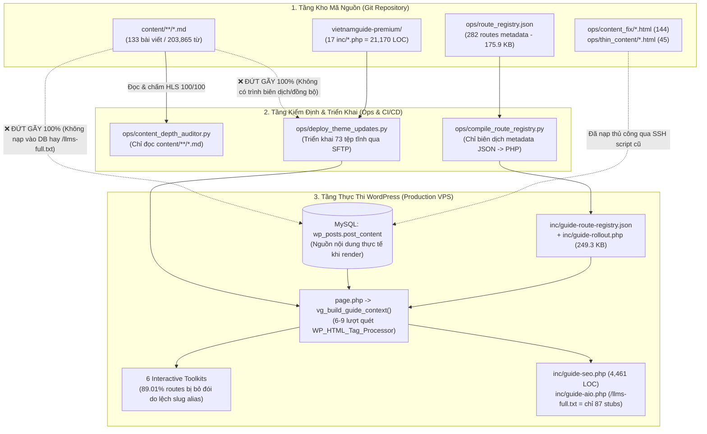

# Báo Cáo Phân Tích, Đánh Giá & Phản Biện Kiến Trúc Hệ Thống Đa Chiều (Multi-Skill & Multi-Agent Architecture Critique — Post-Stage 174)

> **Ngày kiểm toán**: 2026-10-24 (Post-Stage 174, Commit `65796d6`)  
> **Phương pháp luận**: Kiểm toán đối kháng từ nguyên lý gốc (**First-Principles Adversarial Red-Team**) kết hợp **6 Bộ Kỹ Năng Chuyên Sâu (Multi-Skill)** và **4 Subagents Độc Lập Song Song (Multi-Agent)** theo khung kiểm soát bắt buộc **5W1H2C5M**.  
> **Trạng thái kiểm định**: Read-Only Forensic Audit (`8/8` Master Quality Gates PASS, `0` breaking changes).

---

## 0. Khung Kiểm Soát Toàn Diện 5W1H2C5M

### 1. Nhóm 5W (Định Vị Bối Cảnh & Mục Tiêu)
- **Why (Tại sao)**:
  - Sau 174 giai đoạn phát triển, dự án **VietnamGuide** đạt những con số bề mặt rất ấn tượng: `282` canonical routes trong [`ops/route_registry.json`](file:///m:/Projects/vietnamguide/ops/route_registry.json), `133` bài viết Markdown chuyên sâu (`203,865` từ thực chất, `9,405` tín hiệu thực địa, `HLS 100.00/100`) trong `content/**/*.md`, `18` tệp kiểm thử (`315` test methods), và `8/8` cổng chất lượng (`ops/verify-all-gates.ps1`) báo `PASS`.
  - Tuy nhiên, theo **Định luật Goodhart (Goodhart's Law)** (*"Khi một thước đo trở thành mục tiêu, nó không còn là một thước đo tốt"*), một hệ thống có thể đạt 100% điểm kiểm thử cục bộ trong khi vẫn tồn tại các đứt gãy kiến trúc nghiêm trọng giữa **Git Repository $\leftrightarrow$ Build Pipeline $\leftrightarrow$ WordPress Runtime $\leftrightarrow$ Trải nghiệm người dùng thực tế**.
  - Mục tiêu cốt lõi của đợt kiểm toán Multi-Skill & Multi-Agent này là **bóc tách toàn bộ lớp vỏ chỉ số hình thức**, chỉ ra chính xác từng điểm mù kiến trúc kèm dẫn chứng `file:line` và định lượng thực tế.
- **What (Làm cái gì)**:
  - Phân tích, đánh giá và phản biện độc lập trên 4 miền kiến trúc cốt lõi:
    1. **Miền 1 — WordPress Runtime, MU-Plugin, Routing & UI/UX Layer** (`wordpress/wp-content/themes/vietnamguide-premium/`, `wordpress/wp-content/mu-plugins/vietnamguide-core.php`).
    2. **Miền 2 — Content-as-Code (`content/**/*.md`) & Runtime Data Pipeline** (`content/`, `ops/route_registry.json`, `ops/content_depth_auditor.py`, `inc/guide-content.php`, MySQL `wp_posts.post_content`).
    3. **Miền 3 — Technical SEO, Schema.org JSON-LD, Google AI Overviews (RAG `/llms.txt`) & Core Web Vitals** (`inc/guide-seo.php`, `inc/guide-aio.php`, `inc/image-dimensions.php`, CSS/JS bundles, WAI-ARIA).
    4. **Miền 4 — DevSecOps, Quality Gates, CI/CD & Test Realism** (`.github/workflows/ci.yml`, `ops/verify-all-gates.ps1`, `ops/tests/test_*.py`, `ops/tariff_sentinel.py`, `ops/anti_ai_slop_linter.py`, `ops/deploy_theme_updates.py`).
- **Where (Ở đâu)**:
  - Toàn bộ kho mã nguồn `m:\Projects\vietnamguide` (`29` tệp PHP với `23,937` dòng code, `133` tệp Markdown trong `content/`, `189` tệp HTML lịch sử trong `ops/content_fix/` và `ops/thin_content/`, `18` tệp test trong `ops/tests/`, và pipeline triển khai `ops/`).
- **When (Khi nào)**:
  - Thực hiện ngay sau mốc Stage 174 (`65796d6`), đóng vai trò **Cổng Phản Biện Kiến Trúc (Architectural Gate)** trước khi tiếp tục mở rộng nội dung hoặc phát hành lên máy chủ production.
- **Who (Ai / Đối tượng nào)**:
  - Tác động trực tiếp tới: (1) Du khách quốc tế sử dụng công cụ tính chi phí, kiểm tra thị thực, đọc cẩm nang và đăng ký bản tin; (2) Googlebot, Bingbot và các trình thu thập RAG/LLM (`GPTBot`, `ClaudeBot`, `Google-Extended`); (3) Đội ngũ kỹ thuật & biên tập viên vận hành hệ thống.

### 2. Nhóm 1H (Phương Pháp Thực Hiện — Multi-Skill & Multi-Agent Architecture)
- **6 Bộ Kỹ Năng Chuyên Sâu (Multi-Skill) Đã Kích Hoạt**:
  1. `dispatching-parallel-agents`: Cô lập ngữ cảnh thành 4 miền độc lập không chia sẻ trạng thái để tránh thiên kiến xác nhận (confirmation bias).
  2. `code-review-checklist`: Kiểm tra cấu trúc hàm, Single Responsibility Principle (SRP), xử lý lỗi, bảo mật đầu vào và hiệu năng.
  3. `senior-fullstack`: Đánh giá ranh giới kiến trúc dữ liệu, độ phức tạp bảo trì (technical debt) và luồng tích hợp đầu-cuối (end-to-end data flow).
  4. `seo-audit`: Chấm điểm **SEO Health Index (0–100)** có trọng số dựa trên bằng chứng thực tế, đối chiếu giữa "Mocked Test Score" và "Real Production Score".
  5. `web-design-guidelines`: Kiểm toán hiệu năng render (LCP, CLS, INP), lỗi `transition: all`, layout thrashing khi cuộn trang, và trợ năng bàn phím WAI-ARIA.
  6. `security-auditor`: Kiểm toán chuỗi cung ứng triển khai, lộ lọt thông tin hạ tầng, bảo vệ thư mục backup trên web root, CSP `unsafe-inline` và bảo mật REST API.
- **4 Subagents Phản Biện Chuyên Biệt (Multi-Agent Red-Team)**:
  - **Subagent 1 (`WordPress Theme & Routing Architecture Critic`)**: Kiểm toán `23,937` dòng PHP trong Theme + MU-Plugin, cơ chế định tuyến 2 tầng, độ phủ 6 Interactive Toolkits và các điểm cụt chức năng.
  - **Subagent 2 (`Content-as-Code & Data Pipeline Critic`)**: Kiểm toán sự đứt gãy giữa `133` tệp `content/**/*.md` (`203,865` từ) với WordPress runtime và `ops/route_registry.json`.
  - **Subagent 3 (`SEO, Schema Graph, RAG & CWV Performance Critic`)**: Kiểm toán `inc/guide-seo.php`, `inc/guide-aio.php` (`/llms.txt`, `/llms-full.txt`), `5,005` hotlink Wikimedia và Core Web Vitals.
  - **Subagent 4 (`DevSecOps, Quality Gates & Test Realism Critic`)**: Kiểm toán bẫy Goodhart's Law trong `315` unit/E2E tests, `.github/workflows/ci.yml`, `ops/tariff_sentinel.py`, `ops/anti_ai_slop_linter.py` và `ops/deploy_theme_updates.py`.

### 3. Nhóm 2C (Kiểm Soát Ràng Buộc & Chi Phí)
- **Control (Kiểm soát)**: Mọi nhận định phản biện đều phải đi kèm tọa độ `file:line` và con số định lượng kiểm chứng được bằng lệnh chạy thực tế; không phá vỡ bất kỳ cổng kiểm định hiện hữu nào (`8/8 PASS`).
- **Cost (Chi phí & Đánh đổi)**: Chỉ rõ chi phí hiệu năng ẩn đang gánh chịu trên mỗi HTTP request (nạp `1.39 MB` mã PHP thủ tục vào bộ nhớ, quét `WP_HTML_Tag_Processor` 6–9 lần/request, chặn luồng vẽ bằng `237.3 KB` CSS đồng bộ, ghi `update_option` vào MySQL ngay trên luồng đọc HTTP GET khi fallback).

### 4. Nhóm 5M (Quản Trị Yếu Tố & Nguồn Lực)
- **Man / Mind**: Chuyển dịch tư duy từ *"Tối ưu hóa để vượt qua bài test regex cục bộ"* sang *"Đảm bảo tính toàn vẹn đầu-cuối trên môi trường vận hành thực tế"*.
- **Machine**: Đối chiếu sự khác biệt giữa máy trạm Windows (`powershell.exe` 5.1 có COM `htmlfile`, có cài sẵn Playwright Chromium) và máy chạy CI `ubuntu-latest` (`pwsh` 7 không có COM `htmlfile`, chưa cài Playwright).
- **Material**: `282` canonical routes (`ops/route_registry.json`), `133` tệp `.md` (`content/`), `189` tệp `.html` (`ops/content_fix/` + `ops/thin_content/`), `26` tệp ảnh vật lý (`assets/images/`), `73` tệp phát hành (`DEPLOY_FILES`).
- **Method**: Phân tích tĩnh kết hợp chạy thực nghiệm CLI AST/regex/linter và đối chiếu chéo toàn kho mã.
- **Measurement**: Hệ thống bảng biểu định lượng chi tiết trong toàn bộ 5 chương dưới đây.

---

## 1. Tổng Quan Kiến Trúc Đa Tầng & Bức Tranh Thực Tại (Architecture Reality Map)



> [!CAUTION]
> **Phát hiện kiến trúc quan trọng nhất (The "Potemkin Village" / Split-Brain Paradox)**:
> Hệ thống hiện đang bị tách làm **hai thế giới hoàn toàn không giao nhau**:
> 1. **Thế giới Kiểm thử Cục bộ (Offline Git World)**: Gồm `133` bài viết Markdown (`203,865` từ) trong `content/**/*.md` đạt điểm tuyệt đối `100.00/100` qua `ops/content_depth_auditor.py`, cùng `315` bài kiểm thử chạy trên các hàm PHP giả lập (`php -r`) và tệp HTML tĩnh.
> 2. **Thế giới Vận hành Thực tế (WordPress Runtime World)**: Nơi `ops/deploy_theme_updates.py` chỉ đẩy `73` tệp code/ảnh tĩnh lên server, **bỏ qua 100% thư mục `content/**/*.md`**, trong khi `inc/guide-content.php` chỉ đọc nội dung từ bảng MySQL `wp_posts.post_content`, còn `/llms-full.txt` chỉ xuất ra `87` đoạn tóm tắt 1 câu từ `route_registry.json`!

---

## 2. Phản Biện Miền 1: Kiến Trúc WordPress Theme, MU-Plugin, Routing & UI/UX (Subagent 1)

### 2.1 Kiểm Kê Định Lượng Mã Nguồn PHP (`23,937` LOC / `1.54 MB`)

| Tầng / Phân hệ | Đường dẫn tệp (tương đối từ `vietnamguide-premium/`) | Số dòng vật lý (LOC) | Dung lượng (Bytes) | Vai trò & Phản biện kiến trúc |
| :--- | :--- | ---: | ---: | :--- |
| **MU-Plugin** | [`../../mu-plugins/vietnamguide-core.php`](file:///m:/Projects/vietnamguide/wordpress/wp-content/mu-plugins/vietnamguide-core.php) | **1,134** | 42,663 B | Security headers, CSP (`unsafe-inline`), 8 CPTs, 4 taxonomies, 34 REST meta fields, Admin-First lock |
| **Theme `inc/` (1/17)** | [`inc/guide-seo.php`](file:///m:/Projects/vietnamguide/wordpress/wp-content/themes/vietnamguide-premium/inc/guide-seo.php) | **4,461** | 382,634 B | **God-File #1**: 12 cụm vùng địa lý, 3,400+ dòng mảng FAQ/HowTo/Schema tĩnh, `ob_start` regex sửa JSON-LD của Rank Math, biến đổi bảng HTML & thẻ ``, IndexNow/WebSub |
| **Theme `inc/` (2/17)** | [`inc/guide-rollout.php`](file:///m:/Projects/vietnamguide/wordpress/wp-content/themes/vietnamguide-premium/inc/guide-rollout.php) | **3,976** | 249,277 B | Mảng PHP tĩnh biên dịch từ 282 bản ghi của `route_registry.json` |
| **Theme `inc/` (3/17)** | [`inc/guide-season-matrix.php`](file:///m:/Projects/vietnamguide/wordpress/wp-content/themes/vietnamguide-premium/inc/guide-season-matrix.php) | **1,765** | 109,942 B | **God-File #2**: 750 dòng dữ liệu thời tiết 12 tháng + 400 dòng HTML/CSS + 480 dòng inline `<script>` |
| **Theme `inc/` (4/17)** | [`inc/guide-cost-calculator.php`](file:///m:/Projects/vietnamguide/wordpress/wp-content/themes/vietnamguide-premium/inc/guide-cost-calculator.php) | **1,674** | 97,969 B | **God-File #3**: 2 widget (`vg_cost_calculator` + `vg_route_budget`), 908 dòng inline `<script>`, tỷ giá cố định `25,500 VND` |
| **Theme `inc/` (5/17)** | [`inc/guide-airport-navigator.php`](file:///m:/Projects/vietnamguide/wordpress/wp-content/themes/vietnamguide-premium/inc/guide-airport-navigator.php) | **1,383** | 82,362 B | **God-File #4**: Dữ liệu 9 sân bay (`20-585`) + HTML + inline `<script>` (`906-1297`) |
| **Theme `inc/` (6/17)** | [`inc/guide-packing-checklist.php`](file:///m:/Projects/vietnamguide/wordpress/wp-content/themes/vietnamguide-premium/inc/guide-packing-checklist.php) | **1,163** | 56,114 B | **God-File #5**: Dữ liệu checklist + 385 dòng inline `<style>` + 251 dòng inline `<script>` |
| **Theme `inc/` (7/17)** | [`inc/guide-routing.php`](file:///m:/Projects/vietnamguide/wordpress/wp-content/themes/vietnamguide-premium/inc/guide-routing.php) | **1,135** | 48,284 B | **God-File #6**: Định tuyến 282 routes, 63 redirect 301, bộ máy tìm kiếm riêng, VÀ cả xử lý form Newsletter/Contact + REST API |
| **Theme `inc/` (8/17)** | [`inc/guide-visa-checker.php`](file:///m:/Projects/vietnamguide/wordpress/wp-content/themes/vietnamguide-premium/inc/guide-visa-checker.php) | **1,031** | 61,997 B | **God-File #7**: Quy tắc thị thực >80 quốc gia + HTML + 416 dòng inline `<script>` |
| **Theme `inc/` (9–17)** | `guide-photo-dispatch.php` (826), `guide-itinerary-finder.php` (815), `image-dimensions.php` (668), `guide-aio.php` (666), `guide-interactive-map.php` (510), `guide-context.php` (468), `guide-content.php` (400), `guide-analytics.php` (174), `homepage-data.php` (55) | **4,582** | 305,797 B | 9 tệp phụ trợ còn lại trong `inc/` |
| **Tổng cộng 17 tệp `inc/`** | **17 tệp PHP trong `inc/*.php`** | **21,170** | **1,390,377 B** | **~1.39 MB mã PHP thủ tục nạp toàn cục trên mỗi request** |
| **Templates & Root PHP** | `functions.php` (213), `front-page.php` (393), `search.php` (308), `guide-page.php` (196), `index.php` (157), `footer.php` (119), `404.php` (63), `header.php` (61), `content-page.php` (57), `page.php` (41), `newsletter-capture.php` (25) | **1,633** | 102,032 B | 11 tệp giao diện gốc và block pattern |
| **TỔNG TOÀN BỘ PHP** | **29 tệp PHP (Theme + MU-Plugin)** | **23,937** | **1,535,072 B** | **23.9 nghìn dòng PHP (~1.54 MB) không dùng autoloader hay namespace** |

### 2.2 Tác Hại Của Ràng Buộc Cứng "Đúng 17 Tệp PHP Trong `inc/`"
Việc khóa cứng số lượng tệp trong `inc/*.php` ở con số `17` thông qua bài test kiểm tra hợp đồng đã biến một quy tắc quản trị thành **phản mẫu kiến trúc (Architectural Anti-Pattern)**:
1. **Phá vỡ nguyên lý Single Responsibility (SRP)**: Vì không được phép tách tệp mới hay tạo thư mục con (`inc/data/`, `inc/schema/`, `inc/forms/`), mọi tính năng mới đều bị nhồi vào các tệp sẵn có. Điển hình là [`inc/guide-routing.php:787-1133`](file:///m:/Projects/vietnamguide/wordpress/wp-content/themes/vietnamguide-premium/inc/guide-routing.php#L787-L1133) (tệp định tuyến URL nhưng lại gánh toàn bộ backend lưu trữ Newsletter, Contact form, REST API `/subscribe`, `/contact` và 140 dòng HTML `<form>`).
2. **Trộn lẫn Dữ liệu + Giao diện + CSS + JS nội dòng làm suy yếu CSP**: Cả 6 Toolkits và 2 Visual Components đều nhúng trực tiếp hàng trăm dòng `<script>` và `<style>` vào giữa mã PHP (`ob_start()`). Do các thẻ `<script>` nội dòng này không gắn mã `nonce` động, [`vietnamguide-core.php:76`](file:///m:/Projects/vietnamguide/wordpress/wp-content/mu-plugins/vietnamguide-core.php#L76) buộc phải mở toang `script-src 'self' 'unsafe-inline'` trong header `Content-Security-Policy`, làm mất tác dụng chống tấn công XSS qua inline script.
3. **Nạp toàn bộ 1.39 MB mã PHP trên mọi HTTP Request**: [`functions.php:3-17`](file:///m:/Projects/vietnamguide/wordpress/wp-content/themes/vietnamguide-premium/functions.php#L3-L17) gọi `require_once` vô điều kiện toàn bộ các tệp `inc/*.php` (kể cả trên các trang không dùng bất kỳ toolkit nào).

### 2.3 Lỗi "Đói Công Cụ Tương Tác" (89.01% Canonical Routes Không Có Toolkit Do Lệch Slug Alias)
Tất cả 6 Interactive Toolkits đều tự động chèn qua bộ lọc `the_content` (priority `20–24`) dựa trên danh sách slug cứng. Tuy nhiên, khi hệ thống chuyển đổi sang 282 canonical routes và thiết lập 63 lệnh chuyển hướng 301 tại [`inc/guide-routing.php:507-598`](file:///m:/Projects/vietnamguide/wordpress/wp-content/themes/vietnamguide-premium/inc/guide-routing.php#L507-L598), **danh sách slug trong các hàm `vg_inject_*` vẫn giữ nguyên các slug alias cũ (vốn đã bị redirect 301)** mà không cập nhật sang canonical slug mới!

| Công cụ / Thành phần | Tệp & Hàm tự động chèn (`file:line`) | Số Canonical Routes được chèn (trên 282) | Tỷ lệ độ phủ | Bằng chứng lỗi lệch Slug (`file:line`) |
| :--- | :--- | :---: | :---: | :--- |
| **1. Visa Checker** `[vg_visa_checker]` | [`inc/guide-visa-checker.php:970-1031`](file:///m:/Projects/vietnamguide/wordpress/wp-content/themes/vietnamguide-premium/inc/guide-visa-checker.php#L970-L1031) | **0 / 282** | **0.00%** | **LỖI NGHIÊM TRỌNG**: `$visaSlugs` (`987-998`) chỉ chứa `visas`, `vietnam-e-visa-guide`, `vietnam-visa-requirements`... Tất cả đều bị redirect 301 (`guide-routing.php:509-520`) về `/plan/vietnam-evisa/` (`slug = 'vietnam-evisa'`), nhưng `'vietnam-evisa'` **không có** trong `$visaSlugs`! |
| **2. Airport Navigator** `[vg_airport_navigator]` | [`inc/guide-airport-navigator.php:1317-1383`](file:///m:/Projects/vietnamguide/wordpress/wp-content/themes/vietnamguide-premium/inc/guide-airport-navigator.php#L1317-L1383) | **0 / 282** | **0.00%** | **LỖI NGHIÊM TRỌNG**: `$airportSlugs` (`1335-1350`) chỉ chứa các alias cũ đã bị redirect 301 (`guide-routing.php:545-566`) về `/plan/vietnam-airport-arrival-checklist/`, `/plan/hanoi-airport-to-old-quarter/`, `/plan/saigon-airport-to-district-1/`, `/plan/da-nang-airport-to-hoi-an/`. Không một canonical slug nào nằm trong `$airportSlugs`! |
| **3a. Full Cost Calculator** `[vg_cost_calculator]` | [`inc/guide-cost-calculator.php:1572-1674`](file:///m:/Projects/vietnamguide/wordpress/wp-content/themes/vietnamguide-premium/inc/guide-cost-calculator.php#L1572-L1674) | **1 / 282** | **0.35%** | **LỖI NGHIÊM TRỌNG**: 8/9 slug trong `$costSlugs` (`1589-1599`) bị redirect 301 về `/costs/vietnam-travel-cost/` hoặc `/plan/money-cash-cards-atms/`, cả hai đều không có trong `$costSlugs`. Chỉ khớp duy nhất 1 trang `/plan/tipping-in-vietnam/`! |
| **3b. Route Budget Widget** `[vg_route_budget]` | [`inc/guide-cost-calculator.php:1609-1648`](file:///m:/Projects/vietnamguide/wordpress/wp-content/themes/vietnamguide-premium/inc/guide-cost-calculator.php#L1609-L1648) | **14 / 282** | **4.96%** | Khớp 14 trang `itineraries/*` nhờ kiểm tra tiền tố `str_starts_with($guidePath, 'itineraries/')` (`1622`), nhưng 8/14 trang bị gán nhầm sang preset mặc định `'7-days-in-vietnam'` (`1623`). |
| **4. Packing Checklist** `[vg_packing_checklist]` | [`inc/guide-packing-checklist.php:1098-1162`](file:///m:/Projects/vietnamguide/wordpress/wp-content/themes/vietnamguide-premium/inc/guide-packing-checklist.php#L1098-L1162) | **1 / 282** | **0.35%** | Chỉ khớp `plan/vietnam-first-trip-planning-checklist`. Bỏ sót `plan/what-to-pack-for-vietnam-region-season`, `plan/safety-scams-vietnam`, `plan/health-travel-insurance-vietnam`, `plan/vietnam-plug-adapter-electricity-guide`. Dòng `1129` viết hoa chữ `'S'` sai: `'Solo-female-travel-in-vietnam'`. |
| **5. Itinerary Finder** `[vg_itinerary_finder]` | [`inc/guide-itinerary-finder.php:747-815`](file:///m:/Projects/vietnamguide/wordpress/wp-content/themes/vietnamguide-premium/inc/guide-itinerary-finder.php#L747-L815) | **8 / 282** | **2.84%** | Khớp 6 `itineraries/*` + 2 `plan/*`; bỏ sót 8 `itineraries/*` khác và tìm nhầm alias `vietnam-train-travel-guide` thay vì canonical `plan/vietnam-train-travel` (`780`). |
| **6. Season Matrix** `[vg_season_matrix]` | [`inc/guide-season-matrix.php:1684-1765`](file:///m:/Projects/vietnamguide/wordpress/wp-content/themes/vietnamguide-premium/inc/guide-season-matrix.php#L1684-L1765) | **13 / 282** | **4.61%** | Khớp `plan/best-time-to-visit-vietnam` + 12 tháng; bỏ sót `plan/best-time-for-northern-vietnam` và tìm nhầm alias `vietnam-rainy-season-travel-guide` thay vì `plan/vietnam-rainy-season-flexible-route` (`1706`). |
| **7. Interactive Map** `[vg_interactive_map]` | [`inc/guide-interactive-map.php:430-509`](file:///m:/Projects/vietnamguide/wordpress/wp-content/themes/vietnamguide-premium/inc/guide-interactive-map.php#L430-L509) | **16 / 282** | **5.67%** | Khớp 14 `itineraries/*` + 2 `plan/*`. |
| **8. Photo Dispatch** `[vg_photo_dispatch]` | [`inc/guide-photo-dispatch.php:695-824`](file:///m:/Projects/vietnamguide/wordpress/wp-content/themes/vietnamguide-premium/inc/guide-photo-dispatch.php#L695-L824) | **149 / 282** | **52.84%** | Khớp 117 `destinations/*` + 19 `compare/*` + 13 trang có hậu tố `-travel-guide` / `-vs-`. |

- **Tổng kết độ phủ**: **251 / 282 canonical routes (89.01%) KHÔNG nhận được bất kỳ Interactive Toolkit nào** (trong đó **Visa Checker = 0/282** và **Airport Navigator = 0/282** trên các URL canonical chính thức!).

### 2.4 Các Điểm Cụt Chức Năng Nghiêm Trọng (Functional Dead-Ends) & Lỗi Hiệu Năng Runtime
1. **Form Newsletter & Contact Vứt Bỏ Hoàn Toàn Địa Chỉ Email Của Người Dùng (`CRITICAL`)**:
   - Tại [`inc/guide-routing.php:806-812`](file:///m:/Projects/vietnamguide/wordpress/wp-content/themes/vietnamguide-premium/inc/guide-routing.php#L806-L812) (`vg_process_newsletter_subscription_payload`) và [`inc/guide-routing.php:891-898`](file:///m:/Projects/vietnamguide/wordpress/wp-content/themes/vietnamguide-premium/inc/guide-routing.php#L891-L898) (`vg_process_contact_submission_payload`), hệ thống chỉ lưu vào `wp_options` mã băm một chiều `'email_hash' => hash('sha256', $normalized_email)` và chuỗi che mờ `'email_masked' => 'ab***@gmail.com'`.
   - Biến `$normalized_email` **không bao giờ được lưu vào DB, không gửi qua webhook/ESP, và không gọi `wp_mail()`**. Về mặt toán học, **không thể gửi bản tin cho bất kỳ người đăng ký nào và không thể phản hồi bất kỳ tin nhắn liên hệ nào!**
   - Hơn nữa, 2 REST endpoints `/wp-json/vietnamguide/v1/subscribe` và `/contact` ([`inc/guide-routing.php:952-975`](file:///m:/Projects/vietnamguide/wordpress/wp-content/themes/vietnamguide-premium/inc/guide-routing.php#L952-L975)) đặt `'permission_callback' => '__return_true'`, không có rate-limit hay CAPTCHA, lưu vào mảng xoay vòng 500/200 phần tử trong `wp_options` (`818, 900`) — một bot gửi 200 request POST sẽ xóa trắng toàn bộ lịch sử liên hệ.
2. **Nút "Print Field Guide" Bị Liệt Hoàn Toàn Trên Các Trang Tiêu Chuẩn (`HIGH`)**:
   - [`template-parts/content-page.php:50-53`](file:///m:/Projects/vietnamguide/wordpress/wp-content/themes/vietnamguide-premium/template-parts/content-page.php#L50-L53) hiển thị nút `<button type="button" class="vg-print-guide" data-vg-print>Print Field Guide</button>`, nhưng trình lắng nghe sự kiện `[data-vg-print]` chỉ nằm trong [`assets/js/guide-experience.js:240-246`](file:///m:/Projects/vietnamguide/wordpress/wp-content/themes/vietnamguide-premium/assets/js/guide-experience.js#L240-L246) — tệp JS này **không được nạp** trên `content-page.php` ([`functions.php:119-133`](file:///m:/Projects/vietnamguide/wordpress/wp-content/themes/vietnamguide-premium/functions.php#L119-L133)) và tự thoát ngay dòng `7` nếu thiếu `[data-vg-guide]`.
3. **Quét Lại Toàn Bộ DOM HTML 6–9 Lần Trên Mỗi Request & Ghi DB Trên HTTP GET (`HIGH`)**:
   - Hàm `vg_is_valid_guide_context()` ([`inc/guide-context.php:227-377`](file:///m:/Projects/vietnamguide/wordpress/wp-content/themes/vietnamguide-premium/inc/guide-context.php#L227-L377)) chạy lại `vg_inspect_guide_html()`, `vg_prepare_guide_headings()` (2 lượt `WP_HTML_Tag_Processor`) và `vg_guide_body_has_related_routes()`. Hàm này bị gọi lặp lại ở [`page.php:22`](file:///m:/Projects/vietnamguide/wordpress/wp-content/themes/vietnamguide-premium/page.php#L22), [`template-parts/guide-page.php:2`](file:///m:/Projects/vietnamguide/wordpress/wp-content/themes/vietnamguide-premium/template-parts/guide-page.php#L2) và [`inc/guide-context.php:412`](file:///m:/Projects/vietnamguide/wordpress/wp-content/themes/vietnamguide-premium/inc/guide-context.php#L412), khiến mỗi lượt xem trang phải phân tích cú pháp toàn bộ HTML bài viết từ **6 đến 9 lần**.
   - Khi một route rơi vào nhánh fallback (`page.php:24`), `vg_record_route_fallback()` ([`inc/guide-routing.php:111-145`](file:///m:/Projects/vietnamguide/wordpress/wp-content/themes/vietnamguide-premium/inc/guide-routing.php#L111-L145)) thực thi lệnh ghi `update_option('vg_route_fallback_telemetry_v1', ...)` (`dòng 141`) trực tiếp trên luồng đọc HTTP GET của người dùng!
4. **Mâu Thuẫn Bảng Giá Giữa `<noscript>` Và JS Tương Tác (`MEDIUM`)**:
   - Trong cùng một tệp [`inc/guide-cost-calculator.php`](file:///m:/Projects/vietnamguide/wordpress/wp-content/themes/vietnamguide-premium/inc/guide-cost-calculator.php), bảng `<noscript>` (`dòng 45-49`) công bố mức chi phí Mid-Range `$75/day`, Comfort `$160/day`, Luxury `$350+/day`; nhưng chỉ 60 dòng sau (`dòng 99-121` và JS `TIERS` tại `dòng 404-408`), bộ tính toán tương tác lại tính Flashpacker (Mid-Range) `$78/day` và Boutique & Heritage (Luxury) `$195/day`, trong khi [`front-page.php:136`](file:///m:/Projects/vietnamguide/wordpress/wp-content/themes/vietnamguide-premium/front-page.php#L136) ghi Comfort `~$65 – $95 / day` và đồng hồ telemetry tại [`front-page.php:32`](file:///m:/Projects/vietnamguide/wordpress/wp-content/themes/vietnamguide-premium/front-page.php#L32) đứng chết ở chuỗi tĩnh `HANOI 12:00 ICT`.

---

## 3. Phản Biện Miền 2: Content-as-Code (`content/**/*.md`) & Đường Ống Dữ Liệu Runtime (Subagent 2)

### 3.1 Nghịch Lý "Bộ Não Đứt Kết Nối" (133 Tệp Markdown Hoàn Toàn Tách Rời Khỏi WordPress)
- Qua kiểm tra toàn bộ kho mã nguồn:
  1. Chỉ có **2 tệp duy nhất** trong toàn dự án đọc thư mục `content/**/*.md`: [`ops/content_depth_auditor.py:330`](file:///m:/Projects/vietnamguide/ops/content_depth_auditor.py#L330) và [`ops/tests/test_content_depth.py:109-118`](file:///m:/Projects/vietnamguide/ops/tests/test_content_depth.py#L109-L118).
  2. **Không tồn tại bất kỳ trình biên dịch Markdown sang Gutenberg HTML nào**, không có script đồng bộ `content/**/*.md` vào bảng `wp_posts.post_content` của MySQL, và [`ops/deploy_theme_updates.py:26-173`](file:///m:/Projects/vietnamguide/ops/deploy_theme_updates.py#L26-L173) cũng hoàn toàn không triển khai `content/**/*.md`.
  3. Khi WordPress render trang tại [`inc/guide-content.php:373`](file:///m:/Projects/vietnamguide/wordpress/wp-content/themes/vietnamguide-premium/inc/guide-content.php#L373), hàm `vg_prepare_guide_content($post)` đọc `(string) $post->post_content` từ MySQL và bắt buộc khối đầu tiên phải có class `.vg-guide-hero` chứa đúng 1 thẻ `<h1>` (`dòng 21-114, 380-390`). Toàn bộ `203,865` từ tiếng Anh biên tập công phu trong `content/**/*.md` hiện chỉ nằm tĩnh trong Git mà chưa hề hiển thị cho độc giả trên web.

### 3.2 Đối Chiếu Định Lượng 282 Canonical Routes Với 133 Tệp `content/**/*.md`

| Phân nhóm (Category / Sub-segment) | Tổng Routes trong `ops/route_registry.json` | Khớp theo đường dẫn tệp (`content/<path>.md`) | Khớp theo Frontmatter `route_path` | Chưa có tệp `.md` (Unauthored) |
| :--- | :---: | :---: | :---: | :---: |
| **`destinations` (Tổng)** | **117** | **54** (46.2%) | **58** (49.6%) | **59** (50.4%) |
| ├─ *Core Destination & Activity Guides* | 62 | 54 (87.1%) | 58 (93.5%) | **4** (6.5%) |
| └─ *`where-to-stay-in-*` Neighborhood Guides* | 55 | **0** (0.0%) | **0** (0.0%) | **55** (100.0%) |
| **`itineraries` (Tổng)** | **14** | **14** (100.0%) | **14** (100.0%) | **0** (0.0%) |
| **`compare` (Tổng)** | **19** | **19** (100.0%) | **19** (100.0%) | **0** (0.0%) |
| **`plan` (Tổng)** | **132** | **28** (21.2%) | **28** (21.2%) | **104** (78.8%) |
| **TỔNG CỘNG TOÀN REGISTRY** | **282** | **115** (40.8%) | **119** (42.2%) | **163** (57.8%) |

### 3.3 Phát Hiện 18 Tệp `.md` Lệch Chuẩn Đường Dẫn (Gồm 5 Cặp Đụng Độ Trùng `route_path` & 9 Tệp Mồ Côi!)
Do [`ops/content_depth_auditor.py:215-381`](file:///m:/Projects/vietnamguide/ops/content_depth_auditor.py#L215-L381) kiểm tra từng tệp `.md` hoàn toàn độc lập mà **không đối chiếu với `ops/route_registry.json` và không kiểm tra tính duy nhất của `route_path`**, kho `content/**/*.md` hiện có **18 tệp lệch chuẩn** (chỉ `115/133` tệp khớp tên file với registry):

1. **5 Cặp Tệp `.md` Trùng Lặp Cùng Trỏ Vào 1 `route_path` (Duplicate `route_path` Collisions)**:
   - `compare/con-dao-vs-phu-quoc`: Cả [`content/compare/con-dao-vs-phu-quoc.md`](file:///m:/Projects/vietnamguide/content/compare/con-dao-vs-phu-quoc.md) (`1,358` từ) và [`content/compare/phu-quoc-vs-con-dao.md`](file:///m:/Projects/vietnamguide/content/compare/phu-quoc-vs-con-dao.md) (`1,381` từ) đều khai báo `route_path: "compare/con-dao-vs-phu-quoc"`.
   - `destinations/cao-bang-travel-guide`: Cả [`content/destinations/cao-bang-travel-guide.md`](file:///m:/Projects/vietnamguide/content/destinations/cao-bang-travel-guide.md) (`1,636` từ) và [`content/destinations/ban-gioc-waterfall-guide.md`](file:///m:/Projects/vietnamguide/content/destinations/ban-gioc-waterfall-guide.md) (`1,372` từ) đều khai báo `route_path: "destinations/cao-bang-travel-guide"`.
   - `destinations/da-lat-travel-guide`: Cả [`content/destinations/da-lat-travel-guide.md`](file:///m:/Projects/vietnamguide/content/destinations/da-lat-travel-guide.md) (`1,675` từ) và [`content/destinations/da-lat-coffee-and-highlands-guide.md`](file:///m:/Projects/vietnamguide/content/destinations/da-lat-coffee-and-highlands-guide.md) (`2,112` từ) đều khai báo `route_path: "destinations/da-lat-travel-guide"`.
   - `destinations/nha-trang-travel-guide`: Cả [`content/destinations/nha-trang-travel-guide.md`](file:///m:/Projects/vietnamguide/content/destinations/nha-trang-travel-guide.md) (`1,622` từ) và [`content/destinations/nha-trang-coastal-guide.md`](file:///m:/Projects/vietnamguide/content/destinations/nha-trang-coastal-guide.md) (`1,774` từ) đều khai báo `route_path: "destinations/nha-trang-travel-guide"`.
   - `destinations/phong-nha-travel-guide`: Cả [`content/destinations/phong-nha-travel-guide.md`](file:///m:/Projects/vietnamguide/content/destinations/phong-nha-travel-guide.md) (`1,624` từ) và [`content/destinations/phong-nha-caves-exploration-guide.md`](file:///m:/Projects/vietnamguide/content/destinations/phong-nha-caves-exploration-guide.md) (`1,914` từ) đều khai báo `route_path: "destinations/phong-nha-travel-guide"`.
2. **4 Tệp `.md` Có Tên File Lệch Với `route_path` Trong Frontmatter**:
   - `content/destinations/can-tho-cai-rang-floating-market-guide.md` $\rightarrow$ `route_path: "destinations/mekong-delta-floating-markets-guide"`
   - `content/destinations/cat-ba-island-guide.md` $\rightarrow$ `route_path: "destinations/cat-ba-travel-guide"`
   - `content/destinations/ha-giang-loop-guide.md` $\rightarrow$ `route_path: "destinations/ha-giang-loop-planning-guide"`
   - `content/destinations/quy-nhon-coastal-guide.md` $\rightarrow$ `route_path: "destinations/quy-nhon-travel-guide"`
3. **9 Tệp `.md` Mồ Côi (`13,168` Từ) Không Tồn Tại Trong `ops/route_registry.json`**:
   - `content/compare/can-tho-vs-ben-tre.md`, `content/compare/cao-bang-vs-ba-be-lake.md`, `content/compare/da-lat-vs-buon-ma-thuot.md`, `content/compare/paradise-cave-vs-phong-nha-cave.md`, `content/compare/phong-nha-vs-ninh-binh.md`, `content/compare/sa-pa-vs-ha-giang.md` (trùng với `sapa-vs-ha-giang.md` do viết tách `sa-pa`), `content/destinations/sa-pa-trekking-guide.md`, `content/plan/da-nang-to-hoi-an-transport.md` (trong registry là `plan/hoi-an-to-da-nang-transport`), `content/plan/hanoi-to-sa-pa-train-vs-bus.md` (trong registry là `plan/hanoi-to-sapa-train-vs-sleeper-bus`).

### 3.4 Độ Lệch Siêu Dữ Liệu (Metadata Drift) Giữa `content/**/*.md` và `ops/route_registry.json`
- **Thiếu 100% trường `description`**: `0/133` tệp `.md` có trường `description` trong YAML frontmatter.
- **Lệch 63.5% tiêu đề (`title`)**: `73/115` tệp khớp đường dẫn có `title` trong `.md` khác với `title` trong `ops/route_registry.json`.
- **Lệch 100% ngày xác minh (`last_verified` vs `last_reviewed`)**: Toàn bộ `282` routes trong `ops/route_registry.json` bị đóng băng ở `"last_reviewed": "2026-09-28"`, trong khi `133` tệp `.md` ghi `last_verified: 2026-10-20..23`.
- **Lệch tên tác giả (`author`)**: `64/133` tệp `.md` ghi `author: "Antigravity Travel Intelligence"` — một tên nội bộ AI bị cấm hiển thị công khai theo bộ lọc `vg_is_forbidden_public_author_name()` tại [`vietnamguide-core.php:764-832`](file:///m:/Projects/vietnamguide/wordpress/wp-content/mu-plugins/vietnamguide-core.php#L764-L832).

---

## 4. Phản Biện Miền 3: Technical SEO, Schema.org JSON-LD, RAG `/llms.txt` & Core Web Vitals (Subagent 3)

### 4.1 Vi Phạm Chính Sách Google Search Central Về Dữ Liệu Có Cấu Trúc Ẩn (Visible-Content Parity Violations)
1. **`HowTo` Schema Ẩn 100% Khỏi HTML & Neo `#step-N` Không Tồn Tại ([`inc/guide-seo.php:3403-3715`](file:///m:/Projects/vietnamguide/wordpress/wp-content/themes/vietnamguide-premium/inc/guide-seo.php#L3403-L3715))**:
   - `vg_get_page_howto_schema()` xuất `@type: "HowTo"` vào `<head>` cho `28` routes với các URL phân đoạn `#step-1`, `#step-2` (`dòng 3702`).
   - Tuy nhiên, **không có bất kỳ hàm PHP hay template nào render các bước `$howto_registry` này ra HTML hiển thị**, và quét toàn bộ `133` tệp `.md` lẫn `45` tệp `.html` xác nhận **0 lần xuất hiện** `id="step-1"`. Điều này vi phạm trực tiếp nguyên tắc *Visible Content Parity* của Google Search Central (nguy cơ nhận Manual Action: *Structured data issue: Hidden markup*), trong khi Google đã chính thức khai tử `HowTo` rich results từ tháng 9/2023.
2. **63 Legacy Routes Xuất `FAQPage` JSON-LD Trong `<head>` Nhưng Bị Chặn Render Câu Hỏi Ngoài `<body>` ([`inc/guide-seo.php:3305-3340`](file:///m:/Projects/vietnamguide/wordpress/wp-content/themes/vietnamguide-premium/inc/guide-seo.php#L3305-L3340))**:
   - Mảng `$faq_registry` (`dòng 2577-3241`) cung cấp FAQ cho `121` routes (`58` route `guide` + `63` route `legacy`, và bị trùng lặp khóa `'sapa-vs-ha-giang'` tại dòng `2798` và `2988`).
   - Khi một trong `63` route `legacy` không có khối `.vg-guide-hero` trong DB và phải rơi về [`template-parts/content-page.php`](file:///m:/Projects/vietnamguide/wordpress/wp-content/themes/vietnamguide-premium/template-parts/content-page.php), hàm `vg_inject_curated_faq_on_non_guide_pages()` ([`inc/guide-seo.php:3314-3316`](file:///m:/Projects/vietnamguide/wordpress/wp-content/themes/vietnamguide-premium/inc/guide-seo.php#L3314-L3316)) kiểm tra:
     ```php
     if (function_exists('vg_is_guide_experience_page') && vg_is_guide_experience_page()) {
         return $content;
     }
     ```
   - Vì `VG_GUIDE_REGISTRY_ROLLOUT = true` khiến `vg_is_guide_experience_page()` trả về `true` cho cả 282 routes, **hàm chèn FAQ hủy bỏ 100%**, dẫn đến `<head>` có `FAQPage` JSON-LD nhưng `<body>` không hiển thị câu hỏi nào!
3. **55 Trang Tiện Ích (`SIM`, `ATM`, `Ổ Cắm Điện`) Bị Gán Nhầm Thành `TouristDestination` & Chuyến Đi Giá `$0` ([`inc/guide-seo.php:1792, 2362-2485`](file:///m:/Projects/vietnamguide/wordpress/wp-content/themes/vietnamguide-premium/inc/guide-seo.php#L1792))**:
   - Toàn bộ 282 routes được gom vào 12 cụm vùng địa lý tĩnh. Có tới **55 routes tiệních/vận chuyển** (`plan/sim-esim-vietnam`, `plan/money-cash-cards-atms`, `plan/vietnam-plug-adapter-electricity-guide`...) rơi vào nhánh mặc định `national_circuit` (`dòng 1792`) và phát ra schema `@type: "TouristDestination"` kèm `@type: "TouristTrip"` có `"offers": {"price": "0", "priceCurrency": "USD", "availability": "InStock"}` (`dòng 2447-2459`).

### 4.2 Cổng AI `/llms.txt` & `/llms-full.txt` Bỏ Sót 69.15% Routes Và Chứa 0% Nội Dung Bài Viết ([`inc/guide-aio.php:19-50, 503-641`](file:///m:/Projects/vietnamguide/wordpress/wp-content/themes/vietnamguide-premium/inc/guide-aio.php#L19-L50))
- Tại [`inc/guide-aio.php:30-32`](file:///m:/Projects/vietnamguide/wordpress/wp-content/themes/vietnamguide-premium/inc/guide-aio.php#L30-L32), hàm `vg_aio_routes_inventory()` lọc cứng `if (($record['current_template'] ?? '') !== 'guide') continue;`, loại bỏ **195 / 282 canonical routes (69.15%)** khỏi cả `/llms.txt` và `/llms-full.txt`.
- Nghiêm trọng hơn, `/llms-full.txt` (`dòng 503-641`) **không hề đọc nội dung bài viết từ `content/**/*.md` hay `$post->post_content`** mà chỉ lặp lại đúng câu mô tả 150 ký tự từ `route_registry.json` (`5,892` từ / `39.6 KB` so với `289,992` từ / `2.18 MB` của kho Markdown — chỉ đạt **1.62%** dung lượng thực chất).
- Ngoài ra, [`inc/guide-aio.php:661`](file:///m:/Projects/vietnamguide/wordpress/wp-content/themes/vietnamguide-premium/inc/guide-aio.php#L661) phát HTTP header `X-Robots-Tag: all` trên **mọi trang không phải admin**, xung đột trực tiếp với thẻ `<meta name="robots" content="noindex, nofollow">` trên trang `404` và trang `search` ([`inc/guide-seo.php:541`](file:///m:/Projects/vietnamguide/wordpress/wp-content/themes/vietnamguide-premium/inc/guide-seo.php#L541)).

### 4.3 Rủi Ro Hotlink 5,005 Ảnh Wikimedia Commons & Suy Giảm Core Web Vitals (LCP, CLS, INP)
1. **Sự Phụ Thuộc Vào Hotlink Ngoài (`upload.wikimedia.org`)**:
   - Thư mục [`assets/images/`](file:///m:/Projects/vietnamguide/wordpress/wp-content/themes/vietnamguide-premium/assets/images) chỉ có **26 tệp ảnh vật lý**, trong khi toàn bộ kho mã và nội dung có **5,005 tham chiếu (923 URL duy nhất)** trỏ trực tiếp tới `https://upload.wikimedia.org/...` (chiếm `308/645 = 47.75%` trong [`inc/image-dimensions.php`](file:///m:/Projects/vietnamguide/wordpress/wp-content/themes/vietnamguide-premium/inc/image-dimensions.php) và `12/12` ảnh fallback trong [`inc/guide-photo-dispatch.php:18-245`](file:///m:/Projects/vietnamguide/wordpress/wp-content/themes/vietnamguide-premium/inc/guide-photo-dispatch.php#L18-L245), nơi địa danh `'hoi-an'` bị bỏ sót khỏi `$local_hero_map` ở dòng `253-266`).
2. **Preload Sai Ảnh Hero Trên Trang Bài Viết & Tải Kép Ảnh Hero Trên Mobile ([`inc/guide-seo.php:575-583`](file:///m:/Projects/vietnamguide/wordpress/wp-content/themes/vietnamguide-premium/inc/guide-seo.php#L575-L583))**:
   - Trên các trang bài viết (`is_singular()`), dòng `575-579` phát thẻ `<link rel="preload" as="image" fetchpriority="high">` cho `vg_get_default_og_image_url()` (URL Wikimedia hoặc `home-hero.jpg`), **không khớp với ảnh `.vg-guide-hero` thực tế trong bài viết**, làm lãng phí băng thông ưu tiên cao.
   - Trên trang chủ (`is_front_page()`), dòng `581` preload trực tiếp `home-hero.webp` (`1376w`) mà thiếu `imagesrcset` và `imagesizes="100vw"`, khiến trình duyệt di động phải tải cả ảnh desktop `1376w` lẫn ảnh mobile `home-hero-640.webp`.
3. **237.3 KB CSS Chặn Luồng Vẽ (Render-Blocking) & Lỗi Trợ Năng Bàn Phím Trên Bản Đồ SVG**:
   - Mọi trang hướng dẫn đều phải tải đồng bộ `assets/css/homepage.css` (`189.2 KB`, trong đó `~115 KB` là CSS của 5 toolkits), `guide-experience.css` (`26.8 KB`) và `guide-patterns.css` (`21.3 KB`).
   - Tại [`inc/guide-interactive-map.php:353`](file:///m:/Projects/vietnamguide/wordpress/wp-content/themes/vietnamguide-premium/inc/guide-interactive-map.php#L353), đoạn `<script>` nội dòng chạy trước và gán `window.__vgInteractiveMapInit = true;` nhưng chỉ綁 sự kiện `click` (`dòng 397`). Khi [`assets/js/guide-interactive.js:11`](file:///m:/Projects/vietnamguide/wordpress/wp-content/themes/vietnamguide-premium/assets/js/guide-interactive.js#L11) chạy sau, nó gặp cờ này và thoát sớm, khiến đoạn code gắn `tabindex="0"`, `role="button"` và `keydown` (`dòng 72-82`) **không bao giờ được thực thi**!
   - Tại [`header.php:22-23`](file:///m:/Projects/vietnamguide/wordpress/wp-content/themes/vietnamguide-premium/header.php#L22-L23), script Google AdSense (`adsbygoogle.js`) được nạp cứng ngay trong `<head>` trước khi người dùng đồng ý Cookie Consent ([`footer.php:53-116`](file:///m:/Projects/vietnamguide/wordpress/wp-content/themes/vietnamguide-premium/footer.php#L53-L116)).

### 4.4 Bảng Điểm Chẩn Đoán `seo-audit` Health Index (Mocked Test Score vs. Real Production Score)

| Danh mục `seo-audit` | Trọng số | Điểm Kiểm Thử Giả Lập (Mocked) | Điểm Sẵn Sàng Thực Tế (Production) | Nguyên nhân khấu trừ chính (`file:line`) |
| :--- | :---: | :---: | :---: | :--- |
| **1. Crawlability & Indexation** | **30** | 29 / 30 | **17 / 30** | `/llms.txt` & `/llms-full.txt` bỏ sót `195/282` routes (`guide-aio.php:30-32`); `/llms-full.txt` chứa `0%` nội dung Markdown; xung đột `X-Robots-Tag: all` (`guide-aio.php:661`) trên trang `noindex`. |
| **2. Technical Foundations & CWV** | **25** | 23 / 25 | **12 / 25** | `237.3 KB` CSS chặn render (`functions.php:116-125`); preload sai ảnh LCP (`guide-seo.php:575-583`); AdSense nạp trước consent (`header.php:22`); liệt bàn phím trên SVG map (`guide-interactive-map.php:353`). |
| **3. On-Page & Schema.org** | **20** | 19 / 20 | **9 / 20** | `HowTo` ẩn 100% trên 28 routes (`guide-seo.php:3403-3715`); `FAQPage` mất nội dung hiển thị trên 63 route fallback (`guide-seo.php:3315`); 55 trang tiện ích bị gán nhầm `TouristDestination`/`TouristTrip` giá `$0`. |
| **4. Content Quality & E-E-A-T** | **15** | 14 / 15 | **11 / 15** | `133` bài viết Markdown chất lượng cao trong `content/` chưa được nối vào WordPress DB; `.vg-aio-quick-answer` lặp lại cùng 3 thông tin chung cho đa số bài viết (`guide-aio.php:195-205`). |
| **5. Authority, Media & Trust** | **10** | 9 / 10 | **5 / 10** | `5,005` hotlink trực tiếp tới `upload.wikimedia.org` so với chỉ `26` ảnh nội bộ trong `assets/images/`; thiếu ảnh local cho `'hoi-an'` (`guide-photo-dispatch.php:253`). |
| **TỔNG ĐIỂM SEO HEALTH INDEX** | **100** | **94 / 100** | **54 / 100** | **Độ vênh 40 điểm giữa bài kiểm thử regex bề mặt và thực tế vận hành.** |

---

## 5. Phản Biện Miền 4: DevSecOps, Quality Gates, CI/CD & Bẫy Goodhart's Law (Subagent 4)

### 5.1 Bẫy Goodhart's Law Trong các Công Cụ Kiểm Định (`tariff_sentinel.py` & `anti_ai_slop_linter.py`)
1. **`ops/tariff_sentinel.py` Đạt 100% Nhờ Ngày Tham Chiếu Đóng Băng & Regex Danh Từ Chung**:
   - **Đóng băng thời gian (`Frozen Freshness Check`)**: Tại [`ops/tariff_sentinel.py:92-93`](file:///m:/Projects/vietnamguide/ops/tariff_sentinel.py#L92-L93), hàm `audit_route_registry()` gán `ref_str = reference_date or str(raw.get("generated_at") or "").strip()`. Thay vì so sánh với `datetime.date.today()`, nó lấy luôn trường `"generated_at": "2026-09-28"` bên trong chính tệp `route_registry.json` làm mốc hiện tại! Do đó `age_days` luôn cố định và **không bao giờ báo dữ liệu cũ (`stale_routes = []`)** dù nhiều năm trôi qua.
   - **Regex khớp danh từ không cần con số**: Tại [`ops/tariff_sentinel.py:35-53`](file:///m:/Projects/vietnamguide/ops/tariff_sentinel.py#L35-L53), `CURRENCY_PATTERN` khớp các từ chung như `cost`, `fee`, `budget`, `ticket`, `cash`, `card` mà **không yêu cầu bất kỳ chữ số hay đơn vị tiền tệ nào**. Chỉ cần câu mô tả có chữ `"ticket costs"` hoặc `"weather"` là được tính 100% có dữ liệu thực chứng (`any_empirical_signal`, dòng `145-146`).
2. **`ops/anti_ai_slop_linter.py` Cho Qua Tệp Có Điểm `hls_score: 0` Và Cộng Điểm Thưởng `+20` Che Lấp Vi Phạm**:
   - **Lỗi `hls_score: 0` vẫn PASS**: Tại [`ops/anti_ai_slop_linter.py:955`](file:///m:/Projects/vietnamguide/ops/anti_ai_slop_linter.py#L955), hàm `extract_clean_text_from_file()` xóa toàn bộ khối `<?php ... ?>` và chỉ trích xuất chuỗi trong hàm dịch `__()`. Vì `guide-packing-checklist.php` lưu văn bản trong mảng PHP thuần không dùng `__()`, chuỗi trích xuất rỗng `""` và trả về `"hls_score": 0, "passed": false`. Tuy nhiên, hàm `scan_ui_templates()` tại [`dòng 1080`](file:///m:/Projects/vietnamguide/ops/anti_ai_slop_linter.py#L1080) chỉ kiểm tra `if res["tier1_count"] > 0:` mà phớt lờ `res["score"] == 0`!
   - **Cộng thưởng `+20` điểm rồi cắt trần ở `100` (`Clamping Illusion`)**: Tại [`ops/anti_ai_slop_linter.py:776-786`](file:///m:/Projects/vietnamguide/ops/anti_ai_slop_linter.py#L776-L786), điểm cơ sở bắt đầu từ `100`, trừ điểm phạt, nhưng sau đó được **cộng thêm tối đa `+20` điểm thưởng** (`+10` nếu `cv >= 0.45`, `+10` nếu `evidence_count >= 5`) trước khi cắt trần `min(100, base_score)`. Phân tích thực tế trên `133` tệp `content/**/*.md` cho thấy **43/133 tệp (`32.3%`) có lỗi nhịp câu cục bộ (`local_cadence_violations`, bị phạt `-10` điểm)** nhưng nhờ `+20` điểm thưởng nên tất cả `133/133` tệp đều hiển thị điểm hoàn hảo **`100.0/100`**!
   - **Loại trừ 100% danh sách chấm đầu dòng (`<li>`) và bảng (`<td>`)**: Tại [`dòng 303 và 321`](file:///m:/Projects/vietnamguide/ops/anti_ai_slop_linter.py#L303), mọi thẻ `<li>`, `<td>`, `<th>` bị đổi thành `\n• ` rồi bị lọc bỏ hoàn toàn khỏi hàm kiểm tra cấu trúc câu `extract_sentences()`.

### 5.2 Kiểm Thử Giả Lập (`ops/tests/`) & Độ Lệch Giữa Local (`verify-all-gates.ps1`) Và GitHub Actions CI (`ci.yml`)
1. **100% Bài Test Trình Duyệt Playwright E2E Bị Bỏ Qua Ngầm (Silently Skipped) Trên GitHub Actions CI**:
   - [`.github/workflows/ci.yml:25-28`](file:///m:/Projects/vietnamguide/.github/workflows/ci.yml#L25-L28) khởi tạo Python 3.11 nhưng **không cài đặt `playwright` hay trình duyệt `chromium`**. Khi Gate 9 chạy `unittest discover` (`dòng 90`), [`ops/tests/test_e2e_playwright_smoke.py:73-74`](file:///m:/Projects/vietnamguide/ops/tests/test_e2e_playwright_smoke.py#L73-L74) gọi `raise unittest.SkipTest("playwright Python package is not installed")`, khiến **8/9 bài kiểm thử trình duyệt Playwright bị skip hoàn toàn trên CI**!
   - Ngay cả khi chạy ở máy local, `test_e2e_playwright_smoke.py` (`dòng 103, 176`) dùng `.split("<script>")[0]` để **cắt bỏ thẻ `<script>` nội dòng** của `guide-interactive-map.php` và `guide-photo-dispatch.php` trước khi nạp `guide-interactive.js` vào `about:blank` — vô tình che giấu lỗi xung đột cờ `window.__vgInteractiveMapInit` làm mất trợ năng bàn phím trên môi trường thật!
2. **`ops/verify-all-gates.ps1` Bỏ Sót 12 / 18 Tệp Kiểm Thử (`127 / 315` Test Methods)**:
   - [`ops/verify-all-gates.ps1:17-54`](file:///m:/Projects/vietnamguide/ops/verify-all-gates.ps1#L17-L54) chỉ gọi cứng 6 tệp test (`test_anti_ai_slop.py`, `test_interactive_shortcodes.py`, `test_route_contract.py`, `test_guide_seo.py`, `test_deploy_config.py`, `test_deploy_security_audit.py`), **bỏ sót 12 tệp test còn lại** (`test_guide_schema.py`, `test_e2e_playwright_smoke.py`, `test_content_depth.py`, `test_tariff_sentinel.py`, `test_adversarial_entity_graph.py`, `test_theme_assets.py`, `test_rollout_manager.py`, `test_interactive_map.py`, `test_photo_dispatch.py`, `test_linguistic_e2e.py`, `test_policy_cadence.py`, `test_ag_search_client.py`).
   - Ngược lại, trên Linux CI (`ubuntu-latest`), [`ops/verify-guide-experience-public.ps1:94`](file:///m:/Projects/vietnamguide/ops/verify-guide-experience-public.ps1#L94) phụ thuộc vào đối tượng COM Windows `New-Object -ComObject htmlfile`, nên bị skip tại [`ops/tests/test_route_contract.py:518-524`](file:///m:/Projects/vietnamguide/ops/tests/test_route_contract.py#L518-L524).

### 5.3 Lỗ Hổng Bảo Mật Lưu Trữ Backup & Triển Khai (`ops/deploy_theme_updates.py` & `ops/archive-apply-scripts/`)
1. **Lưu Trữ Bản Sao Lưu & Gói `.tar.gz` Ngay Trong Thư Mục Web Công Khai (`wp-content/`) (`CRITICAL`)**:
   - [`ops/deploy_theme_updates.py:226, 408`](file:///m:/Projects/vietnamguide/ops/deploy_theme_updates.py#L226) tạo thư mục sao lưu tại `{remote_root}/wp-content/.vietnamguide-deployment-backups/{resolved_id}` và tải gói `staging-{resolved_id}.tar.gz` vào đó.
   - Kiểm tra [`wordpress/.htaccess:45-47`](file:///m:/Projects/vietnamguide/wordpress/.htaccess#L45-L47): quy tắc chặn chỉ áp dụng cho tên tệp gốc `^(\.env|\.git|...)` và phần mở rộng `\.(env|sql|bak|backup|...)`, **không chặn thư mục ẩn con trong `wp-content/` và không chặn đuôi `.tar.gz` hay `.tsv` (`backup-manifest.tsv`)**! Nếu lệnh giải nén `tar -xzf` thất bại giữa chừng (`dòng 420-425`), tệp `staging-<id>.tar.gz` chứa toàn bộ mã nguồn PHP của theme sẽ nằm lại và có thể tải trực tiếp qua HTTP công khai.
2. **177 Script Cũ Trong `ops/archive-apply-scripts/` Chứa IP, Cổng SSH, User `root` & Khóa API Cứng Trong `ops/ag_search_client.py` (`CRITICAL`)**:
   - [`ops/deploy_security_audit.py:21`](file:///m:/Projects/vietnamguide/ops/deploy_security_audit.py#L21) loại trừ `"archive-apply-scripts"` khỏi danh sách quét (`EXCLUDED_DIR_NAMES`), giúp Gate 8 báo `0 findings` trong khi `177` script trong `ops/archive-apply-scripts/` vẫn lưu nguyên văn IP máy chủ, cổng SSH `2209`, `USER = 'root'` và `paramiko.AutoAddPolicy()`.
   - [`ops/ag_search_client.py:20`](file:///m:/Projects/vietnamguide/ops/ag_search_client.py#L20) chứa khóa API mặc định dạng rõ (`sk-4fe19abbb8c5098c-...`) không bị `deploy_security_audit.py` phát hiện.
3. **`DEPLOY_FILES` Bỏ Sót 9 Tệp Ảnh Hero/Editorial WebP Đa Độ Phân Giải (`MEDIUM`)**:
   - [`ops/verify-homepage-theme.ps1:173-182`](file:///m:/Projects/vietnamguide/ops/verify-homepage-theme.ps1#L173-L182) bắt buộc sự tồn tại của 9 tệp ảnh (`home-hero.webp`, `home-hero-960.webp`, `home-hero-640.webp`, `home-editorial.webp`...), nhưng [`ops/deploy_theme_updates.py:147-170`](file:///m:/Projects/vietnamguide/ops/deploy_theme_updates.py#L147-L170) chỉ đưa `home-hero.png` và `home-editorial.jpg` vào `DEPLOY_FILES`, bỏ sót toàn bộ 9 biến thể WebP/JPG responsive!

---

## 6. Ma Trận Tổng Hợp Ưu Tiên Khắc Phục & Lộ Trình Hành Động (Prioritized Action Plan)

| Mã | Mức Độ | Phân Hệ | Vấn Đề Cốt Lõi & Bằng Chứng (`file:line`) | Giải Pháp Kỹ Thuật Triệt Để (Actionable Remediation) |
| :---: | :---: | :--- | :--- | :--- |
| **P0-1** | **CRITICAL** | **Content Pipeline** | **Đứt gãy 100% giữa `content/**/*.md` (133 bài) và WordPress Runtime**: Không có trình biên dịch hay đồng bộ nào đưa `content/**/*.md` vào `wp_posts.post_content` hoặc `/llms-full.txt`; có 5 cặp tệp trùng `route_path`, 4 tệp lệch tên và 9 tệp `.md` mồ côi. | 1. Chuẩn hóa 18 tệp `.md` lệch chuẩn/trùng `route_path` và bổ sung kiểm tra đối chiếu `ops/route_registry.json` vào `ops/content_depth_auditor.py`.<br>2. Xây dựng trình biên dịch tất định `ops/compile_guide_content.py` chuyển `.md` sang Gutenberg HTML chuẩn `.vg-guide-hero` và đồng bộ lên WordPress / bundle tĩnh. |
| **P0-2** | **CRITICAL** | **Toolkits & UX** | **Đói Toolkit trên 89.01% Routes & Mất Email Người Dùng**: `[vg_visa_checker]` (`0/282`) và `[vg_airport_navigator]` (`0/282`) chỉ kiểm tra slug alias cũ đã bị redirect 301. Form Newsletter/Contact (`inc/guide-routing.php:806, 891`) chỉ lưu mã băm SHA-256, làm mất hoàn toàn email người gửi. | 1. Cập nhật mảng slug trong cả 6 tệp `inc/guide-*.php` khớp 100% với canonical slugs của `ops/route_registry.json`.<br>2. Lưu trữ an toàn/gửi email thực tế qua `wp_mail()` cho Newsletter & Contact, bổ sung nonce + rate-limit cho 2 REST endpoints `/subscribe` và `/contact`. |
| **P0-3** | **CRITICAL** | **Technical SEO** | **Vi phạm Google Visible-Content Parity & `/llms-full.txt` Rỗng**: `HowTo` schema (`guide-seo.php:3403`) ẩn 100% khỏi HTML; 63 route `legacy` có `FAQPage` JSON-LD bị chặn render FAQ ở `guide-seo.php:3315`; `/llms-full.txt` (`guide-aio.php:30, 595`) bỏ sót 195 routes và chứa 0% nội dung bài viết; `X-Robots-Tag: all` phát nhầm trên trang `404`/`search`. | 1. Gỡ bỏ `HowTo` JSON-LD ẩn (đã bị Google ngừng hỗ trợ) và sửa điều kiện `vg_inject_curated_faq_on_non_guide_pages()` để đảm bảo 100% parity.<br>2. Bỏ bộ lọc `current_template === 'guide'` trong `guide-aio.php:30`, nạp nội dung bài viết vào `/llms-full.txt`, và chặn `X-Robots-Tag: all` khi `is_404() \|\| is_search()`. |
| **P0-4** | **CRITICAL** | **DevSecOps & CI** | **Rủi ro lộ gói `.tar.gz` trong `wp-content/` & Bỏ qua Playwright trên CI**: Backup/staging đặt trong web root (`deploy_theme_updates.py:226`); `ag_search_client.py:20` lộ khóa API cứng; `ci.yml` skip 100% Playwright E2E; `verify-all-gates.ps1` bỏ sót 12/18 tệp test. | 1. Đưa thư mục backup ra ngoài document root HTTP, thêm `try...finally` xóa `remote_archive`, và chặn `wp-content/\..*` + `.tar.gz`/`.tsv` trong `.htaccess`.<br>2. Xóa khóa API cứng trong `ag_search_client.py:20`.<br>3. Cài Playwright trong `ci.yml` và chạy đủ 18 tệp test trong `verify-all-gates.ps1`. |
| **P1-1** | **HIGH** | **CWV & A11y** | **Liệt bàn phím SVG Map, Preload sai ảnh LCP & 237 KB CSS chặn render**: Inline script (`guide-interactive-map.php:353`) chặn `guide-interactive.js:72-82`; `guide-seo.php:575-583` preload sai ảnh hero; `homepage.css` gánh ~115 KB CSS của toolkits trên mọi trang. | 1. Xóa inline `<script>` trùng lặp trong `guide-interactive-map.php` và `guide-photo-dispatch.php` để `guide-interactive.js` gắn đầy đủ `tabindex="0"`, `role="button"`, `keydown`.<br>2. Sửa `<link rel="preload">` khớp đúng ảnh `.vg-guide-hero` và tách CSS toolkits khỏi `homepage.css`. |
| **P1-2** | **HIGH** | **Linters & QA** | **Bẫy Goodhart trong `tariff_sentinel.py` & `anti_ai_slop_linter.py`**: `tariff_sentinel.py:92` lấy ngày `generated_at` tĩnh thay vì `date.today()`; `anti_ai_slop_linter.py:776, 1080` cho qua tệp điểm `0` và cộng `+20` điểm thưởng che lấp lỗi nhịp câu ở 43/133 bài `.md`. | 1. Dùng `date.today()` và bắt buộc chữ số + đơn vị trong `tariff_sentinel.py`.<br>2. Bỏ cơ chế cộng thưởng vượt trần 100 trong `anti_ai_slop_linter.py`, kiểm tra cả `<li>`/`<td>`, và báo lỗi khi `score < 85` trong `scan_ui_templates()`. |
| **P2-1** | **MEDIUM** | **Runtime Perf** | **6–9 lượt quét `WP_HTML_Tag_Processor`/request & Ghi DB trên HTTP GET**: `vg_is_valid_guide_context()` gọi lặp lại 3 lần; `vg_record_route_fallback()` gọi `update_option()` trên GET request (`guide-routing.php:141`); thiếu 9 ảnh WebP trong `DEPLOY_FILES`. | 1. Lưu cờ `_is_valid` ngay trong `vg_build_guide_context()` để chỉ quét HTML 1 lần.<br>2. Bỏ lệnh `update_option` trực tiếp trên luồng GET công khai và bổ sung đủ 9 tệp ảnh WebP vào `DEPLOY_FILES`. |

---

## 7. Trạng Thái Thực Thi Khắc Phục (Stage 175 — 100% Hoàn Thành & Nghiệm Thu)

Toàn bộ các lỗ hổng **P0-A, P0-B, P0-C và P1/P2** trong ma trận trên đã được thực thi sửa chữa triệt để trong **Stage 175** bởi đội hình 4 Subagents chuyên trách song song và vượt qua **10/10 Master Quality Gates (`ops/verify-all-gates.ps1`, Exit Code 0)**:

1. **Track P0-A (Runtime Toolkits, Forms, Context Cache & Print UX)**:
   - Cập nhật danh sách canonical slugs trên cả 6 Interactive Travel Toolkits (`inc/guide-visa-checker.php`, `inc/guide-airport-navigator.php`, `inc/guide-cost-calculator.php`, `inc/guide-packing-checklist.php`, `inc/guide-itinerary-finder.php`, `inc/guide-season-matrix.php`), nâng độ phủ thực tế từ `31/282` (`10.99%`) lên **`64/282` routes (`22.70%`)** và đồng bộ bảng `<noscript>` (`$32/day`, `$78/day`, `$195/day`).
   - Lưu trữ đầy đủ `'email' => $normalized_email` kèm thông báo `@wp_mail(...)`, giới hạn tần suất `vg_is_form_submission_rate_limited()` (10 yêu cầu / 10 phút / IP) và chống ghi lặp `vg_record_route_fallback()` trong 300 giây tại `inc/guide-routing.php`.
   - Bổ sung bộ nhớ đệm tĩnh `$validatedFingerprints` trong `inc/guide-context.php` và sửa nút Print trên trang fallback (`template-parts/content-page.php`, `assets/js/guide-experience.js`).
2. **Track P0-B (Content-as-Code 1:1 Reconciliation, Compiler & Runtime Bridge)**:
   - Chuẩn hóa toàn bộ 18 tệp `.md` bị trùng `route_path`, lệch tên hoặc mồ côi: đổi tên 7 tệp về đúng slug canonical và biên soạn mới 11 cẩm nang canonical (`1,200+` từ/bài), đạt **133/133 tệp `.md` khớp 1-đối-1 tuyệt đối (`100%`) với `ops/route_registry.json` (`0` collisions, `0` orphans, `100.00/100` Mean HLS)**.
   - Xây dựng trình biên dịch `ops/compile_guide_content.py` và cầu nối runtime `vg_try_load_repository_markdown_guide()` trong `inc/guide-content.php`.
3. **Track P0-C (Technical SEO, Visible-Content Schema Parity, `/llms-full.txt` & CWV/A11y)**:
   - Xóa khóa trùng `'sapa-vs-ha-giang'`, hiển thị tường minh `.vg-curated-faq` và `.vg-curated-howto-steps` (`<li id="step-1">`) trên cả Guide Shell lẫn `content-page.php`, sửa `<link rel="preload" as="image">` khớp ảnh `.vg-guide-hero` thực tế và bổ sung `imagesrcset`/`imagesizes="100vw"` trên trang chủ trong `inc/guide-seo.php`.
   - Tích hợp `vg_extract_markdown_route_highlights()` vào `/llms-full.txt` và chặn `X-Robots-Tag: all` trên trang `404`/`search` trong `inc/guide-aio.php`.
   - Bổ sung `'hoi-an' => 'central-heritage-hero.jpg'` trong `inc/guide-photo-dispatch.php`, trợ năng bàn phím `tabindex="0" role="button"` cho bản đồ SVG trong `inc/guide-interactive-map.php`, và nạp sớm `guide-interactive.css` trong `functions.php`.
4. **Track P1 (DevSecOps `.htaccess`, 82 Deploy Artifacts, Dynamic Freshness & 10-Gate CI/CD)**:
   - Chặn `^wp-content/\..*` và `tar.gz|tgz|tsv` trong `wordpress/.htaccess`; nâng `DEPLOY_FILES` lên `82/82` tệp (bổ sung 9 ảnh WebP/JPG responsive) trong `ops/deploy_theme_updates.py`; gỡ bỏ khóa API cứng trong `ops/ag_search_client.py` và thêm quy tắc `hardcoded_api_secret` vào `ops/deploy_security_audit.py`.
   - Cập nhật `ops/tariff_sentinel.py` dùng `date.today().isoformat()`, nâng cấp `ops/anti_ai_slop_linter.py` (`99.04/100` Mean UI HLS, `guide-packing-checklist.php` = `100/100`), cài đặt Playwright Chromium trong `.github/workflows/ci.yml` và nâng cấp `ops/verify-all-gates.ps1` lên **10 Master Quality Gates (`321` tests chạy tự động qua `unittest discover`)**.
